<!-- _class: title -->

# Le Data Mining

 

Christopher de Boisvillierrs

2025-03-17

---

# Partie 1: Introduction

---

### &#128202; Qu'est-ce que le Data Mining ?

&#128204; Définition : Le **Data Mining**, ou **exploration de données**, est une technique qui permet d'**analyser de grandes quantités de données** afin d'y découvrir des **tendances, des modèles cachés et des relations utiles**.

### À quoi ça sert ?

- &#128269; **Trouver des liens** entre différentes données  
  _Exemple : quels produits sont souvent achetés ensemble ?_
- &#128680; **Détecter des anomalies**  
  _Exemple : repérer une fraude bancaire en analysant des transactions inhabituelles._
- &#128193; **Classer des données** en catégories  
  _Exemple : un email est-il un spam ou non ?_
- &#128200; **Prédire des valeurs (régression)**  
  _Exemple : estimer le prix d'une maison en fonction de sa surface._

---

## Des exemples concrets (1/3) ? &#128269; _La tumeur_

- &#127973; **Médecine**  
  _Détection d'une tumeur chez un patient_
  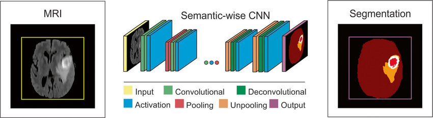

Le but du jeu sera de trouver un **LIEN** permettant de différencier des cerveaux sain et d'autres atteints d'une tumeur.

Nous pouvons déja imaginer un **DATASET** qui se presentera de la sorte:

| Patient   | image         | Tumeur détectée (_Classe_) |
| --------- | ------------- | -------------------------- |
| Patient 1 | patient_1.png | Oui                        |
| Patient 2 | patient_2.png | Non                        |

---

### Des exemples concrets (1/3) ? &#128269; _La tumeur_

La recette pour trouver ce fameux **LIEN** ?

1. **Collecte des données** : collecter des IRM de patients avec et sans tumeurs.
2. **Prétraitement** : nettoyer, _normaliser_, redimensionner les données.
3. **Modélisation** : entraîner un algorithme de _classification_ (ex: CNN, Random Forest).
4. **Évaluation** : **mesurer** la **précision**, le **rappel**, la **matrice de confusion**.

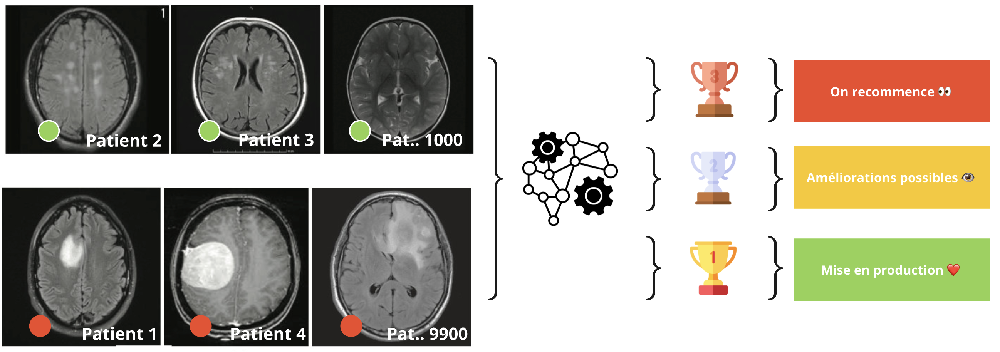

**Approfondir le sujet** : [Brain Tumor Classification with CNN using TensorFlow](https://medium.com/@YasinShafiei/brain-tumor-classification-with-cnn-using-tensorflow-98422a4d0ad2)

---

## **&#128161; Question ouverte**

**Quels autres critères pourraient aider à savoir si le patient à une tumeur ?**

---

## Des exemples concrets (2/3) ? &#128269; _Estimation du prix d'un bien immobilier ?_

Imaginons que nous voulons **prédire le prix** d'une maison en fonction de plusieurs critères:

- &#127968; **Surface de la maison (m²)**
- &#128681; **Localisation** (quartier, proximité des écoles, commerces…)
- &#128663; **Nombre de places de parking**
- &#127869; **Présence d'une piscine**

 

**Problème** : Comment trouver un lien entre des données que l'agence possède et le prix d'une maison/appt.

---

### Des exemples concrets (2/3) ? &#128269; _Estimation du prix d'un bien immobilier ?_

Voici le dataset que possède l'agence comme source de données.

| Maison ID | Surface (m²) | Quartier   | Parking | Piscine | Prix (_Cible_) |
| --------- | ------------ | ---------- | ------- | ------- | -------------- |
| 1         | 120          | Centre     | 1       | Oui     | 350 000        |
| 2         | 80           | Banlieue   | 0       | Non     | 180 000        |
| 3         | 150          | Centre     | 2       | Oui     | 500 000        |
| 4         | 90           | Périphérie | 1       | Non     | 220 000        |

 

Nous souhaitons trouver un lien entre notre dataset et la variable **cible** prix

---

### Des exemples concrets (2/3) ? &#128269; _Estimation du prix d'un bien immobilier ?_

La recette pour trouver ce fameux **LIEN** ?

1. **Collecte des données** : Historique des ventes immobilières.
2. **Prétraitement** : Nettoyage des données, transformation des variables catégorielles.
3. **Modélisation** : **Modèle** pour trouver les **facteurs influençant le prix**.
4. **Prédiction** : Estimer le prix d'une nouvelle maison selon ses caractéristiques.
5. **Évaluation** : Vérification avec les indicateurs **MAE, RMSE, R²**.

---

### Des exemples concrets (2/3) ? &#128269; _Estimation du prix d'un bien immobilier ?_

- **Relation entre surface et prix :**
  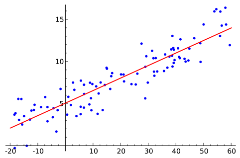

#### **Impact des caractéristiques** :

- Une **maison plus grande** coûte généralement **plus cher**.
- Un **quartier central** augmente la valeur.
- La **présence d'une piscine** ajoute une **valeur significative**.

**Conclusion** : Grâce au modèle, l'agent immobilier peut **prédire un prix réaliste** pour chaque maison et mieux conseiller ses clients.

---

## **&#128161; Question ouverte**

**Quels autres critères pourraient influencer le prix d'une maison ?**

---

### Des exemples concrets (3/3) ? &#128269; _Classification de patients à risque_

### &#128204; Contexte

Un hôpital souhaite **analyser ses patients** pour mieux comprendre **les facteurs de risque** associés à certaines maladies comme le diabète ou les maladies cardiaques.  
Cependant, les médecins ne connaissent **pas à l'avance** les catégories de patients à risque.

C'est un problème de **clustering** où nous cherchons à découvrir des groupes naturels dans les données sans avoir d'étiquettes prédéfinies.

&#128161; **Objectif** : Utiliser un algorithme pour **regrouper automatiquement** les patients en fonction de leurs caractéristiques médicales.

---

## &#128269; Collecte de nos données

Nous disposons d'un **dataset médical** contenant plusieurs variables :

| Patient   | Âge | IMC | Tension | Glycémie | Activité (h/semaine) |
| --------- | --- | --- | ------- | -------- | -------------------- |
| Patient 1 | 65  | 30  | 140/90  | 1.5      | 0                    |
| Patient 2 | 45  | 25  | 120/80  | 0.9      | 5                    |
| Patient 3 | 55  | 32  | 135/85  | 1.8      | 1                    |
| Patient 4 | 38  | 22  | 115/75  | 0.7      | 7                    |
| Patient 5 | 60  | 35  | 145/95  | 2.0      | 0.5                  |

&#128204; **Problème** : Comment sans différentes classe au préalable je peux différencier mes patients ?

---

## &#128269; Application d'un algorithme de clustering

### **&#128295; Étapes du clustering :**

1. **Prétraitement des données** : **Normalisation** des valeurs (âge, IMC, glycémie...).
2. **Estimer un nombre de cluster** : Test avec **K=3**.
3. **Clustering** : Regroupe les patients en fonction de leur **profil médical**.
4. **Analyse des groupes** : Identifier les **facteurs communs** dans chaque groupe.

---

## &#128161; Résultats et interprétation

Après application **d'un algorithme de clustering**, on obtient **trois groupes distincts** :

| Cluster  | Profil des patients                                              | Risque médical |
| -------- | ---------------------------------------------------------------- | -------------- |
| Groupe 1 | Patients jeunes, activité physique élevée, glycémie normale      | **Faible**     |
| Groupe 2 | Patients d'âge moyen, IMC modéré, glycémie légèrement élevée     | **Moyen**      |
| Groupe 3 | Patients âgés, obèses, glycémie élevée, faible activité physique | **Élevé**      |

---

**Visualisation des clusters :**  
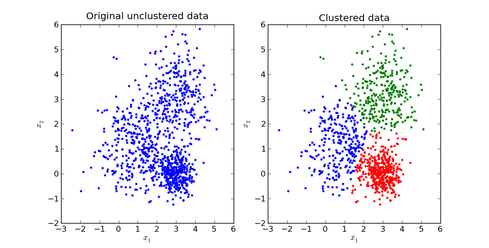

**Conclusion** : L'hôpital peut utiliser ces groupes pour **cibler les patients à risque élevé** et leur proposer des **programmes de prévention** adaptés.

---

## **&#128161; Question ouverte**

**Dans quels autres domaines pourrait-on utiliser du clustering pour regrouper des individus ou objets ?**

---

## **&#128161; Question**

**Qu'avez-vous remarqué dans les trois exemples précédents ?**

---

## **&#128195; Réponse:**

| Cas d'étude | Cible                   | KPI                             | Type          |
| ----------- | ----------------------- | ------------------------------- | ------------- |
| 1           | Classe (tumeur ou non)  | Rappel,matrice de confusion etc | Supérvisé     |
| 2           | Prix (valeur numérique) | $R^2$, $mae$                    | Supérvisé     |
| 3           | Aucune                  | silhouette                      | Non Supérvisé |

---

## **Il éxiste donc des familles d'algorithmes ?**

Regardons l'image suivante :

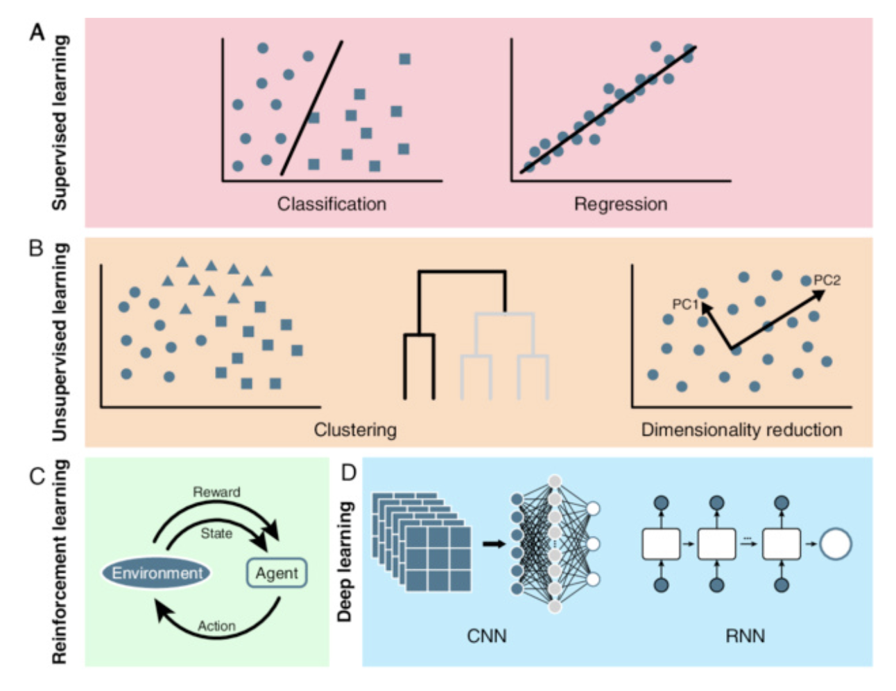

---

### **Il éxiste donc des familles d'algorithmes ?**

| Type d'apprentissage               | Tâche/Méthode                       | Machine Learning (ML) &#9989; | Deep Learning (DL) &#9989; | Besoin d'une valeur cible &#128204; |
| ---------------------------------- | ----------------------------------- | ----------------------------- | -------------------------- | ----------------------------------- |
| **Apprentissage supervisé**        | Tâche de classification             | &#9989; Oui                   | &#9989; Oui                | &#9989; Oui (labels )               |
|                                    | Tâche de régression                 | &#9989; Oui                   | &#9989; Oui                | &#9989; Oui (valeurs )              |
| **Apprentissage non supervisé**    | Clustering                          | &#9989; Oui                   | &#10060; Non               | &#10060; Non                        |
|                                    | Réduction de dimension (ACP, t-SNE) | &#9989; Oui                   | &#10060; Non               | &#10060; Non                        |
| **Apprentissage par renforcement** | Apprentissage par renforcement      | &#10060; Non                  | &#9989; Oui                | &#128073; Oui                       |

---

## Une donnée, c'est quoi ?

Une **donnée** est une **information brute** qui peut être :

- &#128202; **Numérique** : âge, prix, température...
- &#128172; **Textuelle** : commentaires, tweets, articles...
- &#128247; **Visuelle** : images, vidéos...
- &#127925; **Audio** : sons, musique, paroles...

Dans un **modèle mathématique ou informatique**, une donnée peut être **représentée sous forme de vecteur dans un espace à N-dimensions**.

Dans d'autres cas, une image peut être traité comme un ensemble de pixel

<!-- ### Types de données en data mining

| Type de données | Exemples                                | Format                      |
| --------------- | --------------------------------------- | --------------------------- |
| Structurées     | Bases de données, tableaux Excel        | Lignes et colonnes          |
| Semi-structurées| Fichiers XML, JSON                      | Hiérarchie avec balises     |
| Non structurées | Images, vidéos, textes libres           | Format brut                 |

### Caractéristiques des données

- &#128202; **Volume** : quantité de données (Go, To, Po...)
- &#128640; **Vélocité** : vitesse de génération et traitement
- &#127922; **Variété** : diversité des formats et sources
- &#127919; **Véracité** : fiabilité et qualité des données
- &#128176; **Valeur** : utilité pour l'organisation -->

---

# &#127919; Comprendre la notion de vecteur

 

  

    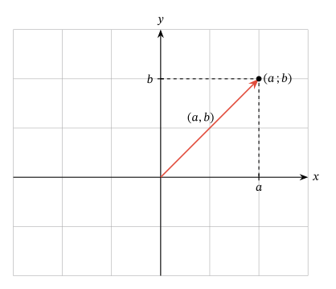
  

  

    <h4>Définition</h4>
    
Un <strong>vecteur</strong> est une structure de données mathématique qui contient une <strong>liste ordonnée de nombres</strong>.

    
En data mining, un vecteur représente souvent les <strong>caractéristiques</strong> d'un objet ou d'une observation. Chaque dimension correspond à un attribut distinct.

    
Exemple: Un patient peut être représenté par le vecteur [âge, poids, taille, tension].

  

---

### &#127919; Comprendre la notion de vecteur

#### Informations utiles sur les vecteurs:

- Un vecteur $\vec{v}$ dans un espace à 2 dimensions peut être noté : $\vec{v} = (x, y)$
- Les vecteurs peuvent être manipulés mathématiquement (addition, multiplication par un scalaire)
- La **norme** (taille) d'un vecteur $\vec{v} = (x, y)$ est donnée par : $\|\vec{v}\| = \sqrt{x^2 + y^2}$

- La **distance de Manhattan** entre deux vecteurs $\vec{v}_1 = (x_1, y_1)$ et $\vec{v}_2 = (x_2, y_2)$ est : $d(\vec{v}_1, \vec{v}_2) = |x_2 - x_1| + |y_2 - y_1|$
- Pour des vecteurs à n dimensions $\vec{v}_1 = (x_1, x_2, ..., x_n)$ et $\vec{v}_2 = (y_1, y_2, ..., y_n)$, la distance de Manhattan est : $d(\vec{v}_1, \vec{v}_2) = \sum_{i=1}^{n} |y_i - x_i|$

---

### &#127919; Comprendre la notion de vecteur

Plus visuellement

  

    
La norme

    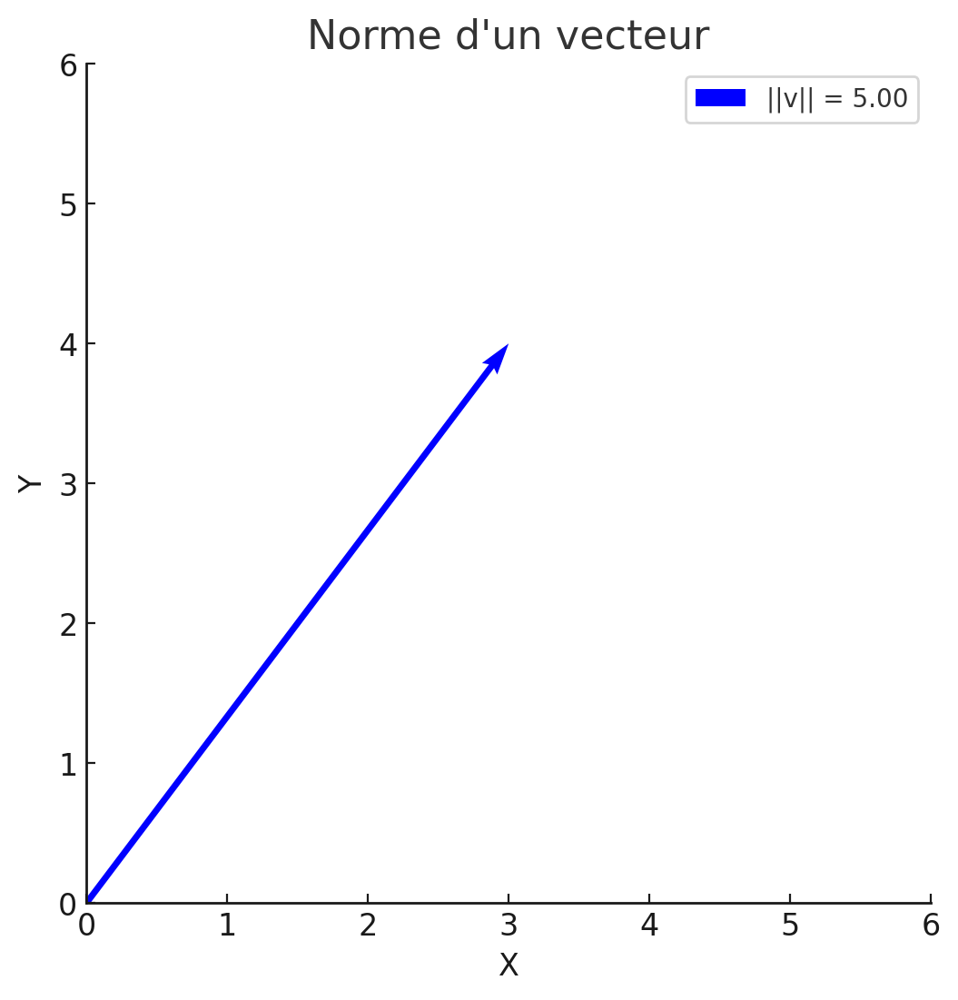
  

  

    
La distance de manhattan

    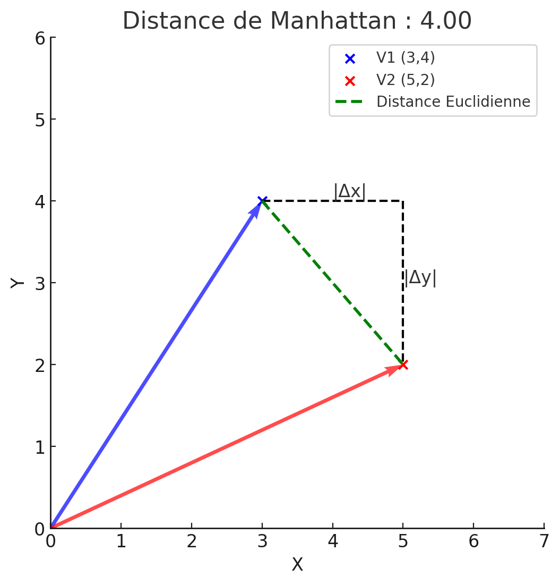
  

---

### &#127919; Comprendre la notion de vecteur

Analysons le tableau suivant:

## &#128221; Données des étudiants

| Étudiant | Âge | Moyenne en Math | Moyenne en physique | Sexe |
| -------- | --- | --------------- | ------------------- | ---- |
| Alice    | 18  | 15              | 10                  | F    |
| Bob      | 25  | 12              | 12                  | M    |
| Charlie  | 30  | 18              | 8                   | M    |
| Diane    | 22  | 10              | 16                  | F    |

---

### &#127919; Comprendre la notion de vecteur

#### &#128202; Représentation vectorielle des étudiants

Dans un espace vectoriel **(âge, moyenne en math,physique, sexe)**, chaque étudiant est représenté sous forme de vecteur :

$${V_{Alice}} = (18, 15,10, F)$$

$${V_{Bob}} = (25, 12,12, M)$$

$${V_{Charlie}} = (30, 18,8, M)$$

$${V_{Diane}} = (22, 10,16, F)$$

 

**Remarque :**

- Ici, le **sexe est encore une variable catégorielle**.
- Si on voulait **l'utiliser dans un modèle mathématique**, on devrait **le convertir en une valeur numérique** (ex : One-Hot Encoding ou Label Encoding).

---

### &#127919; Comprendre la notion de vecteur

Plus visuellement

  

    
Représentation dans un éspace à 2d

    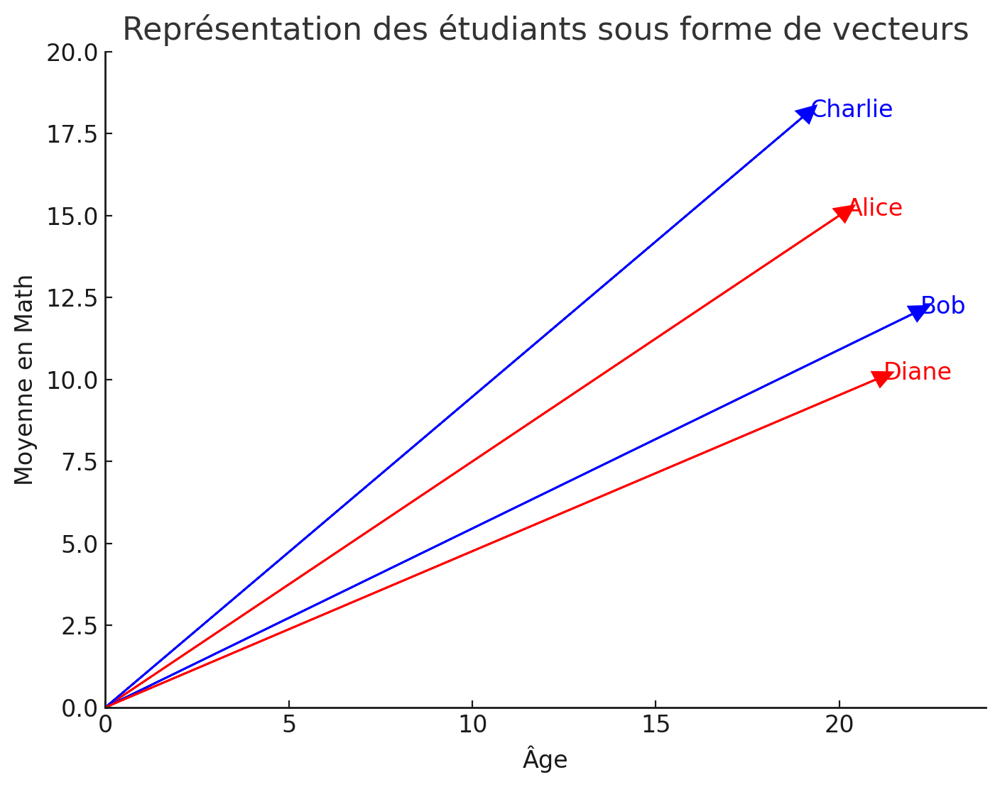
  

  

    
Représentation dans un éspace à 3d

    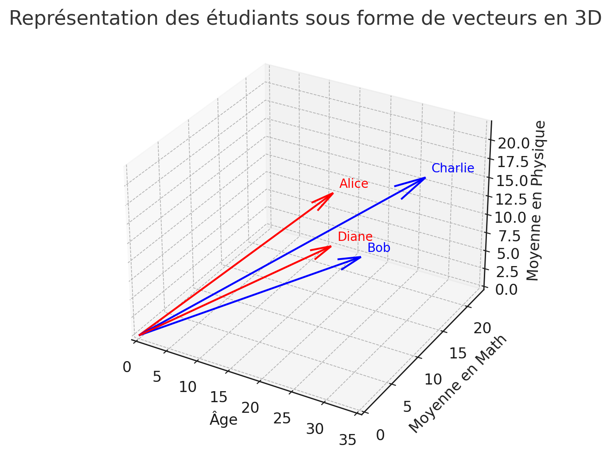
  

---

## **&#128161; Question ouverte**

**Pourquoi je vous parle de vecteur ?**

---

<!-- header: ⭐️ Clustering -->

# Partie 2: Analyse non supérvisé et clustering
Le **clustering** est une technique d'apprentissage non supervisé qui consiste à regrouper des points de données **sans label** en fonction de leurs **similarités**.

---

## &#127919; Comprendre le clustering

  

  
  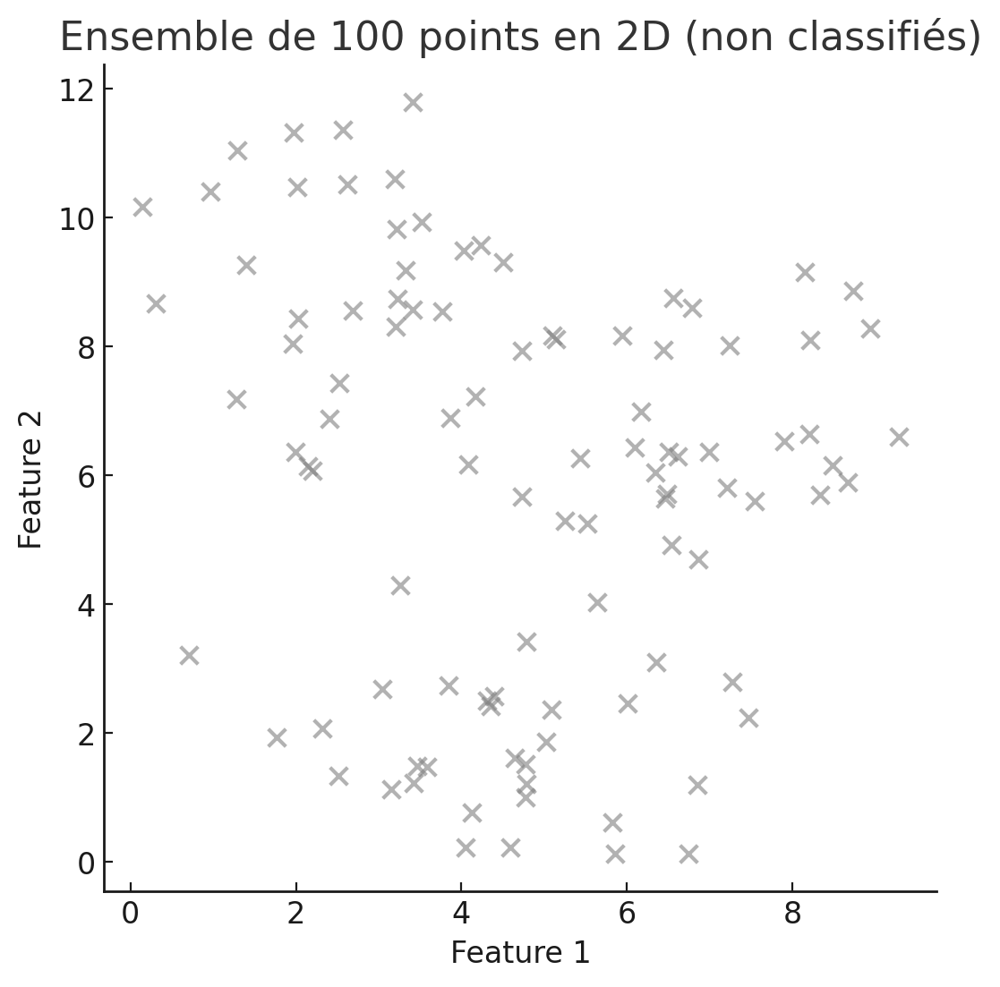
  

  

  

   
  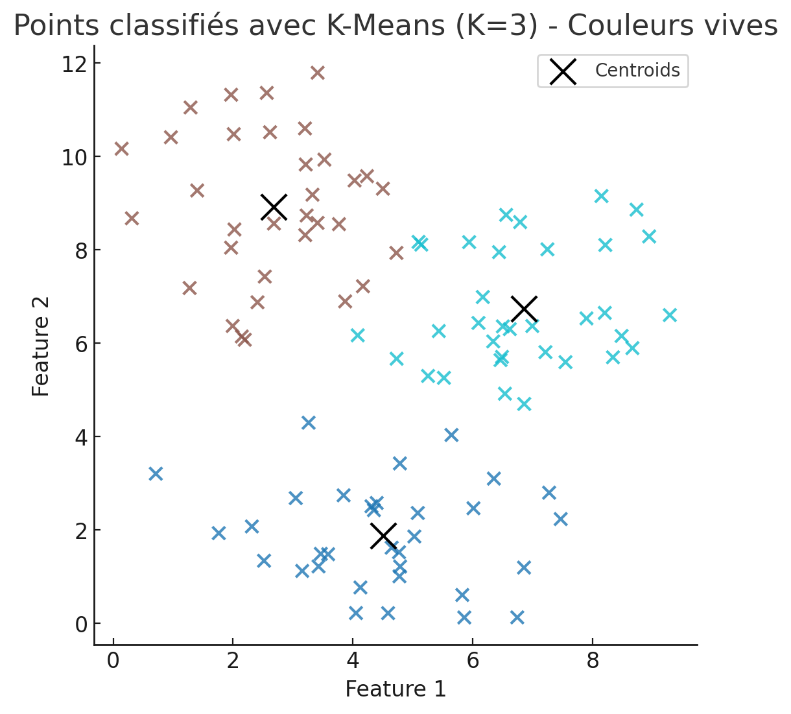
  

L'objectif du clustering est d'identifier dans un amas de points ( **vecteurs** ) les groupes qui pourraient se former naturellement.

### **Pour réussir à répondre à cette problématique il nous faut quoi ?**

---

### Entres les images précédentes voila les étapes du clustering : 

  

    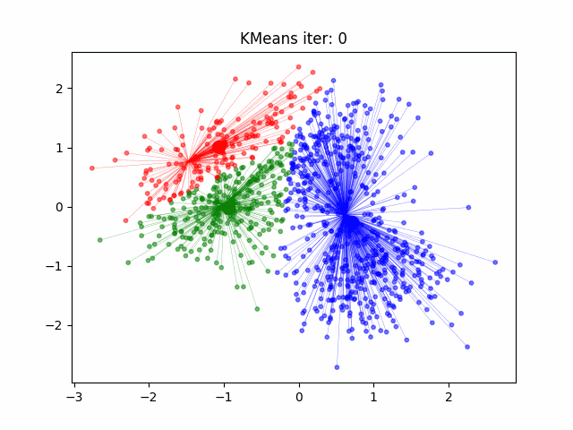
    
Analysons ensemble

  

---

## &#127919; Comprendre le clustering en détail

  

  
  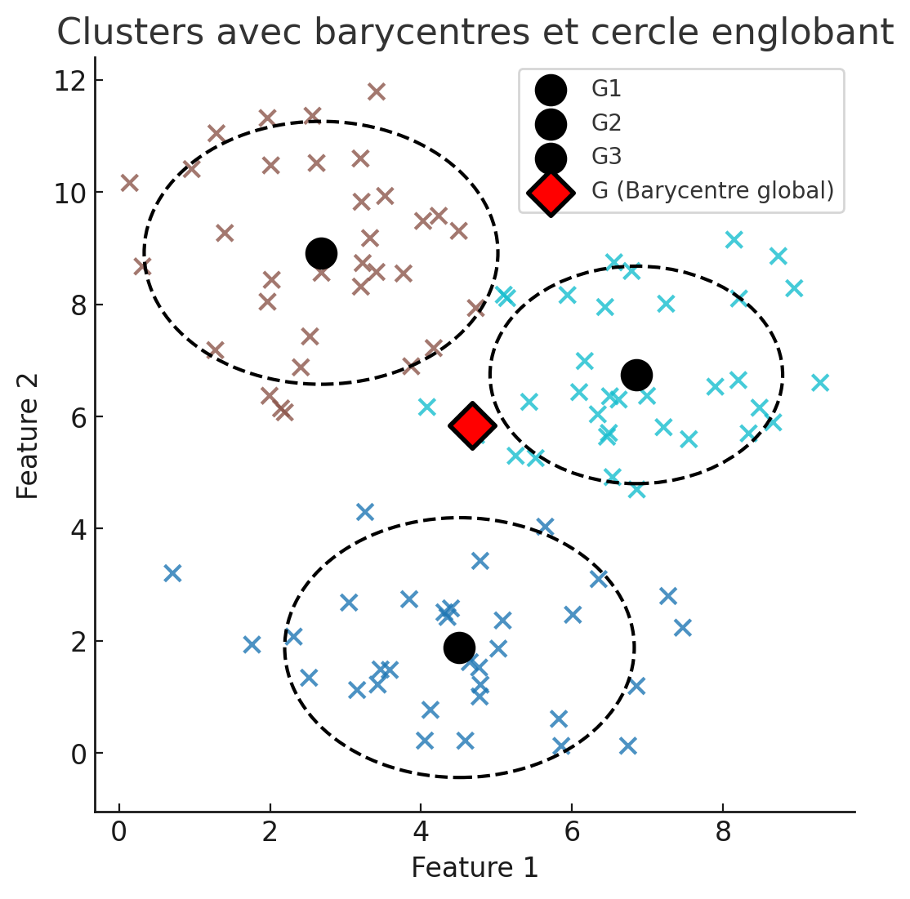
  

  

  

   
Donner un rôle crucial aux centres des classes

   
Les centroïds bougent dans l'espace afin de trouver leurs positionnements idéals

   
Il nous faut minimiser la dispersion des données dans chacuns des groupes (inertie intra classe)

   
 

  

---

## &#127919; Comprendre le clustering encore + en détail

Nous allons voir le Théorème d’Huygens.
 

Il nous indique que:
$$ Inertie\_{totale}=Inertie_{inter-classe}+Inertie_{intra-classe} $$
Ou : 
$$T=B+W$$
Ou:

$$
\sum_{i=1}^{n} d^2(i, G) = \sum_{k=1}^{K} n_k d^2(G_k, G) + \sum_{k=1}^{K} \sum_{i=1}^{n_k} d^2(i, G_k)
$$

---

### **Éxplication de la formule**

 

$d^2(i, G)$ : Distance quadratique entre un point i et le centre global G

$G_k$ : Nombre total de clusters:

$n_k$: Nombre de points appartenant au cluster k:

$d^2(G_k, G)$ : Distance quadratique entre le centroïde du cluster G_k et le centre global G:

$d^2(i, G_k)$ : Distance quadratique entre un point i et le centroïde de son cluster G_k

---
### **Pour résoudre un problème de clustering il nous faut :**

1. Fixer un nombre de classes $K$
2. Définir ou positionner les $K$ classes de départ dans l'espace 
3. Déplacer nos **centroïds** dans un espace décrivant nos données
4. Un objectif, une mission (pourquoi pas notre $W$ )
5. Analyser nos partitions
---
<!-- header: ⭐️ Kmeans -->

# Partie 3: Kmeans, les centres mobiles

---

# &#128269; Introduction au K-Means

**Le K-Means est l'un des algorithmes de clustering les plus populaires.**

- Il divise les données en **K groupes**
- Chaque groupe a un **centroïde**, représentant son centre
- L'algorithme minimise la distance entre les points et leurs centroïdes
- Basé sur la minimisation des distances entre points et centroïdes
- Utilisé en segmentation, classification et réduction de données
- Fonctionne en itérations successives jusqu'à convergence

---

## **L'algorithme du kmeans**

1. Positionnement de centroïds $C_n$ dans l'éspace des données de façon aléatoire
2. Calcul de toutes distantes entre l'ensemble des centroïds $C_n$ et les observation $x_i$:
    - $d(x_i, C_k) = \sqrt{(x_i - C_k)^2}$
3. Associer les donnes $x_i$ aux centroids $C_n$  le plus proches:
    - $x_i \in C_k \quad \text{si} \quad d(x_i, C_k) \leq d(x_i, C_j) \quad \forall j \neq k
$
4. Mise à jour des centroids en respectant la formule suivante:
    - $\mu_k = \frac{1}{|C_k|} \sum_{x_i \in C_k} x_i$
5. Vérification du **critère d'arrêt** :  
   - L’algorithme s’arrête si les centroïdes **ne bougent plus** :  
    $||C_k^{(t+1)} - C_k^{(t)}|| < \epsilon$
   - Ou si un **nombre maximal d'itérations** est atteint.

---

## &#128187; Étape 1 : Initialisation des centroïdes

1. Choisir un nombre de clusters **K**
2. Sélectionner **K centroïdes aléatoires** parmi les observations
3. Définir ces centroïdes comme points initiaux

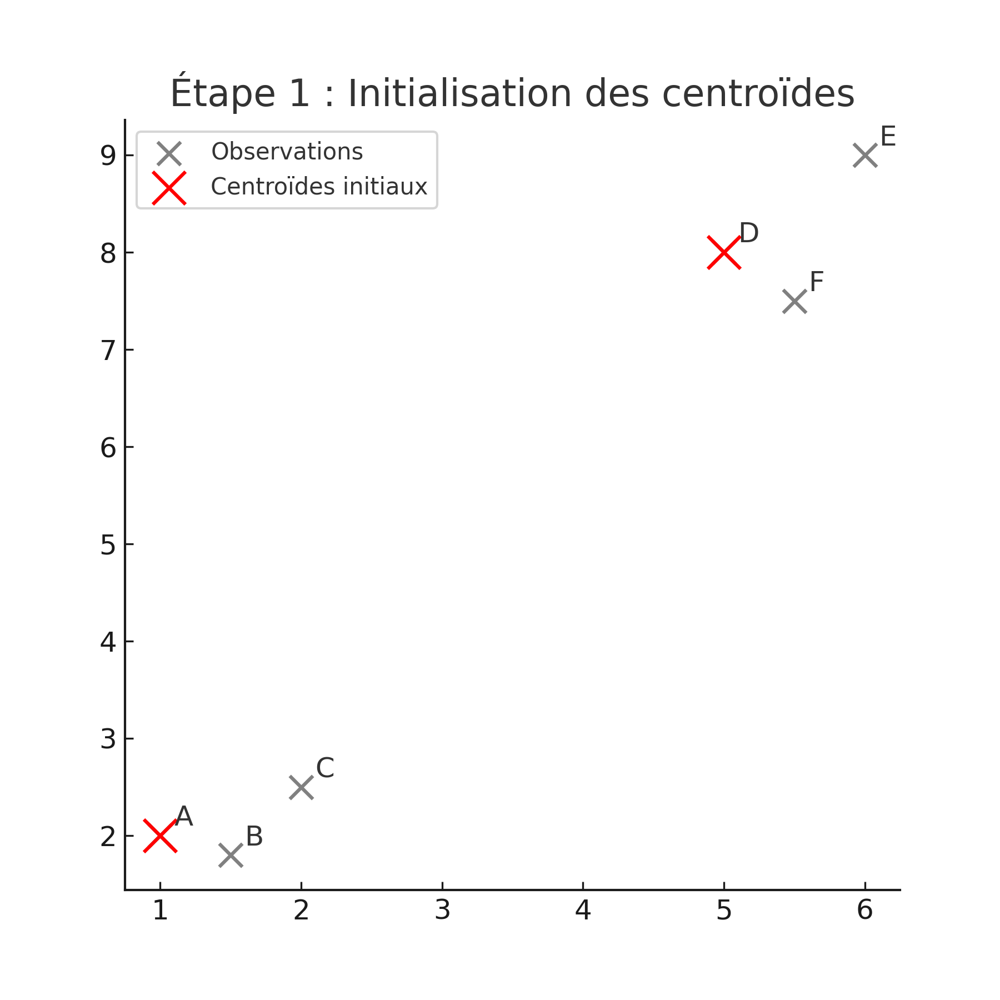

---

## &#128202; Étape 2 : Calcul des distances

1. Calculer la **distance euclidienne** entre chaque point et chaque centroïde :

$
d(x_i, C_k) = \sqrt{(x_i - C_k)^2}
$

2. Assigner chaque point au centroïde **le plus proche**

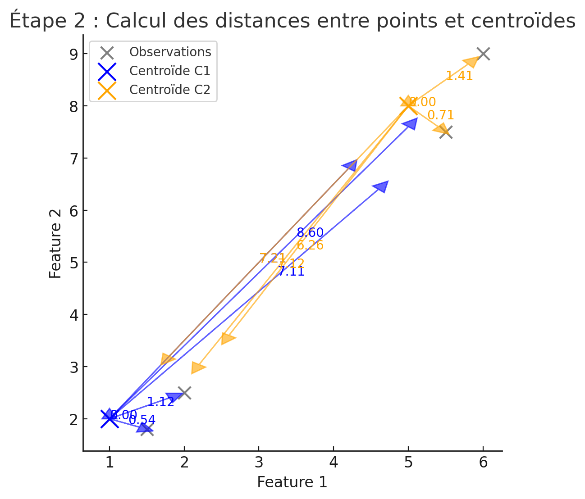

---

## &#128161; Étape 3 : Affectation aux clusters

Chaque point est **attribué** au cluster dont il est **le plus proche**.
Cela crée une **première séparation** des données.

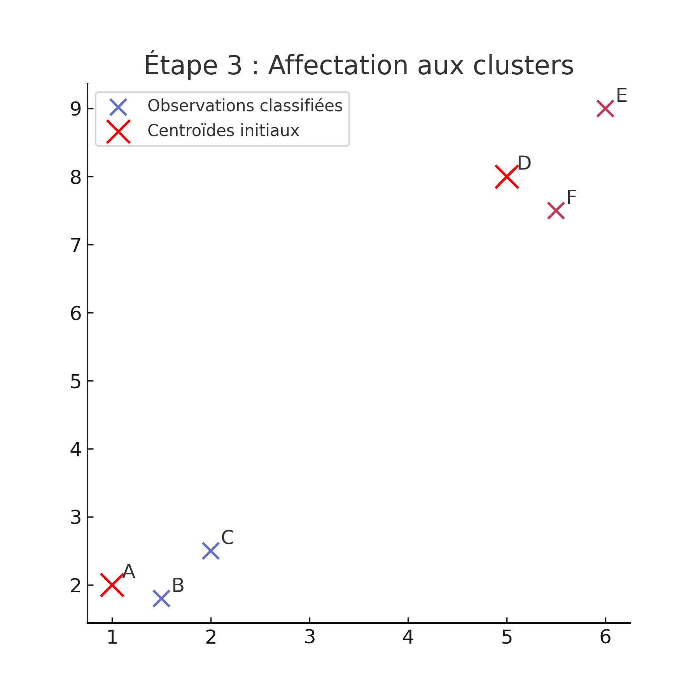

---

## &#128200; Étape 4 : Mise à jour des centroïdes

1. Recalculer les **nouveaux centroïdes** en prenant la **moyenne** des points associés à chaque cluster :

$
C_k^{(new)} = \frac{1}{|C_k|} \sum_{x_i \in C_k} x_i
$
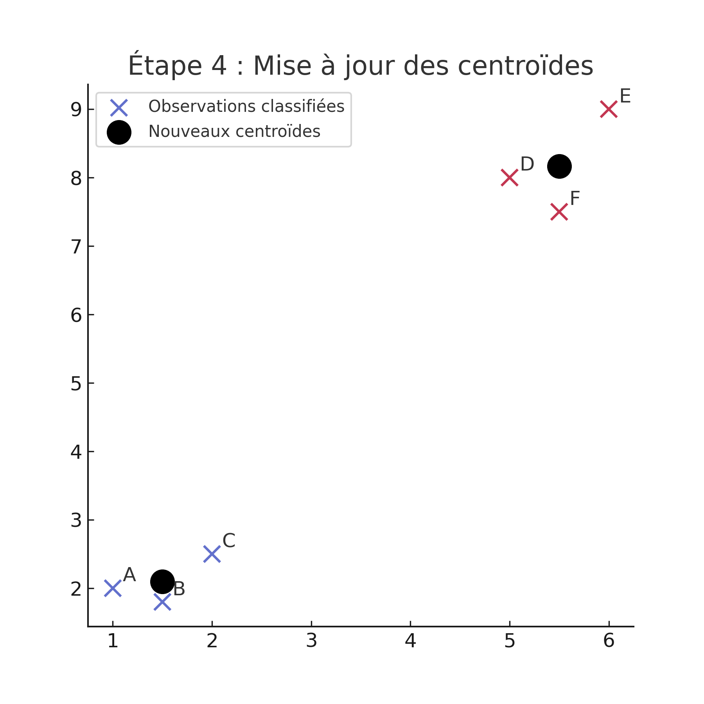

---

## &#9888; Étape 5 : Vérification du critère d'arrêt

L'algorithme s'arrête si :
- Les centroïdes **ne bougent plus** :
   $||C_k^{(t+1)} - C_k^{(t)}|| < \epsilon$
- Un **nombre maximum d’itérations** est atteint.

---

## Points importants &#9888;
- Le nombre de cluster est un point très important

- Comment mesurer les performance de mon **modèle** ?  
- Le kmeans est très sensible aux **outliers** (traité dans la partie suivante)

---

## **Le nombre de cluster est un point très important**

Une méthode nous permet de savoir comment établir notre nombre de clusters initiaux, la méthode **Elbow**.

Le but est simple exécuté plusieurs fois notre algorithme Kmeans avec des clusters allant de 1 à n pour voir l'évolution de $W$.
Nous pouvons nous arrêter au moment ou $W$ ne bouge plus beaucoup. Impliquant qu'importe le nombre de futur cluster le minimum $W$ n'aura plus de changement significatif.

---

## **La méthode elbow**

&#128204;  Explication :
- Le point en rouge (K=4) représente le "coude", où l'inertie cesse de diminuer de manière significative.

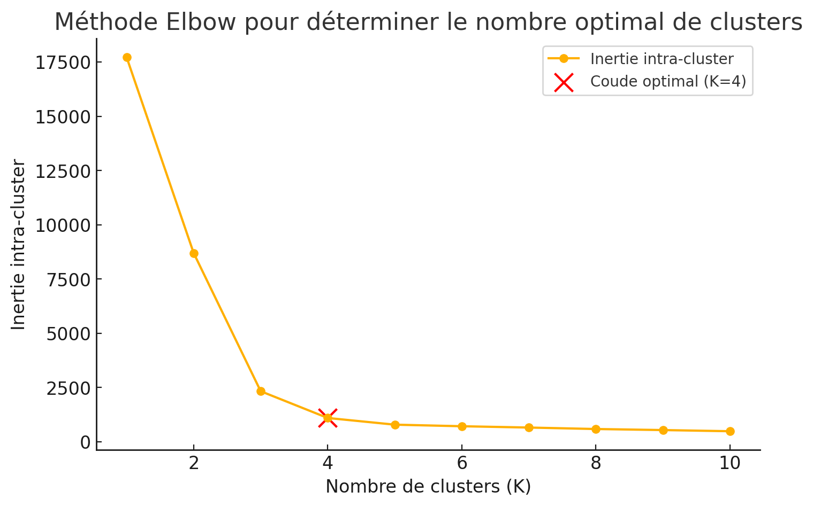

---

## **Comment mesurer les performance de mon modèle ?**

1. Le score de silhouette
2. Le $WSS$

---

**Silhouette** : Mesure **la qualité du clustering** en évaluant **la cohésion** d’un cluster et **la séparation** avec les autres.

### **Formule :**
$
S(i) = \frac{b(i) - a(i)}{\max(a(i), b(i))}
$
- **$a(i)$ : Cohésion** 
  - Distance moyenne entre un point \( i \) et tous les autres points de son **propre cluster**.
- **$b(i)$ : Séparation** 
  - Distance moyenne entre un point \( i \) et tous les points du **cluster voisin le plus proche**.

### **Interprétation du score :**
- **$S(i) \approx 1$** → Le point est bien dans son cluster. 
- **$S(i) \approx 0$** → Le point est proche d’un autre cluster. 
- **$S(i) < 0$** → Le point est probablement mal classé.

---

Le **SSE (Sum of Squared Errors)** mesure la **dispersion des points autour de leur centroïde**.

### **Formule :**
$
SSE = \sum_{i=1}^{k} \sum_{x_j \in C_i} || x_j - \mu_i ||^2
$

### **Explication des termes :**
- **$k$** : Nombre de clusters.
- **$x_j$** : Un point dans le cluster.
- **$C_i$** : Ensemble des points du cluster $i$.
- **$\mu_i$** : Centroïde du cluster $i$.

### **Interprétation du score SSE :**
 **SSE faible** → Les points sont **proches de leurs centroïdes** 
 **SSE élevé** → Les points sont **éloignés de leurs centroïdes** 
 **Problème** → Le SSE **diminue toujours quand $k$ augmente**, donc il **ne suffit pas** pour choisir le bon $k$ (méthode Elbow recommandée !).

**Ces deux métriques permettent d'évaluer et d'optimiser un modèle K-Means !**

---

<!-- header: 🤖 Traitement des datas -->

# Partie 4: Comprendre comment éxploiter des données

- Pré-traitement des données
- Scaling de nos données

---

Le prétraitement des données est une étape **essentielle** en Machine Learning. Il permet d'améliorer la **qualité** et la **pertinence** des données avant leur utilisation dans un modèle.

### **Exemple de dataset brut :**

 Nom    | Âge | Salaire  | Ville       | Score Test | Employé | Date Embauche |
--------|-----|----------|------------|------------|---------|--------------|
 Alice  | 25  | 35000    | Paris      | 78         | Oui     | 2019-03-15   |
 Bob    | 38  | 42000    | Lyon       | 85         | Non     | 2015-07-21   |
 Charlie| NaN | 30000    | Marseille  | 65         | Oui     | 2021-01-10   |
 David  | 50  | 54000    | Paris      | 90         | Non     | 2010-09-12   |
 Emma   | 29  | NaN      | Bordeaux   | NaN        | Oui     | 2018-06-30   |

**Ce dataset brut contient plusieurs problèmes nécessitant un prétraitement.**

---

## &#128269; 1. Gestion des Données Manquantes

**Détection des valeurs manquantes** (`NaN`).
**Techniques de traitement** :
   - Suppression si trop de valeurs manquantes.
   - Imputation (moyenne, médiane, mode, prédiction). 
   
### **Transformation du dataset après imputation** :

| ID  | Nom    | Âge | Salaire  | Ville       | Score Test | Employé | Date Embauche |
|-----|--------|-----|----------|------------|------------|---------|--------------|
| 3   | Charlie| 34  | 30000    | Marseille  | 65         | Oui     | 2021-01-10   |
| 5   | Emma   | 29  | 42000    | Bordeaux   | 80         | Oui     | 2018-06-30   |

---

## &#128682; 2. Détection et Traitement des Outliers

 **Utilisation d’un boxplot pour détecter les outliers.**
 **Techniques de gestion des valeurs aberrantes** :
   - Suppression des valeurs extrêmes.
   - scaling.
   
### **Graphique des outliers (Boxplot sur les salaires)** :
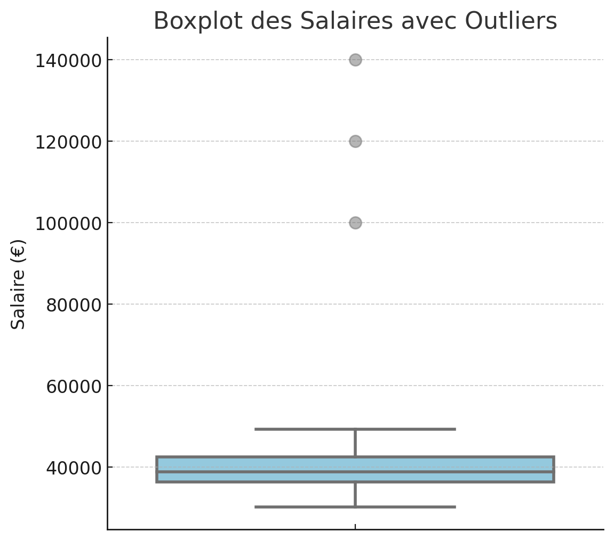

---

## &#128187; 3. Normalisation et Standardisation

 **Utilisation du MinMaxScaler, StandardScaler, RobustScaler.**
 **Objectif** : Mettre toutes les variables numériques sur la même échelle.
 **Transformation des valeurs** :

| ID  | Nom    | Âge Standardisé | Salaire Normalisé |
|-----|--------|----------------|-------------------|
| 1   | Alice  | -1.2            | 0.23              |
| 2   | Bob    |  0.8            | 0.56              |

---
## &#128187; 3.bis Normalisation et Standardisation, comment choisir ?

**StandardScaler (Standardisation)** : Utilisé lorsque les données suivent une distribution **normale** (gaussienne). La formule mathématique est $X_{scaled} = \frac{X - \mu}{\sigma}$, où $\mu$ est la moyenne et $\sigma$ l'écart-type.

**MinMaxScaler (Normalisation)** : Idéal lorsque les données doivent être **comprises entre 0 et 1**, particulièrement pour les réseaux neuronaux. La formule est $X_{scaled} = \frac{X - X_{min}}{X_{max} - X_{min}}$.

**RobustScaler (Standardisation robuste)** : Recommandé lorsque les données contiennent des **outliers** qui pourraient fausser la moyenne et l'écart-type. Utilise la formule $X_{scaled} = \frac{X - Q1}{Q3 - Q1}$, où Q1 et Q3 sont les quartiles.

**MaxAbsScaler (Normalisation)** : Adapté lorsque les données ont des valeurs **positives et négatives** et doivent être **comprises entre -1 et 1**. La formule est $X_{scaled} = \frac{X}{|X_{max}|}$.

---
## &#128187; 3.bis bis Normalisation et Standardisation, pourquoi c'est important ? 
Le scaling est crucial en Machine Learning et Deep Learning car :

-  Évite la domination d’une feature sur une autre → Une variable avec de grandes valeurs (ex: salaire) peut écraser une autre (ex: âge).
-  Accélère la convergence des modèles → Les algorithmes comme Gradient Descent convergent plus vite avec des valeurs bien mises à l’échelle.
-  Améliore la précision → Certains modèles (K-Means, SVM, Réseaux de Neurones) sont sensibles à l’échelle des variables.
-  Facilite l’interprétation des coefficients → Dans les modèles linéaires, standardiser permet d’avoir des coefficients comparables.

Sans scaling, un modèle peut mal apprendre ou être inefficace ! 

---

## &#128640; 4. Encodage des Variables Catégorielles

 **One-Hot Encoding, Ordinal Encoding, Target Encoding.**
 **Exemple de transformation :**

| ID  | Paris | Lyon | Marseille | Bordeaux |
|-----|-------|------|----------|----------|
| 1   | 1     | 0    | 0        | 0        |
| 2   | 0     | 1    | 0        | 0        |

---

## &#128295; 5. Binarisation des Variables

 **Transformation des variables booléennes en 0 et 1.**
 **Exemple :**

| ID  | Employé (binaire) |
|-----|-------------------|
| 1   | 1                 |
| 2   | 0                 |

---

## &#127942; 6. Sélection et Création de Caractéristiques

 **Feature Engineering : Création de nouvelles variables pertinentes.**
 **Exemple : Transformation des dates.**

| ID  | Ancienneté (années) |
|-----|--------------------|
| 1   | 5                  |
| 2   | 9                  |

**Ce processus de prétraitement améliore la qualité des données avant leur utilisation dans un modèle de Machine Learning.**

---

# Des questions ? 