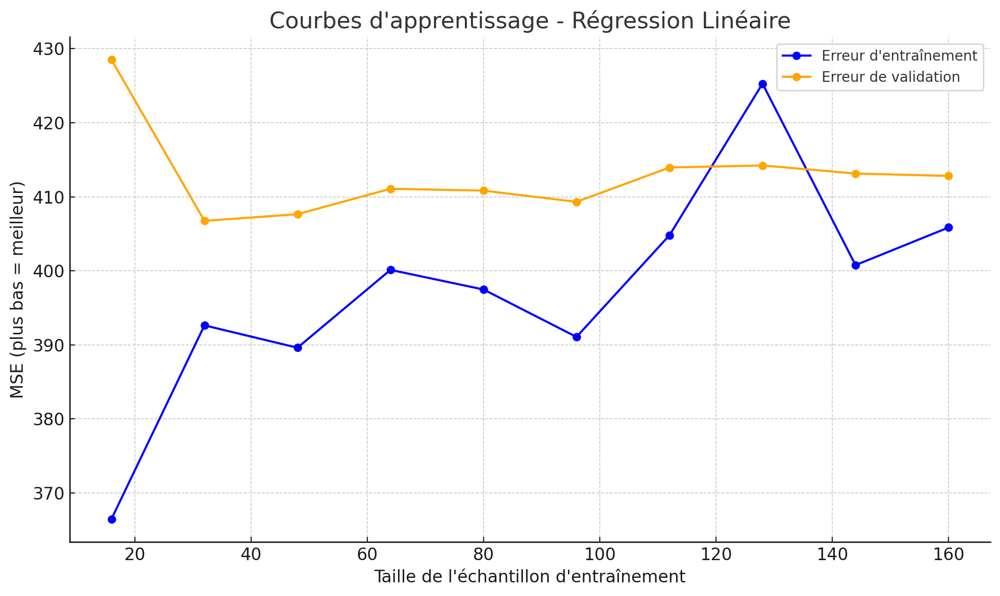

### 📈 Comprendre la courbe d’apprentissage

Une **learning curve** permet de visualiser la performance d’un modèle en fonction de **la quantité de données utilisées pour l'entraîner**.

---

### 🔧 Comment elle est construite avec Scikit-Learn ?

L’idée est simple :  
on va entraîner **plusieurs modèles** sur des **portions croissantes du jeu d’entraînement**, puis mesurer à chaque fois leur performance.

---

### 🪜 Étapes concrètes :

1. On commence avec une petite portion des données (ex : 10 %)
2. On entraîne un modèle sur ces données
3. On évalue son erreur :
   - Sur les données qu’il a vues (erreur d'entraînement)
   - Sur un petit échantillon qu’il n’a **jamais vu** (erreur de validation)
4. On recommence avec 30 %, 50 %, 70 %, jusqu’à 100 % du jeu d’entraînement
5. À chaque étape, on trace l’évolution des erreurs

---

### 📊 Le résultat :

- Une **courbe bleue** : erreur d'entraînement
- Une **courbe orange** : erreur de validation




---

### 🎯 Pourquoi c’est utile ?

- Si l'erreur d'entraînement est basse mais l'erreur de validation haute → **le modèle sur-apprend** (*overfitting*)
- Si les deux erreurs sont hautes → **le modèle n’apprend pas bien** (*underfitting*)
- Si les deux erreurs sont proches et basses → **le modèle est bien réglé !**

---

### 💡 En résumé :

> La courbe d’apprentissage aide à **voir comment le modèle progresse avec plus de données**  
> Elle permet de **diagnostiquer rapidement les limites** du modèle ou du dataset

---

### 👨🏼‍💻 Le code: 

```python 
import numpy as np
import matplotlib.pyplot as plt
from sklearn.datasets import make_regression
from sklearn.linear_model import LinearRegression
from sklearn.model_selection import learning_curve

# Génération d'un jeu de données simple
X, y = make_regression(n_samples=200, n_features=1, noise=15, random_state=42)

# Définir le modèle
model = LinearRegression()

# Calcul de la courbe d'apprentissage
train_sizes, train_scores, test_scores = learning_curve(
    estimator=model,
    X=X,
    y=y,
    train_sizes=np.linspace(0.1, 1.0, 10),
    cv=5,  # On peut dire "plusieurs échantillons de validation"
    scoring='neg_mean_squared_error',
    shuffle=True,
    random_state=42
)

# Moyenne des erreurs (on inverse le signe car sklearn retourne des scores négatifs)
train_scores_mean = -np.mean(train_scores, axis=1)
test_scores_mean = -np.mean(test_scores, axis=1)

# Tracé
plt.figure(figsize=(10, 6))
plt.plot(train_sizes, train_scores_mean, 'o-', label="Erreur d'entraînement", color='blue')
plt.plot(train_sizes, test_scores_mean, 'o-', label="Erreur de validation", color='orange')
plt.title("Courbe d'apprentissage - Régression linéaire")
plt.xlabel("Taille de l'échantillon d'entraînement")
plt.ylabel("Erreur quadratique moyenne (MSE)")
plt.legend()
plt.grid(True)
plt.tight_layout()
plt.show()
```