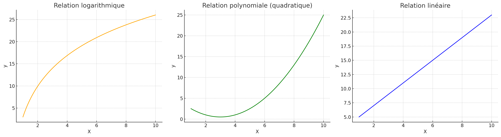

## 📈 1. Transformation logarithmique

### 🧠 Quand l'utiliser ?
- Quand y ou x **augmentent vite au début, puis se tassent**
- Quand on a des **écarts très importants** entre les valeurs
- Pour **réduire l’impact des outliers**

### 💡 Exemple :
```python
df['log_price'] = np.log(df['price'])
```

Cela aide à rendre la relation avec d’autres variables plus linéaire, et améliore la régression.

---

## 📐 2. Transformation polynomiale

### 🧠 Quand l'utiliser ?
- Quand la relation entre X et y forme une **courbe (parabole, bosse, creux)**
- Quand la droite ne suffit plus à bien ajuster les données

### 💡 Exemple :
```python
from sklearn.preprocessing import PolynomialFeatures
poly = PolynomialFeatures(degree=2)
X_poly = poly.fit_transform(X)
```
Cela permet au modèle d’apprendre des **formes non linéaires** avec un modèle linéaire élargi.

---

## 📊 Comparaison visuelle

Voici 3 cas typiques illustrant quand utiliser l’une ou l’autre des transformations :



- 🔶 **Logarithmique** : utile quand la croissance ralentit
- 🟩 **Polynomiale** : quand il y a une courbure nette
- 🔵 **Linéaire** : quand une droite suffit

---

## ⚠️ Attention !
- Une transformation **modifie l’interprétation** des coefficients
- Il faut **évaluer les performances** (MSE, R²) avant/après
- Trop de transformations = risque de **surapprentissage**

---

## ✅ En résumé
| Transformation | À utiliser quand...                        | Outil            |
|----------------|--------------------------------------------|------------------|
| Logarithmique  | Valeurs qui explosent / effet saturant     | `np.log`         |
| Polynomiale    | Courbe dans les données (non-linéarité)    | `PolynomialFeatures` |

> Ces transformations permettent à des modèles simples de capturer des relations complexes !

