<!-- _class: title -->

# Le Data Mining

 

Christopher de Boisvilliers

2025-03-23

------
<!-- header: ⭐️ Plan du cours -->

# Plan du cours
- La régression linéaire **alias** prédire un nombre

- Un peu de pratique avec scikit learn
---
<!-- header: 📈 La Régression linéaire -->

# 1. La régression linéaire
### **Carte d'identité de l'algorithme**

- **Nom**: Régression linéaire  
- **Type d'algorithme**: Modèle supervisé  
- **Besoin de données cibles**: Oui, des valeurs numériques continues  
- **Mission**: Trouver la meilleure droite/plan qui **minimise l'erreur** entre les **prédictions** et les **valeurs réels**  
- **Utilité**: Prédire une valeur numérique continue (**ex: slide suivante**)  

---
### **Rappel**

Un modèle **supervisé** à besoin de données cible un $y= y_{train}+ y_{test}$  
#### **Dataset d'exemple: Prix des maisons**

| ID | Surface (m²)  &#127968; | Chambres &#128716; | Prix (€)  alias y|
|----|----------------|-------------|------------|
| 1  | 85             | 2           | 210,000    |
| 2  | 120            | 3           | 310,000    |
| 3  | 65             | 1           | 175,000    |

### Question &#128269;
Qui peut m'expliquer cette phrase:
- Qui minimise  **l'erreur**  entre les **prédictions** et les **valeurs réels** 

---

### **Une régression linéaire visuellement ressemble à cela**

  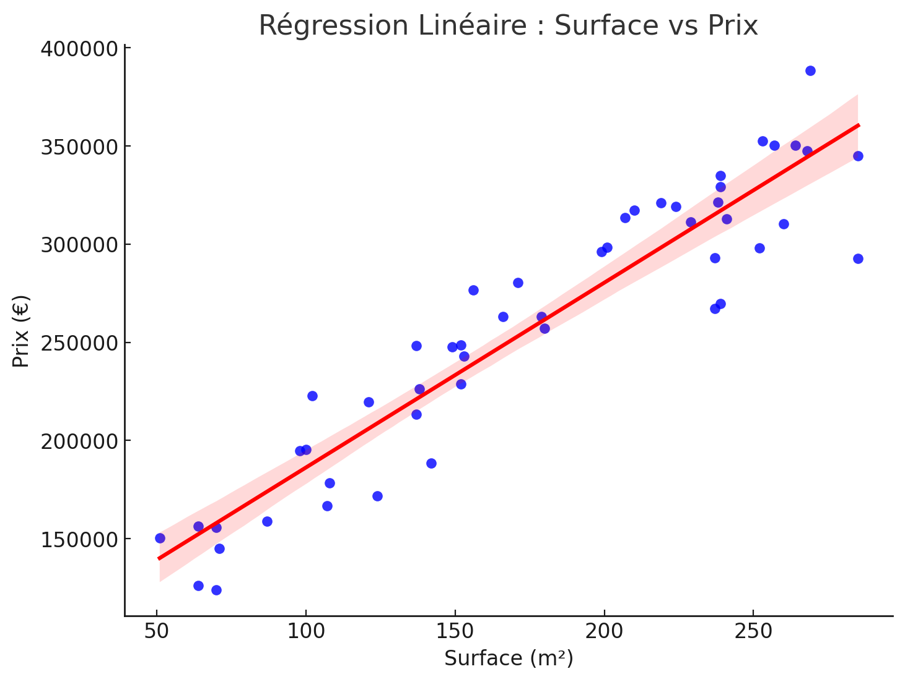
  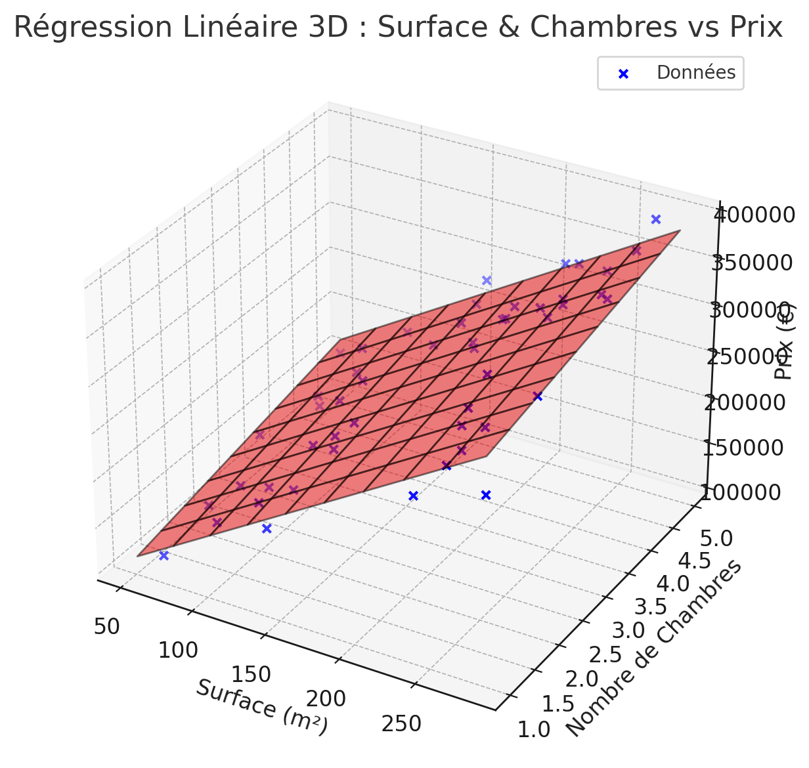

### Question &#128269;
Sur les deux graphiques ci-dessus, qu'est-ce que ma **régression linéaire** ? **Ma prédiction** ? **Mon erreur** ? 

---

### **La régression linéaire n'est finalement qu'une droite/plan**

Cela implique qu'elle est représentée mathématiquement par une formule très simple :

- $y=ax+b$

C'est presque cela, il faut prendre en compte la notion d'erreur et nous obtenons :

- $\hat{y} = \beta_0+\beta_1x_1+\beta_2x_2 ... +\beta_nx_n +\epsilon$

Avec $\epsilon=y_i -\hat{y}$

Explication des termes :
-	$y$ : La variable dépendante (ex: le prix d’une maison).
- $\hat{y}$ : Notre variable **prédite**
-	$x_1$, $x_2$ : Les variables explicatives (ex: surface, nombre de chambres).
-	$\beta_0$ : L’ordonnée à l’origine (intercept), point où le plan coupe l’axe y.
-	$\beta_1$, $\beta_2$ : Les coefficients de régression représentant l’impact de chaque variable.
-	$\varepsilon$ : L’erreur résiduelle qui capte les variations inexpliquées.

---

### **Le but du jeu**

Notre algorithme a une seule mission : trouver l'intercept $\beta_0$ ainsi que les coefficients de régression $\beta_1, \dots, \beta_n$ qui minimisent l'erreur $\varepsilon$, définie comme la différence entre les valeurs observées et les valeurs prédites.
#### **Un petit exemple**
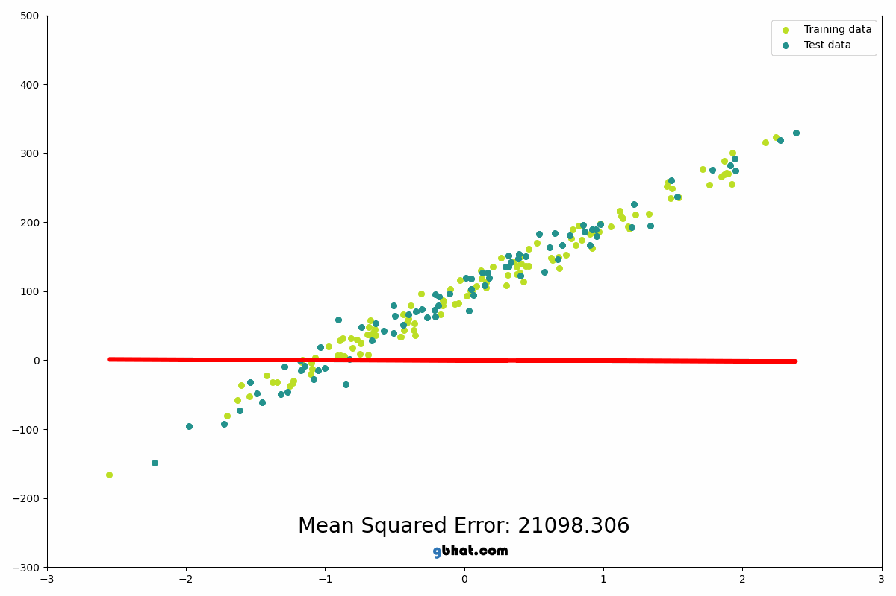
[Visualisation interactive de la régression par moindres carrés ordinaires](https://setosa.io/ev/ordinary-least-squares-regression/)

**&#129304; Intuition: pourquoi l'erreur est elle au carré  ?** (idée KPI)

---
### **Comment trouver cette solution ?**

Il éxiste deux méthodes que nous allons voir dans ce cours:
- La méthodes des moindres carrés 
- La descente de gradient

---
<!-- header: La méthode des moindres carrés -->

### **La méthode des moindres carrés**

1. Trouver $\hat{\beta}$, les coefficients estimés
2. Effectuer la prédiction afin de déterminer l'erreur $\epsilon$

Nous avons :
$\vec{Y}=X\vec{β}+\vec{u}$

Ce qui nous donne pour une seule observation :

$\vec{Y}=β_0+β_1X_1+β_2X_2+…+β_kX_k+\epsilon_1$

Et pour l'ensemble de nos observations, nous obtenons :
$\begin{bmatrix}
y_1 \\
y_2 \\
\vdots \\
y_n
\end{bmatrix}=
\begin{bmatrix}
1 & x_{11} & x_{12} & \dots & x_{1p} \\
1 & x_{21} & x_{22} & \dots & x_{2p} \\
\vdots & \vdots & \vdots & \ddots & \vdots \\
1 & x_{n1} & x_{n2} & \dots & x_{np}
\end{bmatrix}
\begin{bmatrix}
\beta_0 \\
\beta_1 \\
\vdots \\
\beta_p
\end{bmatrix}
+
\begin{bmatrix}
\varepsilon_1 \\
\varepsilon_2 \\
\vdots \\
\varepsilon_n
\end{bmatrix}$

---

### **La méthode des moindres carrés**

La méthode des moindres carrés nous dit que pour obtenir les coefficients estimés $\hat{\beta}$, nous devons effectuer le calcul suivant:

- $\hat{\beta}= (X^TX)^{-1}X^Ty$

Prenons l'exemple suivant : 

$\mathbf{X} =
\begin{bmatrix}
1 & 1 & 2 \\
1 & 2 & 4 \\
1 & 3 & 5 \\
\end{bmatrix}
\quad
\mathbf{y} =
\begin{bmatrix}
8 \\
12 \\
15 \\
\end{bmatrix}$

 

---

### **La méthode des moindres carrés**
1. Calcul de la transposée de $X$
$\mathbf{X}^T =
\begin{bmatrix}
1 & 1 & 1 \\
1 & 2 & 3 \\
2 & 4 & 5 \\
\end{bmatrix}$

2. Calcul du produit scalaire entre $X^T$ et $X$

- $X^T\cdot X=\begin{bmatrix}
1 & 1 & 1 \\
1 & 2 & 3 \\
2 & 4 & 5 \\
\end{bmatrix} \cdot \begin{bmatrix}
1 & 1 & 2 \\
1 & 2 & 4 \\
1 & 3 & 5 \\
\end{bmatrix}= \begin{bmatrix}
1 & 6 & 11 \\
6 & 14 & 25 \\
11 & 25 & 45 \\
\end{bmatrix}$

3. Calculons $X^T \cdot y$
- $X^T \cdot y= \begin{bmatrix}
1 & 1 & 1 \\
1 & 2 & 3 \\
2 & 4 & 5 \\
\end{bmatrix} \cdot \begin{bmatrix}
8 \\
12 \\
15 \\
\end{bmatrix}= \begin{bmatrix} 
35 \\
77 \\ 
139 \end{bmatrix}$
---

### **La méthode des moindres carrés**

4. Calculons $(X^TX)^{-1}$

- $(\mathbf{X}^T \mathbf{X})^{-1} =
\begin{bmatrix}
5 & 5 & -4 \\
5 & 14 & -9 \\
-4 & -9 & 6 \\
\end{bmatrix}$

5. Calculons maintenant nos coefficients $\beta$

- $\hat{\boldsymbol{\beta}} = (\mathbf{X}^T \mathbf{X})^{-1} \mathbf{X}^T \mathbf{y} =
\begin{bmatrix}
4 \\
2 \\
1 \\
\end{bmatrix}$

Notre modèle de régression linéaire aura donc la formule suivante : 

- $\hat{y} = 4 + 2x_1 + 1x_2$

###### **Question : Comment calculer les erreurs ?**

---

<!-- header: ❌ Limites de la méthode des moindres carrés -->

## &#9940; Quand **ne pas utiliser** la méthode des moindres carrés (OLS) ?

---

### &#128200; 1. Multicolinéarité (variables corrélées)

- **Problème** : $\mathbf{X}^T \mathbf{X}$ non inversible
- **Effet** : Coefficients instables ou non calculables
- **Exemple** : $x_2 = 2x_1$ → Redondance
- **Solution** : Régression **Ridge (L2)** ou **Lasso (L1)**

---

### &#128202; 2. Trop de variables ($p \gg n$) ou $p=features$ et $n=observation$

- **Problème** : Trop de dimensions → sur-apprentissage
- **Effet** : Le modèle s’ajuste au bruit
- **Solution** :  **réduction de dimension** (PCA)

---

### &#128683; 3. Données avec des **outliers**

- **Problème** : OLS est très sensible aux grandes erreurs (tous les points sont utilisés)
- **Effet** : Une valeur extrême peut fausser la droite
- **Solution** : Régression Linéaire ( **Huber**)

---

### &#128273; 4. Relation **non linéaire**

- **Problème** : Le lien entre les variables n’est pas une droite
- **Effet** : Mauvaise qualité de prédiction
- **Solution** : 
  - Régression **polynomiale**
  - **Transformation des variables**
  - **Modèles non linéaires** (forêts aléatoires, réseaux de neurones…)

---

### &#128683; 5. Trop de données

- **Problème** : OLS est très sensible à toutes nos données 
- **Effet** : Elle s'adapte parfaitement 
- **Solution** : Régression Linéaire ( **Huber**)

---

###  Résumé des cas à éviter

| Situation                | Problème                          | Solution                   |
|--------------------------|-----------------------------------|----------------------------|
| Colinéarité              | $X^T X$ non inversible        | Ridge, Lasso               |
| Trop de variables        | Sur-apprentissage                 | Lasso, PCA                 |
| Valeurs aberrantes       | Instabilité                       | Huber              |
| Relation non linéaire    | Mauvais ajustement                | Régression non linéaire    |

 
---
<!-- header: La descente de gradient -->

### **La descente de gradient** - **Différence avec les moindres carrés (OLS)**

- **OLS** : méthode analytique → donne une **solution unique** (si possible)
- **Descente de gradient** : méthode **numérique**, dépend :
  - du **point de départ**
  - du **learning rate**
  - du **nombre d’itérations**
  
Elle peut conduire à **plusieurs minima locaux** (surtout dans des modèles non linéaires)

Le but du **SGD** est de trouver un minimum dans son paradigme !

---

### **La descente de gradient**

Une méthode **itérative** qui, à chaque étape, cherche à se rapprocher du **minimum** d’une **fonction de perte** ou loss function (*très important*).
C'est en se rapprochant du minimum de la fonction de perte que nous nous rapprocherons de nos $\beta$ optimaux.

Utilisé dans plusieurs algorithmes :
- Regression linéaire
- Régression logistique 
- Réseaus de neuronnes 

Son but est de minimiser l'erreurs $\epsilon$ en ajustant progressivement les poids $\beta_n$ associés aux différentes features $x_n$

---

### **Visuellement, voici un exemple de cet algorithme**

 
  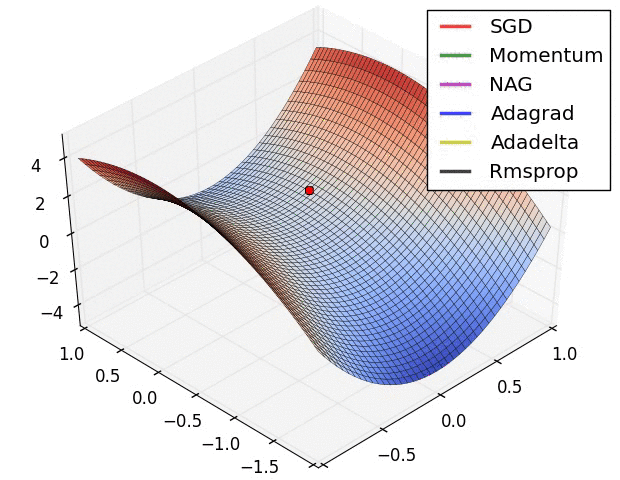

**Des idées ?**

La notion d'erreur est très importante il faut reussir à la représenter mathématiquement, à la calculer ! 

---

### **Deux notions importantes pour comprendre cet algorithme**

1. La loss function (représentative de l'erreur **globale** à chaque itération de notre algorithme)
2. Le learning rate 

---

### **La loss function**

Nous allons d'abord parler de la **loss function**

Une **fonction de perte (loss function)** mesure **l’erreur** entre la sortie prédite  $\hat{y}$ et la sortie réelle $y$.

Prenons le cas de la MSE (il en existe plusieurs on en parle un peu plus tard):

- $\mathcal{L}(\beta) = \frac{1}{n} \sum_{i=1}^n (y_i - \hat{y}_i)^2$

Elle nous donne un **score**:
- Plus ce score est elevé plus mes prédictions sont **....** ?
- Plus ce score est bas plus mes prédictions sont **....** ? 
- Pourquoi au carré ? 
---

### **Représentation visuelle de la loss function**

  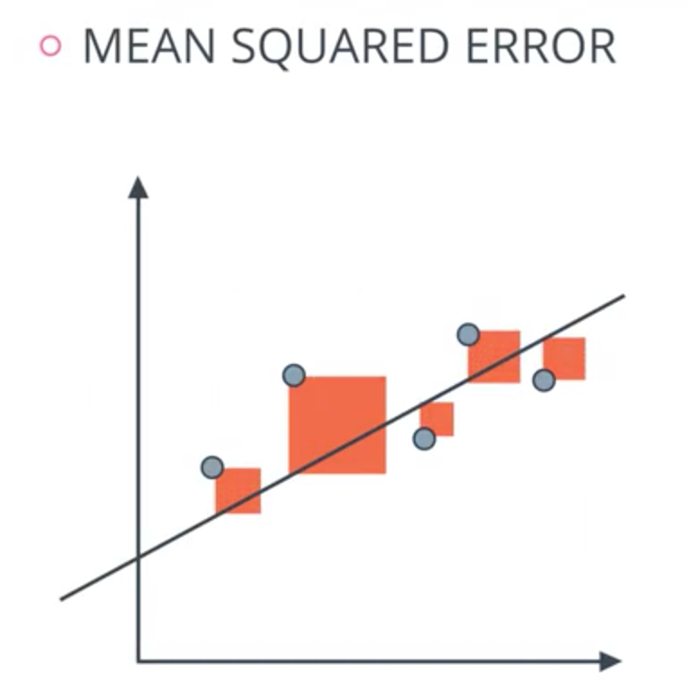
  <ul>
    <li>Les points sont mes observations, mon dataset</li>
    <li>Les carrés rouges représentent ? </li> 
    <li>La droite est ma droite de régression</li>

 
  </ul>

---

### **Un exemple concret**

On dispose d’un jeu de données simple :

| x (surface en m²) | y (prix en k€) |
|-------------------|----------------|
| 1                 | 2              |
| 2                 | 4              |
| 3                 | 6              |

On cherche une **droite** de la forme :
$
\hat{y} = \beta_0 + \beta_1 x
$

Objectif : trouver $\beta_0, \beta_1$ qui **minimisent l’erreur** entre les $y_i$ et les $\hat{y}_i$

---

### **Fonction de perte (MSE)**

On minimise la **somme des carrés des erreurs** :

$
\mathcal{L}(\beta_0, \beta_1) = \frac{1}{n} \sum_{i=1}^n (y_i - \hat{y}_i)^2 = \frac{1}{n} \sum_{i=1}^n (y_i - (\beta_0 + \beta_1 x_i))^2
$

Cette fonction est **convexe** → elle a **un unique minimum**.

On veut **trouver ce minimum** à l’aide de la **descente de gradient**.

N'oubliez pas qu'ici nos inconnues sont $\beta_0$ et $\beta_1$ et non $y_i$ et $x_i$.

Notre but sera de trouver ce minimum à l’aide de la **descente de gradient**, en ajustant les paramètres $\beta_0$ et $\beta_1$ pour réduire progressivement l’erreur.

---

### **Visualisation de la perte**

La fonction $\mathcal{L}(\beta_1)$ peut être **visualisée** comme une courbe :

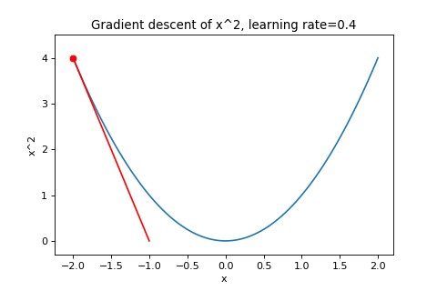

- L’axe horizontal : valeurs possibles de $\beta_1$
- L’axe vertical : valeur de la perte
- Le **minimum** correspond à la **meilleure droite** de régression

---
### **Mais ou est passer $\beta_0$**

Dans les faits la recherche de minimum doit se faire dans un espace à $n+2$ dimensions.
- **Pourquoi ?**
- **Comment notre descente de gradient peut savoir ou se diriger ?**

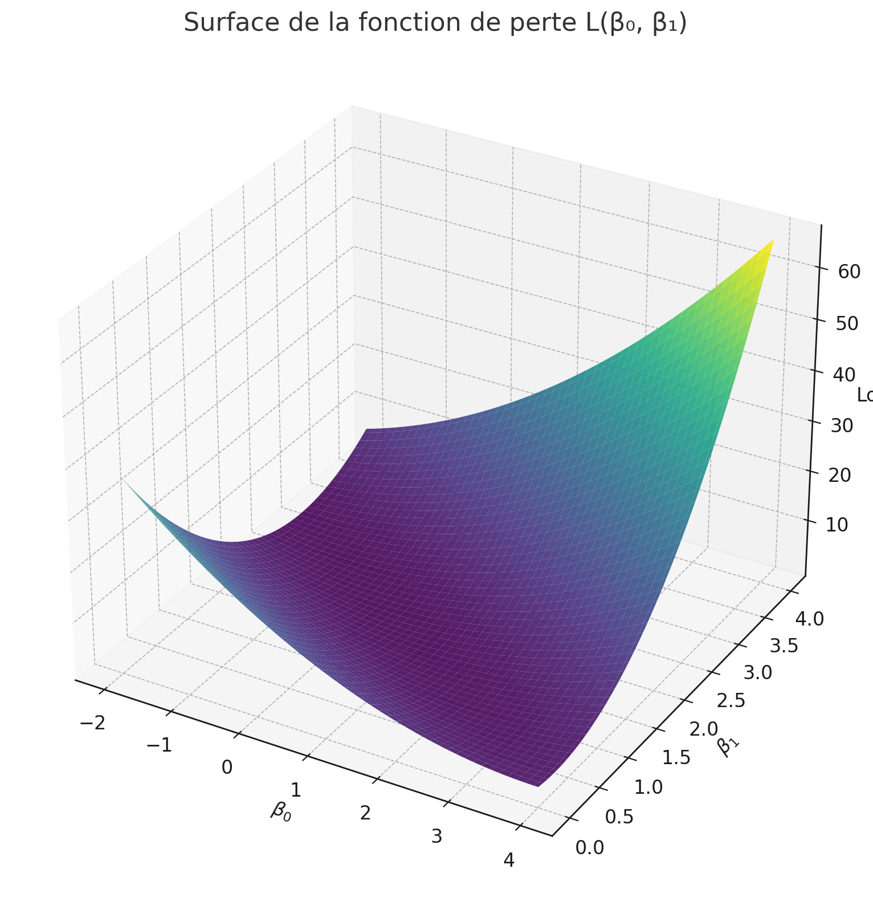

---

### &#128202; Calcul de la tangente : la dérivée

On calcule la **dérivée** de la fonction de perte en un point pour connaître la **pente locale**.

Pourquoi ? Parce que la **tangente est la droite qui "colle" le mieux à la courbe localement**.  
Elle nous donne la **variation instantanée** de la fonction autour d’un point.

---

### Et si on a plusieurs features ?

Dans ce cas, on ne calcule pas une dérivée, mais le **gradient** :

$
\nabla \mathcal{L} =
\begin{bmatrix}
\frac{\partial \mathcal{L}}{\partial \beta_0} \\
\frac{\partial \mathcal{L}}{\partial \beta_1} \\
\vdots \\
\frac{\partial \mathcal{L}}{\partial \beta_p}
\end{bmatrix}
$

On effectue donc une **dérivée partielle pour chaque coefficient** $\beta_j$.

Ce **vecteur de gradient** nous indique la **direction complète dans l’espace des paramètres**  
→ On le suit (dans le sens inverse) pour **atteindre le minimum de la fonction de perte**.

---

Prenons la dérivé partielle de notre fonction : 
- 
$
\mathcal{L}(\beta_0, \beta_1) = \frac{1}{n} \sum_{i=1}^n (y_i - \hat{y}_i)^2 = \frac{1}{n} \sum_{i=1}^n (y_i - (\beta_0 + \beta_1 x_i))^2
$ en $\beta_1$

Nous obtenons: 

$
\frac{\partial \mathcal{L}}{\partial \beta_1} = -\frac{2}{n} \sum_{i=1}^n x_i (y_i - (\beta_0 + \beta_1 x_i))
$

Cette dérivée **donne la direction de la tangente** et indirectement ou nous devons aller à la prochaine étape d'itération :  
- Si $\frac{d\mathcal{L}}{d\beta_1} > 0$ → pente positive → il faut **descendre à gauche**
- Si $< 0$ → pente négative → **descendre à droite**

---
### &#128202; **Prenons l'exemple suivant :**

- Soit la fonction :  
  
  $f(x) = (x - 3)^2 + 2$
  

Sa dérivée est :

- $f'(x) = 2(x - 3) = 2x - 6$

---

### **Analyse au point \( x = 5 \) :**

- $f'(5) = 2 \cdot 5 - 6 = 4$

Cela signifie que **la tangente à la courbe en \( x = 5 \)** a une **pente de 4**  
→ **Une droite de coefficient directeur 4**, comme représentée ci-dessous :

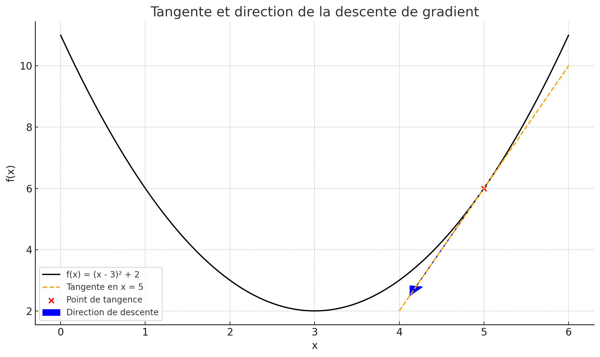

---

### **Mise à jour des paramètres $\beta_n$**

À chaque itération, on met à jour les paramètres comme ceci :

$
\beta_1 \leftarrow \beta_1 - \eta \cdot \frac{\partial \mathcal{L}}{\partial \beta_1}
$

$
\beta_0 \leftarrow \beta_0 - \eta \cdot \frac{\partial \mathcal{L}}{\partial \beta_0}
$

- $\eta$ : learning rate (pas de mise à jour)
- On répète jusqu’à **convergence**

 

**Pourquoi le $-$ ??**

---

 ### **L'impace d'un learning rate $\eta$, petit grand moyen, moyennement grand etc..** 

 L'image suivante parle d'elle même: 

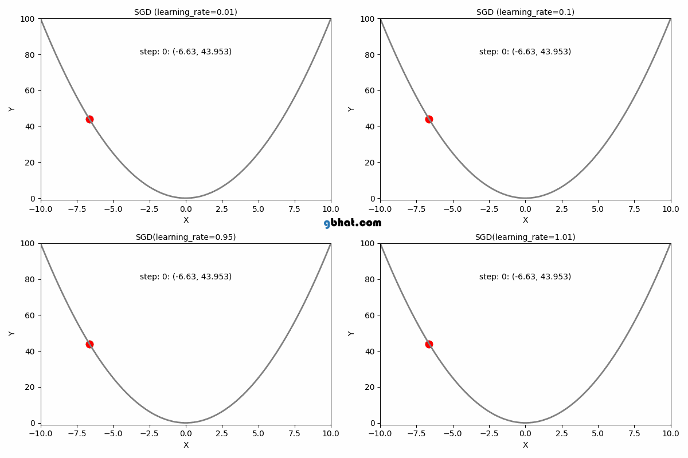

---

###  Exemple  simple

Soit 3 points : $(1, 2), (2, 4), (3, 6)$

On initialise $\beta_0 = 0, \beta_1 = 0$  
Learning rate $\eta = 0.1$

1. $\hat{y}_i = 0$, donc $y_i - \hat{y}_i = y_i$
2. Calcul du gradient :
   $
   \frac{\partial \mathcal{L}}{\partial \beta_1} = -\frac{2}{3} \left(1 \cdot 2 + 2 \cdot 4 + 3 \cdot 6\right) = -\frac{2}{3}(2 + 8 + 18) = -\frac{2}{3} \cdot 28 = -18.67
   $
3. Mise à jour :
   $
   \beta_1 \leftarrow 0 + 0.1 \cdot 18.67 = 1.867
   $

On s'est rapproché du minimum !

---

### **La convergence** 

**D'après vous quand est atteint la convergence de notre algorithme ?** 

---

### **Plusieurs réponses possibles**
1. La variation du coût est négligeable :

$|\mathcal{L}_{t+1} - \mathcal{L}_t| < \varepsilon$

$\varepsilon$ est un petit seuil fixé à l’avance (ex: $10^{-6}$)

Cela signifie que le modèle n’améliore plus significativement la perte.

⸻

2. La variation des paramètres est très faible :

$\|\boldsymbol{\beta}^{(t+1)} - \boldsymbol{\beta}^{(t)}\| < \varepsilon$

Cela signifie que les poids ne bougent presque plus.

⸻

3. Nombre maximal d’itérations atteint

Même si ça n’a pas convergé complètement, on force l’arrêt après un certain nombre d’itérations pour éviter une boucle infinie.

---

### &#9888;&#65039; **Outliers et choix de la fonction de coût**

Dans certains jeux de données, il peut exister des **valeurs extrêmes** (*outliers*) qui s'écartent fortement du reste des observations.

&#10145;&#65039; Ces points peuvent **fausser l'entraînement du modèle** si on utilise une fonction de coût trop sensible aux grandes erreurs.

---

### &#9989; Exemple : la MSE

La **MSE** (erreur quadratique moyenne) donne **plus de poids aux grandes erreurs**, car elle élève les résidus au carré :

$\mathcal{L}_{MSE} = \frac{1}{n} \sum_{i=1}^n (y_i - \hat{y}_i)^2$

&#9989; Très efficace quand les erreurs sont symétriques et les données propres  
&#9888;&#65039; Mais **elle amplifie l'influence des outliers**, qui peuvent alors **dominer l’apprentissage**

---

### &#128736;&#65039; Alternatives plus robustes

Lorsque les données contiennent des outliers, on peut préférer des fonctions de coût **moins sensibles aux valeurs extrêmes**, comme :

- **MAE** (Mean Absolute Error) :

$\mathcal{L}_{MAE} = \frac{1}{n} \sum_{i=1}^n |y_i - \hat{y}_i|$

&#10133; Résiste mieux aux outliers  
&#10134; Moins fluide à optimiser (non dérivable en 0)

- **Huber Loss** (hybride entre MSE et MAE) :
  - Quadratique si l’erreur est petite
  - Linéaire si l’erreur est grande
  - Très utilisée pour combiner **précision** et **robustesse**

---

### &#128161; En résumé

- Le **choix de la fonction de coût** doit tenir compte de la **présence d’outliers**  
- Utiliser une fonction robuste comme la **MAE** ou la **Huber Loss** permet de **protéger le modèle** contre ces valeurs extrêmes

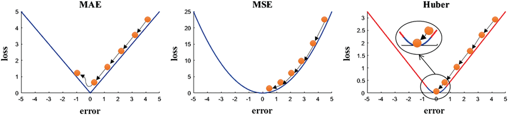

---

### **Nous avons exploré**

- La régression linéaire
- L'ols
- La descente de gradient
- La loss function et des alternatives 
- Pourquoi la descente de gradient est fonctionnel
- Le learning rate

**Des questions ?**

--- 

<!-- header: Implémentation sur scikit learn -->

## **Scikit learn la mise en place d'une régression linéaire**

La théorie c'est important, l'intuition dans les problèmes de data science ne peut venir qu'avec de la pratique et de l'éxpérimentation. 

---

### **Étape 1 : Import des bibliothèques**

  

    train_test_split
  

  

import pandas as pd
import numpy as np
from sklearn.linear_model import LinearRegression
from sklearn.model_selection import train_test_split
from sklearn.metrics import mean_squared_error, r2_score
  

---

### **Étape 2 : Chargement et préparation des données**

  

    Chargement des données
  

  

df = pd.read_csv("donnees.csv") # Supposons que l'on souhaite prédire "prix" 
X = df[["surface", "nombre_pieces"]] 
y = df["prix"] 
  

- `X` contient les **caractéristiques explicatives** (ex: surface, nombre de pièces)
- `y` contient la **variable à prédire** (le prix ici)

**Voir cours 1 pour le prétraitement des données** 

**Attention pour la normalisation, robust scaling ou même imputation faites d'abord la séparation entre train et test pour éviter le data leaking!** 

> #### Data Leaking
> Le data leaking se produit lorsque des informations du jeu de test "fuient" dans le processus d'entraînement, donc dans le $y_{train}$. Cela peut fausser énormement vos résultat à la fin de l'entrainement.

---

### **Etape 3: train test split**

  

    train_test_split
  

  

X_train, X_test, y_train, y_test = train_test_split     
  (
  X, y, test_size=0.2, random_state=42
  )
  

- 80% pour l’entraînement
-  20% pour le test

Pourquoi faire cette manipulation ? 

**Je me répète:** On effectue le train/test split avant le scaling, pour ne pas utiliser les données de test dans le calcul de la moyenne/écart-type.

Ensuite lorsque nous calculerons nos resultat nous appliquerons nos valeurs de scaling trouvé dans le train pour l'appliquer sur le test. 

---

### **Etape 4: Standardisation des variables**

  

Entrainement du modèle  

  

scaler = StandardScaler()
X_train_scaled = scaler.fit_transform(X_train)
X_test_scaled = scaler.transform(X_test)
  

Petit rappel sur le choix du scaler : 

| Scaler | Quand l'utiliser ? |
|--------|-------------------|
| StandardScaler | Données gaussiennes (répartition normale) |
| MinMaxScaler | Données comprises entre 0 et 1 (réseaux de neurones) |
| RobustScaler | Données avec outliers importants |

---

### **Etape 5: Entraïnement du modèle**

Nous pouvons basiquement appliquer cette méthode : 

  

Entrainement du modèle  

  

model = LinearRegression()
model.fit(X_train_scaled, y_train)
  

: 
Attention, par défaut, LinearRegression() utilise :

- La méthode analytique (moindres carrés ordinaires)
-	Pas de descente de gradient
-	Pas de learning rate ou de choix de loss custom

---

### **Etape 5: Entraïnement du modèle - bis**

Si nous souhaitons jouer avec les paramètres que nous avons vue précedement à savoir: 
- Le learning rate
- La modification de la loss
- la méthode de convergence

Nous devons utiliser sgdregressor:

  

Entrainement du modèle  

  

model = SGDRegressor(
    loss="squared_error",      # ou "huber", "epsilon_insensitive", etc.
    learning_rate="invscaling",# ou "constant", "adaptive"
    eta0=0.01,                 # learning rate initial
    max_iter=1000,             # nombre d'itérations
    tol=1e-3                   # critère de convergence
)
  

---
### **SGD vs GD**

Pour bien comprendre :

1. Gradient Descent (GD) classique :
	•	Calcule le vrai gradient moyen :
$\nabla \mathcal{L}(\boldsymbol{\beta}) = \frac{1}{n} \sum_{i=1}^n \nabla \mathcal{L}_i(\boldsymbol{\beta})$
	•	Direction toujours régulière, vers le minimum global

2. Stochastic Gradient Descent (SGD) :
	•	Calcule le gradient à partir d’un seul point $\nabla \mathcal{L}_i(\boldsymbol{\beta})$
	•	Ce gradient varie fortement d’un point à l’autre
	•	Donc la direction prise “saute” un peu partout

---

### **Visuellement, ça donne quoi ?**

- 	GD : tu descends une pente avec une belle ligne droite fluide
- SGD : tu descends la même pente, mais en zigzaguant, parfois tu remontes un peu, puis tu redescends → c’est ça le bruit.

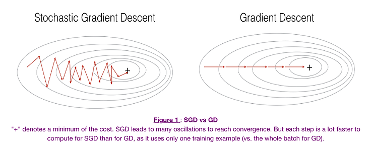

---

### **Métaphore :**

Imagine que tu veux suivre un chemin en regardant une carte complète (GD) vs en demandant à une personne différente à chaque croisement (SGD).
- Tu avances plus vite, mais parfois tu fais de petits détours.

**Pourquoi on l’utilise quand même ?**
-	Parce que malgré le bruit, le coût par itération est faible
-	Et sur de gros datasets, c’est souvent plus efficace globalement

---

### **Etape 6: Prédictions et évaluation**

  

Entrainement du modèle  

  

y_pred = model.predict(X_test_scaled)
mse = mean_squared_error(y_test, y_pred)
r2 = r2_score(y_test, y_pred)
print("MSE :", mse)
print("R² :", r2)
print("Intercept :", model.intercept_)
print("Coefficients :", model.coef_)
  

---
### **Etape 6: Prédictions et évaluation - intérprétation des résultats**

Comment interpréter ces résultats ?
-	MSE (Mean Squared Error)
    - Erreur moyenne au carré entre les prédictions et les vraies valeurs
    - Plus cette valeur est basse, plus les prédictions sont proches de la réalité
-	R² (coefficient de détermination)
    - Exprime la proportion de la variance expliquée par le modèle
    - Compris entre 0 et 1 (parfois négatif si le modèle est pire qu’une constante !)
    - Plus il est proche de 1, mieux le modèle explique les données

---
### **Etape 6: Prédictions et évaluation - Comprendre les paramètres du modèle**
-	intercept_
    - C’est le ( $\beta_0$ ) : la constante, le point d’interception de la droite sur l’axe vertical
    - Elle correspond à la valeur prédite quand toutes les variables valent 0
-	coef_
    - C’est la liste des ( $\beta_1, \beta_2, …, \beta_p$ )
    - Chaque valeur représente l’impact d’une feature sur la cible :
“Quand cette variable augmente de 1, la cible varie de…”

---

### **Étape 7 : Détection d'overfitting ou underfitting**

Après avoir entraîné un modèle, il est essentiel de **vérifier sa capacité à généraliser** :

#### Comment faire ?

##### ➤ Utiliser une **courbe d’apprentissage** (learning curve)

  

Entrainement du modèle  

  

train_sizes, train_scores, test_scores = learning_curve(
    model, X, y, train_sizes=np.linspace(0.1, 1.0, 10), 
    scoring='neg_mean_squared_error', cv=5
)

  

 
Voir notes/learning_curve

-	Elle affiche l’erreur d’entraînement et l’erreur de validation
-	Permet de visualiser rapidement :
-	S’il y a un écart ➜ overfitting
-	Si les deux erreurs sont hautes ➜ underfitting

---

### **Étape 8 : Réévaluation du pipeline – On recommence si besoin !**

Si ton modèle donne de **mauvais résultats**, il ne suffit pas de "changer de modèle".

- Ce n’est pas toujours la faute de l’algorithme.

---

###  Que faire en cas de résultats médiocres ?

**Reprendre depuis le début** : tout part des données !

---

### Vérifications et améliorations possibles

| Étape à revoir             | Stratégies recommandées |
|---------------------------|--------------------------|
| **Prétraitement des données** | Vérifie les **valeurs manquantes**, les **outliers**, la **distribution** des variables |
| **Scaling**                | As-tu bien adapté ton scaler ? (`RobustScaler` pour outliers par ex.) |
| **Variables choisies**     | Peut-on **ajouter des features pertinentes** ou en **retirer des inutiles** ? |
| **Encodage**               | Les variables catégorielles sont-elles **bien transformées** (`OneHotEncoder`, etc.) ? |
| **Modèle trop simple**     | Essaie un modèle plus flexible (`Ridge`, `Lasso`, `PolynomialFeatures`) |
| **Modèle trop complexe**   | Ajoute de la **régularisation** pour limiter l’overfitting |
| **Jeu de données trop petit** | Collecter plus de données, ou utiliser des techniques de validation robustes |

---

### En résumé :

> Si le modèle ne fonctionne pas :
> - On **réanalyse les données**
> - On **revoit le prétraitement**
> - Puis on **reteste le modèle avec une nouvelle approche**

Et on recommence, jusqu'à trouver **l’équilibre entre biais et variance** 

---

### **Pour finir: Équilibre entre Biais et Variance**

- Un **modèle trop simple** a :
  - Un **fort biais** (il ne capture pas la complexité)
  - Une **faible variance**

- Un **modèle trop complexe** a :
  - Un **faible biais**
  - Une **forte variance** (il s’adapte trop aux données)

---

### Objectif : Trouver le bon compromis

- La **courbe d’erreur totale** est la somme du biais² et de la variance
- Il existe un point où cette erreur est **minimale**
- C’est là que le modèle **généralise le mieux**

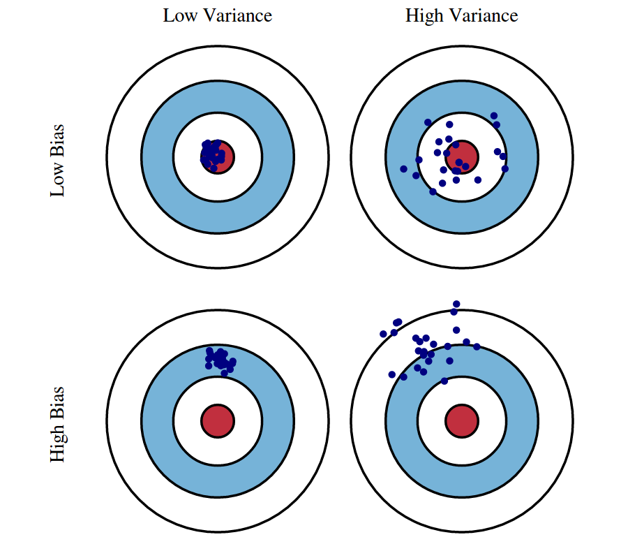

---

### **Des questions ?**