<!-- _class: title -->

# Le Data Mining

 

Christopher de Boisvilliers

2025-03-30

------
<!-- header: ⭐️ Plan du cours -->

# Plan du cours
- Rappel ou découverte sur les statistiques
- L'hypothèse et la p-value
- La régression logistique
- OverFitting / UnderFitting
- Model Tuning
---
<!-- header: 📈 Rappel ou découverte sur les statistiques -->
# 1. Rappels sur les statistiques
### **Rappels & Notations**

- On appelle **variable aléatoire** une variable notée $X$, qui représente la **valeur numérique issue d’une expérience aléatoire**.

- Une **expérience aléatoire répétée** $n$ fois donne une **suite de variables aléatoires** :  
  $
  X = (X_k)_{0 \leq k \leq n}
  $

- La **loi de probabilité** associée à $X$ est notée $p(X)$, et dépend de **paramètres** comme:  
- $\mu$ : la moyenne  
- $\sigma$ : l’écart type  
- $p(X) = p(\mu, \sigma, \dots)$

---
### **Loi Normale : une courbe très spéciale**

La **loi normale** (ou loi gaussienne) est une **distribution de probabilité** très fréquente en statistiques.

---

### **Intuition : à quoi ça sert ?**

- Beaucoup de phénomènes **naturels** suivent une distribution normale :
  - Taille des humains
  - Notes d'un contrôle
  - Erreurs de mesure

- La **forme en cloche** est **symétrique** autour de la moyenne.

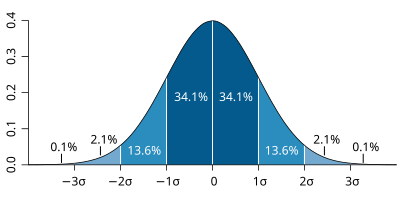

---

###  **Formule mathématique**

La loi normale est définie par :

$$
f(x) = \frac{1}{\sigma \sqrt{2\pi}} \cdot e^{ -\frac{1}{2} \left( \frac{x - \mu}{\sigma} \right)^2 }
$$

- $\mu$ : la **moyenne** (centre de la courbe)
- $\sigma$ : l’**écart-type** (étalement des valeurs)
- $e$ : le nombre d’Euler (≈ 2.718)

---

### **Impact de $\mu$ et $\sigma$ sur la courbe**

- Changer $\mu$ **décale** la courbe (gauche/droite)
- Changer $\sigma$ **étale ou resserre** la courbe

> Plus $\sigma$ est grand, plus la courbe est plate.  
> Plus $\sigma$ est petit, plus la courbe est "piquée".
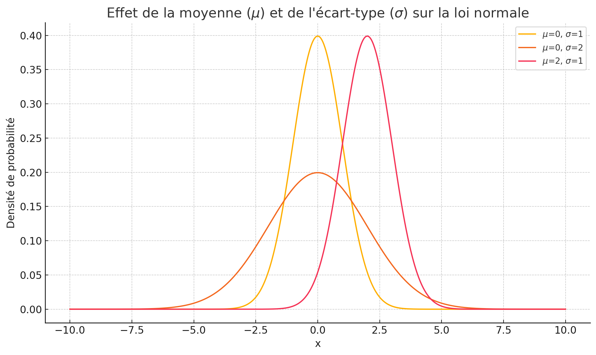

---

### **Ce que nous dit la loi normale  :**
1.	Beaucoup de phénomènes **aléatoires** suivent une “courbe en cloche” :
    -	Taille des individus, erreurs de mesure, notes d’un examen…
    -	Ces données sont centrées autour d’une moyenne et symétriques.
2.	La probabilité de tomber “près” de la moyenne est élevée :
    -	68 % des valeurs sont entre $\mu - \sigma$ et $\mu + \sigma$
    -	95 % entre $\mu - 2\sigma$ et $\mu + 2\sigma$
    -	99.7 % entre $\mu - 3\sigma$ et $\mu + 3\sigma$
3.	Cela veut dire que :
    -	Si un résultat est très éloigné de la moyenne, il est peu **probable**.
    -	La loi normale nous permet donc de quantifier ce qui est **“normal”** ou **“exceptionnel”** dans une distribution.

---
### **Pourquoi je vous parle de cela ?**

Car cette idée qu’un résultat “très éloigné” est **rare** est importante.

C’est le cœur de la logique des tests d’hypothèses que nous verrons dans un instant.

---

<!-- header: 🎲 Rappels sur les statistiques -->

### **La loi des grands nombres**

*"Plus on répète une expérience **aléatoire**, plus la moyenne des résultats se rapproche de la vraie moyenne attendue."* - Jacob Bernoulli

---

### **La loi des grands nombres**

- *Une expérience aléatoire est une action dont on ne peut pas prédire le résultat avec certitude, mais on connaît tous les résultats possibles.*

Prenons le cas d'un lancé de dès **1d6**, nous ne pouvons pas prédire le résultat avec certitude **mais** nous avons l'ensemble des résultats possibles.

---
### **La loi des grands nombres**

### &#128200; Exemple :  Les **lancers d’un dé à 6 faces**

- On lance un **dé équilibré** $n$ fois.
- Chaque lancer est une variable aléatoire $X_i \in \{1,2,3,4,5,6\}$ avec :

$$
\mathbb{E}[X_i] = \mu = 3.5 \qquad \text{et} \qquad \text{Var}(X_i) = \frac{35}{12}=2.9
$$

- On calcule la **moyenne** $\overline{X}_n = \frac{1}{n} \sum_{i=1}^{n} X_i$

> **Si $n$ est grand**, la distribution de $\overline{X}_n$ devient **gaussienne**, centrée sur $\mu = 3.5$.

$\mathbb{E}[X_i]$: C’est la valeur moyenne **attendue** que prend la variable $X_i$.
$Var(X_i)$: Cela mesure à quel point les valeurs de $X_i$ sont dispersées **autour** de sa moyenne.

---
### **La loi des grands nombres**

Mathématiquement voila ceux que nous dis la loi des grands nombres: 

$\lim_{n \to \infty} \frac{X_1 + X_2 + ... + X_n}{n} = E(X)$

Et visuellement nous pouvons le voir très simplement. 

---
### **La loi des grands nombres**

Nous pourrions avoir le comportement suivant après $300$ lancés de dès en analysant la moyenne des lancers :
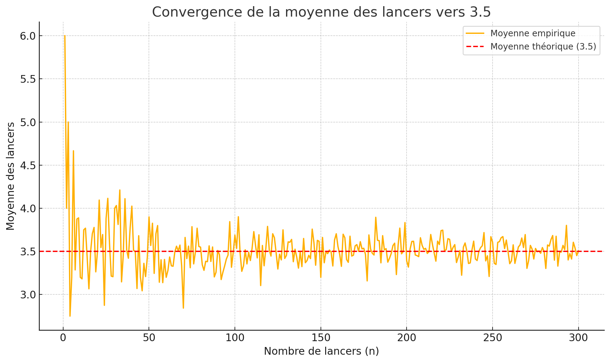

Des remarques ?

---

### **La loi des grands nombres**

Tournons un peu ce graphique nous obtenons:

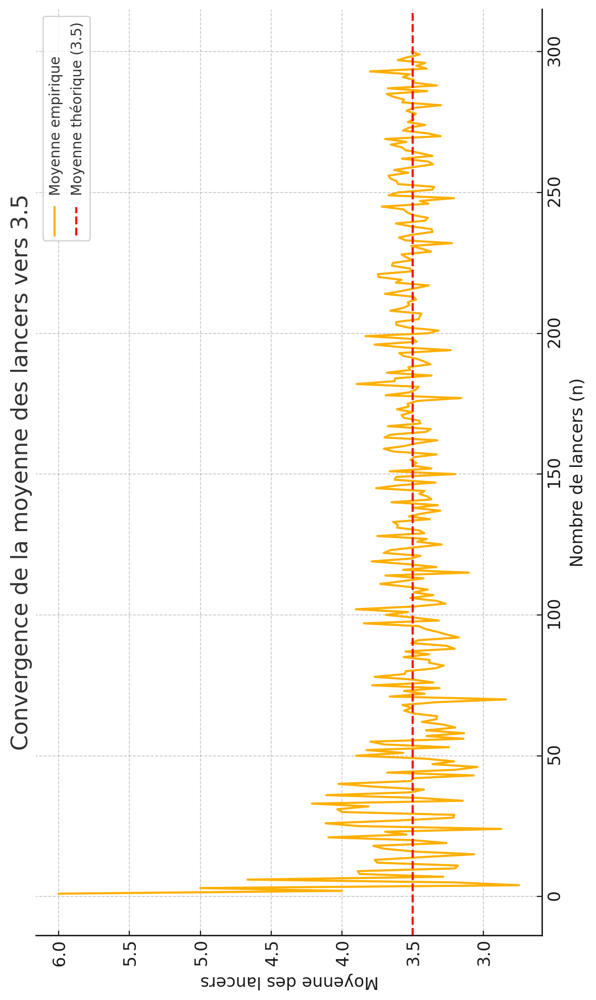

Des remarques ? 

---
### **La loi des grands nombres**

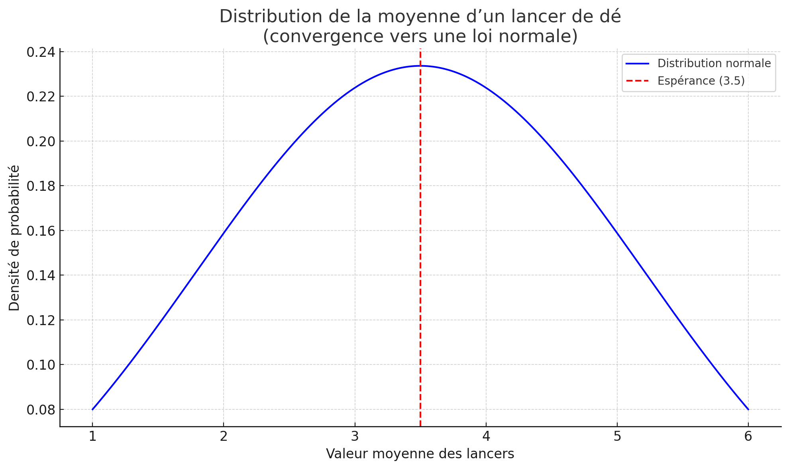

Sans le savoir nous avons compris un deuxième théorème...

Une idée ?

---

### **Le théorème centré limite** ALIAS le TCL
 
- La moyenne d’un grand nombre de variables aléatoires indépendantes et identiquement distribuées suit une loi normale.

---

### **Le théorème centré limite**

-	En statistiques, on travaille souvent avec des **échantillons** tirés d’une population.
-	Chaque **échantillon** donne une moyenne différente.
-	Le TCL explique ce qui se passe lorsqu’on répète ces moyennes plusieurs fois.

 <!-- Que deviennent les moyennes d’échantillons tirés au hasard ? -->

---
### **Le théorème centré limite** - Exemple 1/4

    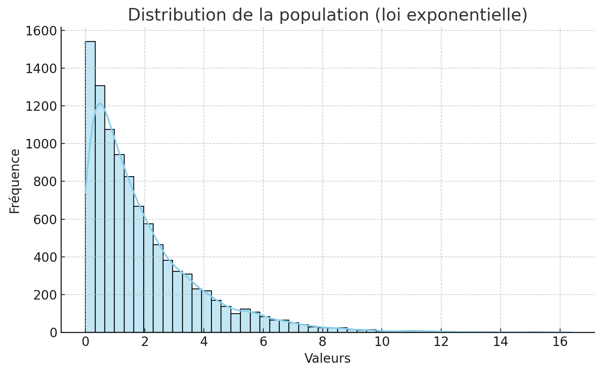
    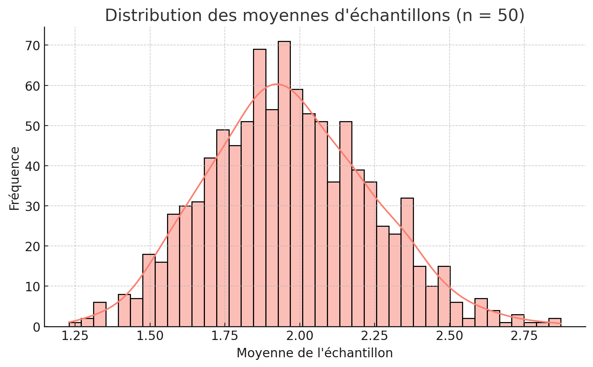

- Le graphique en bleu représente la distribution d'une population qui suit une loi exponentielle
- Le graphique en rouge représente la distribution des **moyennes** des échantillons

---

### **Le théorème centré limite** - Exemple 2/4

Analysons la première courbe:

- Le premier graphique représente une distribution **non** normale
- Si tu prélèves 1 seule valeur dans cette population elle peut être très petite ou parfois grande
- Nous avons une asymétrie marquée avec beaucoup de petites valeurs 
- Nous pouvous dire qu'elle est **skewed** vers la droite

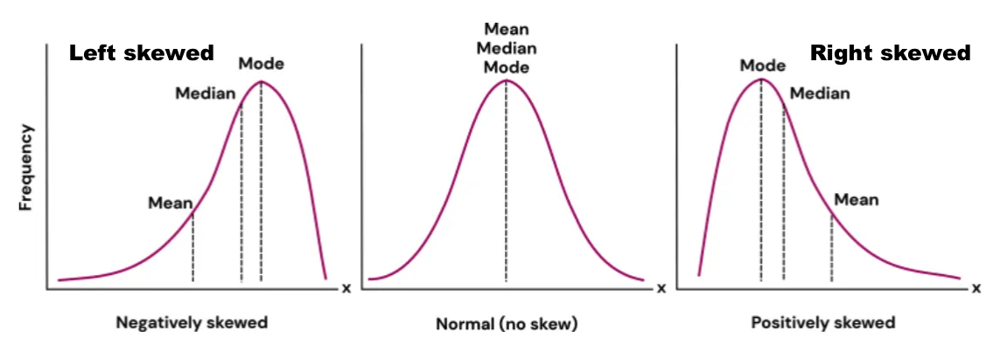

---
### **Le théorème centré limite** - Exemple 3/4

Dans le premiere graphique nous allons répéter une expérience:
1. Tirer au hasard un échantillon de taille n (par ex. n=30) dans notre distribution bleu
2. Calculer la moyenne de cet échantillon
3. Recommencer cette opération des milliers de fois (ex: 10 000)
Tu obtiendras alors 10 000 moyennes d'échantillons, qui est représentatives de ta distribution bleu. 

Posé sur un graphique voila le résultat:

Que pouvons nous observer ? 

---

### **Le théorème centré limite** - Exemple 4/4

Le deuxième graphique (en rouge) représente la distribution de ces 10 000 moyennes.

Et ce qu’on observe (comme le dit le théorème central limite), c’est que :
	•	Même si la population de départ est non normale,
	•	La distribution des moyennes d’échantillons tend vers une loi normale (en cloche),
	•	Et elle est centrée autour de la moyenne réelle de la population.

---

### **De la variable $X$ à la moyenne $\overline{X}_n$**

Soit $X$ une variable aléatoire (ex: temps de session, âge, poids...)  
avec une moyenne $\mu$ et un écart-type $\sigma$

- On tire $n$ valeurs indépendantes de cette variable :  
  $X_1, X_2, \dots, X_n$

- On calcule leur **moyenne d’échantillon** :  
  $\overline{X}_n = \frac{1}{n} \sum_{i=1}^n X_i$

> C’est cette moyenne que l’on va analyser.

---
### **Ce que dit le Théorème Central Limite (TCL)**

Si $X$ a une moyenne $\mu$ et une variance $\sigma^2$,  
alors quand $n$ est grand :

$\overline{X}_n \sim \mathcal{N}(\mu, \frac{\sigma^2}{n})$

“La variable aléatoire $\overline{X}_n$, c’est-à-dire la moyenne de $n$ variables aléatoires indépendantes et identiquement distribuées, suit une loi normale de moyenne $\mu$ et de variance $\frac{\sigma^2}{n}$”.

- La moyenne des échantillons suit une **loi normale**  
- Elle est centrée sur $\mu$  
- Sa dispersion dépend de la taille $n$ de l’échantillon

> Plus $n$ est grand, plus la moyenne est concentrée autour de $\mu$

---
### **Conséquence puissante**

Même si $X$ n’est pas normale...

 $\overline{X}_n$ devient **normalement distribuée**  
 On peut utiliser des outils puissants :
  - Intervalles de confiance
  - p-values
  - Tests t et z

> Grâce au TCL, la moyenne devient notre passerelle vers l’inférence statistique

 <!-- (on pourra y mettre une courbe en cloche + flèche depuis une distribution "bizarre") -->

---

### **Le théorème central limite – Pourquoi c’est super important ?**

- &#128200; En réalité, les données réelles (revenus, temps d’attente, ventes, etc.) ne suivent presque jamais une **loi normale**.  
  Pourtant, on a besoin de **les résumer, prédire, tester**.

- &#128269; La plupart des outils statistiques reposent sur une **hypothèse de normalité** (t-test, z-test etc)

- La **p-value** est calculée **par rapport à une loi normale** (ou t-distribution), donc elle **hérite directement** de ce principe.

&#128736; Le TCL est donc **fondamental** pour toute la Data Science :  
Sans lui, pas de tests, pas d’intervalles de confiance, pas d’inférence fiable.

---
### **Le théorème central limite – Pourquoi c’est super important ?**

Pour être plus clair , même si nous avons ça:
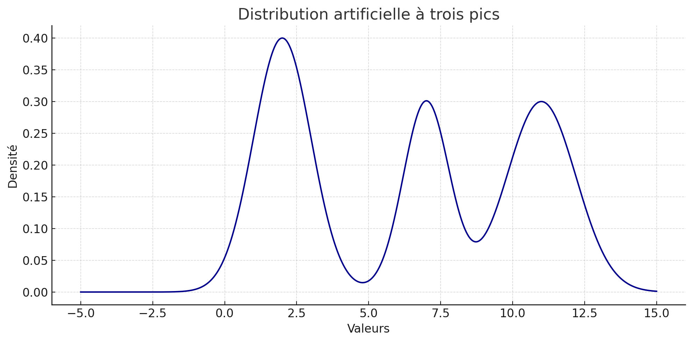
Le tcl nous permet d'obtenir la distribution suivante :
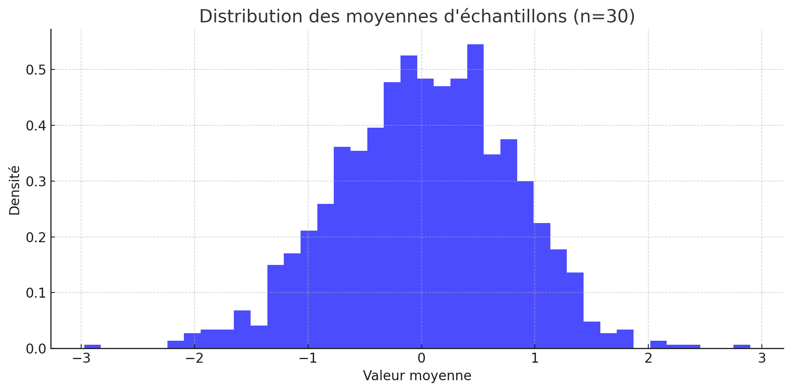

---
### &#x1F52C; Ce que l'on mesure souvent...

- On veut savoir **si une moyenne observée** est "significativement" différente d'une hypothèse.
- Exemples :
  - Le médicament baisse-t-il la température ?
  - L’école améliore-t-elle les résultats ?
  -  Mon algorithme est-il meilleur que le hasard ?

**Tous ces cas utilisent des *moyennes***.

---

### **Les outils statistiques et la normalité**

| Outil statistique              | Hypothèse de normalité ?                     | Explication                                                                                          |
|-------------------------------|---------------------------------------------|------------------------------------------------------------------------------------------------------|
| **Test t de Student**         |  Oui, mais…                                 | Suppose que **la moyenne** suit une loi normale. Grâce au **TCL**, c’est valide dès $n > 30$.        |
| **Test z**                    |  Oui                                       | Requiert que **la variable** soit normale, ou que $n$ soit grand (TCL).                              |
| **p-value**                   |  Oui, indirectement                        | Calculée par rapport à une loi théorique (normale, Student…).                                       |
| **Intervalle de confiance**   |  Oui, selon la méthode                     | Basé sur la **moyenne** donc nécessite normalité ou TCL.                                             |

> &#128204; **Résumé** : Ces outils utilisent la moyenne, et le **théorème central limite** garantit que celle-ci suit une loi normale dès que $n$ est suffisamment grand !

---

### **Étrange mais vrai**

Quand nous utilisons la moyenne d’une variable explicative (comme la surface, l’âge, etc.), nous faisons implicitement appel au théorème central limite (TCL).

&#x1F50D;  **Pourquoi ?**

Parce que, même si les valeurs individuelles ne suivent pas une loi normale, la moyenne de plusieurs échantillons issus de la population tendra vers une loi normale, si la taille de l’échantillon est assez grande.

C’est ce qui nous permet d’utiliser des outils comme les intervalles de confiance, les tests t ou les p-values, même si la distribution de départ est inconnue ou asymétrique.

---

<!-- header: 🔍 Les hypothèses et la p-value -->

### **La p-value et les hyptohèses**

*"La p-value nous aide à savoir si une variable a probablement un effet **réel** sur une observation, ou si ce qu’on observe pourrait juste venir du **hasard**."* -  Cdb

---
### **La p-value et les hyptohèses** - Exemple

####  Le scénario

- On veut tester l’effet de **deux types d’entraînement** sur la prise de muscle.
- On divise les sportifs en **deux groupes** :
  - **Groupe A** : s'entraîne en **force** (charges lourdes)
  - **Groupe B** : s'entraîne en **endurance** (charges légères)

Après 6 semaines, on mesure **le gain de masse musculaire** de chaque groupe.

> ➤ **Question** : Est-ce que la différence qu’on observe entre les deux groupes est **réelle**, ou juste due **au hasard** ?

---

###  L’analyse

- Moyenne du groupe A : **+3,2 kg**
- Moyenne du groupe B : **+2,7 kg**
- ➤ Différence observée : **+0,5 kg**

Cela soulève plusieurs questions importantes :
1.	Est-ce que cette différence est réellement causée par le type d’entraînement ?
2.	Est-ce que cette différence pourrait être due au hasard ?
3.	Peut-être que le groupe A a mieux mangé, dormi, ou s’est mieux reposé ?
Etc .........

---

### **La solution, la p-value**
On calcule la p-value, c’est-à-dire la probabilité d’obtenir une telle différence par hasard, si les deux groupes étaient en réalité identiques.

Si cette probabilité est très faible, on peut conclure que le type d’entraînement a probablement un effet réel.

Cela revient à dire que notre variable explicative est statistiquement significative dans la description du résultat.

Pourquoi c’est puissant ?

Parce que ça nous permet de prendre des décisions basées sur des données :
	•	Garder l’entraînement A si son effet est significatif
	•	Éviter de se laisser tromper par une simple fluctuation aléatoire

---

###  Interprétation de la p-value

- Si **p-value = 0.03**, cela signifie :
  > Il y a **3% de chances** que la différence entre les groupes soit juste due **au hasard**.

---

### Ce que cela veut dire
Nous allons définir $\alpha$ qui sera notre seuil de risque. Dans la littérature nous partons souvent du principe que un $\alpha$ acceptable est de $5%$.
- **Petite p-value (ex: $\alpha$ < 0.05)** :
  - La différence est **peu probable** si les deux groupes étaient équivalents.
  -  On peut dire qu’il y a **probablement un effet réel** du type d’entraînement.
- **Grande p-value (ex: $\alpha$ > 0.1)** :
  - La différence pourrait être juste un **coup de chance**.

---

<!-- header: 🔍 Les hypothèses et la p-value -->

### **&#128202; Qu'est-ce qu'une hypothèse statistique ?**

Une **hypothèse statistique** est une affirmation concernant une population que nous voulons tester.

#### Types d'hypothèses :
- **Hypothèse nulle** ($H_0$) : L'affirmation que nous voulons rejeter
- **Hypothèse alternative** ($H_a$) : L'affirmation que nous voulons prouver

#### &#128269; Exemple : Test d'un nouveau médicament
- $H_0$ : Le médicament n'a pas d'effet
- $H_a$ : Le médicament a un effet positif

---
### **&#128200; Les erreurs de type I et II**

#### &#128202; Erreur de type I (α)
- Rejeter $H_0$ alors qu'elle est vraie
- **Faux positif** : On croit à un effet qui n'existe pas

#### &#128269; Erreur de type II (β)
- Ne pas rejeter $H_0$ alors qu'elle est fausse
- **Faux négatif** : On manque un effet qui existe

#### &#128161; Tableau des décisions

| Décision \ Réalité | $H_0$ vraie | $H_0$ fausse |
|-------------------|-------------|--------------|
| Rejeter $H_0$     | Erreur I    | Bonne décision|
| Ne pas rejeter $H_0$| Bonne décision| Erreur II |

---
### **&#128187; La p-value dans le cas des hypothèses**

#### &#128202; Définition
La **p-value** est la probabilité d'obtenir un résultat au moins aussi extrême que celui observé, sous l'hypothèse que $H_0$ est vraie.

#### &#128269; Interprétation
- **p-value < 0.05** : Rejet de $H_0$ (résultat significatif)
- **p-value ≥ 0.05** : Non rejet de $H_0$ (résultat non significatif)

#### &#128200; Exemple concret
Dans un test de médicament :
- p-value = 0.03 → Le médicament a un effet significatif
- p-value = 0.12 → On ne peut pas conclure à un effet

La p-value aura la formule suivante :  $p-value = P((Xn≥310)|H_0)$
Avec ma moyenne pour $n$ indiviu étant noté $X_n$

---

### **Un exemple concret**

###  Contexte

Imaginons que je sois **chef de produit (PM)** pour une application de réseau social mobile.

Mes données historiques montrent que, sur mes **1000 utilisateurs** :

- Le **temps moyen par session** est de :  
  $\mu = 300$ secondes  
- L’**écart type** de ce temps est :  
  $\sigma = 50$ secondes

Grâce au **théorème central limite**, je peux dire que la **moyenne du temps passé** sur un échantillon de taille \( n \) suit une loi normale :

$\overline{X} \sim \mathcal{N}\left(300,\frac{50}{\sqrt{n}}\right)$ avec $\frac{50}{\sqrt{n}}$ étant notre erreur standard.

Si $n=100$ Cela signifie que les moyennes de 100 utilisateurs vont généralement se trouver dans un intervalle de ±5s autour de 300.

---

#### &#128200; **Visualisation des deux notions (petit aparté)**

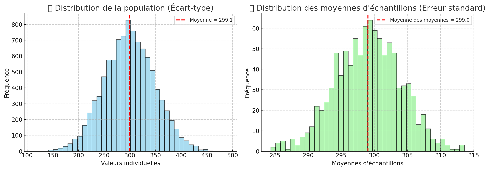

- Pour passer de l'un à l'autre, je dois simplement prendre $n$ individu $m$ fois et effectué la moyenne de chacun des échantillons.
Merci au tcl.

---

#### &#128269; **Interprétation** :

- **À gauche** : Distribution des **valeurs individuelles**
  - L’**écart-type ($\sigma$)** mesure la dispersion des individus autour de la moyenne.
  - Exemple : les temps passés par chaque utilisateur.

- **À droite** : Distribution des **moyennes d’échantillons**
  - L’**erreur standard ($\frac{\sigma}{\sqrt{n}}$)** mesure la dispersion des moyennes autour de la vraie moyenne.
  - Exemple : moyenne des temps de session sur 100 utilisateurs.

---
### **Mais j'ai une intuition...**
Changer le fond de l’app (passer du clair au sombre) va augmenter le temps passé sur l’application.

Quelle est ma $H_0$  ma $H_a$ ?

---
### **Il faut pouvoir tester cette hypothèse sérieusement**

Nous allons mettre en place une expérience A/B :
1.	Développer la fonctionnalité “mode sombre”
2.	Créer deux groupes d’utilisateurs :
    -  Groupe contrôle : reste en mode clair
    -  Groupe test : passe en mode sombre
3.	Sélectionner aléatoirement 100 utilisateurs pour le groupe test
4.	Déployer le mode sombre uniquement à ce groupe
5.	Mesurer le comportement (temps passé)

---

### **Analyser les résultats de l'expérience**
Après la collecte des données :
- Moyenne du groupe test : $\bar{X}_{100} = 310$ secondes
- Rappel : moyenne initiale attendue = $300$ secondes

&#10067; Est-ce que ces +10 secondes sont dues à l’effet réel du mode sombre ?
Ou juste au hasard ?

&#128073; Pour le savoir, on fera un test statistique avec une p-value dans les slides suivantes…

Mais d'abord visuellement qu'est ce que cela nous donne ? 

---
### **Analyser les résultats de l'expérience - Visuellement**

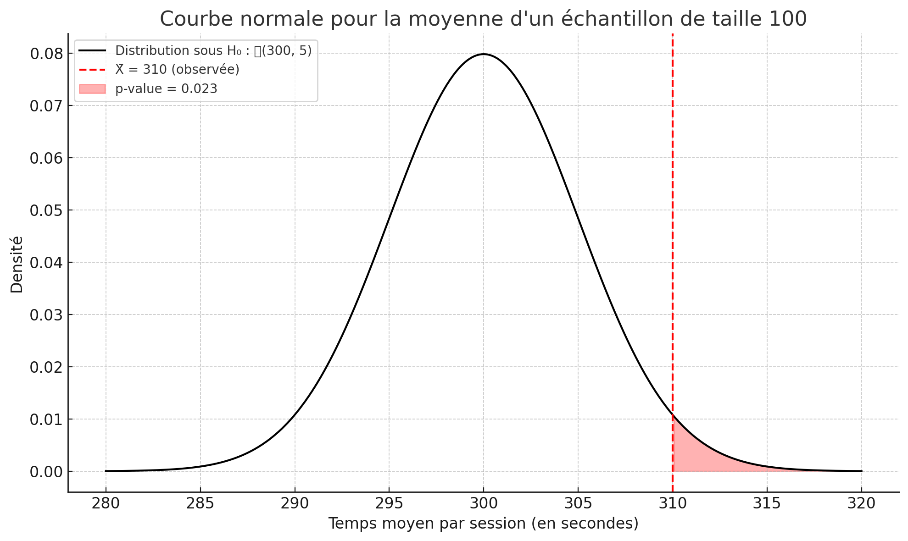
Imaginons cette courbe en cloche comme **le monde tel qu’il serait si le changement de couleur n’avait aucun effet (hypothèse nulle H₀).**
C’est une courbe de “ce qu’on s’attend normalement à observer” si le fond de l’app n’avait rien changé.

---
### **Analyser les résultats de l'expérience - Visuellement**

&#128308; Mais voilà ce qui s’est passé !

Notre moyenne observée est 310 secondes.
&#128073; Elle se situe dans la zone rouge, loin du centre de la courbe.

Cela signifie que ce résultat est rare (se produit très peu souvent).
&#10145; Donc il est **posiblement** statistiquement significatif : ce que nous voyons n’est **probablement** pas dû au hasard.

 Rappel important : On parle ici de la moyenne d’un échantillon, pas d’une valeur individuelle.
Et grâce au théorème central limite, on peut comparer cette moyenne à une loi normale pour savoir si elle est inhabituelle.

Conclusion : Si la moyenne est vraiment loin de ce qu’on attendait, on peut sérieusement envisager que notre nouvelle fonctionnalité a un effet réel.

---
### **Analyser les résultats de l'expérience - Visuellement**

C'est un peu comme si nous avions une deuxième distribution de moyenne $310$
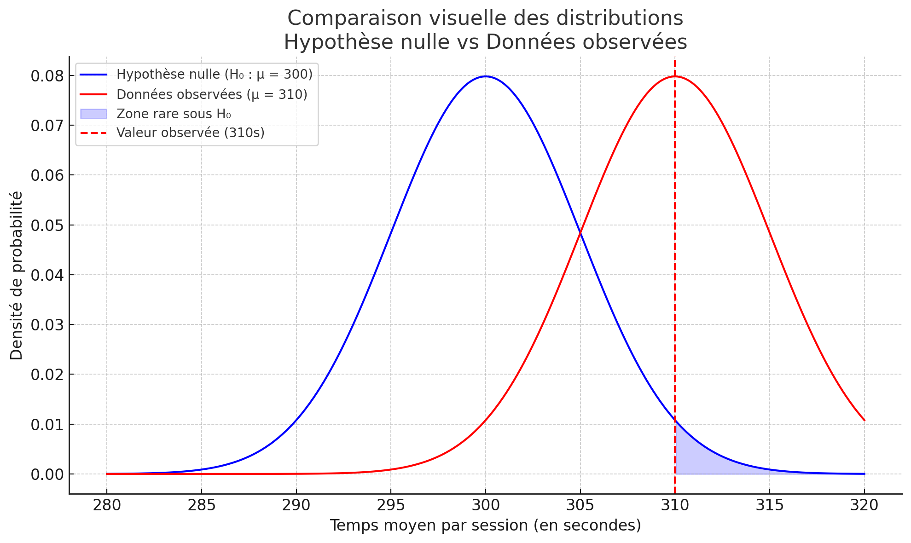

N'oubliez pas : Même si les temps individuels ne suivent pas une loi normale…
La distribution de toutes les moyennes possibles qu’on pourrait obtenir suivra une loi normale, si l’échantillon est assez grand. (TCL)

---
### **Analyser les résultats de l'expérience**

- Nombre d’utilisateurs : $N = 1000$
- Temps moyen habituel : $\mu = 300$ sec
- Écart type : $\sigma = 50$ sec
- Taille de l’échantillon : $n = 100$
- Moyenne observée (dark mode) : $\overline{X} = 310$
---

### **Analyser les résultats de l'expérience**

&#128161; Grâce au théorème central limite (TCL), on sait que :

$$
\overline{X} \sim \mathcal{N}(300,\frac{50}{\sqrt{100}}) = \mathcal{N}(300, 5)
$$

On veut connaître la probabilité d’obtenir une moyenne $\geq 310$ si l'hypothèse nulle est vraie.

---

### **Formule de la statistique Z :**

$$
z = \frac{\overline{X} - \mu}{\sigma / \sqrt{n}} = \frac{310 - 300}{5} = 2
$$

-	Sur la courbe normale centrée autour de $\mu = 300$ avec une erreur standard de 5,
-	La valeur 310 se trouve à 2 unités de distance vers la droite (positif), soit $z = 2$.

**Et alors ?**
-	Plus $Z$ est grand, plus notre résultat est étonnant, rare, donc moins probable d’être dû au hasard.
-	C’est ce $Z$ qu’on utilise pour calculer la p-value
-	Plus $Z$ est élevé, plus la p-value est petite (moins de chances que ce soit dû au hasard)

---

###  **Formule générale (test à droite)**

$$
\text{p-value} = P(Z \geq z) = 1 - \Phi(z)
$$

- $\Phi(z)$ : fonction de répartition de la loi normale standard $\mathcal{N}(0,1)$

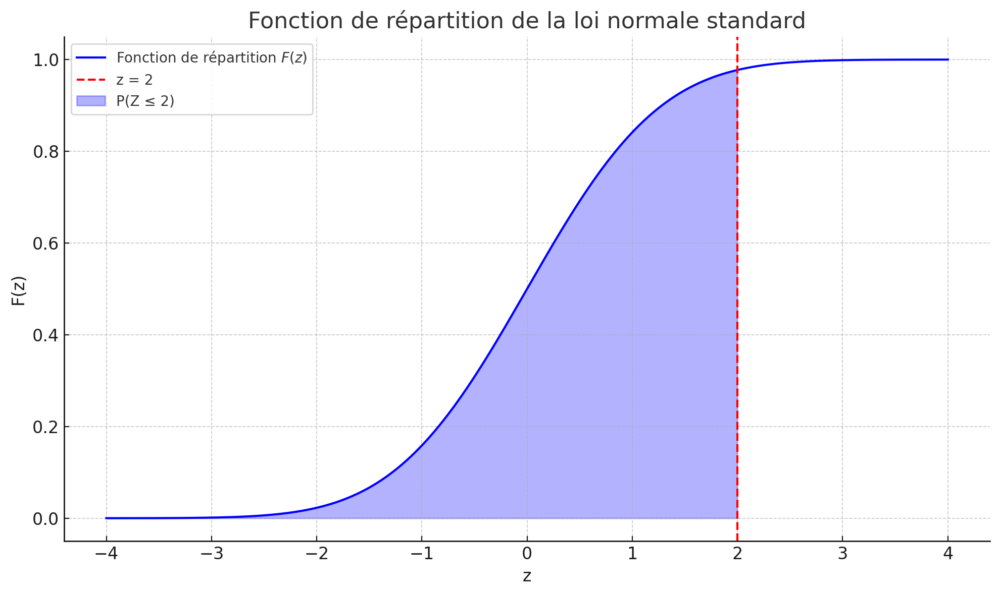

---
###  **Formule générale**
Il éxiste 3 cas possibles
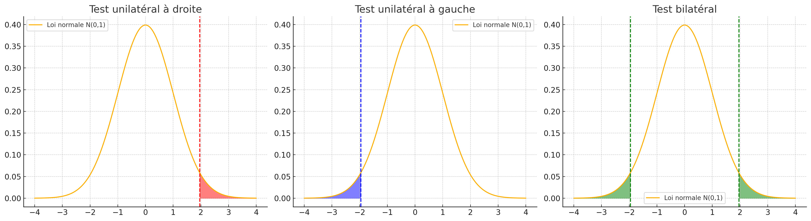

Différents calculs y sont associés: [En savoir plus sur les p-values](https://www.simplypsychology.org/p-value.html)

---

###  **Application à notre cas**

$$
\text{p-value} = 1 - \Phi(2) \approx 1 - 0.9772 = \boxed{0.0228}
$$

&#9989; **Conclusion** : Ce résultat a seulement **2.28% de chances** d’être dû au hasard.  
Il est donc **statistiquement significatif** si $\alpha = 0.05$

Ca ne prouve rien mais je suis en dessous du seuil de risque que je me suis fixé je peux donc affirmer que mon ma variable est significative dans la description d'un résultat. 

---

### **Analyser les résultats de l'expérience - Avec des chiffrest**

| Élément                 | Définition                                                                 |
|-------------------------|----------------------------------------------------------------------------|
| H₀ (hypothèse nulle)    | Le changement de couleur **n’a aucun effet** : μ = 300                    |
| Hₐ (hypothèse alternative) | Le changement **augmente** le temps passé : μ > 300                      |
| Statistique observée    | Moyenne observée : X̄ = 310                                                |
| Taille de l’échantillon | n = 100                                                                    |
| Erreur standard         | σ / √n = 50 / √100 = 5                                                     |
| p-value                 | ≈ 0.0227 (probabilité d’observer 310 ou plus si μ = 300)                   |
| Décision                | p < 0.05 donc **on rejette H₀**                                           |

---

#### &#128161; Résumé :

- L’**écart-type** : parle des **valeurs individuelles**
- L’**erreur standard** : parle des **moyennes d’échantillons**
- Et c’est **l’erreur standard** qu’on utilise pour construire les tests et les p-values !
---

### **Recap de la p-value** 1/2

1.	Hypothèse nulle ($H_0$) :
Sous $H_0$, on suppose que la moyenne des temps de session suit une distribution :
$$ \overline{X}_n \sim \mathcal{N}(300, \frac{50}{\sqrt{n}}) $$
Dans l'exemple, $n = 100$, donc :
$$ \overline{X}_n \sim \mathcal{N}(300, 5) $$
2.	Calcul  d'une probabilité de dépassement sous $H_0$ :
$$
\text{p-value} = P(\overline{X}_n \geq 310 \mid H_0)
$$

---

### **Recap de la p-value** 2/2

3.	Et maintenant la magie du TCL et de la loi normale standard entre en jeu :
On ne peut pas consulter directement une table de $\mathcal{N}(300, 5)$, donc on transforme cette variable en une loi normale standardisée $\mathcal{N}(0,1)$ avec la formule :
$$
Z = \frac{\overline{X}_n - \mu_0}{\sigma / \sqrt{n}} = \frac{310 - 300}{5} = 2
$$
4.	Et maintenant, on utilise $\Phi(z)$ (fonction de répartition de la loi normale centrée réduite) pour obtenir :
$$
P(\overline{X}_n \geq 310) = P(Z \geq 2) = 1 - \Phi(2)
$$

---
### **&#128640; Application en Data Mining**

#### &#128202; Validation des modèles
- Tester si les performances sont significativement meilleures
- Comparer différents algorithmes

#### &#128269; Sélection des features
- Identifier les variables significativement corrélées
- Éliminer les features non pertinentes

---

### **Le petit problème**

Nous n'utilisons pas le Z-score mais le T-test...
| Caractéristique       | Z-test                                | T-test                                |
|-----------------------|---------------------------------------|---------------------------------------|
| Écart-type            | On connaît $\sigma$ de la population | On ne connaît pas $\sigma$ (taille échantillon)            |
| Loi utilisée          | Loi normale standard                  | Loi t de Student                      |
| Taille d'échantillon  | Grand échantillon (ou population connue) | Fonctionne avec petits échantillons (notre dataset)   |

Dans les projets data:
-	Tu n’as jamais accès à toute la population → donc tu ne connais pas $\sigma$
-	Tu estimes l’écart-type des résidus à partir de ton échantillon (appelé $s$, l’écart-type empirique)
-	Du coup, tu ne peux pas calculer exactement un z, mais tu peux estimer un t

---
**Pourquoi ne pas utiliser la loi normale directement ?**
Parce que quand n est petit, la loi t :
-	A des queues plus épaisses (elle est plus prudente)
-	Donne des p-values plus grandes que la normale standard
-	T’attend de mieux connaître les données pour t’engager à dire que quelque chose est significatif

Donc la loi t est plus conservative, ce qui est plus honnête scientifiquement quand tu travailles avec des échantillons.
$$
t = \frac{\hat{\beta}}{SE(\hat{\beta})}
$$
-	$\hat{\beta}$ : le coefficient estimé
-	$SE(\hat{\beta})$ : l’erreur standard estimée du coefficient

---

Si vous obtenez une statistique t (comme $t = 2.3$), alors la p-value est :
$$
\text{p-value} = 1 - T_{df}(t)
$$
Où :
-	$T_{df}(t)$ est la fonction de répartition de la loi de Student à $df$ degrés de liberté (c’est-à-dire $P(T \leq t)$).
-	$1 - T_{df}(t)$ donne la probabilité d’avoir une valeur aussi extrême ou plus grande que celle observée.

---
### **T-distribution vs normal distribution**
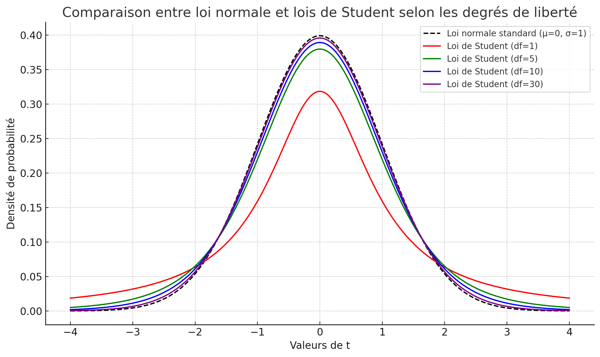

Quand tu as peu de données, il y a plus d’incertitude sur l’estimation de l’écart-type $\sigma$ via $s$ (l’écart-type de l’échantillon).
La loi de Student corrige cette incertitude avec des queues plus épaisses.
Mais quand n augmente :
-	$s$ devient une bonne estimation de $\sigma$
-	Et donc plus besoin de “corriger” la forme de la courbe : la loi normale suffit.

---
### **Répartition des lois de Student-t pour différents degrés de liberté**

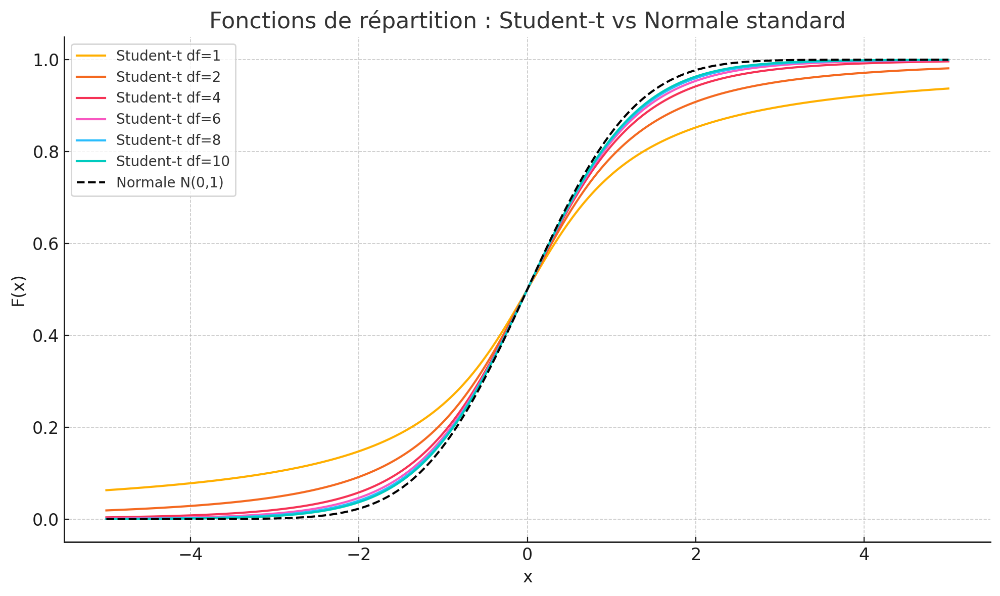

---

### &#128202; Si $n$ est **grand**

On peut utiliser la **loi normale** pour estimer la moyenne :

$$
T \sim Z = \frac{\overline{X} - \mu}{\sigma / \sqrt{n}} \sim \mathcal{N}(0,1)
$$

 On connaît l’écart-type de la population : $\sigma$  
 Le **théorème central limite (TCL)** garantit une distribution normale des moyennes

---

### &#128295; Si $n$ est **quelconque** (petit ou grand)

Et qu’on ne connaît pas l’écart-type de la population :

$$
T = \frac{\overline{X} - \mu}{s / \sqrt{n}} \sim \mathcal{T}_{n-1}(0,1)
$$

 On remplace $\sigma$ par $s$ (l'écart-type de l’échantillon)  
 On utilise la **loi de Student** avec $n-1$ degrés de liberté

---

### **Des indicateurs de sélection**

Nous avons maintenant déja deux élèments importants dans le cadre de la sélection de features.. 

Lesquels ? 

---
### À retenir 

- Les **moyennes d’échantillons** suivent une loi normale (merci le TCL)
- On teste des hypothèses en comparant ces moyennes à ce qu’on attendait
- La **p-value** mesure à quel point le résultat est surprenant sous $H_0$
- On utilise souvent un **t-test** quand on ne connaît pas l’écart-type de la population

---
<!-- header: 🎯 OverFitting et UnderFitting comment l'identifier ? -->

# 3. OverFitting et UnderFitting comment l'identifier ?

### **&#128202; Le dilemme du Machine Learning**

L'un des défis fondamentaux en Machine Learning est de trouver le bon équilibre entre :
- **Ajustement aux données d'entraînement**
- **Capacité à généraliser à de nouvelles données**

#### &#128269; Trois scénarios possibles

1. **UnderFitting** : Le modèle est trop simple
2. **Ajustement optimal** : Le modèle est bien calibré
3. **OverFitting** : Le modèle est trop complexe

Avez vous l'idée d'un **graphique** permettant de voir s'il y a overfitting ou non ?  

---

### **Comprendre la learning curve**

1. CrossValidation 
2. LearningCurve

---

### **Pourquoi faire de la Cross Validation ?**

Lorsqu’on découpe nos données en $y_{\text{train}}$ et $y_{\text{test}}$, on peut se poser plusieurs questions :
-	Comment savoir si ce découpage est représentatif ?
-	Et si on était tombé par hasard sur un bon ou un mauvais découpage ?
-	Notre modèle généralise-t-il vraiment, ou juste sur ce split particulier ?

La validation croisée (comme le k-Fold) répond à cela en :
-	Testant le modèle sur plusieurs découpages différents
-	Donnant une moyenne des performances sur tous ces splits
-	Évitant de sur-apprendre un seul jeu de données

---

### **Comment fonctionne la cross validation** (1/3)

Le concept est simple :
1.	 Définir le nombre de splits $n$ (souvent $n = 5$ ou $10$)
2.	 Diviser le dataset en $n$ groupes (appelés folds)
3.	 À chaque itération :
    - 	Un fold est utilisé comme jeu de test
    - 	Les $n - 1$ autres folds sont utilisés pour entraîner le modèle
4.	 On calcule un score (ex: RMSE, MAE, F1, Recall, etc.)
5.	 À la fin, on moyenne tous les scores pour obtenir une évaluation globale

Chaque observation du dataset est utilisée exactement une fois pour tester, et n - 1 fois pour entraîner.

---
### **Comment fonctionne la cross validation** (2/3)

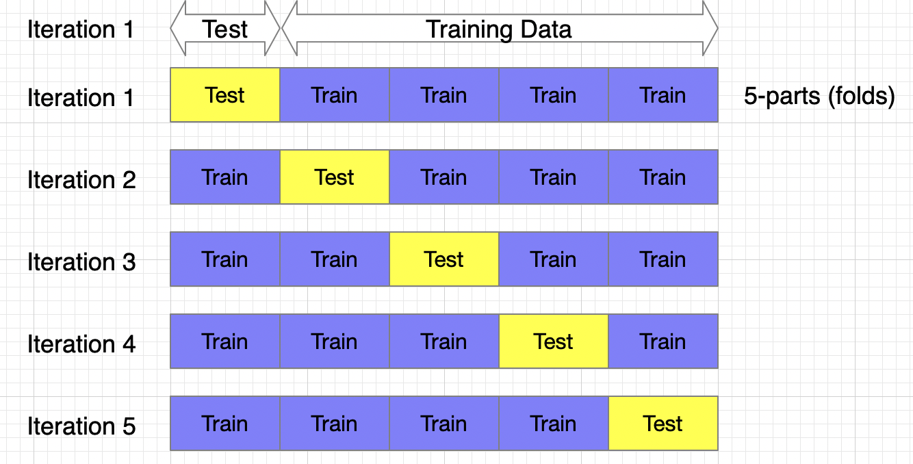

---
### **Comment coder la cross validation** (3/3)

  

    train_test_split
  

  

**1. Création d’un dataset fictif**
X, y = make_regression(n_samples=100, n_features=1, noise=15)

**2. Modèle de régression linéaire**
model = LinearRegression()

**3. Validation croisée en 5 folds, scoring avec R²**
scores = cross_val_score(model, X, y, cv=5, scoring='r2')
print("Scores pour chaque fold :", scores)
print("Score moyen :", np.mean(scores))
  

Retenez bien cela : la validation croisée (**CV**) permet de savoir si notre modèle est capable de généraliser, c’est-à-dire bien performer sur différents sous-échantillons du jeu de données, ce qui approxime sa capacité à généraliser à l’ensemble de la population.

---
### **Une learning curve avec de la CV**

Une learning curve ressemble à cela:
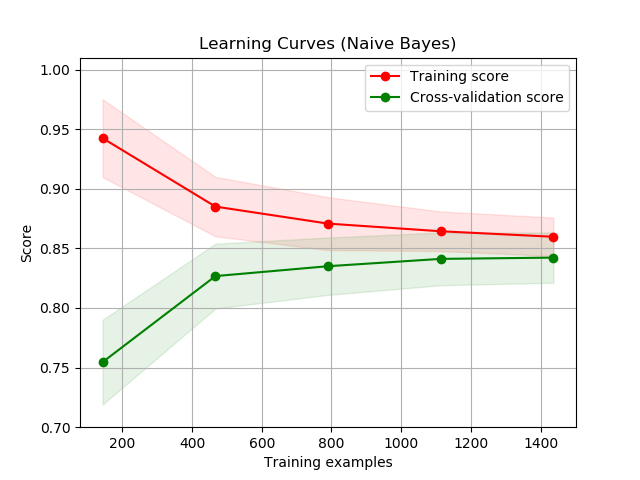

Qu'est ce qu'on peut y voir ? 

---

### **Une learning curve avec de la CV**

1.	On divise notre jeu de données :
    -	80 % pour l’entraînement ($X_{\text{train}}$) et 20 % pour le test ($X_{\text{test}}$)
2.	On effectue une série d’itérations progressives :
    -	À chaque itération, on augmente la taille du set d’entraînement 
3.	Pour chaque taille de jeu d’entraînement :
    -	On effectue une validation croisée à 5 folds **et** On calcule la moyenne des scores 
4.	Pour chaque taille, on entraîne un modèle final sur ce sous-ensemble et on :
    -	Évalue la performance sur le jeu de test (fixe) **et** Stocke et affiche les résultats
5.	On trace ensuite les performances en fonction de la taille du jeu d’entraînement :
    -	Score d’entraînement
    -	Score de validation croisée
    -	Score sur test
---
###  **Interpréter une Learning Curve**

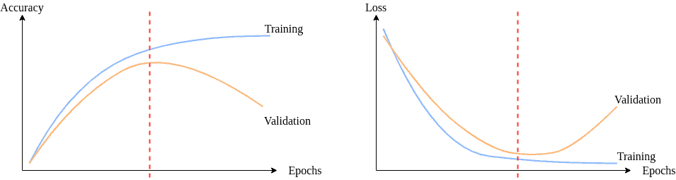

-  **Overfitting** : Le modèle apprend **trop bien** sur le train, mais **échoue à généraliser** sur des données nouvelles.  

-  **Underfitting** : Le modèle est **trop simple** pour les données.  

-  **Bon ajustement** : Les courbes de train et validation se **rapprochent**, avec de **bonnes performances** globales.

 La learning curve t’aide à savoir si **ton modèle a besoin de + de données**, **moins de complexité**, ou **plus de régularisation**.

---
### **Comment coder une learning curve** (3/3)

Pour voir un exemple de code complet pour créer une learning curve, consultez la documentation officielle de scikit-learn :  
[Scikit learn pour la learning curve](https://scikit-learn.org/stable/auto_examples/model_selection/plot_learning_curve.html#sphx-glr-auto-examples-model-selection-plot-learning-curve-py)

---

### **Une information en plus** 

Que pouvez vous me dire de ce graphique: 
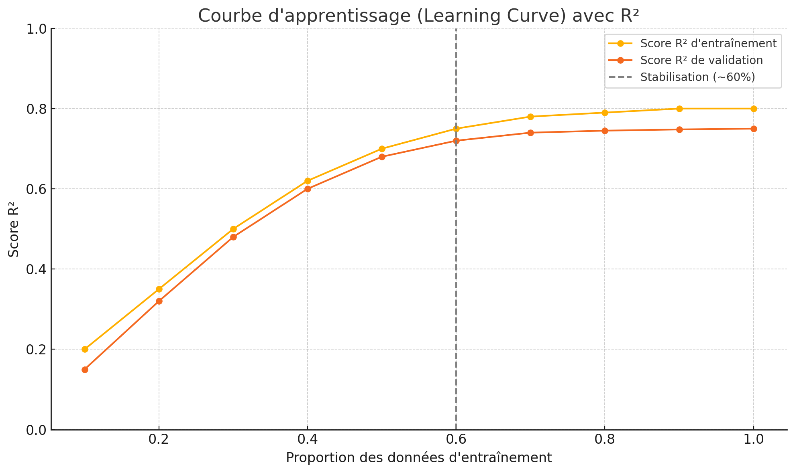

---

### **Une information précieuse à retenir** 

La learning curve nous donne également un indice crucial :
- Elle permet d’estimer la quantité de données nécessaires pour entraîner un modèle sans perte significative de performance.

Dans notre cas, on observe que le score se stabilise autour de 65 % des données d’entraînement.
- Cela signifie qu’ajouter plus de données n’apporte plus de réel gain.

On peut donc construire notre modèle avec cette quantité, réduisant ainsi le coût d’entraînement, en temps comme en ressources.

---

Des questions ?
