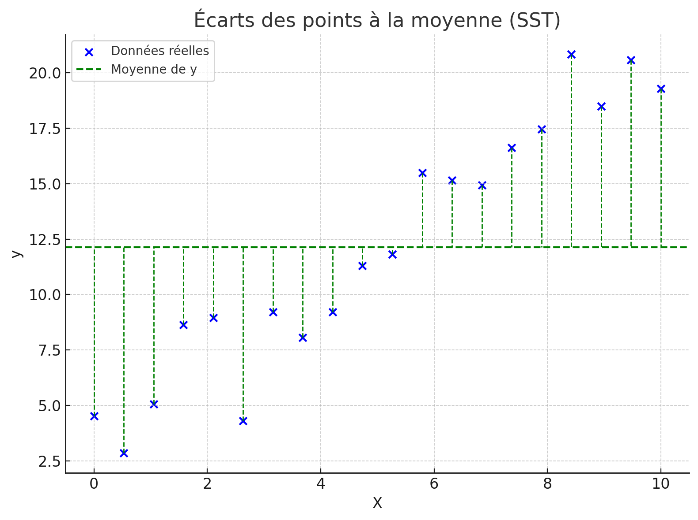
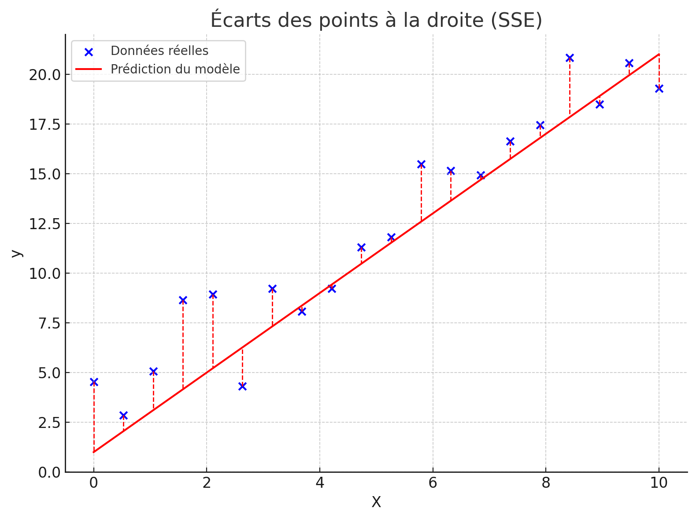
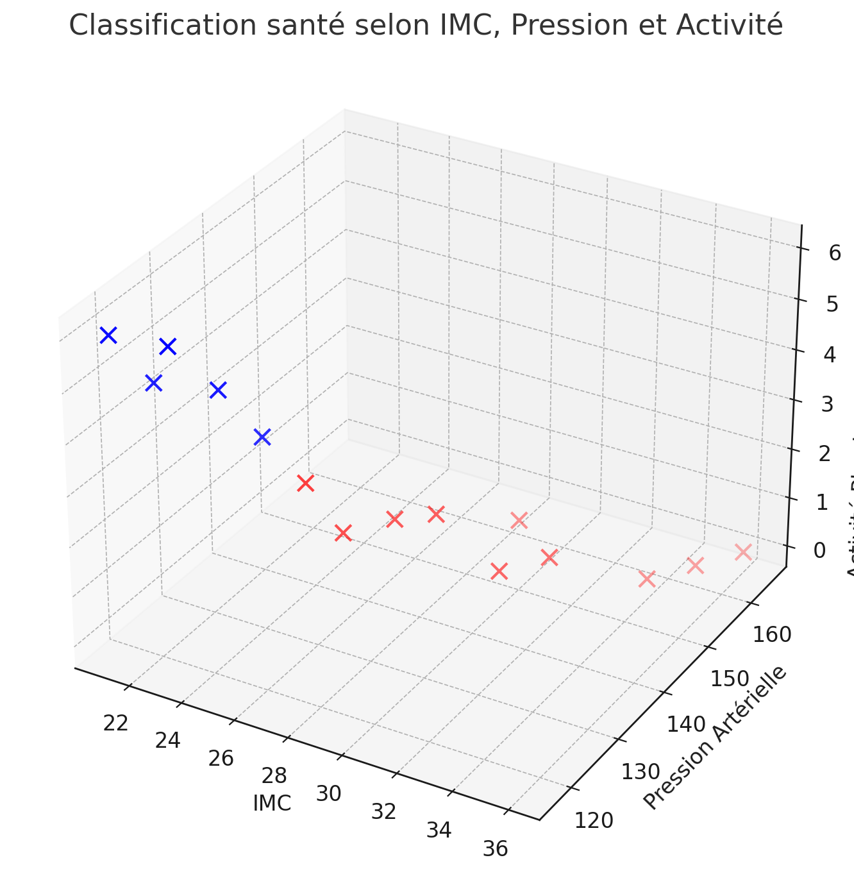
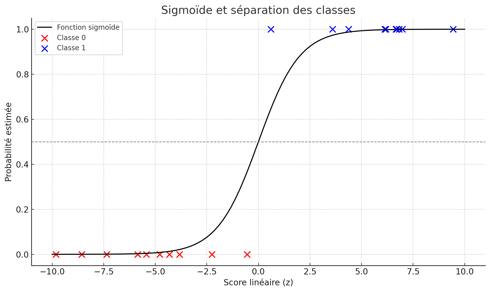
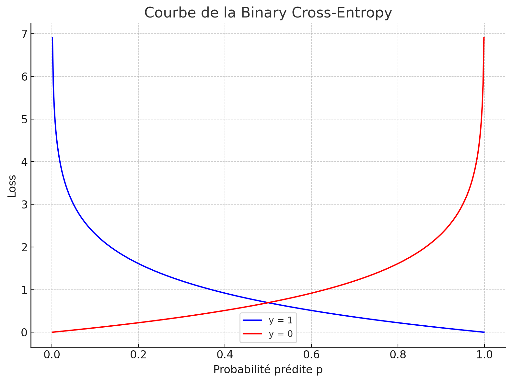
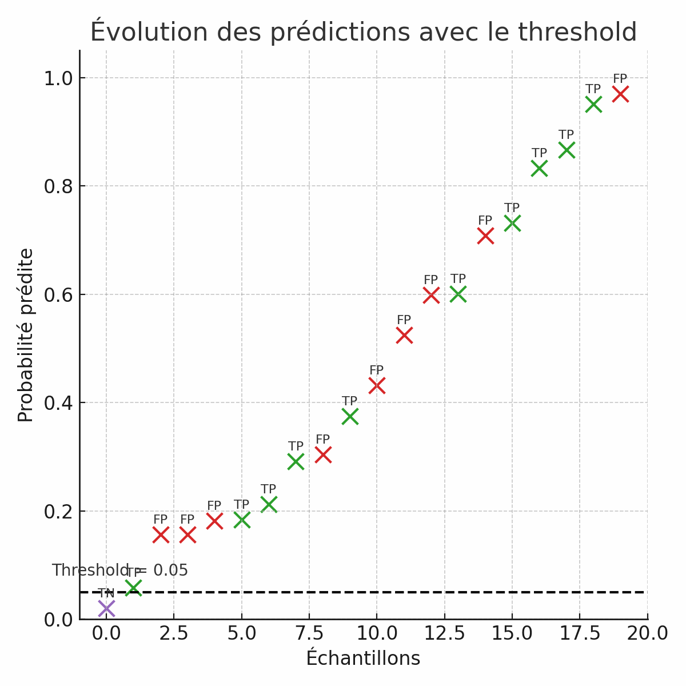
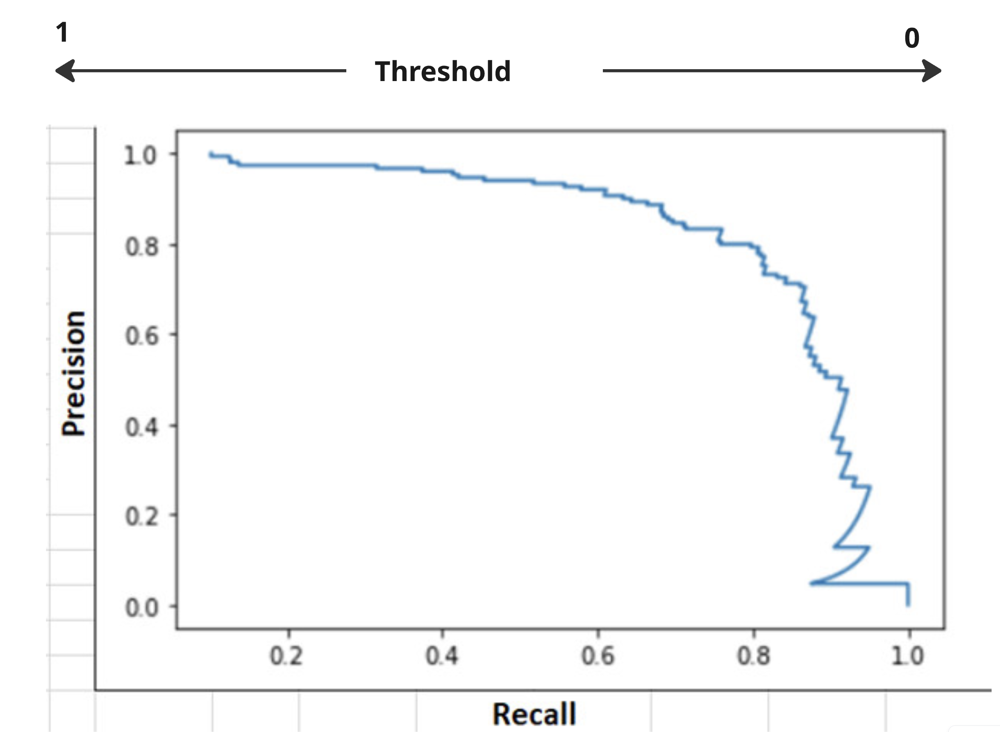
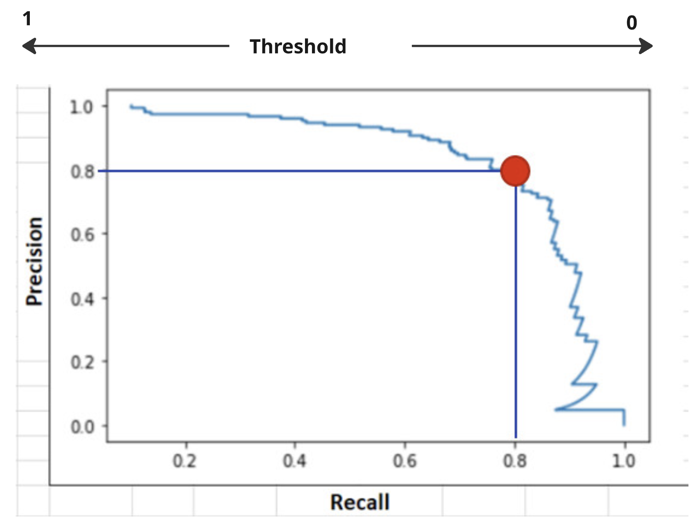

<!-- _class: title -->

# Le Data Mining

 

Christopher de Boisvilliers

2025-04-08

------
<!-- header: ⭐️ Plan du cours -->

# **Plan du cours**
- Les fonctions de pertes et les scores dans la Régression
- Les problèmes de classification supervisés
- La Régression logistique 
- Le scoring en classification

---
<!-- header: Les fonctions de pertes et les scores dans la Régression -->

### **Objectifs du début de cours**

- Revoir les principales **fonctions de perte** utilisées en régression
- Savoir interpréter les **scores** d’un modèle
- Comprendre les **avantages/inconvénients** des métriques
- Poser les bases de comparaison entre modèles (cross-val, tuning...)

---

### **Petit rappel : la régression linéaire**

On cherche à prédire une **valeur continue** $\hat{y}$ à partir de variables $x_1, x_2, ..., x_n$ selon :

$$
\hat{y} = \beta_0 + \beta_1x_1 + \beta_2x_2 + ... + \beta_nx_n
$$

Le but est de **minimiser l’écart entre les prédictions et les valeurs réelles** $y$.

---

###  **La fonction de perte MSE (Mean Squared Error)**

$$
MSE = \frac{1}{n} \sum_{i=1}^{n} (y_i - \hat{y}_i)^2
$$

- **Erreur quadratique moyenne**
- Pénalise fortement les **grandes erreurs**
- Utilisée dans la descente de gradient

> Sensible aux **outliers** !

---

###  **La fonction MAE (Mean Absolute Error)**

$$
MAE = \frac{1}{n} \sum_{i=1}^{n} |y_i - \hat{y}_i|
$$

- **Erreur absolue moyenne**
- Moins sensible aux valeurs extrêmes que le MSE
- Reflète l’erreur moyenne attendue sur une prédiction

> Moins utilisée pour la descente de gradient (non différentiable en 0)

---

###  **RMSE : une version racinée du MSE**

$$
RMSE = \sqrt{MSE} = \sqrt{\frac{1}{n} \sum_{i=1}^{n} (y_i - \hat{y}_i)^2}
$$

- Donne l’erreur **dans la même unité que la variable cible**
- Interprétation plus facile pour un client ou non-spécialiste

---

###  **Le score $R^2$ : Coefficient de détermination**

$$
R^2 = 1 - \frac{\sum (y_i - \hat{y}_i)^2}{\sum (y_i - \bar{y})^2}
$$

- Représente la **part de la variance expliquée par le modèle**
- Compris entre $0$ et $1$ (parfois négatif si le modèle est très mauvais)
- $R^2 = 1$ : prédiction parfaite  
  $R^2 = 0$ : pas mieux qu’une moyenne

Ce score est un simple ratio entres:
- La somme de la distance quadratique  entre la moyenne calculé sur notre variable cible $y$ et notre variable cible
- La somme de la distance quadratique  entre la droite de regression calculé et notre variable cible $y$ et notre variable cible

---
###  **Le score $R^2$ : Coefficient de détermination - Visuellement**

    
    

Ce ration me permet de conclure que je suis que la moyenne est à quel points. 

---

### **Comparaison des pertes**

| Métrique | Sensibilité aux outliers | Interprétable | Utilisable en gradient ? |
|----------|--------------------------|----------------|----------------------------|
| MSE      |  Forte               |  Moyenne     | Oui                    |
| MAE      |  Faible               |  Très bonne        |  Non (non différentiable)     |
| RMSE     |  Forte               |  Très bonne  (sqrt)  |  Oui                    |
| $R^2$    |  Globale             |  Oui    (entre 1 et 0)         |  Non (score, pas perte)     |

---

###  **En résumé**

- Le MSE est **la perte la plus classique** pour entraîner un modèle
- Le MAE est **robuste aux valeurs extrêmes**
- Le RMSE est une **bonne synthèse interprétable**
- Le score $R^2$ est **le plus utilisé pour juger de la qualité globale** du modèle

> Choisissez la métrique selon le contexte du projet et les attentes de l’utilisateur !

---

<!-- header: ⭐️ Problème de classification -->

### **L'idée générale ? 1/4**

Objectif de la classification supervisée
	•	On cherche à prédire une catégorie à partir de données.
	•	Chaque observation est décrite par des caractéristiques ($X$) et associée à une étiquette ($y$) **connue**.

Exemples :
	•	  Prédire si un mail est spam ou non spam
	•	  Dire si un patient est malade ou en bonne santé
	•	  Identifier la marque d'une voiture selon son design

Le modèle apprend à reconnaître les motifs dans les données pour classer correctement de nouveaux cas.

---

### **L'idée générale ? 2/4**

Prenons le dataset suivant : 
| Âge | IMC | Pression Artérielle | Activité Physique (h/semaine) | Santé        |
|-----|-----|----------------------|-------------------------------|--------------|
| 25  | 22  | 120                  | 4                             | Bonne santé  |
| 45  | 30  | 140                  | 1                             | Mauvaise santé |
| 30  | 25  | 125                  | 3                             | Bonne santé  |
| 60  | 32  | 150                  | 0                             | Mauvaise santé |
| 35  | 27  | 130                  | 2                             | Bonne santé  |
| 55  | 35  | 160                  | 1                             | Mauvaise santé |

Notre variable à prédire ($y$) ici est santé. 

---

### **L'idée générale ? 3/4**

Voici la représentation de cet échantillon dans un plan en 3 dimensions:

---

### **L'idée générale ? 4/4**

Comment faire ? 

Comme avec la régression linéaire, il va falloir appliquer un modèle sur nos données.

Ce modèle aura un but principal, séparer nos données en plusieurs groupes. Ici deux.

Nous allons voir de façon succinte dans la suite de ce cours comment faire pour utiliser  la régression logistique 

---

<!-- header: ⭐️ Régression logistique -->

### **L'idée de la régresion logistique**

Au lieu de trouver la meilleure ligne droite comme une régression linéaire pour prédire des données linéaire nous allons essayer de tracer une sigmoïd. 
Un peu comme cela:

En bleu la classe 1 et rouge 0.

---

### **L'idée de la régresion logistique**

Dans l'espace que nous avons, et des $beta$ calculés lors d'une prediction sur notre modèle nous obtiendrons un score de probabilité. De manière generale le seuil (**threshold**) est à $p=0.5$.

- Si $p<0.5$ alors $y_{pred}=0$
- Si $p>0.5$ alors $y_{pred}=1$

---

### **La loss de la régression logistique**

Formule de la binary Cross-Entropy:
$$
\mathcal{L} = -\frac{1}{n} \sum_{i=1}^{n} \left[ y_i \log(p_i) + (1 - y_i) \log(1 - p_i) \right]
$$

Pour mieux comprendre la binary cross-entropy, voici une excellente vidéo explicative :

> [Vidéo explicative de la binary cross-entropy](https://www.youtube.com/watch?time_continue=303&v=DPSXVJF5jIs&embeds_referring_euri=https%3A%2F%2Ftowardsdatascience.com%2F&source_ve_path=MzY4NDIsMjM4NTE)

--- 

### **Intérpretation de la loss $\mathcal{L}$**

| Élément | Signification |
|---------|---------------|
| $\mathcal{L}$ | Fonction de perte moyenne (loss) |
| $n$ | Nombre total d'exemples dans le dataset |
| $\sum_{i=1}^{n}$ | Somme sur tous les exemples |
| $y_i$ | Véritable classe de l'exemple $i$ (0 ou 1) |
| $p_i$ | Probabilité prédite que $y_i = 1$ (issue de la fonction sigmoid)  |
| $y_i \log(p_i)$ | Pénalise les erreurs quand la vraie valeur est 1 |
| $(1 - y_i) \log(1 - p_i)$ | Pénalise les erreurs quand la vraie valeur est 0 |

**Attention** : $p_i = \hat{y}_i = \frac{1}{1 + e^{-\beta^T x_i}}$

--- 

### **Intérpretation de la loss visuellement**

Plus on es proche de 1? Plus on est proche de 0 ? Dans quel cas ? 

Pour plus de détails sur l'implémentation de la régression logistique dans scikit-learn :

[Documentation de LogisticRegression dans scikit-learn](https://scikit-learn.org/stable/modules/generated/sklearn.linear_model.LogisticRegression.html)

---

### **Hypothèses de la régression logistique (1/2)**

La régression logistique a moins d'hypothèses que la régression linéaire, mais certaines doivent toujours être respectées pour garantir des résultats interprétables.

| Hypothèse | Description |
|-----------|-------------|
| 🔄 Indépendance des observations | Chaque ligne du dataset doit être indépendante (pas de doublons, pas de séries temporelles sans traitement) |
| ➕ Relation linéaire avec les log-odds | La relation entre chaque variable explicative $x_i$ et $\log(\frac{p}{1-p})$ doit être linéaire. Sinon, il faudra transformer $x_i$ |
| ❌ Pas de multicolinéarité excessive | Deux variables explicatives ne doivent pas dire "la même chose". On vérifie cela avec le VIF |

---

### **Hypothèses de la régression logistique (2/2)**

| Hypothèse | Description |
|-----------|-------------|
| 📏 Absence de valeurs extrêmes | Les outliers peuvent déséquilibrer les coefficients du modèle. On les visualise avec des boxplots ou des scatterplots |
| 🧮 Échantillon suffisamment grand | On recommande au moins 10 événements (classe 1) par variable explicative pour une estimation fiable des $\beta$ |

---

### **Bonnes nouvelles** :

- Pas besoin d'avoir une variable cible normalement distribuée
- Pas besoin d'homoscédasticité (erreurs avec même variance)  
- Pas besoin de résidus normalement distribués

La logistique est plus souple, mais l'interprétation des coefficients reste sensible aux violations d'hypothèses.

---

<!-- header:  Le scoring en classification -->

### **Les métriques de base**

Pour des prédictions binaires (0 ou 1), on utilise :

- **Accuracy** : proportion de bonnes prédictions 
- **Précision** : parmi les positifs prédits, combien sont corrects ?
- **Reccal** : parmi les vrais positifs, combien ont été trouvés ?
- **F1-score** : compromis entre précision et rappel.

> Ces scores se basent sur la **matrice de confusion** :

|             | Prédit = 1 | Prédit = 0 |
|-------------|------------|------------|
| Vrai = 1    | TP         | FN         |
| Vrai = 0    | FP         | TN         |

---

### **La matrice de confusion la base des différent scores**

Qui peut expliquer cette matrice de confusion : 

|                | $\hat{Y}$ Positif    | $\hat{Y}$ Négatif    |
|----------------|-------------------|-------------------|
| $Y$ Positif   ✅  | TP (Vrai Positif) | FN (Faux Négatif) |
| $Y$ Négatif 🅾️   | FP (Faux Positif) | TN (Vrai Négatif) |

---

### **L'accuracy**

L'accuracy représente le **pourcentage** de données bien classés:

$Accuracy=\frac{TP+TN}{TP+TN+FP+FN}$

Avec en numérateur, la somme des bonnes prédictions et en dénomniateur la somme total de nos prédiction bonnes ou mauvaise (Égale à notre échantillon train). 

Pour plus de détails sur l'implémentation de l'accuracy dans scikit-learn :

  

    <a href="https://scikit-learn.org/stable/modules/generated/sklearn.metrics.accuracy_score.html#sklearn.metrics.accuracy_score" class="card-link">
      📚
      Documentation de accuracy_score dans scikit-learn
      →
    </a>
  

---
### **Les dangers de l'accuracy**
|                | $\hat{Y}$ Positif    | $\hat{Y}$ Négatif    |
|----------------|-------------------|-------------------|
| $Y$ Positif   ✅  | 1 | 9|
| $Y$ Négatif 🅾️   | 0 | 90 |

>Ici le score nous donnerais : $\frac{1+90}{0+90+1+9}=0.91$

Étrange non ? 
Se fier uniquement à l’accuracy peut donner une impression trop optimiste des performances, surtout lorsque les classes sont déséquilibrées.

Utilisez l’accuracy uniquement lorsque :
	•	Les classes cibles sont équilibrées
	•	La prédiction de chaque classe a la même importance

---

## **Recall : Sensibilité**

- Le **recall** mesure la capacité du modèle à **détecter les cas positifs réels**.
- Il correspond à la proportion de **vrais positifs** parmi **tous les cas réellement positifs**.

$$
\text{Recall} = \frac{TP}{TP + FN}
$$

- **TP (True Positives)** : Positifs correctement prédits  
- **FN (False Negatives)** : Positifs oubliés par le modèle  

  

    <a href="https://scikit-learn.org/stable/modules/generated/sklearn.metrics.accuracy_score.html#sklearn.metrics.accuracy_score" class="card-link">
      📚
      Documentation de accuracy_score dans scikit-learn
      →
    </a>
  

---

  ##  **Quand utiliser le Recall ?**

**À privilégier lorsque** :

- Il est crucial de ne **rater aucun cas positif**
- Mieux vaut **des faux positifs que des faux négatifs**

Exemples :
- Détection de fraude
- Maladies rares
- Surveillance incendie

---

### **Exemple du recall qui pose problème :**

|                | $\hat{Y}$ Positif    | $\hat{Y}$ Négatif    |
|----------------|-------------------|-------------------|
| $Y$ Positif   ✅  | 27 | 3|
| $Y$ Négatif 🅾️   | 100 | 10 |

>$$
\text{Recall} = \frac{27}{27+3} = 0.9
$$

**Aucune information sur les mauvaises prédictions quand $y=0$**

---

### **Precision : Précision des prédictions positives**

- La **precision** mesure la proportion de **vrais positifs parmi les cas prédits comme positifs**.

$$
\text{Precision} = \frac{TP}{TP + FP}
$$

- **TP (True Positives)** : Bien classés comme positifs  
- **FP (False Positives)** : Mauvais positifs (faux espoirs)

---

### **Exemple problématique :**

|                | $\hat{Y}$ Positif    | $\hat{Y}$ Négatif    |
|----------------|-------------------|-------------------|
| $Y$ Positif   ✅  | 356 | 900|
| $Y$ Négatif 🅾️   | 44 | 10 |

$$
\text{Precision} = \frac{356}{356 + 44} = 0.89
$$

---

### **F1 score**

- Le F1 score combine **précision** et **rappel** dans une seule mesure.

$$
F_1 = 2 \cdot \frac{\text{Precision} \cdot \text{Recall}}{\text{Precision} + \text{Recall}}
$$

- F1 est **faible si l’un des deux scores est faible**
- Permet de comparer des modèles de manière globale

---

### **Quand utiliser le F1 Score ?**

À utiliser quand :
- Vous cherchez un **compromis entre précision et rappel**
- Les classes sont **déséquilibrées**
- Vous voulez **comparer objectivement différents modèles**

---

### **Les scores avec scikit learn**

  

    Score
  

  

from sklearn.metrics import accuracy_score, precision_score, recall_score, f1_score
y_true = [1, 0, 1, 1, 0, 1, 0, 0, 1, 0]
y_pred = [1, 0, 1, 0, 0, 1, 1, 0, 1, 0]

accuracy = accuracy_score(y_true, y_pred)
precision = precision_score(y_true, y_pred)
recall = recall_score(y_true, y_pred)
f1 = f1_score(y_true, y_pred)

print(f"Accuracy  : {accuracy:.2f}")
print(f"Precision : {precision:.2f}")
print(f"Recall    : {recall:.2f}")
print(f"F1 Score  : {f1:.2f}")
  

---

### **Résumé des scores communs**

| Score | Interprétation  |
|-------|-----------------------------------|
| Accuracy | % de bien classés |
| Précision (Precision) | Sur les positifs prédits, combien sont corrects |
| Rappel (Recall) | Sur les vrais positifs, combien ont été trouvés |
| F1-Score | Moyenne harmonique de précision et rappel |

> Le but du jeu est de reussir à optimiser notre **Précision** ainsi que notre **Rappel**.
---

### **Optimisation de notre Precision et de notre Recall**

Intuition: Si je bouge mon threshold ($p=0.5$) que se passera t'il pour mon recall et ma précision ? 

Des FN peuvent devenir des TP et des FP peuvent devenir des TN...

---

### **Optimisation de notre Precision et de notre Recall**

N'oubliez pas que nous voulons optimiser notre Recall et notre Précision. 
Nous voulons le moment ou les deux scores sont les plus élevés... 

Une idée ? 

---

### **Optimisation de notre Precision et de notre Recall**

**Si je bouge le threshold, que se passe-t-il ?**

TP, TN etc changent...

Nous allons afficher la courbe du *tradeoff* entre **recall** et **precision**

---

### **Optimisation de notre Precision et de notre Recall**

Ou se situe notre meilleur threshold ? 

---

### **Optimisation de notre Precision et de notre Recall**

Visuellement nous pouvons avoir une idée du threshold le plus intéressant...

Voir les notes pour comprendre comment faire.

---

### **Résumé des métriques de classification**

| **Métrique**     | **À utiliser quand...**                                                                 |
|--------------------|--------------------------------------------------------------------------------------------|
| **Accuracy**       | Vous voulez savoir si votre modèle **prédit bien en général**, sans focus sur une classe. |
| **Recall**         | Vous souhaitez **capturer le plus d'occurrences possibles** d'une classe (éviter les FN). |
| **Precision**      | Vous voulez être **très sûr de vos prédictions positives** (éviter les FP).               |
| **F1 Score**       | Vous cherchez un **compromis entre precision et recall** pour comparer les modèles.       |

---
### **Résumé des métriques de classification**

- La coubre de tradeoff precision$X$recall

 
À voir dans le TP:

- Roc AUC comment le mettre en place

  - [Documentation ROC AUC Score](https://scikit-learn.org/stable/modules/generated/sklearn.metrics.roc_auc_score.html#sklearn.metrics.roc_auc_score)
  - [Documentation ROC Curve](https://scikit-learn.org/stable/modules/generated/sklearn.metrics.roc_curve.html#sklearn.metrics.roc_curve)

---

### **Pourquoi 1 ?**

| Raison | Explication |
|--------|-------------|
|  Par convention | La classe positive est codée 1 (fraude, maladie, achat) |
|  Intérêt métier | On cherche à détecter un événement particulier (classe 1 = cas intéressant) |
|  Métriques | Precision, Recall, F1-score évaluent la capacité à bien détecter les "1" |
|  Modélisation | La régression logistique prédit $p(y=1\|x)$ |
|  En entreprise | On veut prédire : "Va-t-il acheter ? Est-ce une fraude ? Est-ce un spam ?" → 1 |

---

Des questions ? 