<!-- _class: title -->

# Le Data Mining

<br/>

## Cours 5 — Du texte aux vecteurs

<br/>

Christopher de Boisvilliers

2026-11-02

---

<!-- header: ⭐️ Plan de la séance -->

### **Plan de la séance**

<div class="cols">
<div style="flex:1.2;">

1. Pourquoi le texte pose problème
2. Du texte aux tokens
3. La distance d'édition
4. Sac de mots et cosinus
5. TF-IDF
6. Des mots aux vecteurs : Word2Vec
7. Limites et synthèse

</div>
<div class="small" style="border-left:2px solid #dbe4f7; padding-left:18px;">

**La suite du module**

<span style="color:#3d65f6; font-weight:700;">5 · Du texte aux vecteurs</span>

6 · Embeddings et Transformers

7 · Recherche vectorielle

8 · RAG avec LangChain

9 · Évaluer et industrialiser

</div>
</div>

<div class="note">

Aujourd'hui : **2 h 30 de cours**, puis **1 h de TP**. Fil rouge : construire la barre de recherche d'un petit site.

</div>

---

### **Objectifs de la séance**

<div class="cols mid">
<div style="flex:1.3;">

À la fin de la séance, vous saurez :

- **préparer** un texte : normaliser, découper, retirer les stop words ;
- **comparer** des mots/textes : distance d'édition, cosinus ;
- **construire** des vecteurs : comptages, TF-IDF ;
- **expliquer** le principe de Word2Vec ;
- **choisir** une représentation selon la question posée.

</div>
<div>


</div>
</div>


---

<!-- header: ⭐️ Pourquoi le texte pose problème -->

### **Deux phrases, une même scène**

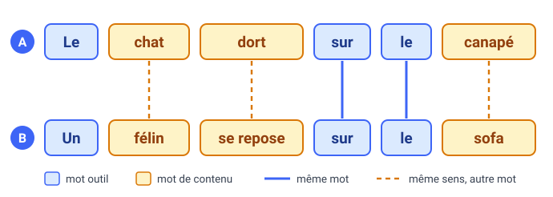

Pour nous, A et B décrivent la même scène. Un programme qui compare les mots n'y trouve que deux points communs, `le` et `sur` : des **mots outils**, qui structurent la phrase sans rien dire de la scène. Les **mots de contenu** (`chat`, `dort`, `canapé`…) n'ont aucune forme en commun.

<div class="ask">

Comment un programme peut-il mesurer la ressemblance entre ces deux phrases ?

</div>

---

### **Pourquoi est-ce si difficile ?**

| Difficulté | Exemple |
|---|---|
| Un mot, plusieurs sens | `avocat` : le fruit ou le métier |
| Une idée, plusieurs mots | `voiture`, `auto`, `bagnole` |
| Des mots nouveaux | `googliser`, `chanmé` |
| Plusieurs écritures | `été`, `ÉTÉ`, `ete` |
| Une phrase ambiguë | « J'ai vu l'homme avec le télescope. » |

Dans la dernière phrase, qui tient le télescope ? Les mots seuls ne permettent pas de trancher.

Aucune de ces difficultés ne se règle en comptant des mots. Nous allons pourtant commencer par là : c'est simple, et cela marche souvent très bien.

---

### **Quatre niveaux d'analyse**

Les linguistes décrivent une phrase à plusieurs niveaux, du plus local au plus global.

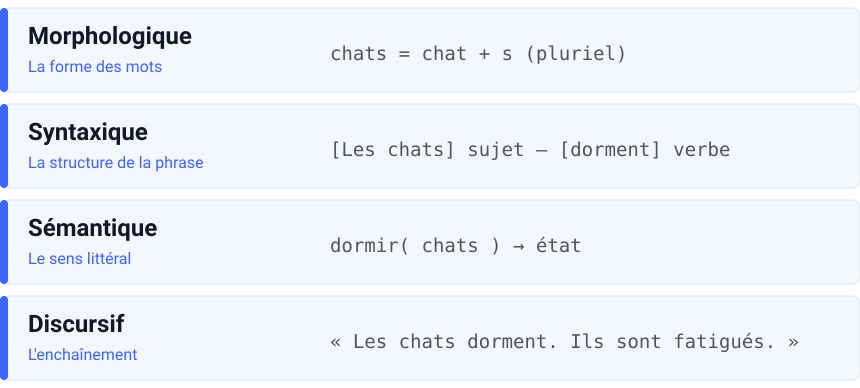

Les méthodes de ce cours restent au niveau des mots : leur forme, leur fréquence, leurs voisins. Les niveaux syntaxique et discursif demandent de lire la phrase entière, ce que feront les Transformers en séance 6.

---

### **Le chemin de la séance**


On avance de gauche à droite. Chaque étape est d'abord faite à la main sur un petit exemple, puis avec scikit-learn.

<div class="note">

Le sens d'un mot selon sa phrase (le contexte) n'apparaît pas encore dans cette chaîne. Ce sera le sujet de la séance 6.

</div>

---

### **Le fil rouge : une barre de recherche**

Toute la séance, on construit la recherche d'un petit site qui contient quatre documents :

<div class="small" style="width:100%;">

`D1` le chat dort sur le canapé du salon · `D2` le chien dort sur le tapis du salon

`D3` un félin se repose sur un sofa · `D4` le salon est grand et le salon est clair

</div>

<div class="tight" style="font-size:.8em;">

| L'utilisateur tape | Ce qui coince | L'outil qui règle le problème |
|---|---|---|
| <span class="search">Chats</span> | D1 contient `chat`, au singulier et en minuscules | prétraitement (section 2) |
| <span class="search">salom</span> | une faute de frappe : aucun mot identique | distance d'édition (section 3) |
| <span class="search">le chat</span> | `le` fait remonter D2 et D4, qui ne parlent pas de chat | stop words, cosinus (sections 2 et 4) |
| <span class="search">félin salon</span> | D4 passe en tête parce qu'il répète `salon` | TF-IDF (section 5) |
| <span class="search">félin</span> | D1 parle d'un chat, sans aucun mot commun | Word2Vec (section 6) |

</div>

---

<!-- header: ⭐️ Du texte aux tokens -->

### **Quelques mots de vocabulaire**

Pour compter des mots, il faut d'abord décider de ce qu'est un mot. Prenons la phrase `le chat et le chien`.

- Elle contient **5 tokens** : chaque mot compte, même répété.
- Elle contient **4 types** : `le` n'est compté qu'une fois.
- Le **vocabulaire** est l'ensemble des types : {`le`, `chat`, `et`, `chien`}.
- Chaque type reçoit un **identifiant** : `le` → 0, `chat` → 1, `et` → 2, `chien` → 3.

<div class="note">

Un modèle ne lit jamais de texte : il reçoit des identifiants. Toute la question du cours est de savoir quels nombres associer ensuite à ces identifiants.

</div>

<p class="small">Dans ce cours, un token est un mot. À partir de la séance 6, un token sera souvent un morceau de mot.</p>

---

### **Deux « é » qui ne sont pas égaux**

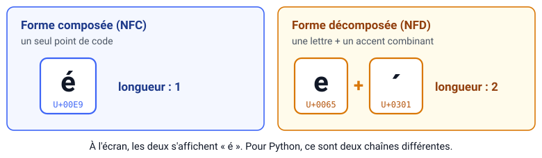

```python
>>> import unicodedata
>>> a = "é"
>>> b = unicodedata.normalize("NFD", a)   # e + accent séparé
>>> a == b, len(a), len(b)
(False, 1, 2)
```

Un texte copié d'un PDF peut utiliser la forme décomposée : une recherche sur `été` le raterait, alors que les deux s'affichent pareil. On ramène donc les deux chaînes à la même forme : `unicodedata.normalize("NFC", texte)`.

---

### **Normaliser, c'est choisir ce qu'on perd**

<div class="why">

Sans normalisation, `Chat`, `chat` et `CHAT` sont comptés comme trois mots différents. On les ramène à une seule écriture pour les compter ensemble.

</div>

<div class="tight">

| Opération | Utile pour | Ce qu'on perd |
|---|---|---|
| minuscules | presque tout | `Orange` l'opérateur devient `orange` le fruit |
| retirer les accents | chercher malgré les fautes | `côte`, `cote` et `côté` se confondent |
| retirer la ponctuation | le sac de mots | le `?` d'une question |
| retirer les chiffres | des textes littéraires | `30 %`, `COVID-19` |

</div>

<div class="warn">

Avec un modèle préentraîné (BERT, GPT…), ne normalisez rien vous-même : son tokenizer s'en charge déjà.

</div>

---

### **Découper en tokens**

<div class="cols">
<div>

**Couper sur les espaces**

```text
"l'ordinateur"  → ["l'ordinateur"]
"aujourd'hui"   → ["aujourd'hui"]
"porte-monnaie" → ["porte-monnaie"]
```

L'apostrophe et le trait d'union restent collés au mot : `l'ordinateur` et `ordinateur` deviennent deux types différents.

</div>
<div>

**Garder les suites de lettres** (`\w+`)

```text
re.findall(r"\w+", "l'ordinateur")
→ ['l', 'ordinateur']
re.findall(r"\w+", "aujourd'hui")
→ ['aujourd', 'hui']
```

Les accents passent, mais `aujourd'hui` est coupé en deux.

</div>
</div>

<div class="why">

Un algorithme ne travaille pas sur une phrase d'un bloc : il a besoin d'une liste de mots. Le découpage décide de ce qui compte comme un mot.

</div>

---

### **Pourquoi retirer les stop words ?**

Les **stop words** sont les mots outils très fréquents : `le`, `la`, `de`, `et`, `ne`, `pas`… Voici les mots les plus fréquents du corpus du TP :

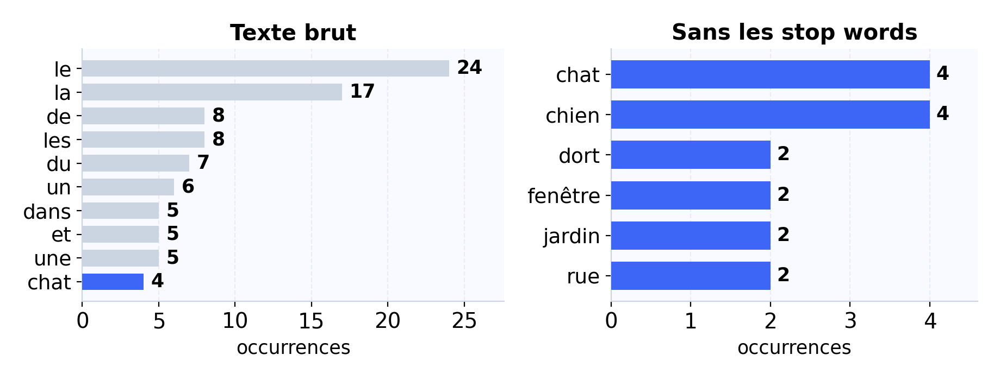

<div class="why">

Des mots comme `le`, `la` ou `de` sont dans toutes les phrases : ils prennent toute la place sans dire de quoi parle le texte. On retire ce qui est trop commun pour ne garder que ce qui a de la valeur : `chat`, `chien`, `jardin`.

</div>

---

### **Stop words : ce qu'on gagne, ce qu'on risque**

<div class="cols">
<div class="card">

**Ce qu'on y gagne**

- un vocabulaire plus petit ;
- des comptages moins dominés par `le` et `de`.

</div>
<div class="card">

**Ce qu'on risque**

`je ne veux pas payer` devient `veux payer` : la négation a disparu, le sens s'est inversé.

</div>
</div>

<div class="warn">

Avis clients : gardez `ne` et `pas`. Recherche par mots-clés : retirez-les. Modèle préentraîné : ne retirez rien, il a besoin de la phrase entière.

</div>

---

### **Retirer les stop words en pratique**

On compare chaque token à une liste fixée à l'avance :

```python
stop = {"le", "la", "les", "un", "une", "de", "du", "sur", "et"}
tokens = ["le", "chat", "dort", "sur", "le", "canapé"]
[t for t in tokens if t not in stop]
# ['chat', 'dort', 'canapé']
```

- Il n'existe pas de liste officielle : spaCy, NLTK ou un fichier maison (celui du TP compte 164 mots) donnent des listes différentes.
- Avec scikit-learn : `CountVectorizer(stop_words=ma_liste)`. La seule liste intégrée, `stop_words="english"`, est en anglais : pour le français, il faut fournir la sienne.

<div class="ask">

La liste du TP contient `ne` et `pas`. Est-ce un bon choix pour analyser des avis clients ?

</div>

---

### **Pourquoi regrouper les formes d'un mot ?**

L'utilisateur tape <span class="search">dormir</span>, mais D1 contient `dort` : pour l'ordinateur, ce sont deux mots sans rapport.

<div class="card" style="width:100%;">

`mange` `manges` `mangeons` `mangez` `mangent` `mangeais` `mangeait` `mangions` `mangeaient` `mangeai` `mangea` `mangèrent` `mangerai` `mangera` `mangerons` `mangeront` `mangerais` `mangerait` `mangeant` `mangé` `mangée` …

</div>

Le verbe `manger` a une quarantaine de formes différentes. Sans regroupement, cela fait une quarantaine de colonnes pour une seule idée, et une requête n'en trouve qu'une.

<div class="why">

Ramener `dort`, `dorment` et `dormait` à `dormir` évite de disperser les comptes d'un même mot sur plusieurs colonnes.

</div>

---

### **Stemming ou lemmatisation ?**

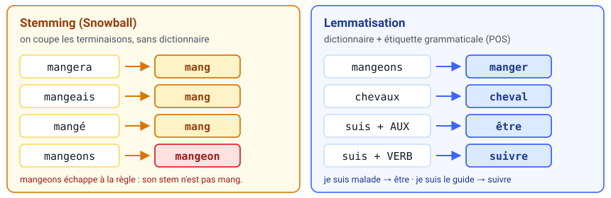

- Le **stemming** coupe les terminaisons avec des règles fixes. C'est rapide, mais le résultat n'est pas toujours un mot, et certaines formes passent à travers.
- La **lemmatisation** cherche la forme du dictionnaire. Elle a besoin de la nature du mot : `suis` donne `être` dans « je suis malade », et `suivre` dans « je suis le guide ».

<p class="src">Stems obtenus avec le stemmer Snowball français (bibliothèque snowballstemmer).</p>

---

### **Étiqueter la grammaire : le POS tagging**

<div class="cols">
<div style="flex:.75;">

| token | étiquette |
|---|---|
| Le | `DET` |
| chat | `NOUN` |
| dort | `VERB` |
| sur | `ADP` |
| le | `DET` |
| canapé | `NOUN` |

</div>
<div>

Chaque token reçoit sa **catégorie grammaticale** (*part of speech*), ici avec les étiquettes Universal POS.

**À quoi ça sert ?**

- choisir le bon lemme : `suis` → `être` ou `suivre` ;
- distinguer `ferme` le nom de `ferme` le verbe ;
- repérer les noms propres (séance 6).

<p class="small">On ne l'implémente pas : spaCy étiquette une phrase en une ligne de code.</p>

</div>
</div>

---

### **Et les mots que le vocabulaire ne connaît pas ?**

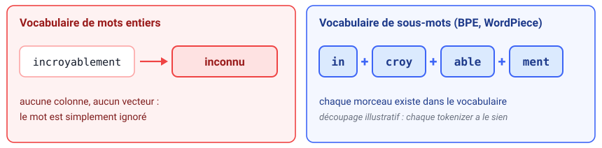

Les modèles récents ne découpent plus en mots, mais en **sous-mots** (algorithmes BPE ou WordPiece). Un mot rare devient une suite de morceaux fréquents : plus aucun mot n'est totalement inconnu.

<div class="why">

Un mot nouveau est découpé en morceaux déjà connus du modèle : il peut être traité au lieu d'être ignoré.

</div>

<p class="small">Nous y reviendrons en séance 6. À partir de là, « token » voudra dire « morceau de mot ».</p>

---

### **La chaîne complète**

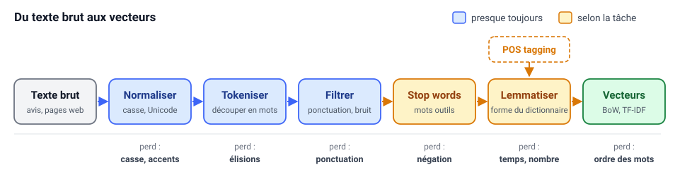

- Les étapes bleues sont presque toujours appliquées. Les orange dépendent de la tâche.
- Le POS tagging ne retire rien : il fournit l'étiquette dont la lemmatisation a besoin.
- L'ordre compte : on tokenise avant de filtrer, et on étiquette avant de lemmatiser.

---

### **Un exemple, étape par étape**

<div class="tight" style="font-size:.8em;">

| Étape | Résultat |
|---|---|
| Texte de départ | `Les chats d'Emily dorment sur le canapé du salon.` |
| 1. Normaliser | `les chats d'emily dorment sur le canape du salon.` |
| 2. Tokeniser (`\w+`) | `[les, chats, d, emily, dorment, sur, le, canape, du, salon]` |
| 3. Filtrer | le `d` isolé disparaît |
| 4. Retirer les stop words | `[chats, emily, dorment, canape, salon]` |
| 5. Étiqueter (POS) | `chats/NOUN emily/PROPN dorment/VERB canape/NOUN salon/NOUN` |
| 6. Lemmatiser | `[chat, emily, dormir, canape, salon]` |

</div>

C'est cette dernière liste qui entre dans le dataset, et non la phrase d'origine.

---

### **Ce qu'on range dans le dataset**

<div class="tight">

| id | texte brut | tokens | n |
|---|---|---|---|
| 1 | Les chats d'Emily dorment sur le canapé. | `chat emily dormir canape` | 4 |
| 2 | Le chien aboie dans le jardin. | `chien aboyer jardin` | 3 |
| 3 | Un félin se repose sur le sofa. | `felin reposer sofa` | 3 |

</div>

- Gardez toujours le texte brut : si le nettoyage a détruit une information, c'est le seul moyen de revenir en arrière.
- Une ligne correspond à un document : une phrase, un avis, un paragraphe.
- Ajoutez les colonnes utiles à la tâche : étiquette, date, longueur…

<div class="ask">

Nous avons maintenant des tokens propres. Comment dire que deux textes se ressemblent ?

</div>

---

<!-- header: ⭐️ La distance d'édition -->

### **Deux mots se ressemblent-ils ?**

<div class="cols">
<div class="card">

**Une faute de frappe**

`ordinateur` / `ordinatuer`

</div>
<div class="card">

**Un pluriel**

`carton` / `cartons`

</div>
<div class="card">

**Un synonyme**

`voiture` / `automobile`

</div>
</div>

Retour au fil rouge : l'utilisateur tape <span class="search">salom</span>. Aucun document ne contient ce mot, et la recherche ne renvoie rien. Pourtant, tout le monde comprend `salon`.

<div class="why">

Comparer mot à mot échoue à la moindre faute de frappe. Compter les lettres à corriger permet de retrouver le mot voulu.

</div>

---

### **Trois opérations autorisées**

<div class="cols" style="text-align:center;">
<div class="card">

**Insérer**

`chat` → `chats`

on ajoute un `s`

</div>
<div class="card">

**Supprimer**

`chats` → `chat`

on retire le `s`

</div>
<div class="card">

**Remplacer**

`chat` → `chot`

on remplace `a` par `o`

</div>
</div>

<div class="note">

La **distance de Levenshtein** entre deux mots est le plus petit nombre d'opérations qui transforme l'un en l'autre. Chaque opération coûte 1.

</div>

Par exemple, il faut 8 opérations pour passer de `voiture` à `automobile`.

---

### **Calculer la distance avec un tableau**

La case $(i, j)$ contient la distance entre les $i$ premières lettres du premier mot et les $j$ premières lettres du second.

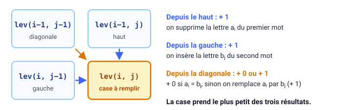

$$\text{lev}(i,j)=\min\big(\text{lev}(i-1,j)+1,\ \text{lev}(i,j-1)+1,\ \text{lev}(i-1,j-1)+[a_i\neq b_j]\big)$$

<p class="small">[a<sub>i</sub> ≠ b<sub>j</sub>] vaut 0 si les deux lettres sont égales, 1 sinon.</p>

<div class="why">

On calcule la distance lettre par lettre en réutilisant les cases précédentes, au lieu de tester toutes les transformations possibles.

</div>

---

### **Le tableau : on pose les bords**

On compare `chat` (en lignes) et `chats` (en colonnes). Le symbole ε désigne le mot vide.

<table class="lev">
<tr><th></th><th>ε</th><th>c</th><th>h</th><th>a</th><th>t</th><th>s</th></tr>
<tr><th>ε</th><td>0</td><td>1</td><td>2</td><td>3</td><td>4</td><td>5</td></tr>
<tr><th>c</th><td>1</td><td class="vide">·</td><td class="vide">·</td><td class="vide">·</td><td class="vide">·</td><td class="vide">·</td></tr>
<tr><th>h</th><td>2</td><td class="vide">·</td><td class="vide">·</td><td class="vide">·</td><td class="vide">·</td><td class="vide">·</td></tr>
<tr><th>a</th><td>3</td><td class="vide">·</td><td class="vide">·</td><td class="vide">·</td><td class="vide">·</td><td class="vide">·</td></tr>
<tr><th>t</th><td>4</td><td class="vide">·</td><td class="vide">·</td><td class="vide">·</td><td class="vide">·</td><td class="vide">·</td></tr>
</table>

Première ligne : passer du mot vide à `c`, `ch`, `cha`… coûte 1, 2, 3… insertions. Première colonne : revenir de `c`, `ch`, `cha`… au mot vide coûte autant de suppressions.

---

### **Le tableau : on remplit case par case**

Chaque case regarde ses trois voisines déjà calculées. Prenons la case ligne `a`, colonne `a`.

<table class="lev">
<tr><th></th><th>ε</th><th>c</th><th>h</th><th>a</th><th>t</th><th>s</th></tr>
<tr><th>ε</th><td>0</td><td>1</td><td>2</td><td>3</td><td>4</td><td>5</td></tr>
<tr><th>c</th><td>1</td><td>0</td><td>1</td><td>2</td><td>3</td><td>4</td></tr>
<tr><th>h</th><td>2</td><td>1</td><td class="voisin">0</td><td class="voisin">1</td><td>2</td><td>3</td></tr>
<tr><th>a</th><td>3</td><td>2</td><td class="voisin">1</td><td class="calcul">0</td><td class="vide">·</td><td class="vide">·</td></tr>
<tr><th>t</th><td>4</td><td class="vide">·</td><td class="vide">·</td><td class="vide">·</td><td class="vide">·</td><td class="vide">·</td></tr>
</table>

<div class="note">

Haut : 1 + 1 = 2. Gauche : 1 + 1 = 2. Diagonale : 0 + 0 = 0, car les deux lettres sont identiques. On garde le minimum : **0**.

</div>

---

### **Le tableau : le résultat**

<table class="lev">
<tr><th></th><th>ε</th><th>c</th><th>h</th><th>a</th><th>t</th><th>s</th></tr>
<tr><th>ε</th><td class="chemin">0</td><td>1</td><td>2</td><td>3</td><td>4</td><td>5</td></tr>
<tr><th>c</th><td>1</td><td class="chemin">0</td><td>1</td><td>2</td><td>3</td><td>4</td></tr>
<tr><th>h</th><td>2</td><td>1</td><td class="chemin">0</td><td>1</td><td>2</td><td>3</td></tr>
<tr><th>a</th><td>3</td><td>2</td><td>1</td><td class="chemin">0</td><td>1</td><td>2</td></tr>
<tr><th>t</th><td>4</td><td>3</td><td>2</td><td>1</td><td class="chemin">0</td><td class="chemin">1</td></tr>
</table>

<div class="note">

La distance se lit dans la dernière case : **1**. Le chemin surligné indique les opérations : on garde `c`, `h`, `a`, `t`, puis on insère `s`.

</div>

---

### **Une distance de 1, c'est beaucoup ?**

Une faute dans `chat` touche un quart du mot, dans `ordinateur` un dixième. On divise donc par la longueur du plus long :

$$\text{similarité}(a,b)=1-\frac{\text{lev}(a,b)}{\max(|a|,\,|b|)}$$

| Paire | Distance | Similarité |
|---|---|---|
| `chats` / `chat` | 1 | 0,80 |
| `carton` / `cartons` | 1 | 0,86 |
| `chien` / `chats` | 3 | 0,40 |
| `ordinateur` / `ordinatuer` | 2 | 0,80 |
| `voiture` / `automobile` | 8 | 0,20 |

<p class="small">Variante de Damerau-Levenshtein : l'inversion de deux lettres voisines compte pour une seule opération, et <code>ordinatuer</code> passe à distance 1.</p>

---

### **Où ça marche, où ça casse**

<div class="cols">
<div class="card">

**Utile pour**

- corriger les fautes de frappe ;
- repérer des doublons (`Dupont` / `Dupond`) ;
- chercher un mot malgré une faute ;
- comparer des séquences d'ADN.

</div>
<div class="card">

**Limité pour**

- les synonymes : `voiture` / `automobile` sont à distance 8 ;
- tout ce qui touche au sens ;
- les longs textes : il faut remplir $n \times m$ cases.

</div>
</div>

<div class="ask">

Nous avons comparé des lettres. Pour comparer des textes entiers, changeons d'unité : comptons des mots.

</div>

---

<!-- header: ⭐️ Sac de mots et cosinus -->

### **Pourquoi transformer un texte en vecteur ?**

Un algorithme ne sait travailler que sur un tableau de nombres : une ligne par observation, les mêmes colonnes pour toutes. Chaque ligne est un **vecteur** (une liste ordonnée de nombres).

<div class="cols">
<div>

**Données classiques : des maisons**

| Maison | Surface (m²) | Chambres |
|:-:|:-:|:-:|
| 1 | 85 | 2 |
| 2 | 120 | 3 |

</div>
<div>

**Notre objectif : des textes**

| Document | chat | chien | salon |
|:-:|:-:|:-:|:-:|
| D1 | 1 | 0 | 1 |
| D2 | 0 | 1 | 1 |

</div>
</div>

<div class="why">

Un modèle ne sait calculer que sur des nombres. Transformer chaque texte en une ligne de nombres permet de les comparer, de les classer ou de les regrouper automatiquement.

</div>

---

### **L'idée du sac de mots**

On oublie l'ordre des mots et on ne garde que leurs comptes : « le chat dort sur le canapé du salon » devient `le` ×2, et `chat`, `dort`, `sur`, `canapé`, `du`, `salon` ×1.

Pour toute la suite, nous utiliserons ces quatre documents :

| | Document |
|---|---|
| D1 | le chat dort sur le canapé du salon |
| D2 | le chien dort sur le tapis du salon |
| D3 | un félin se repose sur un sofa |
| D4 | le salon est grand et le salon est clair |

Ils contiennent 18 mots différents : notre vocabulaire a 18 termes.

---

### **Ce que le sac garde, ce qu'il jette**

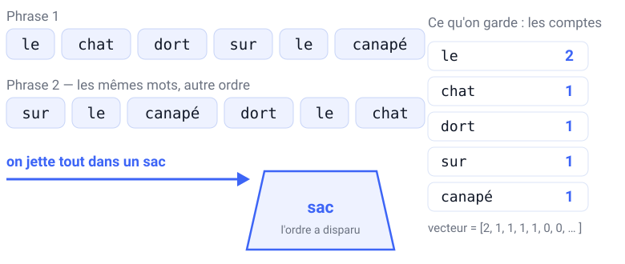

<div class="cols mid">
<div style="flex:0 0 210px;">


</div>
<div class="small">

Les deux phrases donnent exactement le même vecteur. Il a une case par terme du vocabulaire : ici 5 cases remplies, et 13 cases à zéro pour les autres termes du corpus.

La photo résume l'idée : un portrait découpé et jeté dans un sac. Tous les morceaux sont là, mais on ne sait plus où ils allaient.

<span class="src">Photo : Meritxell.canela, Wikimedia Commons, domaine public.</span>

</div>
</div>

---

### **Que mettre dans chaque case ?**

Une seule phrase : `le chat dort, le chat dort encore`.

<div class="cols">
<div>

**Présence (0 ou 1)**

| le | chat | dort | encore |
|:-:|:-:|:-:|:-:|
| 1 | 1 | 1 | 1 |

On sait quels mots sont là, pas combien de fois.

</div>
<div>

**Comptage**

| le | chat | dort | encore |
|:-:|:-:|:-:|:-:|
| 2 | 2 | 2 | 1 |

La répétition est conservée. C'est cette version que TF-IDF utilisera.

</div>
</div>

<div class="why">

La présence dit si un mot apparaît dans le texte ; le comptage dit s'il y revient souvent. Dans scikit-learn, `binary=True` donne la présence.

</div>

<p class="src">D'après J. Brownlee, <em>A Gentle Introduction to the Bag-of-Words Model</em>, Machine Learning Mastery, 2019.</p>

---

### **La matrice documents × termes**

Une ligne par document, une colonne par terme, rangées par ordre alphabétique comme le fait scikit-learn.

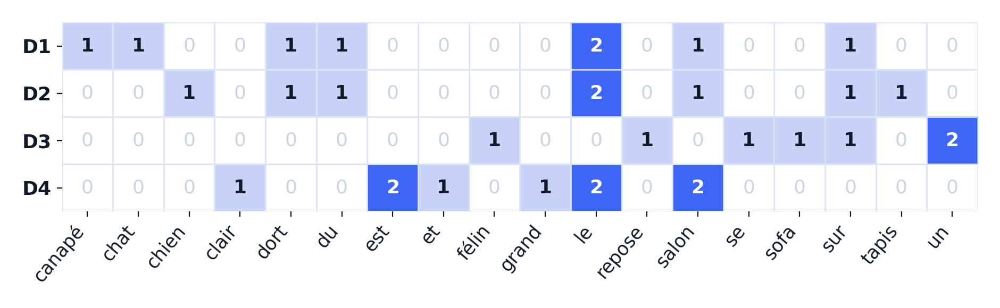

Chaque document devient un vecteur de 18 nombres. D1 et D2 se ressemblent ; D3 n'a presque rien en commun avec eux.

<div class="ask">

Où voit-on, dans ce tableau, que D3 parle pourtant de la même scène que D1 ?

</div>

---

### **Une matrice pleine de zéros**

Notre exemple est trompeur : 26 cases sur 72 sont remplies (36 %), parce que le corpus est minuscule. Voici la matrice du corpus du TP :

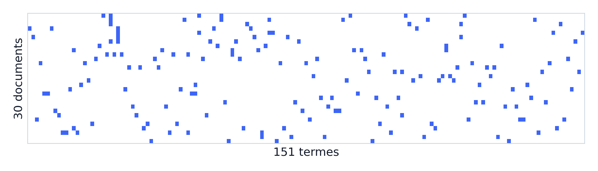

30 documents, 151 termes, 168 cases non nulles : 3,7 %. On parle de matrice **creuse** (*sparse*).

<div class="why">

Un document n'utilise qu'une toute petite partie du vocabulaire. Ne stocker que les valeurs non nulles évite de remplir la mémoire de zéros.

</div>

---

### **`fit` puis `transform`**

```python
vec = CountVectorizer()
X = vec.fit_transform(corpus)   # apprend le vocabulaire et compte
x = vec.transform([requete])    # compte avec ce même vocabulaire
```

- `fit` apprend le vocabulaire sur le corpus et fixe l'ordre des colonnes.
- `transform` compte les mots d'un nouveau texte dans ces mêmes colonnes, et ignore les mots inconnus.
- Une requête peut donc donner un vecteur rempli de zéros.

<div class="why">

Tous les textes doivent utiliser exactement les mêmes colonnes : la colonne 0 doit désigner le même mot pour le corpus et pour la requête.

</div>

---

### **Mesurer un angle plutôt qu'une distance**

<div class="cols mid">
<div style="flex:1.2;">

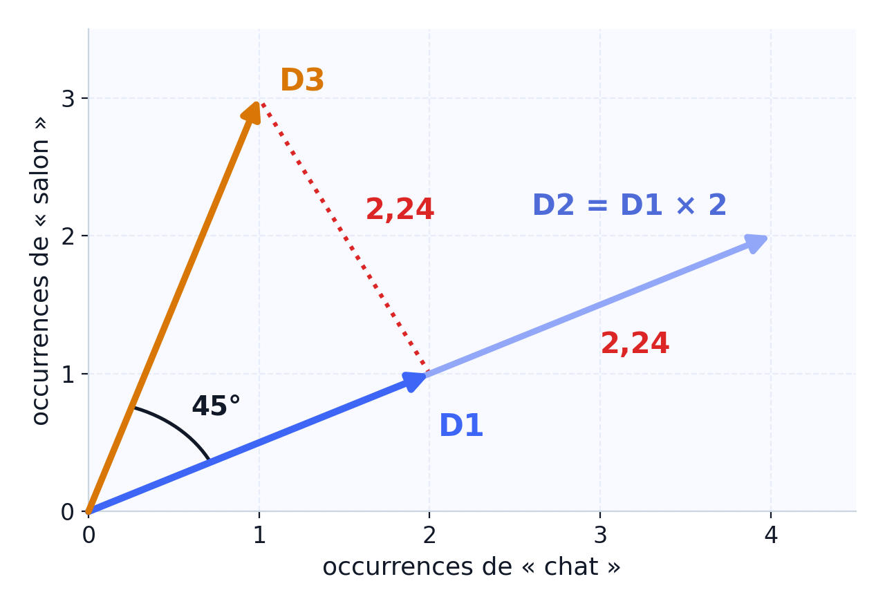

</div>
<div>

$$\cos(\theta)=\frac{\mathbf a\cdot\mathbf b}{\|\mathbf a\|\,\|\mathbf b\|}$$

- $\mathbf a\cdot\mathbf b = \sum_i a_i b_i$ : produit case à case
- $\|\mathbf a\|=\sqrt{\sum_i a_i^2}$ : longueur du vecteur
- 1 = même direction, 0 = aucun mot commun

</div>
</div>

D2 et D3 sont tous les deux à 2,24 de D1, alors que D2 n'est que D1 recopié deux fois. Le cosinus les distingue : 1 pour D2, 0,71 pour D3.

<div class="why">

Un texte deux fois plus long a des comptages deux fois plus grands, même s'il dit la même chose. Le cosinus ignore la longueur et ne compare que les proportions de mots.

</div>

---

### **Classer les documents pour la requête « le chat »**

| Document | Contenu | Cosinus |
|---|---|---|
| D1 | le chat dort sur le canapé du salon | **0,671** |
| D2 | le chien dort sur le tapis du salon | 0,447 |
| D3 | un félin se repose sur un sofa | 0,000 |
| D4 | le salon est grand et le salon est clair | 0,365 |

- D1 : $q\cdot D1 = 1\times2 + 1\times1 = 3$, $\|q\|=\sqrt{2}$ et $\|D1\|=\sqrt{10}$, d'où $3/\sqrt{20}=0{,}671$.
- D2 et D4 ne partagent que `le` (deux fois) : même produit scalaire, mais D4 est plus long, donc moins similaire.
- D3 obtient 0 : il ne contient ni `le` ni `chat`. Il parle pourtant d'un chat.

---

### **Même requête, sans les stop words**

On retire `le`, `du`, `sur`, `un`, `se`, `est` et `et` des documents et de la requête : on passe de 32 à 15 tokens, et de 18 à 11 termes.

| Document | Avec stop words | Sans stop words |
|---|---|---|
| D1 | 0,671 | **0,500** |
| D2 | 0,447 | 0 |
| D3 | 0 | 0 |
| D4 | 0,365 | 0 |

D2 et D4 ne remontaient qu'à cause de `le`. Une fois ces mots très communs retirés, seul D1, qui parle vraiment d'un chat, garde un score supérieur à 0.

<div class="note">

C'est le gain annoncé à la section 2. Mais la liste tranche sans nuance : un mot est gardé ou supprimé. TF-IDF proposera un réglage plus fin.

</div>

---

### **Le sac perd l'ordre des mots**

<div class="cols mid">
<div class="card">

`le chien mord l'homme`

`l'homme mord le chien`

</div>
<div>

Mêmes mots, mêmes comptes : le cosinus vaut **1**. Les deux phrases racontent pourtant des histoires opposées.

</div>
</div>

**Une solution simple : les bigrammes.** On compte aussi les paires de mots voisins : `le chien`, `chien mord`, `mord l'homme`… Les deux phrases n'ont plus les mêmes colonnes, mais leur nombre explose : jusqu'à $|V|^2$ en théorie.

<div class="warn">

Les bigrammes rendent un peu d'ordre, mais ils ne règlent pas les synonymes : `voiture` et `automobile` n'ont toujours aucune colonne commune.

</div>

---

### **Et si aucun mot de la requête n'est connu ?**

Requête : <span class="search">animal de compagnie</span>. Aucun de ces trois mots n'apparaît dans les quatre documents.

<div class="warn">

Le vecteur de la requête ne contient que des zéros. Le cosinus vaut alors 0/0 : il n'est pas défini, et scikit-learn renvoie 0 par convention. Les quatre documents sont à égalité, alors que trois d'entre eux parlent d'un animal de compagnie.

</div>

C'est le cas le plus fréquent en production : vocabulaire métier, fautes de frappe, abréviations, autre langue. Un mot inconnu n'a tout simplement aucune colonne où s'inscrire.

---

### **Tous les mots ne se valent pas**

| Mot | Occurrences | Documents qui le contiennent |
|---|---|---|
| `le` | 6 | 3 sur 4 |
| `salon` | 4 | 3 sur 4 |
| `félin` | 1 | 1 sur 4 |

`le` apparaît dans presque tous les documents : il ne permet pas de les distinguer. `félin` n'apparaît que dans D3 : s'il est dans la requête, il désigne exactement le bon document.

<div class="ask">

Comment donner plus de poids à `félin` qu'à `le`, sans écrire la liste des mots importants à la main ?

</div>

---

### **Le sac de mots en résumé**

- Un document devient un vecteur, avec une case par terme du vocabulaire.
- Chaque case contient une présence (0 ou 1) ou un nombre d'occurrences.
- Le cosinus compare deux vecteurs en ne regardant que leur direction.
- Trois limites : l'ordre est perdu, les synonymes restent séparés, les mots inconnus sont ignorés.

---

<!-- header: ⭐️ TF-IDF -->

### **Donner du poids aux mots qui distinguent**

Un mot est important pour un document s'il est :

- **fréquent dans ce document** : c'est le TF (*term frequency*) ;
- **rare dans le reste du corpus** : c'est l'IDF (*inverse document frequency*).

<div class="cols">
<div class="card">

`le` est dans 3 documents sur 4. Il ne permet pas d'en choisir un : son poids doit baisser.

</div>
<div class="card">

`félin` n'est que dans D3. C'est un très bon indice : son poids doit monter.

</div>
</div>

<div class="why">

Un mot présent dans presque tous les documents n'aide pas à les départager. TF-IDF baisse le poids des mots très courants et monte celui des mots rares, qui ont plus de valeur.

</div>

<p class="src">Salton et Buckley (1988), <em>Term-weighting approaches in automatic text retrieval</em>.</p>

---

### **La formule**

$$w_{t,d}=\text{tf}(t,d)\times\text{idf}(t)$$

- $\text{tf}(t,d)$ : le nombre de fois où le terme $t$ apparaît dans le document $d$.
- $\text{idf}(t)$ : un poids qui augmente quand le terme est rare. scikit-learn utilise :

$$\text{idf}(t)=\ln\!\left(\frac{1+N}{1+\text{df}(t)}\right)+1$$

avec $N$ le nombre de documents et $\text{df}(t)$ le nombre de documents qui contiennent $t$.

<div class="why">

Sans le logarithme, un mot rare pèserait des milliers de fois plus qu'un mot courant et écraserait tous les autres. Le logarithme garde des poids comparables.

</div>

<p class="small">Chaque vecteur est ensuite divisé par sa norme, pour ne pas avantager les longs documents.</p>

---

### **L'IDF sur nos quatre documents**

Avec $N = 4$ : $\text{idf}(\text{chat}) = \ln(5/2) + 1 = 1{,}916$ et $\text{idf}(\text{le}) = \ln(5/4) + 1 = 1{,}223$.

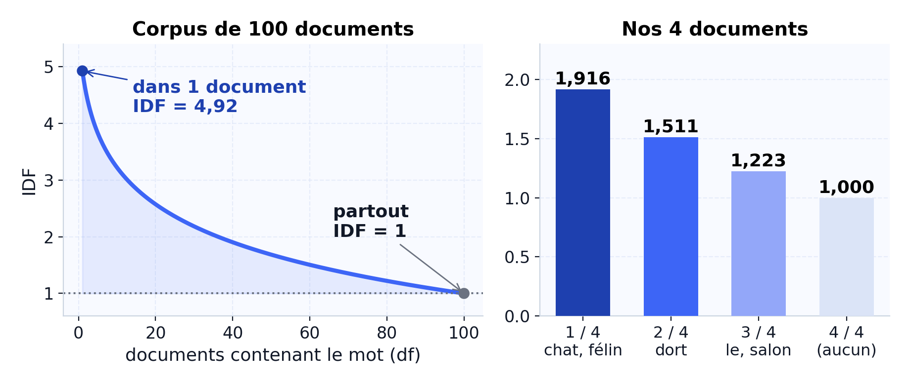

À gauche, l'allure générale : l'IDF chute vite dès qu'un mot devient courant. À droite, nos valeurs : `chat` ne pèse que 1,57 fois plus que `le`, car le corpus est minuscule.

---

### **La requête « le chat », cette fois en TF-IDF**

| Document | Cosinus (comptages) | Cosinus (TF-IDF) |
|---|---|---|
| D1 | **0,671** | **0,641** |
| D2 | 0,447 | 0,288 |
| D3 | 0,000 | 0,000 |
| D4 | 0,365 | 0,214 |

- Le classement ne change pas : D1 reste en tête, et c'est normal, il contient vraiment `chat`.
- Les écarts se creusent : D2 et D4, qui ne partagent que `le` avec la requête, perdent beaucoup.
- D3 reste à 0 : TF-IDF ne crée aucun lien entre `chat` et `félin`.

---

### **Quand TF-IDF change le classement**

Requête : <span class="search">félin salon</span>

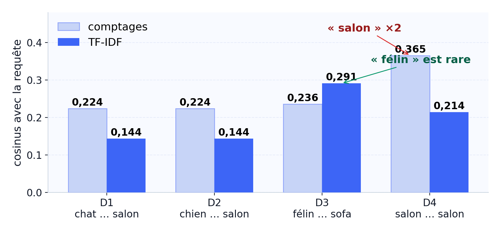

Avec les comptages, D4 gagne parce qu'il répète `salon`, alors qu'il ne parle d'aucun animal. Avec TF-IDF, `salon` perd du poids (il est dans 3 documents sur 4) et `félin` en gagne : D3 passe en tête.

---

### **Ce que TF-IDF ne sait pas faire**

- **Les synonymes** : `voiture` et `automobile` n'ont toujours aucune colonne commune.
- **Les sens multiples** : `avocat` le fruit et `avocat` le métier partagent la même colonne.
- **L'ordre** : il reste perdu.
- **Les mots inconnus** : ils sont toujours ignorés.
- **La stabilité** : ajouter des documents modifie tous les poids.

---

### **TF-IDF en résumé**

1. Le TF compte un mot dans le document, l'IDF mesure sa rareté dans le corpus.
2. Avec la formule de scikit-learn, un mot présent partout garde un IDF de 1 : c'est le minimum.
3. TF-IDF creuse les écarts entre documents. Il ne change le classement que lorsqu'un mot banal écrase un mot plus rare.
4. Il reste fondé sur les mots écrits : synonymes, sens multiples et mots inconnus lui échappent.

<div class="ask">

Un IDF calculé sur nos 4 documents peut-il servir tel quel pour un corpus de 10 000 documents ? Pourquoi ?

</div>

---

<!-- header: ⭐️ Des mots aux vecteurs -->

### **Pourquoi des vecteurs de mots ?**

Retour au fil rouge : l'utilisateur tape <span class="search">félin</span>. D1 parle d'un chat, mais n'a aucun mot en commun avec la requête.

<div class="cols mid">
<div>

Dans un sac de mots, chaque mot a sa propre colonne. Pris seul, un mot est un vecteur *one-hot* :

```text
chat  = [1, 0, 0, …]
félin = [0, 1, 0, …]
pneu  = [0, 0, 1, …]
```

</div>
<div>

cos(`chat`, `félin`) = 0

cos(`chat`, `pneu`) = 0

Pour ces vecteurs, `félin` est aussi loin de `chat` que `pneu`.

</div>
</div>

<div class="why">

Avec une colonne par mot, deux synonymes n'ont rien en commun. On veut des vecteurs où deux mots de même sens ont des valeurs proches.

</div>

---

### **L'idée de Word2Vec**

> « You shall know a word by the company it keeps. » J. R. Firth, 1957

Dans « le ___ dort sur le canapé », on peut mettre `chat`, `chien` ou `félin`, mais pas `pneu`. Des mots qui partagent leurs voisins ont souvent un sens proche.

Word2Vec lit des millions de phrases et apprend un vecteur par mot, de sorte que les mots aux voisins semblables reçoivent des vecteurs proches. Aucun dictionnaire n'est nécessaire.

<p class="src">Mikolov et al. (2013), <em>Efficient Estimation of Word Representations in Vector Space</em>.</p>

---

### **Les contextes : une fenêtre qui glisse**

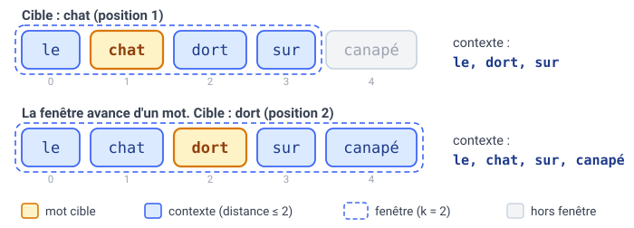

On parcourt le corpus mot par mot. Pour chaque mot cible, les voisins situés à $k$ positions ou moins forment son contexte. Chaque couple (cible, voisin) devient un exemple d'entraînement.

<div class="warn">

La taille de la fenêtre est un réglage. Petite, elle capte la syntaxe (quel mot suit quel autre). Grande, elle capte plutôt le thème du texte.

</div>

---

### **Deux façons d'apprendre : CBOW et Skip-gram**

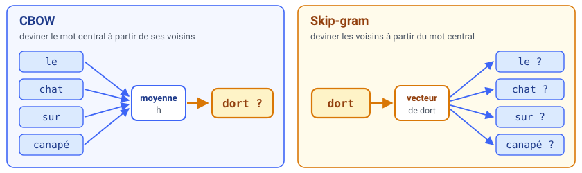

- **CBOW** devine le mot central à partir de ses voisins : rapide, bon sur les mots fréquents.
- **Skip-gram** fait l'inverse : plus lent, mais meilleur sur les mots rares.

<div class="why">

Pour forcer deux mots qui ont les mêmes voisins à recevoir des vecteurs proches, on entraîne le modèle à deviner un mot à partir de ses voisins.

</div>

---

### **Où sont les vecteurs ?**

Les vecteurs sont rangés dans une matrice $W$ de taille $|V| \times d$ : une ligne par mot, $d$ colonnes (souvent 100 à 300).

$$h=\frac{1}{|C|}\sum_{w\in C}\mathbf e_w$$

<div class="small">

$\mathbf e_w$ : la ligne de $W$ du mot $w$. $C$ : les mots du contexte, sans la cible. $|C| \le 2k$, car la fenêtre est tronquée aux bords de la phrase.

</div>

- **CBOW** fait la moyenne $h$ des vecteurs du contexte, puis donne un score à chaque mot du vocabulaire.
- **Skip-gram** part du vecteur du mot central et donne un score aux mots du contexte.
- Au départ, $W$ est aléatoire. L'entraînement la corrige pour que les mots réellement observés obtiennent les meilleurs scores.

---

### **Combien de paramètres ?**

<div class="cols">
<div>

Word2Vec utilise deux matrices de taille $|V| \times d$ : celle d'entrée contient les vecteurs que l'on garde, celle de sortie sert à calculer les scores.

Pour 10 000 mots en 100 dimensions : $2 \times 10\,000 \times 100 = 2 \times 10^6$ poids.

</div>
<div class="card">

**Ordres de grandeur**

- corpus : des millions de mots
- vocabulaire : $10^4$ à $10^6$ mots
- dimension : 100 à 300 ; au-delà, le gain devient faible

</div>
</div>

<div class="warn">

Avec 100 000 mots en 300 dimensions, on atteint 60 millions de paramètres. Le calcul pose un autre problème : pour chaque exemple, il faudrait un score pour chacun des $|V|$ mots. Le *negative sampling* (séance 6) évite ce calcul.

</div>

---

### **Les vecteurs du TP, vus en 2D**

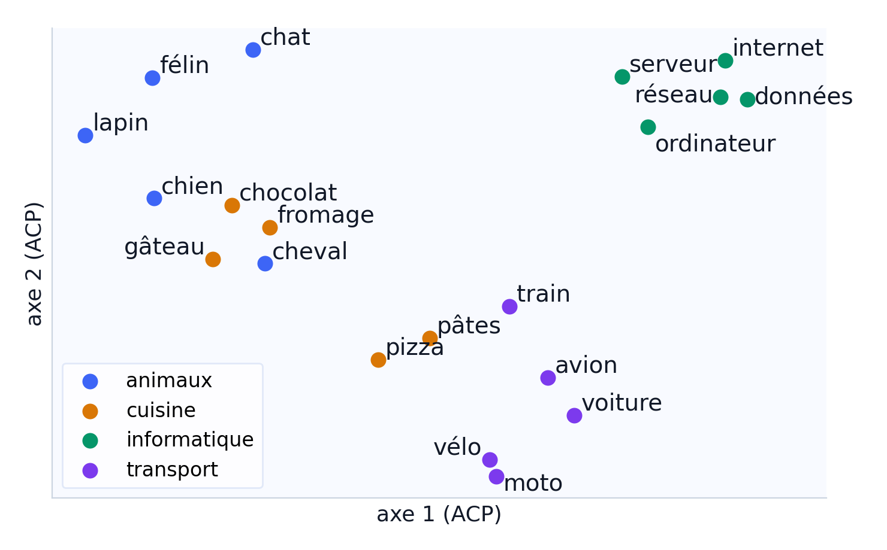

20 mots du modèle du TP, ramenés de 100 à 2 dimensions (projection ACP) pour pouvoir les dessiner. Les thèmes se regroupent seuls ; les couleurs, c'est nous qui les avons ajoutées.

<div class="warn">

Proche veut dire « employé dans les mêmes contextes » : `chat` a pour voisins `félin` (0,72) et `chien` (0,62), mais `chaud` et `froid` sont aussi à 0,74.

</div>

---

### **Les analogies : des déplacements qui se répètent**

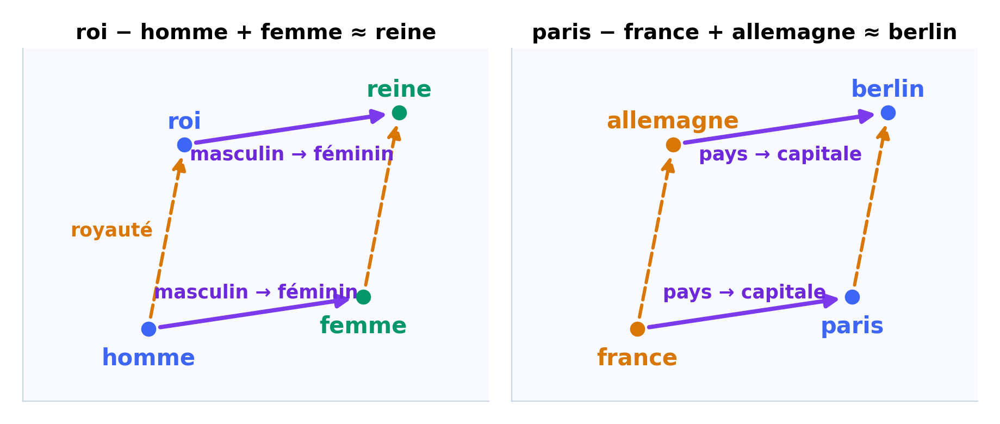

Dans un espace idéal, aller de `homme` à `femme` demande le même déplacement qu'aller de `roi` à `reine`. On peut alors calculer :

$$\vec{\text{roi}} - \vec{\text{homme}} + \vec{\text{femme}} \approx \vec{\text{reine}}$$

<p class="small">Schéma simplifié : les vrais vecteurs ont 100 dimensions, et le parallélogramme n'est jamais parfait.</p>

---

### **Sur le modèle du TP, ça marche… à peu près**

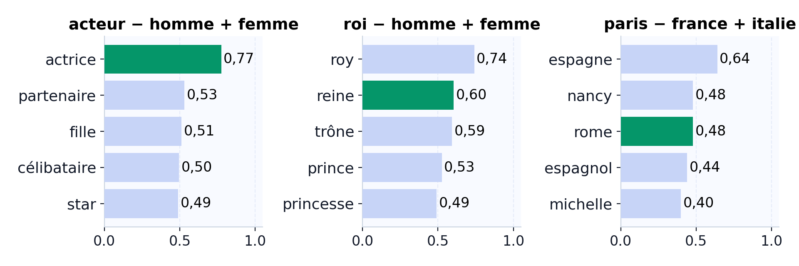

- `acteur − homme + femme` donne bien `actrice`, nettement en tête.
- `roi − homme + femme` place `reine` 2e, derrière `roy`, l'ancienne orthographe de `roi`.
- `paris − france + italie` donne `espagne` ; `rome` n'arrive que 3e.

<div class="note">

Les analogies citées dans les articles sont souvent choisies parmi celles qui marchent. Ici, `femme − homme` et `reine − roi` n'ont qu'un cosinus de 0,37.

</div>

---

### **Et pour une phrase entière ?**

Word2Vec donne un vecteur par mot. Or une requête et un document sont des suites de mots : pour les comparer, il faut un vecteur par texte.

<div class="cols">
<div class="card">

**La moyenne des mots** (*pooling*)

Simple, mais l'ordre disparaît : `le chien mord l'homme` et `l'homme mord le chien` ont la même moyenne.

</div>
<div class="card">

**Un encodeur de phrases**

Un modèle entraîné pour produire directement un vecteur par phrase, comme ceux de `sentence-transformers` (séance 6).

</div>
</div>

<div class="note">

C'est ce vecteur de phrase qui servira à la recherche vectorielle des séances 7 et 8.

</div>

---

<!-- header: ⭐️ Limites et synthèse -->

### **Cinq limites à garder en tête**

<div class="tight">

| Limite | Exemple | Piste |
|---|---|---|
| Synonymes | `voiture` / `automobile` : cosinus 0 | vecteurs appris (Word2Vec) |
| Sens multiples | `avocat` : un vecteur pour deux sens | un vecteur par contexte |
| Ordre | qui mord qui ? | modèles de séquence |
| Mots inconnus | aucun vecteur | sous-mots (fastText, BPE) |
| Expressions | `animal de compagnie` | encodeur de phrases |

</div>

<div class="note">

Word2Vec règle en grande partie la première limite : sur le modèle du TP, les voisins de `voiture` sont `véhicule` (0,74) et `bagnole` (0,71). Les quatre autres demandent de lire la phrase entière.

</div>

---

### **Un mot, plusieurs sens**

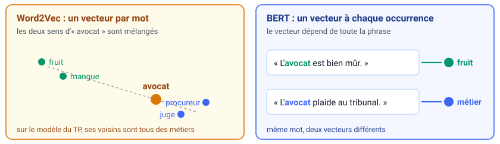

- Word2Vec donne un seul vecteur à `avocat`. Sur le modèle du TP, ses plus proches voisins sont tous des métiers : `légiste`, `avocate`, `procureur`. Le fruit a disparu.
- Un Transformer comme BERT calcule un vecteur différent pour chaque phrase. C'est le sujet de la séance 6.

---

### **Retour au fil rouge**

<div class="tight" style="font-size:.8em;">

| Requête | Problème | Ce qui l'a réglé | Réglé ? |
|---|---|---|---|
| <span class="search">Chats</span> | majuscule et pluriel | normalisation, lemmatisation | oui |
| <span class="search">salom</span> | faute de frappe | distance d'édition | oui |
| <span class="search">le chat</span> | `le` fait remonter D2 et D4 | stop words, TF-IDF | oui |
| <span class="search">félin salon</span> | D4 répète `salon` | TF-IDF | oui |
| <span class="search">félin</span> | synonyme de `chat` | Word2Vec | en partie |
| <span class="search">avocat mûr</span> | un mot, deux sens | un vecteur par contexte | séance 6 |

</div>

<div class="note">

Chaque outil de la séance répond à un problème concret de recherche. Les deux dernières lignes montrent ce qu'il reste à voir en séance 6.

</div>

---

### **Comparer les représentations**

<div class="tight">

| | Ce qu'elle garde | Ce qu'elle perd | Coût |
|---|---|---|---|
| Comptages | quels mots, combien de fois | l'ordre, les synonymes | très faible |
| TF-IDF | les mots qui distinguent | l'ordre, les synonymes | faible |
| Word2Vec | une proximité de sens | l'ordre, les sens multiples | moyen |

</div>

- L'utilisateur emploie les mêmes mots que les documents ? Comptages ou TF-IDF suffisent, et leurs résultats sont faciles à expliquer.
- Il écrit autrement que les documents ? Il faut des vecteurs denses : Word2Vec, puis les encodeurs de la séance 6.

---

### **Exercice : trois phrases**

<div class="card" style="width:100%;">

`D1` le chat dort sur le canapé

`D2` le chien dort sur le tapis

`D3` un félin se repose sur le sofa

</div>

<div class="cols" style="margin-top:12px;">
<div>

1. Construisez la matrice de comptage.
2. Calculez cos(D1, D2), puis cos(D1, D3).

</div>
<div>

3. Refaites le calcul en TF-IDF, avec la formule de scikit-learn.
4. Le score de D3 baisse fortement en TF-IDF. Pourquoi ?

</div>
</div>

---

### **Correction de l'exercice**

| | cos(D1, D2) | cos(D1, D3) |
|---|---|---|
| Comptages | 0,75 | 0,40 |
| TF-IDF | 0,54 | 0,21 |
| Moyenne des vecteurs du TP | 0,97 | 0,84 |

- En TF-IDF, D3 ne partage avec D1 que `le` et `sur`. Présents dans les trois documents, ces mots tombent à un IDF de 1, contre 1,69 pour les mots rares.
- Avec les vecteurs Word2Vec, `félin` est proche de `chat` et `sofa` de `canapé` : D3 se rapproche enfin de D1.

<p class="small">Sur ce modèle compressé, canapé et sofa ont même exactement le même vecteur.</p>

---

### **Ce qu'il faut savoir refaire à la main**

1. Nettoyer une phrase : normaliser, tokeniser, retirer les stop words, et dire ce que chaque étape fait perdre.
2. Compter les occurrences et construire la matrice documents × termes.
3. Calculer un IDF avec la formule de scikit-learn, et expliquer pourquoi il augmente quand le mot est rare.
4. Calculer un cosinus, y compris quand l'un des vecteurs est nul.
5. Remplir une petite matrice de Levenshtein.
6. Trouver les voisins d'un mot dans un fichier de vecteurs.

<div class="note">

Si vous savez faire ces six opérations à la main, la suite du module (phrases, documents, recherche) consiste surtout à les combiner.

</div>

---

### **Ce qu'il faut retenir**


- **Le prétraitement** (normalisation, stop words, lemmatisation) est une suite de choix : chacun fait perdre quelque chose et se décide selon la tâche.
- **Levenshtein** compare des lettres, sans rien savoir du sens.
- **Comptages et TF-IDF** comparent des mots. TF-IDF donne plus de poids aux mots rares.
- **Word2Vec** rapproche les mots qui apparaissent dans les mêmes contextes.
- Chaque méthode perd quelque chose : l'ordre, les synonymes ou les mots inconnus. Le bon choix dépend de la question posée.

---

### **À vous : trois situations**

Pour chaque cas, quelle représentation choisiriez-vous, et quelle limite acceptez-vous ?

<div class="card" style="width:100%; margin-top:10px;">

**1.** Chercher `voiture` dans un catalogue qui n'emploie que le mot `automobile`.

</div>
<div class="card" style="width:100%; margin-top:10px;">

**2.** Retrouver les documents où `avocat` désigne le fruit, et pas le métier.

</div>
<div class="card" style="width:100%; margin-top:10px;">

**3.** Répondre à une question dont aucun mot n'apparaît dans le corpus.

</div>

<p class="small" style="margin-top:12px;">Réponse attendue : une représentation, une justification, et la limite que vous acceptez.</p>

---

### **Le TP : trois blocs, une heure**

<div class="cols">
<div class="card">

**Bloc 1 · 15 min**

Normaliser, tokeniser, retirer les stop words, puis mesurer l'effet.

</div>
<div class="card">

**Bloc 2 · 20 min**

Comptages, TF-IDF, cosinus, et un vecteur nul à provoquer.

</div>
<div class="card">

**Bloc 3 · 12 min**

Embeddings déjà calculés : voisins, analogies, échecs.

</div>
</div>

<p class="small">Les 13 minutes restantes servent aux consignes, aux erreurs d'exécution et à vos questions.</p>

**En sortant du TP, vous devez savoir :**

- mesurer l'effet des stop words sur le nombre de tokens et de types ;
- expliquer le cosinus nul entre `voiture` et `automobile` en TF-IDF ;
- dire ce que fixe `fit` et ce qu'ignore `transform` ;
- choisir entre comptages et vecteurs denses pour une tâche donnée.
