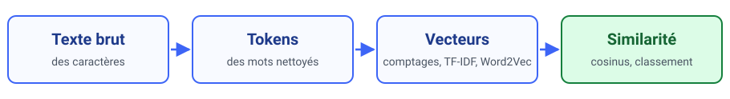
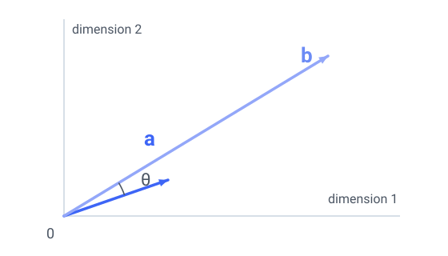
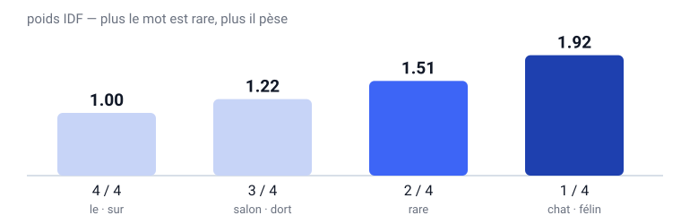
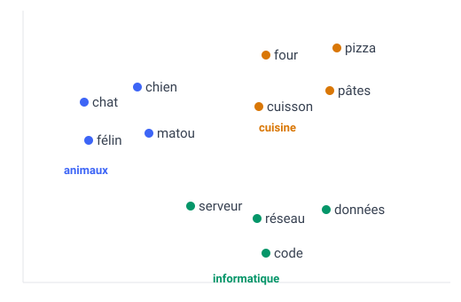
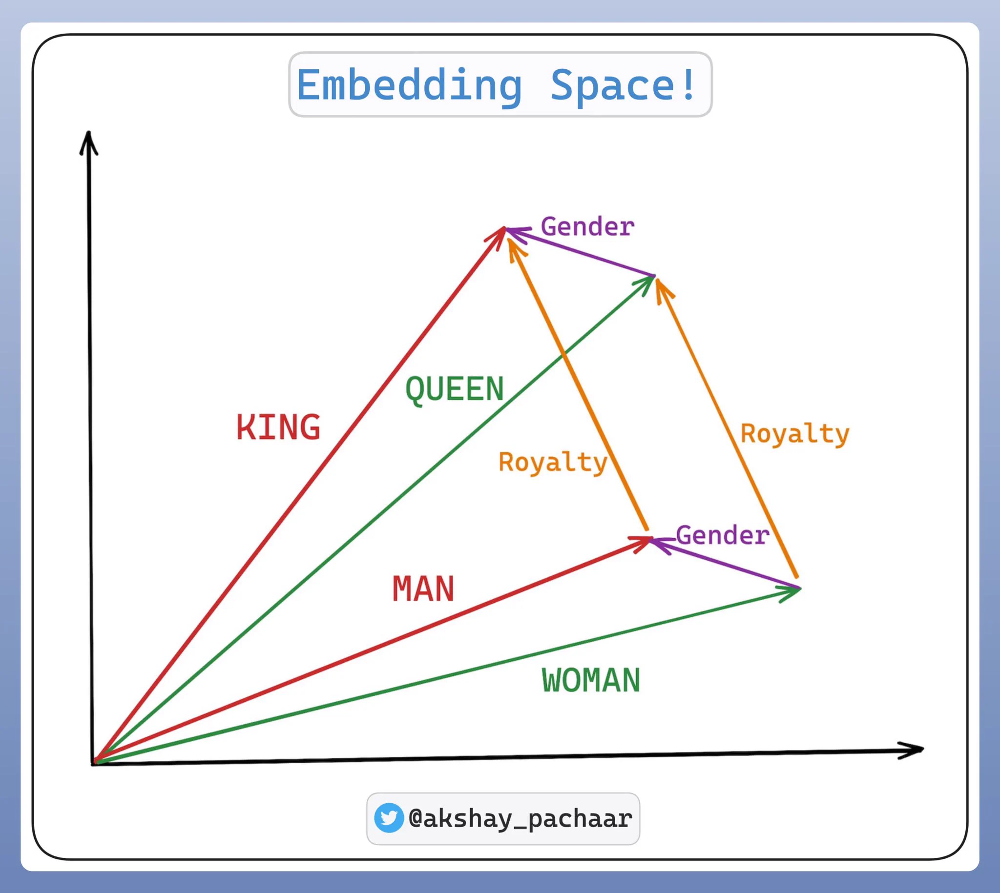

<!-- _class: title -->

# Le Data Mining

<br/>

## Cours 5 — Fondamentaux du NLP et préparation au RAG

<br/>

Christopher de Boisvilliers

2026-11-02

---

<!-- header: ⭐️ Plan de la séance -->

### **Plan de la séance**

<div style="display:flex; gap:26px; margin-top:6px;">
<div style="flex:1.12; font-size:.92em;">

1. **Pourquoi le langage résiste**
2. **Du texte aux tokens**
3. **Distance d'édition**
4. **Sac de mots et cosinus**
5. **TF-IDF**
6. **Des mots aux vecteurs (Word2Vec)**
7. **Limites et préparation au RAG**

</div>
<div style="flex:.88; border-left:2px solid #dbe4f7; padding-left:18px; font-size:.86em;">

**Les 5 séances**

<span style="color:#3d65f6; font-weight:700;">5 · NLP : du texte aux vecteurs</span>

6 · Embeddings et Transformers

7 · Recherche vectorielle

8 · RAG avec LangChain

9 · Évaluer et industrialiser

</div>
</div>

<div style="margin-top:10px; padding:10px 14px; background:#f4f7ff; border-radius:8px; font-size:.86em;">
Aujourd'hui : <strong>2 h 30 de cours</strong> — puis <strong>1 h de TP</strong>.<br/>
<span style="color:#4b5563;">RAG = <em>Retrieval-Augmented Generation</em> : répondre à une question en retrouvant d'abord les bons passages d'un corpus, puis en les donnant à un modèle de langage.</span>
</div>

---

<!-- header: ⭐️ Objectifs de la séance -->

### **Objectifs de la séance**

<p style="font-size:.84em; margin:0 0 6px 0;">
À la fin de cette séance, vous saurez :
</p>

<div style="display:flex; flex-direction:column; gap:7px; font-size:.8em;">
<div style="background:#f4f7ff; border-radius:8px; padding:8px 14px;">
<strong>1.</strong> <strong>préparer</strong> un texte pour un modèle — normaliser, tokeniser, filtrer — et dire ce que chaque choix coûte. <span style="color:#9aa4b8;">(section 2)</span>
</div>
<div style="background:#f4f7ff; border-radius:8px; padding:8px 14px;">
<strong>2.</strong> <strong>mesurer</strong> une ressemblance : d'abord par les caractères (distance d'édition), puis par les mots (cosinus). <span style="color:#9aa4b8;">(sections 3 et 4)</span>
</div>
<div style="background:#f4f7ff; border-radius:8px; padding:8px 14px;">
<strong>3.</strong> <strong>pondérer</strong> les termes pour qu'un mot présent partout n'écrase plus un mot discriminant. <span style="color:#9aa4b8;">(section 5)</span>
</div>
<div style="background:#f4f7ff; border-radius:8px; padding:8px 14px;">
<strong>4.</strong> <strong>obtenir</strong> des vecteurs denses qui rapprochent <code>voiture</code> et <code>automobile</code>, et <strong>nommer</strong> leurs limites. <span style="color:#9aa4b8;">(sections 6 et 7)</span>
</div>
<div style="background:#f4f7ff; border-radius:8px; padding:8px 14px;">
<strong>5.</strong> <strong>décrire</strong> les deux phases d'un RAG <span style="color:#9aa4b8;">(section 7)</span> et <strong>choisir</strong> une représentation en assumant son prix.
</div>
</div>

<div style="margin-top:12px; padding:10px 14px; border:1.5px dashed #3d65f6; border-radius:8px; font-size:.84em;">
<strong>Prérequis</strong> : cours 1 à 4 (Python, <code>scikit-learn</code>, régression logistique). <strong>Aucune</strong> connaissance en linguistique n'est supposée : tout est introduit à partir d'exemples chiffrés.
</div>

---

<!-- header: ⭐️ Pourquoi le langage résiste -->

### **Deux phrases, une même scène**

<div style="display:flex; flex-direction:column; gap:12px; margin:14px 0 12px 0;">
<div style="background:#f4f7ff; border-left:5px solid #3d65f6; border-radius:8px; padding:12px 18px; font-size:1.1em;">
« <mark>Le</mark> chat dort <mark>sur</mark> <mark>le</mark> canapé. »
</div>
<div style="background:#f4f7ff; border-left:5px solid #3d65f6; border-radius:8px; padding:12px 18px; font-size:1.1em;">
« Un félin se repose <mark>sur</mark> <mark>le</mark> sofa. »
</div>
</div>

<div style="text-align:center; font-size:.78em; color:#4b5563; white-space:nowrap;">
13 occurrences · 10 formes · <strong>2 formes communes</strong> (<code>le</code>, <code>sur</code>) · <strong>0 mot de contenu commun</strong>
<div style="font-size:.86em; margin-top:2px; color:#4b5563;">« mot de contenu » = un mot qui porte du sens (nom, verbe, adjectif), par opposition aux mots outils.</div>
</div>

<div style="margin-top:14px; padding:12px 16px; border:1.5px dashed #3d65f6; border-radius:8px; font-size:.95em;">
Pour un humain, c'est la même scène.<br/>
Pour une méthode lexicale, la similarité est faible et ne repose que sur <strong>deux mots outils</strong>.
</div>

<p style="text-align:center; margin-top:14px; font-size:.95em;">
C'est ce gouffre que ce cours comble — et qui prépare le RAG.
</p>

---

### **Pourquoi est-ce si difficile ?**

<div style="display:grid; grid-template-columns:1fr 1fr; gap:14px; margin-top:10px; font-size:.85em;">

<div style="background:#f4f7ff; border-radius:10px; padding:14px 16px;">
<strong>1 · Ambiguïté</strong><br/>
« avocat » : le fruit ou le métier ?<br/>
« J'ai vu l'homme avec le télescope. »
</div>

<div style="background:#f4f7ff; border-radius:10px; padding:14px 16px;">
<strong>2 · Productivité</strong><br/>
On invente des mots et des phrases jamais vus :<br/>
« chanmé », « googliser », « je me suis fait gruger ».
</div>

<div style="background:#f4f7ff; border-radius:10px; padding:14px 16px;">
<strong>3 · Variabilité de surface</strong><br/>
<code>ÉTÉ</code> · <code>été</code> · <code>ete</code> (sans accent) · <code>etté</code> (faute)<br/>
Une même idée, quatre graphies.
</div>

<div style="background:#f4f7ff; border-radius:10px; padding:14px 16px;">
<strong>4 · Dépendance au contexte</strong><br/>
« La banque était fermée. »<br/>
Laquelle ? Sans contexte, indécidable.
</div>

</div>

<div style="margin-top:12px; text-align:center; font-size:.82em; color:#4b5563;">
Quatre causes distinctes — et quatre raisons pour lesquelles un simple <code>if</code> ne suffira jamais.
</div>

---

### **Quatre niveaux d'analyse**

<p style="font-size:.85em; color:#4b5563; margin-bottom:6px;">
À ne pas confondre avec les quatre difficultés : ici on regarde <em>où</em> se situe le problème, sur <strong>quatre niveaux retenus dans ce cours</strong>.
</p>


<p style="font-size:.85em; color:#4b5563; margin-top:8px;">
Le NLP classique les traite séparément. La suite du parcours montrera des modèles qui les traitent ensemble.
</p>

---

### **La chaîne que nous allons construire**



<div style="margin-top:18px; display:flex; gap:12px; font-size:.85em;">
<div style="flex:1; border-left:4px solid #3d65f6; padding-left:12px;">
<strong>Aujourd'hui</strong><br/>
Texte → tokens → vecteurs
</div>
<div style="flex:1; border-left:4px solid #93a7f9; padding-left:12px;">
<strong>Séances 6 à 9</strong><br/>
Contexte → index → génération
</div>
</div>

<p style="margin-top:14px; font-size:.85em; color:#4b5563;">
Chaque brique sera construite à la main avant d'être appelée via une bibliothèque.
</p>

---

<!-- header: ⭐️ Du texte aux tokens -->

### **De la chaîne de caractères aux tokens**

<div style="display:flex; gap:22px; margin-top:4px;">
<div style="flex:1; font-size:.78em;">

**Le vocabulaire de base**

| Terme | Définition |
|---|---|
| **Type** | forme distincte |
| **Occurrence** | apparition d'un type dans le texte |
| **Token** | unité produite par le tokenizer (ici : un mot) |
| **Vocabulaire $V$** | ensemble des types |
| **Identifiant** | entier associé à un type |

</div>
<div style="flex:1; font-size:.84em;">

`le chat et le chien`

- **5 tokens** (occurrences)
- **4 types** (`le` apparaît 2 fois)
- $V$ = {`le`, `chat`, `et`, `chien`}
- identifiants : `le`→0, `chat`→1, `et`→2, `chien`→3

</div>
</div>

<div style="margin-top:12px; padding:10px 14px; background:#f4f7ff; border-radius:8px; font-size:.85em;">
Un modèle ne voit jamais de texte : il voit des <strong>identifiants</strong>. Toute la question est de savoir ce qu'on met <em>derrière</em> ces identifiants.<br/>
<span style="color:#4b5563;">Dans tout ce cours, <strong>token = un mot</strong>. En séance 6, le token deviendra un <strong>morceau de mot</strong> : c'est le même terme, mais pas la même unité.</span>
</div>

---

### **Un caractère n'est pas toujours un caractère**

```python
>>> len("é")                               # forme composée (NFC)
1
>>> len(unicodedata.normalize("NFD", "é")) # e + accent combinant
2
```

<div style="margin-top:10px; font-size:.9em;">

- `len()` compte des **points de code**, pas des caractères perçus (une lettre accentuée peut en occuper deux).
- Conséquence : deux textes visuellement identiques ne sont pas forcément égaux caractère par caractère.
- D'où, souvent, une **normalisation avant de comparer** — mais un tokenizer préentraîné peut imposer la sienne.

</div>

<div style="margin-top:12px; padding:10px 14px; border-left:4px solid #3d65f6; background:#f4f7ff; border-radius:6px; font-size:.85em;">
Règle pratique : <code>unicodedata.normalize("NFC", texte)</code> avant de comparer deux chaînes — sinon, suivre la normalisation du tokenizer utilisé.
</div>

---

### **Normaliser, c'est décider ce qu'on perd**

| Décision | Quand la prendre | Ce qu'on perd |
|---|---|---|
| minuscules | presque toujours | la casse (`Apple` ≠ `apple`) |
| supprimer les accents | recherche tolérante | `cote` / `côté` / `coté` |
| retirer la ponctuation | sac de mots | le point d'interrogation, l'emphase |
| retirer les chiffres | textes littéraires | `30 %`, `COVID-19` |
| espaces multiples | texte continu | l'indentation d'un code |

<div style="margin-top:14px; padding:10px 14px; background:#fff4e5; border-left:4px solid #d97706; border-radius:6px; font-size:.86em;">
Il n'existe pas de « bonne » normalisation : il existe des <strong>choix</strong>, et chacun se paie quelque part.
</div>

<p style="margin-top:10px; font-size:.85em; color:#4b5563;">
Un tokenizer préentraîné (BERT, GPT…) applique déjà sa propre normalisation : la refaire peut la contredire.<br/>
<strong>Règle d'arbitrage :</strong> comparer deux chaînes → les normaliser <em>toutes les deux</em> dans la même forme (NFC par défaut, NFKC si ligatures ou compatibilité) ; passer du texte à un tokenizer préentraîné → ne rien normaliser soi-même.
</p>

---

### **Tokeniser : aucun découpage naïf ne suffit**

<div style="display:flex; gap:18px; font-size:.78em;">
<div style="flex:1;">

**Découper sur les espaces**

```
"l'ordinateur"  → ["l'ordinateur"]
"aujourd'hui"   → ["aujourd'hui"]
"porte-monnaie" → ["porte-monnaie"]
```

1 token chacune :<br/>
l'apostrophe et le trait d'union ne sont pas vus comme des frontières.

</div>
<div style="flex:1;">

**Découper avec `\w+`**

```
re.findall(r"\w+", "cœur été l'ordinateur")
→ ['cœur', 'été', 'l', 'ordinateur']
```

Les accents et `œ` passent.<br/>
Mais `l'ordinateur` est coupé en deux, et `\w` inclut chiffres et `_`.

</div>
</div>

<div style="margin-top:12px; padding:10px 14px; background:#f4f7ff; border-radius:8px; font-size:.86em;">
Aucune règle naïve n'est correcte pour toutes les tâches : le bon découpage dépend de l'<strong>unité</strong> qu'on veut manipuler.
</div>

---

### **Les stop words : un gain, un piège**

<div style="display:flex; gap:20px; margin-top:4px;">
<div style="flex:1; font-size:.85em;">

**Le gain**

- moins de dimensions donc des calculs plus rapides
- moins de bruit : les mots outils n'occupent plus l'essentiel des comptages

</div>
<div style="flex:1; font-size:.85em;">

**Le piège**

`je ne veux pas payer`

→ après retrait : `veux payer`

La négation a disparu. Le sens est inversé.

</div>
</div>

<div style="margin-top:14px; font-size:.88em;">

- Souvent retirés pour **BoW / TF-IDF** — mais c'est un **hyperparamètre** : sur des avis clients, `ne… pas` porte le signal.
- Un tokenizer de Transformer découpe avant tout filtrage : on ne supprime rien avant lui.
- Dans un **RAG**, le filtre s'applique — ou non — à l'index et à la requête, jamais au modèle.

</div>

---

### **Stemming ou lemmatisation ?**

| Mot | Stemming (stem produit) | Lemmatisation |
|---|---|---|
| mangeons | `mang` | `manger` |
| mangera | `mang` | `manger` |
| mangé | `mang` | `manger` |
| mangeais | `mang` | `manger` |
| meilleur | `meilleur` | `bon` |

<div style="display:flex; gap:20px; margin-top:12px; font-size:.84em;">
<div style="flex:1;">

**Stemming** — règles de troncature (Snowball), sans dictionnaire.<br/>
Un stem n'est pas un radical linguistique : c'est la forme produite par l'algorithme.

</div>
<div style="flex:1;">

**Lemmatisation** — analyse morphologique et étiquette grammaticale.<br/>
Plus lente ; `meilleur → bon` dépend de l'analyseur.

</div>
</div>


---

### **Étiqueter la grammaire : le POS tagging**

<p style="font-size:.84em; color:#4b5563; margin:2px 0 6px 0;">
Chaque token reçoit une étiquette grammaticale (Universal POS). Exemple :
</p>

<div style="display:flex; gap:16px; font-size:.86em;">
<div style="flex:1.1;">

| token | étiquette |
|---|---|
| Le | `DET` |
| président | `NOUN` |
| parle | `VERB` |
| de | `ADP` |
| la | `DET` |
| banque | `NOUN` |

</div>
<div style="flex:1;">

**À quoi ça sert**

- **lever une ambiguïté** : `la fermeture` (nom) vs `fermer` (verbe)
- **lemmatiser juste** : `suis` → `être` ou `suivre` selon le contexte
- **préparer l'extraction d'entités** (séance 6)

</div>
</div>

<div style="margin-top:10px; padding:10px 14px; background:#f4f7ff; border-radius:8px; font-size:.84em;">
C'est un <strong>outil de pipeline</strong>, pas un concept de ce cours : on l'utilise, on ne l'implémente pas.
</div>

---

### **Ce qu'on garde pour la suite**

<div style="font-size:.88em;">

**1 · Les sous-mots (BPE, WordPiece)** — avec les sous-mots, « token » ne veut plus dire « mot » : c'est un morceau de mot, et ce sera le sens du terme en séance 6.

`incroyable` → `in` + `croy` + `able` (segmentation illustrative) : un mot inconnu devient une suite de morceaux connus.
C'est la réponse au problème des mots hors vocabulaire. Le principe est repris par tous les Transformers — BPE, WordPiece ou Unigram selon le modèle (séance 6).

**2 · Le POS tagging, en trois lignes**

Chaque token reçoit une étiquette (`DET`, `NOUN`, `VERB`… en Universal POS). Utile pour lever une ambiguïté et pour lemmatiser correctement. C'est un **outil de pipeline**, pas un concept de ce cours.

</div>

<div style="margin-top:16px; padding:12px 16px; border:1.5px dashed #3d65f6; border-radius:8px; font-size:.9em;">
On sait maintenant produire des tokens propres.<br/>
Question suivante : comment dire que <strong>deux textes se ressemblent</strong> ?
</div>


---

### **Le pipeline de prétraitement, de bout en bout**


<div style="display:flex; gap:16px; font-size:.8em; margin-top:2px;">
<div style="flex:1;">

**Les deux étapes optionnelles** (orange) ne le sont pas pour les mêmes raisons : les stop words allègent le vecteur, la lemmatisation rapproche les formes d'un même mot.

</div>
<div style="flex:1;">

**Le POS tagging** n'est pas une étape de filtrage : il fournit l'étiquette dont la lemmatisation a besoin (`suis` → `être` ou `suivre`).

</div>
</div>

<p style="font-size:.78em; color:#4b5563; margin-top:4px;">
Ordre non négociable : on ne filtre pas avant d'avoir tokenisé, et on ne lemmatise pas sans étiquette grammaticale.
</p>

---

<!-- header: ⭐️ Distance d'édition -->

### **Deux chaînes se ressemblent-elles ?**

<div style="display:flex; flex-direction:column; gap:10px; margin-top:6px; font-size:.86em;">
<div style="background:#f4f7ff; border-radius:8px; padding:12px 16px;">
<strong>Une faute de frappe</strong> — <code>ordinateur</code> / <code>ordinatuer</code><br/>
L'utilisateur a tapé trop vite.
</div>
<div style="background:#f4f7ff; border-radius:8px; padding:12px 16px;">
<strong>Une flexion</strong> — <code>carton</code> / <code>cartons</code><br/>
Le même objet, deux formes.
</div>
<div style="background:#f4f7ff; border-radius:8px; padding:12px 16px;">
<strong>Un synonyme</strong> — <code>voiture</code> / <code>automobile</code><br/>
Le même objet, et pourtant une distance de <strong>8</strong>.
</div>
</div>

<p style="margin-top:12px; font-size:.9em;">
Peut-on mesurer la ressemblance <em>sans</em> passer par des vecteurs ? Commençons par le plus simple : les caractères.
</p>

---

### **Trois opérations, un coût de 1**

<div style="display:grid; grid-template-columns:1fr 1fr 1fr; gap:12px; margin-top:10px; font-size:.8em; text-align:center;">
<div style="background:#f4f7ff; border-radius:10px; padding:14px 10px;">
<strong>Insertion</strong><br/><br/>
<code>chat</code> → <code>chats</code><br/><br/>
<span style="color:#4b5563;">ajouter <code>s</code></span>
</div>
<div style="background:#f4f7ff; border-radius:10px; padding:14px 10px;">
<strong>Suppression</strong><br/><br/>
<code>chats</code> → <code>chat</code><br/><br/>
<span style="color:#4b5563;">ôter <code>s</code></span>
</div>
<div style="background:#f4f7ff; border-radius:10px; padding:14px 10px;">
<strong>Substitution</strong><br/><br/>
<code>chat</code> → <code>chot</code><br/><br/>
<span style="color:#4b5563;">remplacer <code>a</code> par <code>o</code></span>
</div>
</div>

<div style="margin-top:16px; padding:12px 16px; border-left:4px solid #3d65f6; background:#f4f7ff; border-radius:6px; font-size:.9em;">
<strong>Distance de Levenshtein</strong> = coût minimal de la suite d'opérations qui transforme une chaîne en l'autre.
</div>

---

### **La récurrence**

<div style="font-size:.78em;">

$$\text{lev}(i,j)=\min\begin{cases}\text{lev}(i-1,j)+1 & \text{supprimer } a_i\\[2pt] \text{lev}(i,j-1)+1 & \text{ajouter } b_j\\[2pt] \text{lev}(i-1,j-1)+[a_i\neq b_j] & \text{substituer, ou conserver si } a_i=b_j\end{cases}$$

$$\text{conditions initiales :}\quad \text{lev}(i,0)=i \qquad \text{lev}(0,j)=j$$

</div>

<div style="font-size:.86em; margin-top:4px;">

- $\text{lev}(i,j)$ = distance entre les **$i$ premiers caractères** de $a$ et les **$j$ premiers** de $b$.
- $[a_i \neq b_j]$ vaut **0 si les caractères sont égaux, 1 sinon**.
- On lit le résultat dans la **dernière case** de la matrice.
- Les conditions initiales ne sont pas décoratives : sans elles, la récurrence ne démarre pas.

</div>

---

### **La matrice : initialisation**

<p style="font-size:.82em; color:#4b5563; margin:2px 0 0 0;">
<em>a</em> = <code>chat</code> (lignes) · <em>b</em> = <code>chats</code> (colonnes) · la première ligne et la première colonne sont les conditions initiales.
</p>
<table style="border-collapse:collapse;margin:10px auto;">
<tr><th style='width:56px;height:40px;text-align:center;border:1px solid #dbe4f7;padding:0;font-family:Roboto Mono,monospace;font-size:19px;background:#eef2ff;font-weight:700;color:#111827;'></th><th style='width:56px;height:40px;text-align:center;border:1px solid #dbe4f7;padding:0;font-family:Roboto Mono,monospace;font-size:19px;background:#eef2ff;font-weight:700;color:#111827;'>ε</th><th style='width:56px;height:40px;text-align:center;border:1px solid #dbe4f7;padding:0;font-family:Roboto Mono,monospace;font-size:19px;background:#eef2ff;font-weight:700;color:#111827;'>c</th><th style='width:56px;height:40px;text-align:center;border:1px solid #dbe4f7;padding:0;font-family:Roboto Mono,monospace;font-size:19px;background:#eef2ff;font-weight:700;color:#111827;'>h</th><th style='width:56px;height:40px;text-align:center;border:1px solid #dbe4f7;padding:0;font-family:Roboto Mono,monospace;font-size:19px;background:#eef2ff;font-weight:700;color:#111827;'>a</th><th style='width:56px;height:40px;text-align:center;border:1px solid #dbe4f7;padding:0;font-family:Roboto Mono,monospace;font-size:19px;background:#eef2ff;font-weight:700;color:#111827;'>t</th><th style='width:56px;height:40px;text-align:center;border:1px solid #dbe4f7;padding:0;font-family:Roboto Mono,monospace;font-size:19px;background:#eef2ff;font-weight:700;color:#111827;'>s</th></tr>
<tr><th style='width:56px;height:40px;text-align:center;border:1px solid #dbe4f7;padding:0;font-family:Roboto Mono,monospace;font-size:19px;background:#eef2ff;font-weight:700;color:#111827;'>ε</th><td style='width:56px;height:40px;text-align:center;border:1px solid #dbe4f7;padding:0;font-family:Roboto Mono,monospace;font-size:19px;'>0</td><td style='width:56px;height:40px;text-align:center;border:1px solid #dbe4f7;padding:0;font-family:Roboto Mono,monospace;font-size:19px;'>1</td><td style='width:56px;height:40px;text-align:center;border:1px solid #dbe4f7;padding:0;font-family:Roboto Mono,monospace;font-size:19px;'>2</td><td style='width:56px;height:40px;text-align:center;border:1px solid #dbe4f7;padding:0;font-family:Roboto Mono,monospace;font-size:19px;'>3</td><td style='width:56px;height:40px;text-align:center;border:1px solid #dbe4f7;padding:0;font-family:Roboto Mono,monospace;font-size:19px;'>4</td><td style='width:56px;height:40px;text-align:center;border:1px solid #dbe4f7;padding:0;font-family:Roboto Mono,monospace;font-size:19px;'>5</td></tr>
<tr><th style='width:56px;height:40px;text-align:center;border:1px solid #dbe4f7;padding:0;font-family:Roboto Mono,monospace;font-size:19px;background:#eef2ff;font-weight:700;color:#111827;'>c</th><td style='width:56px;height:40px;text-align:center;border:1px solid #dbe4f7;padding:0;font-family:Roboto Mono,monospace;font-size:19px;color:#c7cedb;background:#fafbfe;'>·</td><td style='width:56px;height:40px;text-align:center;border:1px solid #dbe4f7;padding:0;font-family:Roboto Mono,monospace;font-size:19px;color:#c7cedb;background:#fafbfe;'>·</td><td style='width:56px;height:40px;text-align:center;border:1px solid #dbe4f7;padding:0;font-family:Roboto Mono,monospace;font-size:19px;color:#c7cedb;background:#fafbfe;'>·</td><td style='width:56px;height:40px;text-align:center;border:1px solid #dbe4f7;padding:0;font-family:Roboto Mono,monospace;font-size:19px;color:#c7cedb;background:#fafbfe;'>·</td><td style='width:56px;height:40px;text-align:center;border:1px solid #dbe4f7;padding:0;font-family:Roboto Mono,monospace;font-size:19px;color:#c7cedb;background:#fafbfe;'>·</td><td style='width:56px;height:40px;text-align:center;border:1px solid #dbe4f7;padding:0;font-family:Roboto Mono,monospace;font-size:19px;color:#c7cedb;background:#fafbfe;'>·</td></tr>
<tr><th style='width:56px;height:40px;text-align:center;border:1px solid #dbe4f7;padding:0;font-family:Roboto Mono,monospace;font-size:19px;background:#eef2ff;font-weight:700;color:#111827;'>h</th><td style='width:56px;height:40px;text-align:center;border:1px solid #dbe4f7;padding:0;font-family:Roboto Mono,monospace;font-size:19px;color:#c7cedb;background:#fafbfe;'>·</td><td style='width:56px;height:40px;text-align:center;border:1px solid #dbe4f7;padding:0;font-family:Roboto Mono,monospace;font-size:19px;color:#c7cedb;background:#fafbfe;'>·</td><td style='width:56px;height:40px;text-align:center;border:1px solid #dbe4f7;padding:0;font-family:Roboto Mono,monospace;font-size:19px;color:#c7cedb;background:#fafbfe;'>·</td><td style='width:56px;height:40px;text-align:center;border:1px solid #dbe4f7;padding:0;font-family:Roboto Mono,monospace;font-size:19px;color:#c7cedb;background:#fafbfe;'>·</td><td style='width:56px;height:40px;text-align:center;border:1px solid #dbe4f7;padding:0;font-family:Roboto Mono,monospace;font-size:19px;color:#c7cedb;background:#fafbfe;'>·</td><td style='width:56px;height:40px;text-align:center;border:1px solid #dbe4f7;padding:0;font-family:Roboto Mono,monospace;font-size:19px;color:#c7cedb;background:#fafbfe;'>·</td></tr>
<tr><th style='width:56px;height:40px;text-align:center;border:1px solid #dbe4f7;padding:0;font-family:Roboto Mono,monospace;font-size:19px;background:#eef2ff;font-weight:700;color:#111827;'>a</th><td style='width:56px;height:40px;text-align:center;border:1px solid #dbe4f7;padding:0;font-family:Roboto Mono,monospace;font-size:19px;color:#c7cedb;background:#fafbfe;'>·</td><td style='width:56px;height:40px;text-align:center;border:1px solid #dbe4f7;padding:0;font-family:Roboto Mono,monospace;font-size:19px;color:#c7cedb;background:#fafbfe;'>·</td><td style='width:56px;height:40px;text-align:center;border:1px solid #dbe4f7;padding:0;font-family:Roboto Mono,monospace;font-size:19px;color:#c7cedb;background:#fafbfe;'>·</td><td style='width:56px;height:40px;text-align:center;border:1px solid #dbe4f7;padding:0;font-family:Roboto Mono,monospace;font-size:19px;color:#c7cedb;background:#fafbfe;'>·</td><td style='width:56px;height:40px;text-align:center;border:1px solid #dbe4f7;padding:0;font-family:Roboto Mono,monospace;font-size:19px;color:#c7cedb;background:#fafbfe;'>·</td><td style='width:56px;height:40px;text-align:center;border:1px solid #dbe4f7;padding:0;font-family:Roboto Mono,monospace;font-size:19px;color:#c7cedb;background:#fafbfe;'>·</td></tr>
<tr><th style='width:56px;height:40px;text-align:center;border:1px solid #dbe4f7;padding:0;font-family:Roboto Mono,monospace;font-size:19px;background:#eef2ff;font-weight:700;color:#111827;'>t</th><td style='width:56px;height:40px;text-align:center;border:1px solid #dbe4f7;padding:0;font-family:Roboto Mono,monospace;font-size:19px;color:#c7cedb;background:#fafbfe;'>·</td><td style='width:56px;height:40px;text-align:center;border:1px solid #dbe4f7;padding:0;font-family:Roboto Mono,monospace;font-size:19px;color:#c7cedb;background:#fafbfe;'>·</td><td style='width:56px;height:40px;text-align:center;border:1px solid #dbe4f7;padding:0;font-family:Roboto Mono,monospace;font-size:19px;color:#c7cedb;background:#fafbfe;'>·</td><td style='width:56px;height:40px;text-align:center;border:1px solid #dbe4f7;padding:0;font-family:Roboto Mono,monospace;font-size:19px;color:#c7cedb;background:#fafbfe;'>·</td><td style='width:56px;height:40px;text-align:center;border:1px solid #dbe4f7;padding:0;font-family:Roboto Mono,monospace;font-size:19px;color:#c7cedb;background:#fafbfe;'>·</td><td style='width:56px;height:40px;text-align:center;border:1px solid #dbe4f7;padding:0;font-family:Roboto Mono,monospace;font-size:19px;color:#c7cedb;background:#fafbfe;'>·</td></tr>
</table>
<p style="font-size:.82em; text-align:center; color:#4b5563; margin-top:2px;">
Transformer 0 caractère en <em>j</em> caractères coûte <em>j</em> insertions — et inversement.
</p>

---

### **La matrice : on remplit case par case**

<p style="font-size:.82em; color:#4b5563; margin:2px 0 0 0;">
Chaque case regarde ses <strong>trois voisines</strong> (haut, gauche, diagonale) et prend le minimum. Ici le calcul de la case ligne <code>a</code>, colonne <code>a</code>.
</p>
<table style="border-collapse:collapse;margin:10px auto;">
<tr><th style='width:56px;height:40px;text-align:center;border:1px solid #dbe4f7;padding:0;font-family:Roboto Mono,monospace;font-size:19px;background:#eef2ff;font-weight:700;color:#111827;'></th><th style='width:56px;height:40px;text-align:center;border:1px solid #dbe4f7;padding:0;font-family:Roboto Mono,monospace;font-size:19px;background:#eef2ff;font-weight:700;color:#111827;'>ε</th><th style='width:56px;height:40px;text-align:center;border:1px solid #dbe4f7;padding:0;font-family:Roboto Mono,monospace;font-size:19px;background:#eef2ff;font-weight:700;color:#111827;'>c</th><th style='width:56px;height:40px;text-align:center;border:1px solid #dbe4f7;padding:0;font-family:Roboto Mono,monospace;font-size:19px;background:#eef2ff;font-weight:700;color:#111827;'>h</th><th style='width:56px;height:40px;text-align:center;border:1px solid #dbe4f7;padding:0;font-family:Roboto Mono,monospace;font-size:19px;background:#eef2ff;font-weight:700;color:#111827;'>a</th><th style='width:56px;height:40px;text-align:center;border:1px solid #dbe4f7;padding:0;font-family:Roboto Mono,monospace;font-size:19px;background:#eef2ff;font-weight:700;color:#111827;'>t</th><th style='width:56px;height:40px;text-align:center;border:1px solid #dbe4f7;padding:0;font-family:Roboto Mono,monospace;font-size:19px;background:#eef2ff;font-weight:700;color:#111827;'>s</th></tr>
<tr><th style='width:56px;height:40px;text-align:center;border:1px solid #dbe4f7;padding:0;font-family:Roboto Mono,monospace;font-size:19px;background:#eef2ff;font-weight:700;color:#111827;'>ε</th><td style='width:56px;height:40px;text-align:center;border:1px solid #dbe4f7;padding:0;font-family:Roboto Mono,monospace;font-size:19px;'>0</td><td style='width:56px;height:40px;text-align:center;border:1px solid #dbe4f7;padding:0;font-family:Roboto Mono,monospace;font-size:19px;'>1</td><td style='width:56px;height:40px;text-align:center;border:1px solid #dbe4f7;padding:0;font-family:Roboto Mono,monospace;font-size:19px;'>2</td><td style='width:56px;height:40px;text-align:center;border:1px solid #dbe4f7;padding:0;font-family:Roboto Mono,monospace;font-size:19px;'>3</td><td style='width:56px;height:40px;text-align:center;border:1px solid #dbe4f7;padding:0;font-family:Roboto Mono,monospace;font-size:19px;'>4</td><td style='width:56px;height:40px;text-align:center;border:1px solid #dbe4f7;padding:0;font-family:Roboto Mono,monospace;font-size:19px;'>5</td></tr>
<tr><th style='width:56px;height:40px;text-align:center;border:1px solid #dbe4f7;padding:0;font-family:Roboto Mono,monospace;font-size:19px;background:#eef2ff;font-weight:700;color:#111827;'>c</th><td style='width:56px;height:40px;text-align:center;border:1px solid #dbe4f7;padding:0;font-family:Roboto Mono,monospace;font-size:19px;'>1</td><td style='width:56px;height:40px;text-align:center;border:1px solid #dbe4f7;padding:0;font-family:Roboto Mono,monospace;font-size:19px;'>0</td><td style='width:56px;height:40px;text-align:center;border:1px solid #dbe4f7;padding:0;font-family:Roboto Mono,monospace;font-size:19px;'>1</td><td style='width:56px;height:40px;text-align:center;border:1px solid #dbe4f7;padding:0;font-family:Roboto Mono,monospace;font-size:19px;'>2</td><td style='width:56px;height:40px;text-align:center;border:1px solid #dbe4f7;padding:0;font-family:Roboto Mono,monospace;font-size:19px;'>3</td><td style='width:56px;height:40px;text-align:center;border:1px solid #dbe4f7;padding:0;font-family:Roboto Mono,monospace;font-size:19px;'>4</td></tr>
<tr><th style='width:56px;height:40px;text-align:center;border:1px solid #dbe4f7;padding:0;font-family:Roboto Mono,monospace;font-size:19px;background:#eef2ff;font-weight:700;color:#111827;'>h</th><td style='width:56px;height:40px;text-align:center;border:1px solid #dbe4f7;padding:0;font-family:Roboto Mono,monospace;font-size:19px;'>2</td><td style='width:56px;height:40px;text-align:center;border:1px solid #dbe4f7;padding:0;font-family:Roboto Mono,monospace;font-size:19px;'>1</td><td style='width:56px;height:40px;text-align:center;border:1px solid #dbe4f7;padding:0;font-family:Roboto Mono,monospace;font-size:19px;'>0</td><td style='width:56px;height:40px;text-align:center;border:1px solid #dbe4f7;padding:0;font-family:Roboto Mono,monospace;font-size:19px;'>1</td><td style='width:56px;height:40px;text-align:center;border:1px solid #dbe4f7;padding:0;font-family:Roboto Mono,monospace;font-size:19px;'>2</td><td style='width:56px;height:40px;text-align:center;border:1px solid #dbe4f7;padding:0;font-family:Roboto Mono,monospace;font-size:19px;'>3</td></tr>
<tr><th style='width:56px;height:40px;text-align:center;border:1px solid #dbe4f7;padding:0;font-family:Roboto Mono,monospace;font-size:19px;background:#eef2ff;font-weight:700;color:#111827;'>a</th><td style='width:56px;height:40px;text-align:center;border:1px solid #dbe4f7;padding:0;font-family:Roboto Mono,monospace;font-size:19px;'>3</td><td style='width:56px;height:40px;text-align:center;border:1px solid #dbe4f7;padding:0;font-family:Roboto Mono,monospace;font-size:19px;'>2</td><td style='width:56px;height:40px;text-align:center;border:1px solid #dbe4f7;padding:0;font-family:Roboto Mono,monospace;font-size:19px;'>1</td><td style='width:56px;height:40px;text-align:center;border:1px solid #dbe4f7;padding:0;font-family:Roboto Mono,monospace;font-size:19px;background:#fff4e5;border:2px solid #d97706;font-weight:700;'>0</td><td style='width:56px;height:40px;text-align:center;border:1px solid #dbe4f7;padding:0;font-family:Roboto Mono,monospace;font-size:19px;'>1</td><td style='width:56px;height:40px;text-align:center;border:1px solid #dbe4f7;padding:0;font-family:Roboto Mono,monospace;font-size:19px;'>2</td></tr>
<tr><th style='width:56px;height:40px;text-align:center;border:1px solid #dbe4f7;padding:0;font-family:Roboto Mono,monospace;font-size:19px;background:#eef2ff;font-weight:700;color:#111827;'>t</th><td style='width:56px;height:40px;text-align:center;border:1px solid #dbe4f7;padding:0;font-family:Roboto Mono,monospace;font-size:19px;color:#c7cedb;background:#fafbfe;'>·</td><td style='width:56px;height:40px;text-align:center;border:1px solid #dbe4f7;padding:0;font-family:Roboto Mono,monospace;font-size:19px;color:#c7cedb;background:#fafbfe;'>·</td><td style='width:56px;height:40px;text-align:center;border:1px solid #dbe4f7;padding:0;font-family:Roboto Mono,monospace;font-size:19px;color:#c7cedb;background:#fafbfe;'>·</td><td style='width:56px;height:40px;text-align:center;border:1px solid #dbe4f7;padding:0;font-family:Roboto Mono,monospace;font-size:19px;color:#c7cedb;background:#fafbfe;'>·</td><td style='width:56px;height:40px;text-align:center;border:1px solid #dbe4f7;padding:0;font-family:Roboto Mono,monospace;font-size:19px;color:#c7cedb;background:#fafbfe;'>·</td><td style='width:56px;height:40px;text-align:center;border:1px solid #dbe4f7;padding:0;font-family:Roboto Mono,monospace;font-size:19px;color:#c7cedb;background:#fafbfe;'>·</td></tr>
</table>
<div style="font-size:.82em; margin-top:2px;">
haut = 1+1 = 2 · gauche = 1+1 = 2 · diagonale = 0+0 = <strong>0</strong> (mêmes caractères) → <strong>0</strong>
</div>

---

### **La matrice : le résultat**

<p style="font-size:.82em; color:#4b5563; margin:2px 0 0 0;">
La dernière case donne la distance : <strong>1</strong>. Le chemin surligné montre l'opération retenue.
</p>
<table style="border-collapse:collapse;margin:10px auto;">
<tr><th style='width:56px;height:40px;text-align:center;border:1px solid #dbe4f7;padding:0;font-family:Roboto Mono,monospace;font-size:19px;background:#eef2ff;font-weight:700;color:#111827;'></th><th style='width:56px;height:40px;text-align:center;border:1px solid #dbe4f7;padding:0;font-family:Roboto Mono,monospace;font-size:19px;background:#eef2ff;font-weight:700;color:#111827;'>ε</th><th style='width:56px;height:40px;text-align:center;border:1px solid #dbe4f7;padding:0;font-family:Roboto Mono,monospace;font-size:19px;background:#eef2ff;font-weight:700;color:#111827;'>c</th><th style='width:56px;height:40px;text-align:center;border:1px solid #dbe4f7;padding:0;font-family:Roboto Mono,monospace;font-size:19px;background:#eef2ff;font-weight:700;color:#111827;'>h</th><th style='width:56px;height:40px;text-align:center;border:1px solid #dbe4f7;padding:0;font-family:Roboto Mono,monospace;font-size:19px;background:#eef2ff;font-weight:700;color:#111827;'>a</th><th style='width:56px;height:40px;text-align:center;border:1px solid #dbe4f7;padding:0;font-family:Roboto Mono,monospace;font-size:19px;background:#eef2ff;font-weight:700;color:#111827;'>t</th><th style='width:56px;height:40px;text-align:center;border:1px solid #dbe4f7;padding:0;font-family:Roboto Mono,monospace;font-size:19px;background:#eef2ff;font-weight:700;color:#111827;'>s</th></tr>
<tr><th style='width:56px;height:40px;text-align:center;border:1px solid #dbe4f7;padding:0;font-family:Roboto Mono,monospace;font-size:19px;background:#eef2ff;font-weight:700;color:#111827;'>ε</th><td style='width:56px;height:40px;text-align:center;border:1px solid #dbe4f7;padding:0;font-family:Roboto Mono,monospace;font-size:19px;background:#c7d4f7;font-weight:700;'>0</td><td style='width:56px;height:40px;text-align:center;border:1px solid #dbe4f7;padding:0;font-family:Roboto Mono,monospace;font-size:19px;'>1</td><td style='width:56px;height:40px;text-align:center;border:1px solid #dbe4f7;padding:0;font-family:Roboto Mono,monospace;font-size:19px;'>2</td><td style='width:56px;height:40px;text-align:center;border:1px solid #dbe4f7;padding:0;font-family:Roboto Mono,monospace;font-size:19px;'>3</td><td style='width:56px;height:40px;text-align:center;border:1px solid #dbe4f7;padding:0;font-family:Roboto Mono,monospace;font-size:19px;'>4</td><td style='width:56px;height:40px;text-align:center;border:1px solid #dbe4f7;padding:0;font-family:Roboto Mono,monospace;font-size:19px;'>5</td></tr>
<tr><th style='width:56px;height:40px;text-align:center;border:1px solid #dbe4f7;padding:0;font-family:Roboto Mono,monospace;font-size:19px;background:#eef2ff;font-weight:700;color:#111827;'>c</th><td style='width:56px;height:40px;text-align:center;border:1px solid #dbe4f7;padding:0;font-family:Roboto Mono,monospace;font-size:19px;'>1</td><td style='width:56px;height:40px;text-align:center;border:1px solid #dbe4f7;padding:0;font-family:Roboto Mono,monospace;font-size:19px;background:#c7d4f7;font-weight:700;'>0</td><td style='width:56px;height:40px;text-align:center;border:1px solid #dbe4f7;padding:0;font-family:Roboto Mono,monospace;font-size:19px;'>1</td><td style='width:56px;height:40px;text-align:center;border:1px solid #dbe4f7;padding:0;font-family:Roboto Mono,monospace;font-size:19px;'>2</td><td style='width:56px;height:40px;text-align:center;border:1px solid #dbe4f7;padding:0;font-family:Roboto Mono,monospace;font-size:19px;'>3</td><td style='width:56px;height:40px;text-align:center;border:1px solid #dbe4f7;padding:0;font-family:Roboto Mono,monospace;font-size:19px;'>4</td></tr>
<tr><th style='width:56px;height:40px;text-align:center;border:1px solid #dbe4f7;padding:0;font-family:Roboto Mono,monospace;font-size:19px;background:#eef2ff;font-weight:700;color:#111827;'>h</th><td style='width:56px;height:40px;text-align:center;border:1px solid #dbe4f7;padding:0;font-family:Roboto Mono,monospace;font-size:19px;'>2</td><td style='width:56px;height:40px;text-align:center;border:1px solid #dbe4f7;padding:0;font-family:Roboto Mono,monospace;font-size:19px;'>1</td><td style='width:56px;height:40px;text-align:center;border:1px solid #dbe4f7;padding:0;font-family:Roboto Mono,monospace;font-size:19px;background:#c7d4f7;font-weight:700;'>0</td><td style='width:56px;height:40px;text-align:center;border:1px solid #dbe4f7;padding:0;font-family:Roboto Mono,monospace;font-size:19px;'>1</td><td style='width:56px;height:40px;text-align:center;border:1px solid #dbe4f7;padding:0;font-family:Roboto Mono,monospace;font-size:19px;'>2</td><td style='width:56px;height:40px;text-align:center;border:1px solid #dbe4f7;padding:0;font-family:Roboto Mono,monospace;font-size:19px;'>3</td></tr>
<tr><th style='width:56px;height:40px;text-align:center;border:1px solid #dbe4f7;padding:0;font-family:Roboto Mono,monospace;font-size:19px;background:#eef2ff;font-weight:700;color:#111827;'>a</th><td style='width:56px;height:40px;text-align:center;border:1px solid #dbe4f7;padding:0;font-family:Roboto Mono,monospace;font-size:19px;'>3</td><td style='width:56px;height:40px;text-align:center;border:1px solid #dbe4f7;padding:0;font-family:Roboto Mono,monospace;font-size:19px;'>2</td><td style='width:56px;height:40px;text-align:center;border:1px solid #dbe4f7;padding:0;font-family:Roboto Mono,monospace;font-size:19px;'>1</td><td style='width:56px;height:40px;text-align:center;border:1px solid #dbe4f7;padding:0;font-family:Roboto Mono,monospace;font-size:19px;background:#c7d4f7;font-weight:700;'>0</td><td style='width:56px;height:40px;text-align:center;border:1px solid #dbe4f7;padding:0;font-family:Roboto Mono,monospace;font-size:19px;'>1</td><td style='width:56px;height:40px;text-align:center;border:1px solid #dbe4f7;padding:0;font-family:Roboto Mono,monospace;font-size:19px;'>2</td></tr>
<tr><th style='width:56px;height:40px;text-align:center;border:1px solid #dbe4f7;padding:0;font-family:Roboto Mono,monospace;font-size:19px;background:#eef2ff;font-weight:700;color:#111827;'>t</th><td style='width:56px;height:40px;text-align:center;border:1px solid #dbe4f7;padding:0;font-family:Roboto Mono,monospace;font-size:19px;'>4</td><td style='width:56px;height:40px;text-align:center;border:1px solid #dbe4f7;padding:0;font-family:Roboto Mono,monospace;font-size:19px;'>3</td><td style='width:56px;height:40px;text-align:center;border:1px solid #dbe4f7;padding:0;font-family:Roboto Mono,monospace;font-size:19px;'>2</td><td style='width:56px;height:40px;text-align:center;border:1px solid #dbe4f7;padding:0;font-family:Roboto Mono,monospace;font-size:19px;'>1</td><td style='width:56px;height:40px;text-align:center;border:1px solid #dbe4f7;padding:0;font-family:Roboto Mono,monospace;font-size:19px;background:#c7d4f7;font-weight:700;'>0</td><td style='width:56px;height:40px;text-align:center;border:1px solid #dbe4f7;padding:0;font-family:Roboto Mono,monospace;font-size:19px;background:#c7d4f7;font-weight:700;'>1</td></tr>
</table>
<div style="margin-top:6px; padding:10px 14px; background:#f4f7ff; border-left:4px solid #3d65f6; border-radius:6px; font-size:.86em;">
<code>chat</code> → <code>chats</code> : on conserve <code>c</code>, <code>h</code>, <code>a</code>, <code>t</code>, puis on <strong>insère</strong> <code>s</code>. Coût total : <strong>1</strong>.
</div>

---

### **Normaliser la distance, et les autres cas**

<div style="font-size:.9em; text-align:center;">
<p style="margin:0 0 2px 0;">Similarité normalisée :</p>

$$
1-\frac{\mathrm{lev}(a,b)}{\max(|a|,|b|)}
$$

</div>

| Paire | Distance | Similarité |
|---|---|---|
| `chats` / `chat` | 1 | 0,80 |
| `carton` / `cartons` | 1 | 0,86 |
| `chien` / `chats` | 3 | 0,40 |
| `ordinateur` / `ordinatuer` | 2 | 0,80 |
| `voiture` / `automobile` | 8 | 0,20 |

<div style="margin-top:10px; font-size:.82em; color:#4b5563;">
La formule de normalisation ci-dessus est une <strong>convention</strong> parmi d'autres (on divise aussi parfois par la somme des longueurs).
En <strong>Damerau-Levenshtein</strong>, une transposition compte pour 1 : <code>ordinatuer</code> revient alors à une distance de 1.<br/>
Par convention, la similarité de deux chaînes vides vaut 1.
</div>

---

### **Où ça marche, où ça casse**

<div style="display:flex; gap:20px; margin-top:4px;">
<div style="flex:1; font-size:.84em;">

**Ça marche**

- correction orthographique
- dédoublonnage de fichiers ou de contacts
- recherche approximative (fuzzy)
- alignement de séquences (avec des coûts adaptés)

</div>
<div style="flex:1; font-size:.84em;">

**Ça casse**

- `voiture` / `automobile` : distance 8 sur 10, sens identique
- aucune notion de mot ni de sens
- coût $O(nm)$ sur de longs textes
- comparer des documents est possible, mais coûteux et rarement pertinent

</div>
</div>

<div style="margin-top:14px; padding:12px 16px; border:1.5px dashed #3d65f6; border-radius:8px; font-size:.9em;">
On a mesuré des <strong>caractères</strong>. Pour comparer des <strong>textes</strong>, il faut changer d'unité : les mots.
</div>

---

<!-- header: ⭐️ Sac de mots et cosinus -->

### **L'idée du sac de mots**

<div style="font-size:.9em;">

Un document devient un **sac** : on garde *quels* mots et *combien* de fois, on jette l'ordre.

</div>

<div style="margin:10px 0; padding:12px 16px; background:#f4f7ff; border-left:4px solid #3d65f6; border-radius:6px; font-size:.9em;">
« le chat dort sur le canapé du salon »
→ <code>chat</code>×1 · <code>dort</code>×1 · <code>canapé</code>×1 · <code>salon</code>×1 · <code>le</code>×2 · <code>sur</code>×1 · <code>du</code>×1
</div>

<div style="display:flex; gap:20px; font-size:.86em;">
<div style="flex:1;">

**Le vocabulaire**

Sur nos 4 documents : **18 termes** — autant de types distincts.
C'est l'ensemble des colonnes de la matrice.

</div>
<div style="flex:1;">

**La question**

Deux sacs étant donnés, comment dire qu'ils se ressemblent — avec un **nombre**, pas une intuition ?

</div>
</div>


---

### **Le sac, mécaniquement**


<div style="display:flex; gap:14px; align-items:center; margin-top:6px;">
<div style="flex:0 0 auto;">


</div>
<div style="flex:1; font-size:.84em; color:#4b5563;">
Deux phrases qui disent la même chose dans un autre ordre donnent <strong>le même vecteur</strong> : c'est le prix de la méthode — et sa force, car le comptage devient comparable.
<br/><span style="font-size:.94em;">Le vecteur a <strong>une case par terme du vocabulaire</strong> : ici 5 termes, sur les 18 du corpus — les autres cases valent 0. La dimension est fixe, même si la phrase est courte.</span>
<br/><span style="font-size:.78em; color:#9aa4b8;">Le sac, au sens littéral : on y jette des morceaux, on perd leur disposition. Photo : Meritxell.canela, Wikimedia Commons, domaine public.</span>
</div>
</div>


---

### **Remplir les cases : présence ou comptage ?**

<p style="font-size:.84em; color:#4b5563; margin:2px 0 6px 0;">
Une seule phrase : <code>le chat dort, le chat dort encore</code> — vocabulaire de 4 termes.
</p>

<div style="display:flex; gap:20px; font-size:.86em;">
<div style="flex:1;">

**Présence (0 / 1)**

<table style="border-collapse:collapse;margin:6px auto;"><tr><th style='width:56px;height:30px;text-align:center;border:1px solid #dbe4f7;padding:0;font-size:15px;background:#3d65f6;color:#ffffff;font-weight:700;'>le</th><th style='width:56px;height:30px;text-align:center;border:1px solid #dbe4f7;padding:0;font-size:15px;background:#3d65f6;color:#ffffff;font-weight:700;'>chat</th><th style='width:56px;height:30px;text-align:center;border:1px solid #dbe4f7;padding:0;font-size:15px;background:#3d65f6;color:#ffffff;font-weight:700;'>dort</th><th style='width:56px;height:30px;text-align:center;border:1px solid #dbe4f7;padding:0;font-size:15px;background:#3d65f6;color:#ffffff;font-weight:700;'>encore</th></tr><tr><td style='width:56px;height:34px;text-align:center;border:1px solid #dbe4f7;padding:0;font-family:Roboto Mono,monospace;font-size:17px;'>1</td><td style='width:56px;height:34px;text-align:center;border:1px solid #dbe4f7;padding:0;font-family:Roboto Mono,monospace;font-size:17px;'>1</td><td style='width:56px;height:34px;text-align:center;border:1px solid #dbe4f7;padding:0;font-family:Roboto Mono,monospace;font-size:17px;'>1</td><td style='width:56px;height:34px;text-align:center;border:1px solid #dbe4f7;padding:0;font-family:Roboto Mono,monospace;font-size:17px;'>1</td></tr></table>

Le modèle sait que les mots sont là — pas combien de fois.

</div>
<div style="flex:1;">

**Comptage**

<table style="border-collapse:collapse;margin:6px auto;"><tr><th style='width:56px;height:30px;text-align:center;border:1px solid #dbe4f7;padding:0;font-size:15px;background:#3d65f6;color:#ffffff;font-weight:700;'>le</th><th style='width:56px;height:30px;text-align:center;border:1px solid #dbe4f7;padding:0;font-size:15px;background:#3d65f6;color:#ffffff;font-weight:700;'>chat</th><th style='width:56px;height:30px;text-align:center;border:1px solid #dbe4f7;padding:0;font-size:15px;background:#3d65f6;color:#ffffff;font-weight:700;'>dort</th><th style='width:56px;height:30px;text-align:center;border:1px solid #dbe4f7;padding:0;font-size:15px;background:#3d65f6;color:#ffffff;font-weight:700;'>encore</th></tr><tr><td style='width:56px;height:34px;text-align:center;border:1px solid #dbe4f7;padding:0;font-family:Roboto Mono,monospace;font-size:17px;'>2</td><td style='width:56px;height:34px;text-align:center;border:1px solid #dbe4f7;padding:0;font-family:Roboto Mono,monospace;font-size:17px;'>2</td><td style='width:56px;height:34px;text-align:center;border:1px solid #dbe4f7;padding:0;font-family:Roboto Mono,monospace;font-size:17px;'>2</td><td style='width:56px;height:34px;text-align:center;border:1px solid #dbe4f7;padding:0;font-family:Roboto Mono,monospace;font-size:17px;'>1</td></tr></table>

La répétition est conservée : c'est cette version que TF-IDF pondérera.

</div>
</div>

<div style="margin-top:10px; padding:10px 14px; background:#f4f7ff; border-radius:8px; font-size:.84em;">
Même phrase, même vocabulaire, <strong>deux vecteurs différents</strong> : le choix du score fait partie du modèle, pas du texte.
</div>

<p style="font-size:.66em; color:#9aa4b8; margin-top:4px;">D'après J. Brownlee, <em>A Gentle Introduction to the Bag-of-Words Model</em>, Machine Learning Mastery, 2019.</p>

---

### **La matrice documents × termes**

<p style="font-size:.82em; color:#4b5563; margin:2px 0 0 0;">
Lignes = documents · colonnes = termes du vocabulaire · valeur = nombre d'occurrences. 10 colonnes montrées sur 18.
</p>
<table style="border-collapse:collapse;margin:8px auto;">
<tr><th style='width:58px;height:38px;text-align:center;border:1px solid #dbe4f7;padding:0;font-size:16px;font-family:Roboto Mono,monospace;background:#eef2ff;font-weight:700;color:#111827;'>document</th><th style='width:58px;height:38px;text-align:center;border:1px solid #dbe4f7;padding:0;font-size:16px;font-family:Roboto Mono,monospace;background:#eef2ff;font-weight:700;color:#111827;'>chat</th><th style='width:58px;height:38px;text-align:center;border:1px solid #dbe4f7;padding:0;font-size:16px;font-family:Roboto Mono,monospace;background:#eef2ff;font-weight:700;color:#111827;'>chien</th><th style='width:58px;height:38px;text-align:center;border:1px solid #dbe4f7;padding:0;font-size:16px;font-family:Roboto Mono,monospace;background:#eef2ff;font-weight:700;color:#111827;'>dort</th><th style='width:58px;height:38px;text-align:center;border:1px solid #dbe4f7;padding:0;font-size:16px;font-family:Roboto Mono,monospace;background:#eef2ff;font-weight:700;color:#111827;'>canapé</th><th style='width:58px;height:38px;text-align:center;border:1px solid #dbe4f7;padding:0;font-size:16px;font-family:Roboto Mono,monospace;background:#eef2ff;font-weight:700;color:#111827;'>tapis</th><th style='width:58px;height:38px;text-align:center;border:1px solid #dbe4f7;padding:0;font-size:16px;font-family:Roboto Mono,monospace;background:#eef2ff;font-weight:700;color:#111827;'>félin</th><th style='width:58px;height:38px;text-align:center;border:1px solid #dbe4f7;padding:0;font-size:16px;font-family:Roboto Mono,monospace;background:#eef2ff;font-weight:700;color:#111827;'>sofa</th><th style='width:58px;height:38px;text-align:center;border:1px solid #dbe4f7;padding:0;font-size:16px;font-family:Roboto Mono,monospace;background:#eef2ff;font-weight:700;color:#111827;'>salon</th><th style='width:58px;height:38px;text-align:center;border:1px solid #dbe4f7;padding:0;font-size:16px;font-family:Roboto Mono,monospace;background:#eef2ff;font-weight:700;color:#111827;'>le</th><th style='width:58px;height:38px;text-align:center;border:1px solid #dbe4f7;padding:0;font-size:16px;font-family:Roboto Mono,monospace;background:#eef2ff;font-weight:700;color:#111827;'>est</th><th style='width:58px;height:38px;text-align:center;border:1px solid #dbe4f7;padding:0;font-size:16px;font-family:Roboto Mono,monospace;background:#eef2ff;font-weight:700;color:#111827;'>…</th></tr>
<tr><th style='width:58px;height:38px;text-align:center;border:1px solid #dbe4f7;padding:0;font-size:16px;font-family:Roboto Mono,monospace;background:#eef2ff;font-weight:700;color:#111827;'>D1</th><td style='width:58px;height:38px;text-align:center;border:1px solid #dbe4f7;padding:0;font-size:16px;font-family:Roboto Mono,monospace;background:#dbe4f7;'>1</td><td style='width:58px;height:38px;text-align:center;border:1px solid #dbe4f7;padding:0;font-size:16px;font-family:Roboto Mono,monospace;background:#fafbfe;'>0</td><td style='width:58px;height:38px;text-align:center;border:1px solid #dbe4f7;padding:0;font-size:16px;font-family:Roboto Mono,monospace;background:#dbe4f7;'>1</td><td style='width:58px;height:38px;text-align:center;border:1px solid #dbe4f7;padding:0;font-size:16px;font-family:Roboto Mono,monospace;background:#dbe4f7;'>1</td><td style='width:58px;height:38px;text-align:center;border:1px solid #dbe4f7;padding:0;font-size:16px;font-family:Roboto Mono,monospace;background:#fafbfe;'>0</td><td style='width:58px;height:38px;text-align:center;border:1px solid #dbe4f7;padding:0;font-size:16px;font-family:Roboto Mono,monospace;background:#fafbfe;'>0</td><td style='width:58px;height:38px;text-align:center;border:1px solid #dbe4f7;padding:0;font-size:16px;font-family:Roboto Mono,monospace;background:#fafbfe;'>0</td><td style='width:58px;height:38px;text-align:center;border:1px solid #dbe4f7;padding:0;font-size:16px;font-family:Roboto Mono,monospace;background:#dbe4f7;'>1</td><td style='width:58px;height:38px;text-align:center;border:1px solid #dbe4f7;padding:0;font-size:16px;font-family:Roboto Mono,monospace;background:#b9c9f2;'>2</td><td style='width:58px;height:38px;text-align:center;border:1px solid #dbe4f7;padding:0;font-size:16px;font-family:Roboto Mono,monospace;background:#fafbfe;'>0</td><td style='width:58px;height:38px;text-align:center;border:1px solid #dbe4f7;padding:0;font-size:16px;font-family:Roboto Mono,monospace;background:#fafbfe;color:#9aa4b8;'>…</td></tr>
<tr><th style='width:58px;height:38px;text-align:center;border:1px solid #dbe4f7;padding:0;font-size:16px;font-family:Roboto Mono,monospace;background:#eef2ff;font-weight:700;color:#111827;'>D2</th><td style='width:58px;height:38px;text-align:center;border:1px solid #dbe4f7;padding:0;font-size:16px;font-family:Roboto Mono,monospace;background:#fafbfe;'>0</td><td style='width:58px;height:38px;text-align:center;border:1px solid #dbe4f7;padding:0;font-size:16px;font-family:Roboto Mono,monospace;background:#dbe4f7;'>1</td><td style='width:58px;height:38px;text-align:center;border:1px solid #dbe4f7;padding:0;font-size:16px;font-family:Roboto Mono,monospace;background:#dbe4f7;'>1</td><td style='width:58px;height:38px;text-align:center;border:1px solid #dbe4f7;padding:0;font-size:16px;font-family:Roboto Mono,monospace;background:#fafbfe;'>0</td><td style='width:58px;height:38px;text-align:center;border:1px solid #dbe4f7;padding:0;font-size:16px;font-family:Roboto Mono,monospace;background:#dbe4f7;'>1</td><td style='width:58px;height:38px;text-align:center;border:1px solid #dbe4f7;padding:0;font-size:16px;font-family:Roboto Mono,monospace;background:#fafbfe;'>0</td><td style='width:58px;height:38px;text-align:center;border:1px solid #dbe4f7;padding:0;font-size:16px;font-family:Roboto Mono,monospace;background:#fafbfe;'>0</td><td style='width:58px;height:38px;text-align:center;border:1px solid #dbe4f7;padding:0;font-size:16px;font-family:Roboto Mono,monospace;background:#dbe4f7;'>1</td><td style='width:58px;height:38px;text-align:center;border:1px solid #dbe4f7;padding:0;font-size:16px;font-family:Roboto Mono,monospace;background:#b9c9f2;'>2</td><td style='width:58px;height:38px;text-align:center;border:1px solid #dbe4f7;padding:0;font-size:16px;font-family:Roboto Mono,monospace;background:#fafbfe;'>0</td><td style='width:58px;height:38px;text-align:center;border:1px solid #dbe4f7;padding:0;font-size:16px;font-family:Roboto Mono,monospace;background:#fafbfe;color:#9aa4b8;'>…</td></tr>
<tr><th style='width:58px;height:38px;text-align:center;border:1px solid #dbe4f7;padding:0;font-size:16px;font-family:Roboto Mono,monospace;background:#eef2ff;font-weight:700;color:#111827;'>D3</th><td style='width:58px;height:38px;text-align:center;border:1px solid #dbe4f7;padding:0;font-size:16px;font-family:Roboto Mono,monospace;background:#fafbfe;'>0</td><td style='width:58px;height:38px;text-align:center;border:1px solid #dbe4f7;padding:0;font-size:16px;font-family:Roboto Mono,monospace;background:#fafbfe;'>0</td><td style='width:58px;height:38px;text-align:center;border:1px solid #dbe4f7;padding:0;font-size:16px;font-family:Roboto Mono,monospace;background:#fafbfe;'>0</td><td style='width:58px;height:38px;text-align:center;border:1px solid #dbe4f7;padding:0;font-size:16px;font-family:Roboto Mono,monospace;background:#fafbfe;'>0</td><td style='width:58px;height:38px;text-align:center;border:1px solid #dbe4f7;padding:0;font-size:16px;font-family:Roboto Mono,monospace;background:#fafbfe;'>0</td><td style='width:58px;height:38px;text-align:center;border:1px solid #dbe4f7;padding:0;font-size:16px;font-family:Roboto Mono,monospace;background:#dbe4f7;'>1</td><td style='width:58px;height:38px;text-align:center;border:1px solid #dbe4f7;padding:0;font-size:16px;font-family:Roboto Mono,monospace;background:#dbe4f7;'>1</td><td style='width:58px;height:38px;text-align:center;border:1px solid #dbe4f7;padding:0;font-size:16px;font-family:Roboto Mono,monospace;background:#fafbfe;'>0</td><td style='width:58px;height:38px;text-align:center;border:1px solid #dbe4f7;padding:0;font-size:16px;font-family:Roboto Mono,monospace;background:#fafbfe;'>0</td><td style='width:58px;height:38px;text-align:center;border:1px solid #dbe4f7;padding:0;font-size:16px;font-family:Roboto Mono,monospace;background:#fafbfe;'>0</td><td style='width:58px;height:38px;text-align:center;border:1px solid #dbe4f7;padding:0;font-size:16px;font-family:Roboto Mono,monospace;background:#fafbfe;color:#9aa4b8;'>…</td></tr>
<tr><th style='width:58px;height:38px;text-align:center;border:1px solid #dbe4f7;padding:0;font-size:16px;font-family:Roboto Mono,monospace;background:#eef2ff;font-weight:700;color:#111827;'>D4</th><td style='width:58px;height:38px;text-align:center;border:1px solid #dbe4f7;padding:0;font-size:16px;font-family:Roboto Mono,monospace;background:#fafbfe;'>0</td><td style='width:58px;height:38px;text-align:center;border:1px solid #dbe4f7;padding:0;font-size:16px;font-family:Roboto Mono,monospace;background:#fafbfe;'>0</td><td style='width:58px;height:38px;text-align:center;border:1px solid #dbe4f7;padding:0;font-size:16px;font-family:Roboto Mono,monospace;background:#fafbfe;'>0</td><td style='width:58px;height:38px;text-align:center;border:1px solid #dbe4f7;padding:0;font-size:16px;font-family:Roboto Mono,monospace;background:#fafbfe;'>0</td><td style='width:58px;height:38px;text-align:center;border:1px solid #dbe4f7;padding:0;font-size:16px;font-family:Roboto Mono,monospace;background:#fafbfe;'>0</td><td style='width:58px;height:38px;text-align:center;border:1px solid #dbe4f7;padding:0;font-size:16px;font-family:Roboto Mono,monospace;background:#fafbfe;'>0</td><td style='width:58px;height:38px;text-align:center;border:1px solid #dbe4f7;padding:0;font-size:16px;font-family:Roboto Mono,monospace;background:#fafbfe;'>0</td><td style='width:58px;height:38px;text-align:center;border:1px solid #dbe4f7;padding:0;font-size:16px;font-family:Roboto Mono,monospace;background:#b9c9f2;'>2</td><td style='width:58px;height:38px;text-align:center;border:1px solid #dbe4f7;padding:0;font-size:16px;font-family:Roboto Mono,monospace;background:#b9c9f2;'>2</td><td style='width:58px;height:38px;text-align:center;border:1px solid #dbe4f7;padding:0;font-size:16px;font-family:Roboto Mono,monospace;background:#b9c9f2;'>2</td><td style='width:58px;height:38px;text-align:center;border:1px solid #dbe4f7;padding:0;font-size:16px;font-family:Roboto Mono,monospace;background:#fafbfe;color:#9aa4b8;'>…</td></tr>
</table>
<p style="font-size:.82em; color:#4b5563; margin-top:2px;">
Chaque ligne est un <strong>vecteur de 18 nombres</strong>. La plupart valent zéro.
</p>

---

### **Un vecteur très creux**

<div style="display:flex; gap:22px; font-size:.86em; margin-top:6px;">
<div style="flex:1;">

**Ici**

- 18 dimensions
- **6 ou 7** valeurs non nulles par document
- densité moyenne **36 %** (26 cases sur 72) — parce que le corpus est minuscule

</div>
<div style="flex:1;">

**En réel**

- $10^4$ à $10^6$ dimensions
- quelques dizaines de mots par document
- densité **< 1 %**

</div>
</div>

<div style="margin-top:14px; padding:12px 16px; background:#fff4e5; border-left:4px solid #d97706; border-radius:6px; font-size:.88em;">
Sur un vrai corpus, un vecteur de 50 000 dimensions contient souvent moins de 100 valeurs non nulles.
C'est ce qu'on appelle un vecteur <strong>creux</strong> (<em>sparse</em>).
</div>

---

### **`fit` puis `transform` : la règle d'or**

```python
vectorizer = CountVectorizer()
X = vectorizer.fit_transform(corpus)   # apprend le vocabulaire ET transforme
x = vectorizer.transform([requete])    # projette DANS ce vocabulaire
```

<div style="font-size:.86em; margin-top:8px;">

- `fit` **fige** la liste des colonnes — jusqu'au prochain `fit`, qui crée un autre modèle.
- `transform` ignore silencieusement les mots absents du vocabulaire.
- Conséquence : une requête peut très bien ne produire **aucun** signal.

</div>

<div style="margin-top:12px; padding:10px 14px; border-left:4px solid #3d65f6; background:#f4f7ff; border-radius:6px; font-size:.86em;">
Le vocabulaire fait partie du <strong>modèle</strong>. Recharger un modèle sans son vocabulaire, c'est comparer deux espaces différents.
</div>

---

### **Similarité cosinus**

<div style="display:flex; gap:18px; align-items:center;">
<div style="flex:1.1;">



</div>
<div style="flex:1; font-size:.92em;">

$$
\cos(\theta)=\frac{\mathbf a\cdot\mathbf b}{\|\mathbf a\|\,\|\mathbf b\|}
$$

- $\cos=1$ : même direction
- $\cos=0$ : vecteurs orthogonaux — aucun mot partagé
- ici jamais négatif : les comptages sont **non négatifs**

</div>
</div>

<div style="margin-top:10px; padding:10px 14px; background:#f4f7ff; border-radius:8px; font-size:.84em;">
Pourquoi pas la distance euclidienne ? Elle est sensible à la <strong>norme</strong> : $q$ et $2q$ désignent la même direction, mais sont à distance non nulle. Le cosinus ne regarde que l'<strong>angle</strong>.<br/><br/>La norme utilisée est la norme L2 : $\|\mathbf a\|=\sqrt{\sum_i a_i^2}$.<br/>Si l'un des deux vecteurs est nul, le cosinus est <strong>indéfini</strong> (0/0).
</div>

---

### **Exemple : requête « le chat »**

| Document | Contenu | Cosinus |
|---|---|---|
| D1 | le chat dort sur le canapé du salon | **0,671** |
| D2 | le chien dort sur le tapis du salon | 0,447 |
| D3 | un félin se repose sur un sofa | 0,000 |
| D4 | le salon est grand et le salon est clair | 0,365 |

<div style="font-size:.84em; margin-top:6px;">

- D1 gagne : $q\cdot D1 = 1\times2 + 1\times1 = 3$, $\|q\|=\sqrt{2}$, $\|D1\|=\sqrt{10}$ → $3/\sqrt{20}=0{,}671$.
- D2 et D4 ont le **même produit scalaire** ($q\cdot D = 2$) : c'est la norme qui tranche, $\sqrt{10}$ contre $\sqrt{15}$ → 0,447 contre 0,365.
- D3 tombe à **0** : aucun mot commun. Premier signal d'alarme.

</div>

---

### **Le sac perd l'ordre — et le sens**

<div style="display:flex; gap:18px; font-size:.84em; margin-top:4px;">
<div style="flex:1; background:#f4f7ff; border-radius:8px; padding:12px 14px;">

`le chien mord l'homme`<br/>
`l'homme mord le chien`

</div>
<div style="flex:1;">

Mêmes comptages, <strong>cosinus = 1</strong>.<br/>
Deux scènes opposées, un score parfait.

</div>
</div>

<div style="font-size:.86em; margin-top:12px;">

**La parade classique : les bigrammes**

`le chien`, `chien mord`, `mord l'homme`… On réintroduit un **ordre local entre mots adjacents**, au prix d'un espace de bigrammes théoriquement $V\times V$.

</div>

<div style="margin-top:10px; padding:10px 14px; background:#fff4e5; border-left:4px solid #d97706; border-radius:6px; font-size:.86em;">
Les bigrammes ajoutent de l'ordre local. Ils ne règlent <strong>ni</strong> les synonymes (<code>voiture</code> / <code>automobile</code> : cosinus 0) <strong>ni</strong> les mots inconnus.
</div>

---

### **Et si aucun mot n'est connu ?**

<div style="display:flex; gap:20px; font-size:.86em;">
<div style="flex:1;">

**Requête**<br/>
`animal de compagnie`

</div>
<div style="flex:1;">

**Vocabulaire du corpus**<br/>
`chat`, `chien`, `dort`, `canapé`, `tapis`, `félin`, `sofa`, `salon`…

</div>
</div>

<div style="margin-top:14px; padding:12px 16px; background:#fef2f2; border-left:4px solid #dc2626; border-radius:6px; font-size:.9em;">
Aucun terme commun → <strong>vecteur nul</strong> → cosinus <strong>indéfini</strong> (0/0), que scikit-learn affiche à 0 par convention.
</div>

<div style="font-size:.86em; margin-top:12px;">

Ce n'est pas un bug : un mot absent du vocabulaire n'a aucune colonne où s'écrire.
C'est pourtant le cas le plus fréquent en production : vocabulaire métier, fautes, abréviations, autre langue.

</div>

---

### **Le comptage brut a un défaut**

<div style="font-size:.88em;">

| Mot | Occurrences | Documents concernés |
|---|---|---|
| `le` | 6 | 3 sur 4 |
| `salon` | 4 | 3 sur 4 |
| `félin` | 1 | 1 sur 4 |

</div>

<div style="margin-top:10px; font-size:.88em;">

`le` est présent dans 3 documents sur 4 : il ne peut, au mieux, que distinguer D3 des trois autres.
`félin` n'apparaît que dans **un seul** document : il isole exactement la bonne réponse.

</div>

<div style="margin-top:14px; padding:12px 16px; border:1.5px dashed #3d65f6; border-radius:8px; font-size:.9em;">
Il faut donc <strong>pondérer</strong> les termes — et la bonne mesure de « rare » n'est pas la fréquence dans le document, mais le <strong>nombre de documents qui contiennent le mot</strong>. C'est tout l'objet de TF-IDF.
</div>

---

### **Récapitulatif**

<div style="font-size:.86em;">

1. Un texte devient un **vecteur de comptages** dans un vocabulaire figé.
2. `fit` puis `transform` : le vocabulaire fait partie du modèle.
3. Le **cosinus** compare des directions, pas des longueurs.
4. Trois limites déjà visibles : **ordre perdu**, **mots inconnus**, **mots outils survalorisés**.

</div>

<div style="margin-top:16px; padding:14px 18px; background:#f4f7ff; border-radius:10px; font-size:.95em;">
<strong>Question</strong> — La requête <code>animal de compagnie</code> obtient 0 partout.
<br/>Que faudrait-il changer pour qu'elle obtienne un score non nul, <em>sans</em> toucher au corpus ?
<br/><span style="font-size:.85em; color:#4b5563;">(Indice : TF-IDF ne changera rien à ce cas précis.)</span>
</div>

---

<!-- header: ⭐️ TF-IDF -->

### **L'idée : pondérer ce qui distingue**

<div style="display:flex; gap:20px; font-size:.86em; margin-top:4px;">
<div style="flex:1;">

**Le problème**

`le` est partout, donc il ne sépare rien.
`félin` est rare, donc il identifie.

Or le comptage brut les traite de la même façon : **1 occurrence = 1**.

</div>
<div style="flex:1;">

**L'idée**

Un terme est important s'il est :

- **fréquent dans le document** → TF
- **rare dans le corpus** → IDF

</div>
</div>

<div style="margin-top:10px; padding:10px 14px; background:#f4f7ff; border-left:4px solid #3d65f6; border-radius:6px; font-size:.84em;">
Intuition : un mot qui apparaît dans <em>tous</em> les documents ne peut pas servir à en choisir un.
</div>



<p style="font-size:.68em; color:#9aa4b8; margin-top:8px;">Salton &amp; Buckley (1988), <em>Term-weighting approaches in automatic text retrieval</em>.</p>

---

### **Les deux facteurs**

<div style="font-size:.86em;">

**TF** — nombre d'occurrences du terme dans le document (comptage brut dans scikit-learn) :

</div>

$$
\text{tf}(t,d)=n_{t,d}
$$

<div style="font-size:.86em; margin-top:6px;">

**IDF** — à quel point le terme est rare dans le corpus (convention scikit-learn, lissée) :

</div>

$$
\text{idf}(t)=\ln\!\left(\frac{1+N}{1+\text{df}(t)}\right)+1
\qquad
w_{t,d}=\text{tf}(t,d)\times\text{idf}(t)
$$

<div style="font-size:.82em; color:#4b5563; margin-top:6px;">
<em>N</em> = nombre de documents · <em>df(t)</em> = nombre de documents contenant <em>t</em> · les <em>+1</em> lissent le rapport : l'IDF ne peut jamais être nul ni négatif.<br/>
Le vecteur obtenu est ensuite <strong>normalisé en L2</strong>. La variante « classique » divise <em>tf</em> par la longueur du document — un facteur <strong>par document</strong>. Après normalisation L2, les deux conventions donnent des cosinus <strong>identiques</strong>.
</div>

---

### **Calcul sur notre corpus**

<p style="font-size:.82em; color:#4b5563; margin:0;">
N = 4 documents. Valeurs calculées avec la formule lissée ci-dessus.
</p>

| Terme | df | IDF |
|---|---|---|
| `le` | 3 | ln(5/4) + 1 = **1,223** |
| `salon` | 3 | ln(5/4) + 1 = **1,223** |
| `dort` | 2 | ln(5/3) + 1 = **1,511** |
| `chat` | 1 | ln(5/2) + 1 = **1,916** |
| `félin` | 1 | ln(5/2) + 1 = **1,916** |

<div style="margin-top:8px; font-size:.82em; color:#4b5563;">
Aucun terme n'est jamais annulé : <code>le</code>, présent dans 3 documents sur 4, garde un IDF de 1,22, soit <strong>1,57 fois moins</strong> qu'un mot unique — mais jamais zéro.
</div>

---

### **Requête « le chat », cette fois en TF-IDF**

| Document | Cosinus (comptages) | Cosinus (TF-IDF) |
|---|---|---|
| D1 | **0,671** | **0,641** |
| D2 | 0,447 | 0,288 |
| D3 | 0,000 | 0,000 |
| D4 | 0,365 | 0,214 |

<div style="font-size:.84em; margin-top:8px;">

- L'**ordre ne change pas** : D1 reste premier, et c'est normal — D1 contient vraiment `chat`.
- Ce qui change, c'est l'**écart** : D2 passe de 0,447 à 0,288, D4 de 0,365 à 0,214.
- TF-IDF ne réécrit pas la vérité : il **accentue les différences**.

</div>

---

### **Le cas où le classement bascule**

<p style="font-size:.84em; color:#4b5563; margin:0 0 4px 0;">
Requête : <code>félin salon</code>
</p>

| Document | Cosinus (comptages) | Cosinus (TF-IDF) |
|---|---|---|
| D1 le chat dort sur le canapé du salon | 0,224 | 0,144 |
| D2 le chien dort sur le tapis du salon | 0,224 | 0,144 |
| D3 un félin se repose sur un sofa | 0,236 | **0,291** |
| D4 le salon est grand et le salon est clair | **0,365** | 0,214 |

<div style="font-size:.84em; margin-top:6px;">

- En **comptages**, D4 gagne : il répète `salon` deux fois, alors qu'il ne parle pas d'animaux.
- En TF-IDF, **D3 gagne** : `salon` est banalisé (3 documents sur 4), `félin` retrouve son poids.
- C'est exactement le comportement attendu : la pondération corrige un classement trompeur.

</div>

---

### **Les limites de TF-IDF**

<div style="display:flex; gap:20px; font-size:.84em;">
<div style="flex:1;">

**Ce qu'il ne règle pas**

- **synonymes** : `voiture` / `automobile` → cosinus 0
- **polysémie** : `avocat` (fruit / métier) → même colonne
- **ordre** : toujours perdu
- **mots inconnus** : toujours invisibles

</div>
<div style="flex:1;">

**Ce qu'il faut savoir en plus**

- l'IDF dépend du **corpus** : changer de corpus change les poids
- un IDF calculé sur 4 documents est très instable (forte variance)
- il faut **figer** le vectoriseur avec le modèle, comme le vocabulaire

</div>
</div>

<div style="margin-top:14px; padding:12px 16px; border:1.5px dashed #3d65f6; border-radius:8px; font-size:.88em;">
Reste un mur : deux mots qui veulent dire la même chose n'ont <strong>aucune colonne commune</strong>.
</div>

---

### **Récapitulatif**

<div style="font-size:.86em;">

1. **TF** mesure la présence dans le document, **IDF** la rareté dans le corpus.
2. La convention scikit-learn est **lissée** : un mot présent partout garde un IDF de 1 — un **plancher**, pas un poids fort.
3. TF-IDF **accentue les écarts** ; il ne change l'ordre que quand un mot banal écrase un mot discriminant.
4. Il reste **lexical** : synonymes, polysémie et mots inconnus lui échappent.

</div>

<div style="margin-top:14px; padding:14px 18px; background:#f4f7ff; border-radius:10px; font-size:.92em;">
<strong>Question</strong> — Pourquoi un IDF calculé sur 4 documents ne doit-il pas être réutilisé tel quel sur un corpus de 10 000 documents ?
</div>

---

<!-- header: ⭐️ Des mots aux vecteurs -->

### **Un one-hot ne dit rien**

<div style="display:flex; gap:18px; font-size:.84em; margin-top:4px;">
<div style="flex:1;">

**Le one-hot**

Un vecteur de la taille du vocabulaire, avec un seul 1.

```
chat  = [1,0,0,0,0,...]
chien = [0,1,0,0,0,...]
pneu  = [0,0,0,1,0,...]
```

cos(chat, chien) = **0**<br/>
cos(chat, pneu) = **0**<br/>
Aucune information : tous les mots sont équidistants.

</div>
<div style="flex:1;">

**L'hypothèse distributionnelle** (Firth, 1957)

> « You shall know a word by the company it keeps. »

Deux mots qui apparaissent **dans les mêmes contextes** ont un sens proche.

C'est tout le programme de Word2Vec : apprendre des vecteurs **à partir des voisinages**, sans dictionnaire.

<p style="font-size:.68em; color:#9aa4b8; margin-top:6px;">Mikolov et al. (2013), <em>Efficient Estimation of Word Representations in Vector Space</em>.</p>

</div>
</div>

---

### **La fenêtre glissante**

<p style="font-size:.86em; margin:2px 0 6px 0;">
<code>le(0) chat(1) dort(2) sur(3) canapé(4)</code> — fenêtre <em>k</em> = 2
</p>

<div style="display:flex; gap:18px; font-size:.84em;">
<div style="flex:1;">

**Cible : `dort` (position 2)**

Contexte = mots à une distance ≤ 2 :

`le` (0) · `chat` (1) · `sur` (3) · `canapé` (4)

→ 4 associations mot ↔ contexte :<br/>
(`dort`, `le`), (`dort`, `chat`), (`dort`, `sur`), (`dort`, `canapé`)

</div>
<div style="flex:1; background:#f4f7ff; border-radius:8px; padding:12px 14px;">

**Puis on décale**

Cible `le` (0) : contexte `chat`, `dort` (bornes !)<br/><br/>
Cible `chat` (1) : contexte `le`, `dort`, `sur`<br/><br/>
… et ainsi de suite sur tout le corpus.

</div>
</div>

<div style="margin-top:10px; padding:10px 14px; background:#fff4e5; border-left:4px solid #d97706; border-radius:6px; font-size:.84em;">
La fenêtre est un <strong>hyperparamètre</strong> : petite = relations syntaxiques, grande = thèmes.
</div>

---

### **Deux façons d'apprendre : CBOW et Skip-gram**

<div style="display:grid; grid-template-columns:1fr 1fr; gap:16px; margin-top:8px; font-size:.84em;">

<div style="background:#f4f7ff; border-radius:10px; padding:14px 16px;">
<strong>CBOW</strong> — prédire le centre depuis le contexte

```
contexte : le, chat, sur, canapé
        ↓
cible    : dort
```

Rapide, efficace sur les mots fréquents.

</div>

<div style="background:#f4f7ff; border-radius:10px; padding:14px 16px;">
<strong>Skip-gram</strong> — prédire le contexte depuis le centre

```
cible    : dort
        ↓
contexte : le, chat, sur, canapé
```

Plus lent, meilleur sur les **mots rares**.

</div>

</div>

<div style="margin-top:12px; font-size:.84em; color:#4b5563;">
Les deux produisent la même chose : une matrice de vecteurs. Seul le sens des paires change.
</div>

---

### **Où sont les vecteurs ?**

<div style="font-size:.86em;">

Chaque mot possède une ligne dans la <strong>matrice d'entrée W</strong> (taille <em>|V| × d</em>) : c'est elle qui contient les embeddings.

</div>

$$
h=\frac{1}{|C|}\sum_{w\in C} \mathbf{e}_w
\qquad\text{avec } C=\text{contexte}(w_t),\ w_t\notin C,\ |C|\leq 2k
$$

<div style="font-size:.78em; color:#4b5563; margin-top:2px;">
<em>e<sub>w</sub></em> = le vecteur du mot <em>w</em> (une ligne de W) · <em>w<sub>t</sub></em> = le mot central, la cible · <em>h</em> = le vecteur agrégé du contexte ·
|C| ≤ 2k parce qu'au premier mot de la phrase, la fenêtre ne contient que k voisins.
</div>

<div style="font-size:.84em; margin-top:6px;">

- **CBOW** : on moyenne les vecteurs du contexte pour former <em>h</em>, puis on calcule un score pour chaque mot du vocabulaire.
- **Skip-gram** : on part du vecteur du mot central et on calcule un score pour chaque mot du contexte.
- L'entraînement **ajuste W** : les mots réellement observés doivent obtenir un score élevé.

</div>

---

### **Combien ça coûte ?**

<div style="display:flex; gap:20px; font-size:.86em; margin-top:4px;">
<div style="flex:1;">

**Deux matrices**

- entrée : <em>|V| × d</em>
- sortie : <em>|V| × d</em>

10 000 mots × 100 dimensions → **2 × 10⁶ poids**

<div style="margin-top:8px; font-size:.92em; color:#4b5563;">
La <strong>ligne de la matrice d'entrée</strong> associée à un mot <em>est</em> son embedding : la couche intermédiaire n'est que la moyenne de ces lignes.
</div>

</div>
<div style="flex:1;">

**Ordres de grandeur**

- corpus : millions de mots
- dimension : 100 à 300 — compromis capacité / coût ; au-delà, les gains deviennent marginaux
- vocabulaire : 10⁴ à 10⁶

</div>
</div>

<div style="margin-top:14px; padding:12px 16px; background:#fff4e5; border-left:4px solid #d97706; border-radius:6px; font-size:.86em;">
Un vocabulaire de 100 000 mots en 300 dimensions = <strong>60 millions</strong> de paramètres, pour deux matrices.
Et pour chaque paire, il faut calculer <em>|V|</em> scores : c'est ce <strong>coût de calcul</strong> que réduisent le negative sampling et le softmax hiérarchique (séance 6), pas le nombre de paramètres.
</div>

---

### **Ce que ça donne**

<div style="display:flex; gap:18px; align-items:center;">
<div style="flex:1;">



</div>
<div style="flex:1; font-size:.84em;">

Après entraînement sur un gros corpus, les voisins de `chat` sont `chien`, `matou`, `félin` — avec des cosinus de 0,6 à 0,9.<br/><span style="color:#4b5563;">Même famille sur le modèle du TP : `félin` 0,72 · `chien` 0,62 · `chats` 0,62.</span>

Les thèmes se regroupent **sans qu'on les ait jamais nommés**.

</div>
</div>

<div style="margin-top:10px; padding:10px 14px; background:#fff4e5; border-left:4px solid #d97706; border-radius:6px; font-size:.84em;">
Attention : c'est une similarité <strong>distributionnelle</strong>, pas du « sens ».
<code>chaud</code> et <code>froid</code> sont proches (mêmes contextes) ; <code>canapé</code> et <code>sofa</code> aussi.
</div>

---

### **Lire un espace d'embeddings**

<div style="display:flex; gap:14px; align-items:flex-start;">
<div style="flex:1.05;">



</div>
<div style="flex:1; font-size:.76em;">

**1.** Chaque mot est un **vecteur tracé depuis l'origine** (MAN = `homme`, WOMAN = `femme`, KING = `roi`, QUEEN = `reine`).

**2.** Les flèches violettes « Gender » sont **identiques** : MAN→WOMAN et KING→QUEEN.

**3.** Les flèches orange « Royalty » sont **identiques** : MAN→KING et WOMAN→QUEEN.

**4.** Les quatre points forment un **parallélogramme** :

<code style="font-size:1.05em;">QUEEN = KING + (WOMAN − MAN)</code>

</div>
</div>

<p style="text-align:center; font-size:.8em; color:#4b5563; margin-top:4px;">
Un vecteur différence n'est pas un mot : c'est un <strong>sens</strong> — et il se réutilise.
</p>

<p style="font-size:.6em; color:#9aa4b8; margin-top:0;">Figure : schéma de @akshay_pachaar, repris tel quel avec son crédit d'auteur.</p>

---

### **Ce que ça vaut vraiment**

<div style="display:flex; gap:18px; font-size:.82em;">
<div style="flex:1;">

**Sur notre modèle de TP**

- $\cos(\vec{\text{reine}}-\vec{\text{roi}},\ \vec{\text{femme}}-\vec{\text{homme}}) = \mathbf{0{,}37}$
- l'analogie place bien `reine` en tête (hors variante `roy`)
- mais `paris − france + italie` donne **`espagne`**

</div>
<div style="flex:1;">

**Pourquoi ce n'est pas une loi**

- dépend du corpus et de sa taille
- dépend des fréquences (mots rares mal estimés)
- transporte les **biais** du corpus
- un petit modèle à 100 dimensions amplifie tout ça

<div style="margin-top:6px; font-size:.95em; color:#4b5563;">
Ce 0,37 n'est pas une similarité entre mots : c'est le cosinus de deux <em>déplacements</em> (reine − roi et femme − homme), mesuré sur le petit modèle du TP. Les 0,6–0,9 de la slide « Ce que ça donne » sont des similarités de <em>position</em>, sur un gros corpus : ni la même grandeur, ni le même modèle.</div>

</div>
</div>

<div style="margin-top:12px; padding:12px 16px; border:1.5px dashed #3d65f6; border-radius:8px; font-size:.86em;">
L'analogie n'est pas une preuve d'intelligence : c'est une <strong>régularité statistique</strong> qui marche souvent, pas toujours.
Elle illustre une propriété du corpus, pas une compréhension du monde.
</div>

---

### **D'un mot à un document**

<div style="font-size:.86em;">

Un mot a maintenant un vecteur. Mais un **document**, un **chunk** (un passage de document), une **phrase** en ont-ils un ?

</div>

<div style="display:flex; gap:18px; margin-top:8px; font-size:.84em;">
<div style="flex:1; background:#f4f7ff; border-radius:8px; padding:12px 14px;">
<strong>Pooling</strong><br/>
Moyenner les vecteurs des mots du document.<br/>
Simple — mais l'ordre et les relations entre mots disparaissent.
</div>
<div style="flex:1; background:#f4f7ff; border-radius:8px; padding:12px 14px;">
<strong>Encodeur de phrases</strong><br/>
Un modèle entraîné pour produire <em>directement</em> un vecteur de phrase.<br/>
C'est ce que fait <code>sentence-transformers</code> (séance 6).
</div>
</div>

<div style="margin-top:14px; padding:12px 16px; border:1.5px dashed #3d65f6; border-radius:8px; font-size:.88em;">
C'est <strong>ce</strong> vecteur-là qu'un RAG indexe — pas des vecteurs de mots isolés.<br/>
Tant que ce maillon n'est pas vu, le RAG reste une boîte noire.
</div>

---

<!-- header: ⭐️ Limites et préparation au RAG -->

### **Cinq limites, un même mur**

| Limite | Symptôme | Ce qu'il faudrait |
|---|---|---|
| **Lexical** (BoW, TF-IDF) | `voiture` / `automobile` → cosinus 0 | des vecteurs appris |
| **Polysémie** | `avocat` = fruit **et** métier, un seul vecteur | un vecteur **par contexte** |
| **Ordre** | `le chien mord l'homme` ≈ `l'homme mord le chien` | modéliser la séquence |
| **Hors vocabulaire** | un mot absent n'a <em>aucun</em> vecteur | des sous-mots (fastText), un vrai encodeur |
| **Expression** | `animal de compagnie` : le sens n'est pas la somme des mots | un encodeur de phrases |

<div style="margin-top:12px; padding:10px 14px; background:#f4f7ff; border-radius:8px; font-size:.84em;">
Word2Vec <strong>atténue</strong> la première ligne, sans la supprimer. Les suivantes demandent de regarder <strong>la phrase entière</strong>, pas le mot isolé.
</div>

---

### **Un vecteur par contexte**

<div style="font-size:.86em;">

Le mot `avocat` n'a pas un sens : il a **des** sens. Un vecteur unique force à les moyenner.

</div>

<div style="display:flex; flex-direction:column; gap:10px; margin-top:8px; font-size:.82em;">
<div style="background:#f4f7ff; border-left:4px solid #3d65f6; border-radius:8px; padding:10px 14px;">
« L'<strong>avocat</strong> mûr tombe de l'arbre. » → un vecteur calculé <em>pour cette occurrence</em> (fruit)
</div>
<div style="background:#f4f7ff; border-left:4px solid #d97706; border-radius:8px; padding:10px 14px;">
« L'<strong>avocat</strong> plaide au tribunal. » → un autre vecteur, recalculé (métier)
</div>
<p style="font-size:.8em; color:#4b5563; margin-top:6px;">Ce ne sont pas deux entrées d'un dictionnaire : le vecteur est <strong>calculé à chaque contexte</strong>, pour chaque token. Le même mot dans la même phrase redonne le même vecteur — ce n'est pas aléatoire, c'est conditionnel.</p>
</div>

<div style="margin-top:12px; font-size:.84em;">

Les modèles **contextuels** (BERT et ses successeurs) produisent un vecteur qui dépend de toute la phrase : les deux `avocat` ci-dessus n'ont plus le même vecteur.

C'est l'objet de la **séance 6**. Ici, il suffit de retenir <em>pourquoi</em> c'est nécessaire.

</div>

---

### **RAG — phase 1 : l'indexation (hors ligne)**

<div style="font-size:.8em; color:#4b5563;">
On prépare les documents <strong>une fois</strong>, avant toute question.
</div>

<div style="display:flex; align-items:stretch; gap:6px; margin-top:10px; font-size:.72em; text-align:center;">
<div style="flex:1; background:#f4f7ff; border:1.5px solid #3d65f6; border-radius:8px; padding:10px 6px;">
<strong>Documents</strong><br/><span style="color:#4b5563;">PDF, wiki, tickets…</span>
</div>
<div style="align-self:center; color:#3d65f6; font-size:1.6em;">→</div>
<div style="flex:1; background:#f4f7ff; border:1.5px solid #3d65f6; border-radius:8px; padding:10px 6px;">
<strong>Chunks</strong><br/><span style="color:#4b5563;">découpage en passages</span>
</div>
<div style="align-self:center; color:#3d65f6; font-size:1.6em;">→</div>
<div style="flex:1; background:#f4f7ff; border:1.5px solid #3d65f6; border-radius:8px; padding:10px 6px;">
<strong>Encodeur</strong><br/><span style="color:#4b5563;">1 vecteur par chunk</span><br/><span style="color:#9aa4b8; font-size:.85em;">il ne chiffre rien : il projette dans un espace dense</span>
</div>
<div style="align-self:center; color:#3d65f6; font-size:1.6em;">→</div>
<div style="flex:1; background:#f4f7ff; border:1.5px solid #3d65f6; border-radius:8px; padding:10px 6px;">
<strong>Index vectoriel</strong><br/><span style="color:#4b5563;">recherche rapide</span>
</div>
</div>

<div style="margin-top:10px; font-size:.82em;">
Ce que ce cours a construit : le <strong>vecteur</strong> (séance 5, section 6) et la <strong>similarité</strong> (section 4). Ce que la séance 7 ajoutera : le <strong>chunking</strong> et l'<strong>index</strong>.
</div>

<p style="font-size:.68em; color:#9aa4b8; margin-top:6px;">Lewis et al. (2020), <em>Retrieval-Augmented Generation for Knowledge-Intensive NLP Tasks</em>.</p>

---

### **RAG — phase 2 : l'interrogation (en ligne)**

<div style="display:flex; align-items:stretch; gap:5px; margin-top:8px; font-size:.66em; text-align:center;">
<div style="flex:1; background:#fff; border:1.5px solid #3d65f6; border-radius:8px; padding:8px 4px;">
<strong>Question</strong>
</div>
<div style="align-self:center; color:#3d65f6;">→</div>
<div style="flex:1; background:#fff; border:1.5px solid #3d65f6; border-radius:8px; padding:8px 4px;">
<strong>Même encodeur</strong><br/><span style="color:#4b5563;">vecteur requête</span>
</div>
<div style="align-self:center; color:#3d65f6;">→</div>
<div style="flex:1; background:#fff; border:1.5px solid #3d65f6; border-radius:8px; padding:8px 4px;">
<strong>Top-k</strong><br/><span style="color:#4b5563;">cosinus</span>
</div>
<div style="align-self:center; color:#3d65f6;">→</div>
<div style="flex:1; background:#fff; border:1.5px solid #3d65f6; border-radius:8px; padding:8px 4px;">
<strong>Prompt</strong><br/><span style="color:#4b5563;">question + passages</span>
</div>
<div style="align-self:center; color:#3d65f6;">→</div>
<div style="flex:1; background:#fff; border:1.5px solid #3d65f6; border-radius:8px; padding:8px 4px;">
<strong>LLM</strong><br/><span style="color:#4b5563;">génère</span>
</div>
<div style="align-self:center; color:#3d65f6;">→</div>
<div style="flex:1; background:#eef2ff; border:1.5px solid #3d65f6; border-radius:8px; padding:8px 4px;">
<strong>Réponse</strong><br/><span style="color:#4b5563;">+ sources</span>
</div>
</div>

<div style="margin-top:12px; font-size:.8em;">

- Le <strong>retriever</strong> ne répond pas : il **sélectionne**. Le **LLM** ne cherche pas : il **rédige** à partir des passages fournis.
- La même fonction d'encodage doit servir aux chunks **et** à la question, sinon les vecteurs vivent dans deux espaces différents.
- Les <strong>sources</strong> ne sont pas un ornement : c'est ce qui rend la réponse vérifiable.

</div>

---

### **Qui traite quoi**

| Séance | Ce qu'elle ajoute | Ce qu'elle reprend ici |
|---|---|---|
| **6** — Embeddings et Transformers | attention, BERT, `sentence-transformers`, pooling | section 6 (projection), section 7 (polysémie) |
| **7** — Recherche vectorielle | chunking, index HNSW, `rappel@k` | section 4 (cosinus), section 5 (TF-IDF comme baseline) |
| **8** — RAG avec LangChain | loaders, splitters, retriever, chaîne complète | le schéma en deux phases ci-dessus |
| **9** — Évaluer et industrialiser | fidélité, coûts, latence, garde-fous | les limites des sections 3 à 7 |

<div style="margin-top:12px; padding:10px 14px; background:#f4f7ff; border-radius:8px; font-size:.84em;">
Rien dans la suite ne sera magique : chaque brique aura été construite à la main avant d'être appelée par une bibliothèque.
</div>

---

<!-- header: ⭐️ Synthèse -->

### **La carte du cours**

<div style="display:flex; gap:6px; align-items:center; font-size:.62em; text-align:center; margin-top:6px;">
<div style="flex:1; background:#f4f7ff; border-radius:8px; padding:10px 4px;"><strong>Texte brut</strong><br/><span style="color:#4b5563;">Unicode</span></div>
<div style="color:#3d65f6;">→</div>
<div style="flex:1; background:#f4f7ff; border-radius:8px; padding:10px 4px;"><strong>Tokens</strong><br/><span style="color:#4b5563;">normalisation, stop words</span></div>
<div style="color:#3d65f6;">→</div>
<div style="flex:1; background:#f4f7ff; border-radius:8px; padding:10px 4px;"><strong>Représentation</strong><br/><span style="color:#4b5563;">BoW, TF-IDF, Word2Vec</span></div>
<div style="color:#3d65f6;">→</div>
<div style="flex:1; background:#f4f7ff; border-radius:8px; padding:10px 4px;"><strong>Similarité</strong><br/><span style="color:#4b5563;">cosinus (vecteurs) · Levenshtein (chaînes)</span></div>
<div style="color:#3d65f6;">→</div>
<div style="flex:1; background:#eef2ff; border:1.5px solid #3d65f6; border-radius:8px; padding:10px 4px;"><strong>Contexte</strong><br/><span style="color:#4b5563;">séance 6</span></div>
</div>

<div style="margin-top:16px; font-size:.86em;">

- Chaque étape **jette** de l'information : ordre, casse, accents, sens figuré.
- Chaque étape **ajoute** une capacité : comparer, classer, généraliser.
- Savoir ce qui a été jeté, c'est savoir quand la méthode va échouer.

</div>

<div style="margin-top:12px; padding:10px 14px; border:1.5px dashed #3d65f6; border-radius:8px; font-size:.86em;">
Il n'existe pas de « meilleure représentation » : il existe une représentation adaptée à une tâche, avec un prix connu.
</div>

---

### **Trois situations, trois choix**

<p style="font-size:.84em; margin:0 0 6px 0;">
Pour chacune, quelle représentation choisissez-vous — et quelle limite acceptez-vous ?
</p>

<div style="display:flex; flex-direction:column; gap:9px; font-size:.82em;">
<div style="background:#f4f7ff; border-radius:8px; padding:10px 14px;">
<strong>1.</strong> Chercher <code>voiture</code> dans un catalogue qui n'écrit que <code>automobile</code>.
</div>
<div style="background:#f4f7ff; border-radius:8px; padding:10px 14px;">
<strong>2.</strong> Retrouver les documents où <code>avocat</code> désigne le fruit, pas le métier.
</div>
<div style="background:#f4f7ff; border-radius:8px; padding:10px 14px;">
<strong>3.</strong> Répondre à une question dont <em>aucun</em> mot n'appartient au vocabulaire du corpus.
</div>
</div>

<p style="font-size:.8em; color:#4b5563; margin-top:10px;">
Attendu : une représentation nommée (BoW, TF-IDF, Word2Vec, encodeur de phrase), une justification, et la limite assumée.
</p>

---

### **Le TP : 3 blocs, 1 heure**

<div style="display:flex; gap:16px; font-size:.82em; margin-top:4px;">
<div style="flex:1; background:#f4f7ff; border-radius:10px; padding:12px 14px;">
<strong>Bloc 1 · 15 min</strong><br/>
Normaliser, tokeniser, filtrer les stop words. Mesurer l'effet de chaque choix.
</div>
<div style="flex:1; background:#f4f7ff; border-radius:10px; padding:12px 14px;">
<strong>Bloc 2 · 20 min</strong><br/>
BoW → TF-IDF → cosinus. Classer une requête, provoquer un vecteur nul.
</div>
<div style="flex:1; background:#f4f7ff; border-radius:10px; padding:12px 14px;">
<strong>Bloc 3 · 12 min</strong><br/>
Embeddings pré-calculés : voisins, analogie, un échec à expliquer.
</div>
</div>

<p style="font-size:.76em; color:#4b5563; margin-top:8px;">
Total des blocs : 47 min — les <strong>13 minutes restantes</strong> sont consacrées à la lecture des consignes, aux erreurs d'exécution et aux questions.
</p>

<div style="margin-top:14px; font-size:.84em;">

**À savoir faire en sortant**

- expliquer pourquoi <code>voiture</code> et <code>automobile</code> ont un cosinus de 0 en TF-IDF
- dire ce qu'un `fit` fige, et ce qu'un `transform` ignore
- choisir entre lexical et dense pour une tâche donnée, en assumant le prix

</div>

<p style="text-align:center; margin-top:14px; font-size:.9em; color:#3d65f6;">
<strong>→ Place au TP.</strong>
</p>
