<!-- _class: title -->

# Le Data Mining

<br/>

## Cours 5 — Du texte aux vecteurs

<br/>

Christopher de Boisvilliers

2026

---

<!-- header: ⭐️ Ouverture · 6 min -->

### **Cinq questions, une prédiction**

<div class="tight" style="font-size:.78em;">

| # | Question | Section |
|---|---|---|
| 1 | Produit scalaire de `[1,2,3]` et `[1,1,1]` ? Norme de `[1,2,3]` ? | cours 2 |
| 2 | La sigmoïde pour un score de 0, c'est combien ? | cours 4 |
| 3 | 40 vrais positifs, 10 faux négatifs, 5 faux positifs : rappel ? | cours 4 |
| 4 | `fit` puis `predict` : quelle différence en une ligne ? | cours 2 |
| 5 | Pourquoi standardiser une colonne avant un modèle linéaire ? | cours 2 |

</div>

<div class="predict">

**Prédiction, sans réfléchir plus de 30 secondes :** que fait un ordinateur quand on lui demande de comparer deux phrases ?

</div>

<p class="small">Quatre minutes, sur papier libre. On relèvera trois réponses à voix haute — sans les corriger. Elles serviront en fin de séance.</p>

---

### **Ce que vous saurez faire**

<div class="cap">

| # | Capacité | Section |
|---|---|---|
| **C1** | **Prétraiter** un texte brut en justifiant chaque décision, et nommer ce qu'elle fait perdre | S2 |
| **C2** | **Mesurer** une similarité de surface et dire pourquoi elle ignore le sens | S3 |
| **C3** | **Vectoriser** un document, classer une requête, expliquer un score nul | S4 |
| **C4** | **Pondérer** et **prédire** si TF-IDF change un classement | S5 |
| **C5** | **Expliquer** Word2Vec en bornant sa portée | S6 |
| **C6** | **Choisir** une représentation et nommer la limite acceptée | S7–S8 |

</div>

<div class="note">

**C6 est la seule qui compte vraiment.** C1 à C5 sont des moyens. Si vous ne retenez qu'une chose : savoir choisir, et savoir dire ce que vous perdez en choisissant.

</div>

---

### **Le contrat**

<div class="cols">
<div class="card">

**Avant ** chaque section, vous tenterez.

Une tentative ratée suivie de la correction produit plus de rétention qu'une explication claire lue sans effort.

</div>
<div class="card">

**Vous écrivez**, ou vous dites à voix haute.

Décider « je le sais » ne compte pas. C'est l'acte de production qui consolide.

</div>
</div>

<div class="cols" style="margin-top:10px;">
<div class="card">

**Vous donnez votre confiance** avant de vérifier.

*Sûr · probable · au hasard.* Une erreur dont vous étiez sûr révèle une conception fausse. Une erreur dont vous doutiez est un trou de mémoire. Ça ne se répare pas pareil.

</div>
<div class="card">

**Vous réviserez** à J+1, J+7, J+21.

Trois créneaux, 15 à 18 minutes. Chacun est une **récupération**, jamais une relecture.

</div>
</div>

<p class="small">Si vous ne faites qu'une chose après ce cours : le créneau J+1. C'est là que la courbe de l'oubli est la plus raide.</p>

---

<!-- header: ⭐️ 1 · Pourquoi le texte pose problème · 7 min -->

### **Deux phrases, une même scène**

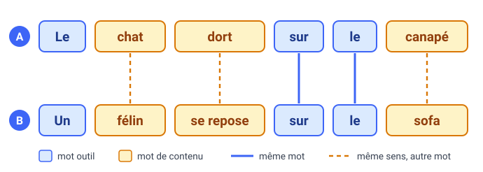

Pour nous, A et B décrivent la même scène. Un programme qui compare les mots n'y trouve que deux points communs, `le` et `sur` : des **mots outils**, qui structurent la phrase sans rien dire de la scène. Les **mots de contenu** (`chat`, `dort`, `canapé`…) n'ont aucune forme en commun.

---

### **À vous : comment feriez-vous ?**

<div class="predict">

Vous avez deux phrases qui parlent de la même chose mais ne partagent aucun mot de contenu. **Écrivez en une ligne** — ou dites-le à votre voisin — comment vous feriez pour qu'un programme les rapproche.

60 secondes. Aucune réponse attendue : c'est le problème de toute la séance.

</div>

<p class="small">On relève trois propositions. On n'en valide aucune maintenant. On y revient en S8, et vous verrez lesquelles tiennent.</p>

---

### **Pourquoi est-ce si difficile ?**

<div class="tight">

| Difficulté | Exemple |
|---|---|
| **Ambiguïté** — un mot, plusieurs sens | `avocat` : le fruit ou le métier |
| **Productivité** — des mots nouveaux | `googliser`, `chanmé` |
| **Variabilité de surface** — plusieurs écritures | `été`, `ÉTÉ`, `ete` |
| **Dépendance au contexte** | « La banque était fermée. » |

</div>

Quatre sources, une liste **close**. Le cours les traitera dans cet ordre : la 3 en S2, la 1 en S5, la 2 et la 4 en S6.

<p class="small">Une cinquième difficulté circule souvent : « une phrase ambiguë ». C'est un cas de dépendance au contexte, pas une source séparée — « J'ai vu l'homme avec le télescope » est indécidable seul, ce qui est exactement la ligne 4.</p>

---

### **Quatre niveaux d'analyse**

Les linguistes décrivent une phrase à plusieurs niveaux, du plus local au plus global.

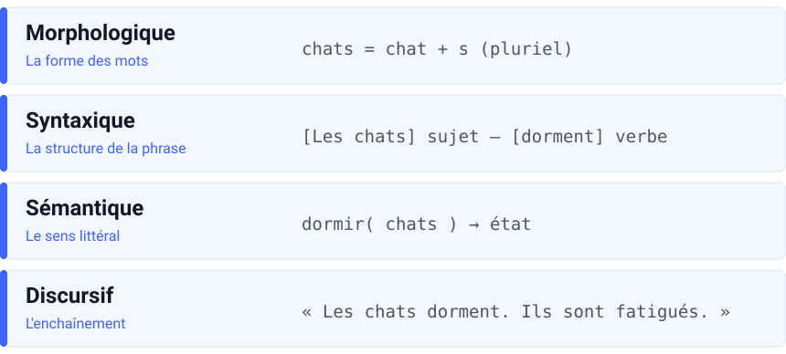

<div class="warn">

**Ne confondez pas les deux classifications.** Les quatre sources de la slide précédente sont des **mécanismes d'échec**. Les niveaux ci-dessus sont des **étages de description**. Une même source peut se manifester à plusieurs niveaux.

</div>

Les méthodes de ce cours restent au niveau des mots : leur forme, leur fréquence, leurs voisins. Les niveaux syntaxique et discursif demandent de lire la phrase entière — ce que feront les Transformers en séance 6.

---

### **Ticket de sortie — S1**

<div class="exit">

**1.** Citez les **quatre** sources de difficulté, avec un exemple **différent** de ceux de la slide pour chacune.

**2.** Les sources et les niveaux d'analyse sont deux classifications différentes. Dites en une phrase ce qui les distingue.

</div>

<div class="small">

90 secondes, sans notes. La question 2 est celle où l'on se trompe : « les sources c'est ce qui est dur » n'est pas une réponse — il faut dire ce qu'est un **niveau**.

</div>

---

<!-- header: ⭐️ 2 · Du texte aux tokens · 24 min -->

### **Le fil rouge : une barre de recherche**

Toute la séance, on construit la recherche d'un petit site qui contient quatre documents :

<div class="small" style="width:100%;">

`D1` le chat dort sur le canapé du salon · `D2` le chien dort sur le tapis du salon

`D3` un félin se repose sur un sofa · `D4` le salon est grand et le salon est clair

</div>

<div class="tight" style="font-size:.8em;">

| L'utilisateur tape | Ce qui coince | L'outil qui règle le problème |
|---|---|---|
| <span class="search">Chats</span> | D1 contient `chat`, au singulier et en minuscules | prétraitement (section 2) |
| <span class="search">salom</span> | une faute de frappe : aucun mot identique | distance d'édition (section 3) |
| <span class="search">le chat</span> | `le` fait remonter D2 et D4, qui ne parlent pas de chat | stop words, cosinus (sections 2 et 4) |
| <span class="search">félin salon</span> | D4 passe en tête parce qu'il répète `salon` | TF-IDF (section 5) |
| <span class="search">félin</span> | D1 parle d'un chat, sans aucun mot commun | Word2Vec (section 6) |

</div>

<p class="small">Ces cinq requêtes reviennent à chaque section. À la fin, on fera le compte de ce qui est réglé et de ce qui ne l'est pas.</p>

---

### **Quelques mots de vocabulaire**

Pour compter des mots, il faut d'abord décider de ce qu'est un mot. Prenons la phrase `le chat et le chien`.

- Elle contient **5 tokens** : chaque mot compte, même répété.
- Elle contient **4 types** : `le` n'est compté qu'une fois.
- Le **vocabulaire** est l'ensemble des types : {`le`, `chat`, `et`, `chien`}.
- Chaque type reçoit un **identifiant** : `le` → 0, `chat` → 1, `et` → 2, `chien` → 3.

<div class="note">

Un modèle ne lit jamais de texte : il reçoit des identifiants. Toute la question du cours est de savoir quels nombres associer ensuite à ces identifiants.

</div>

<p class="small">Dans ce cours, un token est un mot. À partir de la séance 6, un token sera souvent un morceau de mot.</p>

---

### **À vous : deux « é » identiques ?**

<div class="predict">

Sur votre écran, `é` s'affiche pareil partout. **Maintenant :** est-ce que le même caractère tapé au clavier, copié depuis un PDF et collé depuis un site web sont **toujours égaux** pour Python ?

Répondez oui ou non, main levée, avant de voir la suite.

</div>

<p class="small">On note le nombre de « oui ». Il est en général supérieur à 80 % — et c'est faux.</p>

---

### **Deux « é » qui ne sont pas égaux**

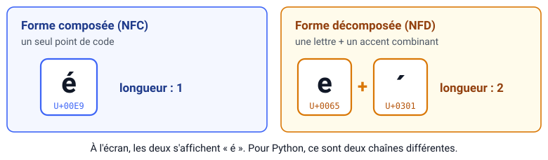

```python
>>> import unicodedata
>>> a = "é"
>>> b = unicodedata.normalize("NFD", a)   # e + accent séparé
>>> a == b, len(a), len(b)
(False, 1, 2)
```

---

### **Ce que fait chaque ligne, et pourquoi**

<div class="tight">

| Étape | Ce qu'on fait | Pourquoi |
|---|---|---|
| `a = "é"` | on prend le caractère tel qu'il vient | c'est ce que l'utilisateur tape |
| `normalize("NFD", a)` | on **décompose** : le `e` puis l'accent | imite ce que produit un PDF ou un vieux Mac |
| `a == b` | on compare | **faux** : deux suites de points de code différentes |
| `len(a), len(b)` | on mesure | `1` contre `2` — le même caractère affiché occupe deux cases |

</div>

<div class="why">

Un texte copié d'un PDF peut utiliser la forme décomposée : une recherche sur `été` le raterait, alors que les deux s'affichent pareil. On ramène donc les deux chaînes à la même forme — et c'est cette décision qui s'appelle **normaliser**.

</div>

---

### **À compléter : prouvez-le sur `été`**

<div class="fade">

On veut vérifier que `été` tapé au clavier et `été` copié d'un PDF sont égaux **après** normalisation. La normalisation est écrite. **Il manque la vérification.**

```python
import unicodedata

clavier = "été"
pdf     = unicodedata.normalize("NFD", "été")

a = unicodedata.normalize("NFC", clavier)
b = ___________________________________________

# écrire ici la ligne qui affiche True
```

Écrivez les **deux** lignes manquantes. 90 secondes.

</div>

<p class="small">Indice si vous bloquez : ce que vous voulez prouver, c'est l'égalité — pas la longueur.</p>

---

### **Normaliser, c'est choisir ce qu'on perd**

<div class="why">

Sans normalisation, `Chat`, `chat` et `CHAT` sont comptés comme trois mots différents. On les ramène à une seule écriture pour les compter ensemble. **Mais chaque opération détruit quelque chose** — et c'est ce « quelque chose » qu'il faut savoir nommer.

</div>

<div class="tight">

| Opération | Utile pour | Ce qu'on perd |
|---|---|---|
| minuscules | presque tout | `Orange` l'opérateur devient `orange` le fruit |
| retirer les accents | chercher malgré les fautes | `côte`, `cote` et `côté` se confondent |
| retirer la ponctuation | le sac de mots | le `?` d'une question |
| retirer les chiffres | des textes littéraires | `30 %`, `COVID-19` |

</div>

<div class="warn">

Avec un modèle préentraîné (BERT, GPT…), ne normalisez rien vous-même : son tokenizer s'en charge déjà.

</div>

---

### **Vérification — quelle normalisation ici ?**

<div class="cfu">

Vous analysez **2 000 avis clients** en français pour en extraire les thèmes. Quel choix est le plus défendable ?

**1.** Minuscules et **sans accents**, pour que `Café`, `cafe` et `CAFÉ` se rejoignent.

**2.** Minuscules, **accents conservés**, et tout ramené en NFC.

**3.** Retirer d'abord les **stop words**, dont `ne` et `pas`, puis normaliser le reste.

**4.** Ne rien normaliser : le **tokenizer du modèle** s'en charge.

</div>

<p class="small">Main levée par numéro, ou doigts 1-2-3-4. On ne note pas. On regarde seulement quelle conception est en train de s'installer.</p>

---

### **Découper en tokens — méthode 1 : les espaces**

```text
"l'ordinateur"  → ["l'ordinateur"]
"aujourd'hui"   → ["aujourd'hui"]
"porte-monnaie" → ["porte-monnaie"]
```

<div class="why">

L'apostrophe et le trait d'union restent **collés** au mot. Conséquence : `l'ordinateur` et `ordinateur` deviennent deux types différents, et une recherche sur `ordinateur` ne trouve pas `l'ordinateur`.

</div>

**Verdict** : cette méthode ne casse rien, mais elle **rate** les élisions et les composés — c'est-à-dire une grande partie du français courant.

---

### **Découper en tokens — méthode 2 : les suites de lettres**

```text
re.findall(r"\w+", "l'ordinateur")
→ ['l', 'ordinateur']
re.findall(r"\w+", "aujourd'hui")
→ ['aujourd', 'hui']
```

<div class="why">

Les accents passent (`cœur`, `été` fonctionnent), mais `aujourd'hui` est **coupé en deux**. Et le `l` isolé devient un token d'une lettre qu'il faudra filtrer.

</div>

<div class="warn">

**Aucun découpage naïf ne suffit en français.** C'est pour cela que les modèles modernes apprennent leur découpage (sous-mots, séance 6) au lieu de l'écrire à la main.

</div>

---

### **Stop words : ce qu'on gagne, ce qu'on risque**

Les **stop words** sont les mots outils très fréquents : `le`, `la`, `de`, `et`, `ne`, `pas`…

<div class="cols">
<div class="card">

**Ce qu'on y gagne**

- un vocabulaire plus petit ;
- des comptages moins dominés par `le` et `de` ;
- un cosinus qui cesse de récompenser les documents remplis de mots vides.

</div>
<div class="card">

**Ce qu'on risque**

`je ne veux pas payer` devient `veux payer`.

La négation a disparu. **Le sens s'est inversé.**

</div>
</div>

<div class="warn">

Avis clients : **gardez** `ne` et `pas`. Recherche par mots-clés : retirez-les. Modèle préentraîné : ne retirez rien, il a besoin de la phrase entière.

</div>

<p class="small">Il n'existe pas de liste officielle : spaCy, NLTK et le fichier du TP (164 mots) donnent des listes différentes. La liste est un choix, pas une donnée.</p>

---

### **Stemming ou lemmatisation ?**

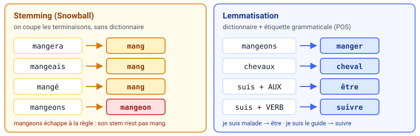

<div class="tight">

| | Stemming | Lemmatisation |
|---|---|---|
| **Ce qu'il fait** | coupe les terminaisons par des règles fixes | cherche la forme du dictionnaire |
| **Résultat** | pas toujours un mot (`mang`) | toujours un mot (`manger`) |
| **Coût** | rapide | lent, dépend du POS |
| **Cas piège** | `mangeons` → `mang`, mais `mangeais` → `mangeais` | `suis` → `être` **ou** `suivre` |

</div>

<div class="small">

Le verbe `manger` a une quarantaine de formes. Sans regroupement, cela fait une quarantaine de colonnes pour une seule idée — et une requête n'en trouve qu'une. Stems obtenus avec le stemmer Snowball français.

</div>

---

### **La chaîne complète**

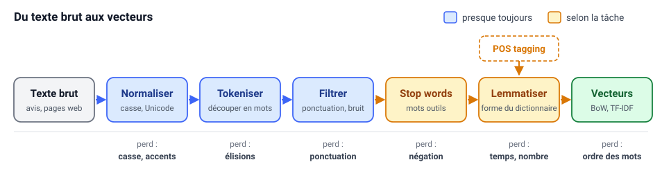

- Les étapes **bleues** sont presque toujours appliquées. Les **orange** dépendent de la tâche.
- Le POS tagging ne retire rien : il fournit l'étiquette dont la lemmatisation a besoin (séance 6 pour le détail).
- Les **sous-mots** sont la réponse aux mots inconnus — mention seulement ici, séance 6 pour le mécanisme.
- **L'ordre compte** : on tokenise avant de filtrer, et on étiquette avant de lemmatiser.

---

### **À compléter : les trois dernières étapes**

<div class="fade">

Les trois premières étapes sont faites. **Terminez la chaîne.**

<div class="tight" style="font-size:.8em;">

| Étape | Résultat |
|---|---|
| Texte de départ | `Les chats d'Emily dorment sur le canapé du salon.` |
| 1. Normaliser `✅` | `les chats d'emily dorment sur le canape du salon.` |
| 2. Tokeniser (`\w+`) `✅` | `[les, chats, d, emily, dorment, sur, le, canape, du, salon]` |
| 3. Filtrer les tokens d'une lettre `✅` | `[les, chats, emily, dorment, sur, le, canape, du, salon]` |
| 4. **Retirer les stop words** | ? |
| 5. **Étiqueter (POS)** | ? |
| 6. **Lemmatiser** | ? |

</div>

90 secondes, à deux. La liste de stop words est celle du TP (elle contient `le`, `les`, `sur`, `du`).

</div>

---

### **Ticket de sortie — S2**

<div class="exit">

**1.** Vous recevez `Les CHATS d'Emily DORMENT.` Décrivez les **quatre étapes** de prétraitement dans l'ordre et donnez le résultat de chacune.

**2.** Nommez **une** décision de prétraitement qui fait perdre de l'information, et dites ce qu'elle fait perdre.

**3.** *(section 1)* Pourquoi commence-t-on par compter des mots alors qu'on vient de montrer que cela ne marche pas sur les synonymes ?

</div>

<p class="small">La question 3 est la plus importante des trois : c'est elle qui vous empêche de croire que ce cours est un catalogue d'outils périmés.</p>

---

<!-- header: ⭐️ 3 · La distance d'édition · 16 min -->

### **Deux mots se ressemblent-ils ?**

<div class="cols">
<div class="card">

**Une faute de frappe**

`ordinateur` / `ordinatuer`

</div>
<div class="card">

**Un pluriel**

`carton` / `cartons`

</div>
<div class="card">

**Un synonyme**

`voiture` / `automobile`

</div>
</div>

Retour au fil rouge : l'utilisateur tape <span class="search">salom</span>. Aucun document ne contient ce mot, et la recherche ne renvoie rien. Pourtant, tout le monde comprend `salon`.

<div class="why">

Comparer mot à mot échoue à la moindre faute de frappe. Compter les lettres à corriger permet de retrouver le mot voulu.

</div>

<p class="small">Les trois cas ci-dessus n'appellent pas la même réponse. La suite de la section va montrer que les deux premiers se réparent, et que le troisième est un mur.</p>

---

### **Trois opérations autorisées**

<div class="cols" style="text-align:center;">
<div class="card">

**Insérer**

`chat` → `chats`

on ajoute un `s`

</div>
<div class="card">

**Supprimer**

`chats` → `chat`

on retire le `s`

</div>
<div class="card">

**Remplacer**

`chat` → `chot`

on remplace `a` par `o`

</div>
</div>

<div class="note">

La **distance de Levenshtein** entre deux mots est le **plus petit** nombre d'opérations qui transforme l'un en l'autre. Chaque opération coûte 1.

</div>

Par exemple, il faut 8 opérations pour passer de `voiture` à `automobile`. Retenez ce nombre : il revient à la fin de la section.

---

### **Calculer la distance avec un tableau**

La case $(i, j)$ contient la distance entre les $i$ premières lettres du premier mot et les $j$ premières lettres du second.

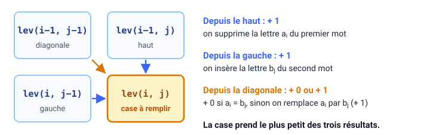

$$\text{lev}(i,j)=\min\big(\text{lev}(i-1,j)+1,\ \text{lev}(i,j-1)+1,\ \text{lev}(i-1,j-1)+[a_i\neq b_j]\big)$$

<p class="small">$[a_i \neq b_j]$ vaut 0 si les deux lettres sont égales, 1 sinon. C'est le seul terme qui dépend des lettres elles-mêmes.</p>

<div class="why">

On calcule lettre par lettre en réutilisant les cases précédentes, au lieu de tester toutes les transformations possibles. C'est ce qui fait passer d'un temps exponentiel à un temps proportionnel au produit des longueurs.

</div>

---

### **Exemple complet — on pose les bords**

On compare `chat` (en lignes) et `chats` (en colonnes). Le symbole ε désigne le mot vide.

<table class="lev">
<tr><th></th><th>ε</th><th>c</th><th>h</th><th>a</th><th>t</th><th>s</th></tr>
<tr><th>ε</th><td>0</td><td>1</td><td>2</td><td>3</td><td>4</td><td>5</td></tr>
<tr><th>c</th><td>1</td><td class="vide">·</td><td class="vide">·</td><td class="vide">·</td><td class="vide">·</td><td class="vide">·</td></tr>
<tr><th>h</th><td>2</td><td class="vide">·</td><td class="vide">·</td><td class="vide">·</td><td class="vide">·</td><td class="vide">·</td></tr>
<tr><th>a</th><td>3</td><td class="vide">·</td><td class="vide">·</td><td class="vide">·</td><td class="vide">·</td><td class="vide">·</td></tr>
<tr><th>t</th><td>4</td><td class="vide">·</td><td class="vide">·</td><td class="vide">·</td><td class="vide">·</td><td class="vide">·</td></tr>
</table>

<div class="why">

Un bord n'est pas une convention arbitraire : c'est le **coût de la transformation d'un mot vide en un préfixe**. Toute la suite se calcule à partir de là.

</div>

---

### **Ce que chaque bord coûte, et pourquoi**

<div class="tight">

| Bord | Valeurs | Raisonnement |
|---|---|---|
| **colonne** `ε` (lignes 1 à 4) | `1, 2, 3, 4` | du mot vide à `c`, `ch`, `cha`, `chat` : une **suppression** par lettre |
| **ligne** `ε` (colonnes 1 à 5) | `1, 2, 3, 4, 5` | du mot vide à `c`, `ch`, `cha`, `chat`, `chats` : une **insertion** par lettre |

</div>

<div class="note">

Retenez la symétrie : **la ligne insère, la colonne supprime**. Ce n'est pas une règle à mémoriser par cœur — c'est la conséquence de ce qu'on lit en ligne (un préfixe de `chat`) et de ce qu'on lit en colonne (un préfixe de `chats`). Si vous vous trompez de sens, la matrice se remplit quand même, mais la distance finale est fausse.

</div>

---

### **Exemple complet — une case où les lettres sont égales**

<table class="lev">
<tr><th></th><th>ε</th><th>c</th><th>h</th><th>a</th><th>t</th><th>s</th></tr>
<tr><th>ε</th><td>0</td><td>1</td><td>2</td><td>3</td><td>4</td><td>5</td></tr>
<tr><th>c</th><td>1</td><td>0</td><td>1</td><td>2</td><td>3</td><td>4</td></tr>
<tr><th>h</th><td>2</td><td>1</td><td class="voisin">0</td><td class="voisin">1</td><td>2</td><td>3</td></tr>
<tr><th>a</th><td>3</td><td>2</td><td class="voisin">1</td><td class="calcul">0</td><td class="vide">·</td><td class="vide">·</td></tr>
<tr><th>t</th><td>4</td><td class="vide">·</td><td class="vide">·</td><td class="vide">·</td><td class="vide">·</td><td class="vide">·</td></tr>
</table>

**Case ligne `a`, colonne `a`** — les lettres sont **identiques** :

<div class="tight">

| Candidat | Calcul | Valeur |
|---|---|---|
| haut | `lev(h,a) = 1`, puis `+ 1` | 2 |
| gauche | `lev(a,a) = 1`, puis `+ 1` | 2 |
| diagonale | `lev(h,h) = 0`, puis `+ 0` car `a = a` | **0** ← minimum |

</div>

<p class="small">La diagonale part de la case `lev(h,h)`, qui vaut 0 : le préfixe `ch` est déjà aligné. On en hérite gratuitement, parce que les deux lettres sont égales.</p>

---

### **Exemple complet — la même case, lettres différentes**

Même matrice, cette fois la case ligne `a`, colonne `t`.

**Case ligne `a`, colonne `t`** — les lettres **diffèrent** :

<div class="tight">

| Candidat | Calcul | Valeur |
|---|---|---|
| haut | `lev(h,t) = 2`, puis `+ 1` | 3 |
| gauche | `lev(a,a) = 0`, puis `+ 1` | **1** ← minimum |
| diagonale | `lev(h,a) = 1`, puis `+ 1` car `a ≠ t` | 2 |

</div>

<div class="warn">

Le terme $[a_i \neq b_j]$ ne sert **qu'à la diagonale**. C'est lui qui décide si l'on profite de la lettre commune ou si l'on paie une substitution. Quand les lettres diffèrent, la diagonale n'est plus gratuite — elle coûte 1 de plus que la case dont elle hérite.

</div>

<p class="small">Ici, la bonne décision n'est pas la diagonale mais la **gauche** : on insère `t` au lieu de substituer. C'est exactement ce que fait la distance finale de `chat` → `chats` : une insertion, pas un remplacement.</p>

---

### **À vous d'expliquer**

<div class="predict">

Dans la case ligne `a` / colonne `a`, la diagonale coûte **0**. Dans la case ligne `a` / colonne `t`, la diagonale coûte **2**.

**Pourquoi cette différence ?** Répondez en une phrase, sans regarder la slide précédente.

</div>

<div class="small">

Si vous répondez « parce que les lettres sont différentes », allez plus loin : la diagonale part de la case `lev(h,h)`, qui vaut 0 — c'est le préfixe `ch` déjà aligné. Le coût de la diagonale, c'est ce qu'on hérite **plus** la substitution éventuelle.

</div>

---

### **À compléter : la dernière ligne**

<div class="fade">

Même matrice. **Seule la dernière ligne manque.** Remplissez les six cases, de gauche à droite.

<table class="lev">
<tr><th></th><th>ε</th><th>c</th><th>h</th><th>a</th><th>t</th><th>s</th></tr>
<tr><th>ε</th><td>0</td><td>1</td><td>2</td><td>3</td><td>4</td><td>5</td></tr>
<tr><th>c</th><td>1</td><td>0</td><td>1</td><td>2</td><td>3</td><td>4</td></tr>
<tr><th>h</th><td>2</td><td>1</td><td>0</td><td>1</td><td>2</td><td>3</td></tr>
<tr><th>a</th><td>3</td><td>2</td><td>1</td><td>0</td><td>1</td><td>2</td></tr>
<tr><th>t</th><td class="afaire">?</td><td class="afaire">?</td><td class="afaire">?</td><td class="afaire">?</td><td class="afaire">?</td><td class="afaire">?</td></tr>
</table>

La dernière case vous donne la distance entre `chat` et `chats`. 2 minutes.

</div>

<div class="small">

Si vous remplissez sans hésiter : passez directement à l'exercice indépendant (`ordinateur` / `ordinatuer`). L'estompage ne sert à rien à ceux qui savent déjà — c'est vous qui décidez.

</div>

---

### **Une distance de 1, c'est beaucoup ?**

Une faute dans `chat` touche un quart du mot, dans `ordinateur` un dixième. On divise donc par la longueur du plus long :

$$\text{similarité}(a,b)=1-\frac{\text{lev}(a,b)}{\max(|a|,\,|b|)}$$

<div class="tight">

| Paire | Distance | Similarité | Ce que ça veut dire |
|---|---|---|---|
| `chats` / `chat` | 1 | 0,80 | même mot, deux formes |
| `carton` / `cartons` | 1 | 0,86 | même mot, deux formes |
| `chien` / `chats` | 3 | 0,40 | deux animaux, deux mots sans rapport |
| `ordinateur` / `ordinatuer` | 2 | 0,80 | faute de frappe réparable |
| **`voiture` / `automobile`** | **8** | **0,20** | **deux mots pour la même chose** |

</div>

<div class="warn">

La dernière ligne est le mur de la section. `voiture` et `automobile` désignent le même objet, et aucune opération sur les lettres ne les rapproche. **Il faut changer d'unité.**

</div>

<div class="small">

Variante de Damerau-Levenshtein : l'inversion de deux lettres voisines compte pour une seule opération, et `ordinatuer` passe à distance 1. La normalisation `1 − d/max(len)` est une convention parmi d'autres, pas « la » similarité.

</div>

---

### **Où ça marche, où ça casse**

<div class="cols">
<div class="card">

**Utile pour**

- corriger les fautes de frappe ;
- repérer des doublons (`Dupont` / `Dupond`) ;
- chercher un mot malgré une faute ;
- comparer des séquences d'ADN.

</div>
<div class="card">

**Limité pour**

- les synonymes : `voiture` / `automobile` à distance 8 ;
- `poisson` / `poison` : distance **1**, deux référents sans rapport ;
- les longs textes : il faut remplir $n \times m$ cases.

</div>
</div>

<div class="note">

`poisson` / `poison` est le contre-exemple à retenir : une distance **petite** ne garantit pas un sens **proche**. Une distance d'édition mesure un écart d'orthographe, jamais un écart de sens.

</div>

<p class="small">Nous avons comparé des lettres. Pour comparer des textes entiers, changeons d'unité : comptons des mots.</p>

---

### **Ticket de sortie — S3**

<div class="exit">

**1.** `chat` → `chats` : quelle distance, et quelle opération correspond au chemin optimal ?

**2.** Donnez un cas où une distance d'édition **petite** ne signifie pas que les deux mots sont proches par le sens.

**3.** *(section 2)* Vous devez nettoyer `aujourd'hui`. Que produit un découpage sur `\w+`, et pourquoi est-ce un problème ?

</div>

<p class="small">La question 2 est celle qui vous protège du pire malentendu du cours : croire qu'un nombre qui mesure l'orthographe mesure le sens.</p>

---

<!-- header: ⭐️ 4 · Sac de mots et cosinus · 23 min -->

### **Pourquoi transformer un texte en vecteur ?**

Un algorithme ne sait travailler que sur un tableau de nombres : une ligne par observation, les mêmes colonnes pour toutes. Chaque ligne est un **vecteur** (une liste ordonnée de nombres).

<div class="cols">
<div>

**Données classiques : des maisons**

| Maison | Surface (m²) | Chambres |
|:-:|:-:|:-:|
| 1 | 85 | 2 |
| 2 | 120 | 3 |

</div>
<div>

**Notre objectif : des textes**

| Document | chat | chien | salon |
|:-:|:-:|:-:|:-:|
| D1 | 1 | 0 | 1 |
| D2 | 0 | 1 | 1 |

</div>
</div>

<div class="why">

Un modèle ne sait calculer que sur des nombres. Transformer chaque texte en une ligne de nombres permet de les comparer, de les classer ou de les regrouper automatiquement.

</div>

---

### **À vous : même vecteur ?**

<div class="predict">

Deux phrases :

`le chien mord l'homme` · `l'homme mord le chien`

**Écrivez votre prédiction :** leurs vecteurs de comptage seront-ils identiques ou différents ? Et si on calcule leur cosinus, que trouve-t-on ?

60 secondes. C'est la question piège de la section.

</div>

---

### **L'idée du sac de mots**

On oublie l'ordre des mots et on ne garde que leurs comptes : « le chat dort sur le canapé du salon » devient `le` ×2, et `chat`, `dort`, `sur`, `canapé`, `du`, `salon` ×1.

Pour toute la suite, nous utiliserons ces quatre documents :

| | Document |
|---|---|
| D1 | le chat dort sur le canapé du salon |
| D2 | le chien dort sur le tapis du salon |
| D3 | un félin se repose sur un sofa |
| D4 | le salon est grand et le salon est clair |

Ils contiennent **18 mots différents** : notre vocabulaire a 18 termes.

---

### **Ce que le sac garde, ce qu'il jette**

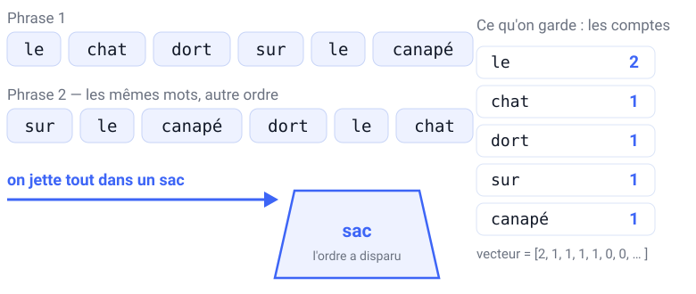

<div class="cols mid">
<div style="flex:0 0 210px;">


</div>
<div class="small">

Les deux phrases donnent **exactement le même vecteur**. Il a une case par terme du vocabulaire : ici 5 cases remplies, et 13 cases à zéro pour les autres termes du corpus.

La photo résume l'idée : un portrait découpé et jeté dans un sac. Tous les morceaux sont là, mais on ne sait plus où ils allaient.

<span class="src">Photo : Meritxell.canela, Wikimedia Commons, domaine public.</span>

</div>
</div>

---

### **Que mettre dans chaque case ?**

Une seule phrase : `le chat dort, le chat dort encore`.

<div class="cols">
<div>

**Présence (0 ou 1)**

| le | chat | dort | encore |
|:-:|:-:|:-:|:-:|
| 1 | 1 | 1 | 1 |

On sait quels mots sont là, pas combien de fois.

</div>
<div>

**Comptage**

| le | chat | dort | encore |
|:-:|:-:|:-:|:-:|
| 2 | 2 | 2 | 1 |

La répétition est conservée. C'est cette version que TF-IDF utilisera.

</div>
</div>

<div class="why">

La présence dit si un mot apparaît dans le texte ; le comptage dit s'il y revient souvent. Dans scikit-learn, `binary=True` donne la présence.

</div>

<p class="src">D'après J. Brownlee, <em>A Gentle Introduction to the Bag-of-Words Model</em>, Machine Learning Mastery, 2019.</p>

---

### **La matrice documents × termes**

Une ligne par document, une colonne par terme, rangées par ordre alphabétique comme le fait scikit-learn.

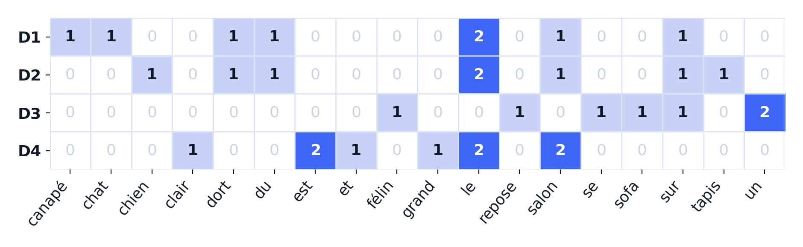

Chaque document devient un vecteur de **18 nombres**. D1 et D2 se ressemblent ; D3 n'a presque rien en commun avec eux.

<div class="ask">

Où voit-on, dans ce tableau, que D3 parle pourtant de la même scène que D1 ?

</div>

---

### **Une matrice pleine de zéros**

Notre exemple est trompeur : 26 cases sur 72 sont remplies (36 %), parce que le corpus est minuscule. Voici la matrice du corpus du TP :

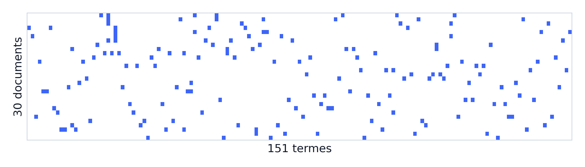

30 documents, 151 termes, 168 cases non nulles : **3,7 %**. On parle de matrice **creuse** (*sparse*).

<div class="why">

Un document n'utilise qu'une toute petite partie du vocabulaire. Ne stocker que les valeurs non nulles évite de remplir la mémoire de zéros — et c'est pour cela que scikit-learn renvoie une matrice creuse, pas un tableau dense.

</div>

---

### **`fit` puis `transform`**

```python
vec = CountVectorizer()
X = vec.fit_transform(corpus)   # apprend le vocabulaire et compte
x = vec.transform([requete])    # compte avec ce même vocabulaire
```

- `fit` apprend le vocabulaire sur le corpus et **fixe l'ordre des colonnes**.
- `transform` compte les mots d'un nouveau texte dans ces mêmes colonnes, et **ignore les mots inconnus**.
- Une requête peut donc donner un vecteur rempli de zéros.

<div class="why">

Tous les textes doivent utiliser exactement les mêmes colonnes : la colonne 0 doit désigner le même mot pour le corpus et pour la requête. C'est la seule raison d'être de `fit`.

</div>

<div class="small">

C'est du cours 2 : `fit` apprend, `transform` applique. La différence avec `predict`, c'est que `transform` ne prédit rien — il met en forme.

</div>

---

### **Mesurer un angle plutôt qu'une distance**

<div class="cols mid">
<div style="flex:1.2;">

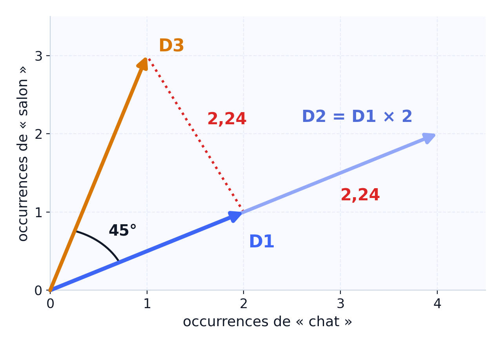

</div>
<div>

$$\cos(\theta)=\frac{\mathbf a\cdot\mathbf b}{\|\mathbf a\|\,\|\mathbf b\|}$$

- $\mathbf a\cdot\mathbf b = \sum_i a_i b_i$ : produit case à case
- $\|\mathbf a\|=\sqrt{\sum_i a_i^2}$ : longueur du vecteur
- 1 = même direction, 0 = aucun mot commun

</div>
</div>

D2 et D3 sont tous les deux à 2,24 de D1, alors que D2 n'est que D1 recopié deux fois. Le cosinus les distingue : **1** pour D2, **0,71** pour D3.

<div class="why">

Un texte deux fois plus long a des comptages deux fois plus grands, même s'il dit la même chose. Le cosinus ignore la longueur et ne compare que les proportions de mots.

</div>

---

### **Exemple complet — cosinus de `le chat` et D1**

Requête `q = le chat`. Document `D1 = le chat dort sur le canapé du salon`.

<div class="tight">

| Étape | Calcul | Résultat |
|---|---|---|
| 1. Vecteur de la requête | `le` ×1, `chat` ×1 | `q = [1, 1]` |
| 2. Vecteur du document | `le` ×2, `chat` ×1 | `D1 = [2, 1]` |
| 3. Produit scalaire | $1\times2 + 1\times1$ | **3** |
| 4. Normes | $\sqrt{1^2+1^2}$ et $\sqrt{2^2+1^2}$ | $\sqrt2 \approx 1{,}414$ · $\sqrt5 \approx 2{,}236$ |
| 5. Cosinus | $3 / (\sqrt2 \times \sqrt5)$ | **0,949** |

</div>

<div class="note">

Le **0,671** de la slide suivante est calculé sur les **18 colonnes** du vocabulaire : les zéros ne changent pas le produit scalaire mais gonflent les **normes**. C'est le piège de l'exercice.

</div>

---

### **À compléter — puis en autonomie**

<div class="fade">

**Étape 1 (guidée).** Requête `le chat`, document `D2 = le chien dort sur le tapis du salon`. Sur les deux colonnes utiles (`le`, `chat`) : `q = [1,1]`, `D2 = [2,0]`.

Produit scalaire : ? — Norme de `D2` : ? — Cosinus : ?

**Étape 2 (seul).** Même requête, document `D4 = le salon est grand et le salon est clair`. Écrivez les trois valeurs, puis comparez à la slide suivante.

</div>

<p class="small">Les deux résultats attendus sont dans le tableau de la slide suivante. Ne regardez qu'après avoir écrit les vôtres.</p>

---

### **Le classement pour `le chat`**

<div class="reveal">

| Document | Contenu | Cosinus |
|---|---|---|
| D1 | le chat dort sur le canapé du salon | **0,671** |
| D2 | le chien dort sur le tapis du salon | 0,447 |
| D3 | un félin se repose sur un sofa | 0,000 |
| D4 | le salon est grand et le salon est clair | 0,365 |

</div>

- D1 : $q\cdot D1 = 3$, $\|q\|=\sqrt{2}$, $\|D1\|=\sqrt{10}$, d'où $3/\sqrt{20}=0{,}671$.
- D2 et D4 ne partagent que `le` (deux fois) : même produit scalaire, mais D4 est plus long, donc moins similaire.
- D3 obtient 0 : il ne contient ni `le` ni `chat`. **Il parle pourtant d'un chat.**

<p class="small">Si votre cosinus pour D2 est très supérieur à 0,447, vous avez calculé sur deux colonnes au lieu de dix-huit. Les zéros ne changent pas le numérateur mais gonflent les normes.</p>

---

### **Et si aucun mot de la requête n'est connu ?**

Requête : <span class="search">animal de compagnie</span>. Aucun de ces trois mots n'apparaît dans les quatre documents.

<div class="warn">

Le vecteur de la requête ne contient que des zéros. Le cosinus vaut alors **0/0** : il n'est **pas défini**, et scikit-learn renvoie 0 par convention.

Ce n'est pas « le document n'est pas pertinent ». C'est « **la mesure n'existe pas** ».

</div>

C'est le cas le plus fréquent en production : vocabulaire métier, fautes de frappe, abréviations, autre langue. Un mot inconnu n'a tout simplement aucune colonne où s'inscrire.

<p class="small">Les quatre documents sont alors à égalité, y compris trois d'entre eux qui parlent d'un animal de compagnie. Le classement n'est pas mauvais : il est vide.</p>

---

### **Ticket de sortie — S4**

<div class="exit">

**1.** Une requête n'a **aucun** mot du vocabulaire. Que vaut son vecteur, et que renvoie le cosinus ? Pourquoi ?

**2.** `le chien mord l'homme` et `l'homme mord le chien` : même vecteur, cosinus = ? Que cela prouve-t-il ?

**3.** *(sections 2 et 3)* Deux raisons pour lesquelles `voiture` et `automobile` obtiennent un cosinus de 0 ici.

</div>

<p class="small">La question 1 est la plus mal répondue de tout le cours. « Cosinus = 0 » n'est pas une réponse complète : il manque le fait que la division n'a pas de valeur.</p>

---

<!-- header: ⭐️ 5 · TF-IDF · 16 min -->

### **Tous les mots ne se valent pas**

| Mot | Occurrences | Documents qui le contiennent |
|---|---|---|
| `le` | 6 | 3 sur 4 |
| `salon` | 4 | 3 sur 4 |
| `félin` | 1 | 1 sur 4 |

`le` apparaît dans presque tous les documents : il ne permet pas de les distinguer. `félin` n'apparaît que dans D3 : s'il est dans la requête, il désigne exactement le bon document.

<div class="ask">

Comment donner plus de poids à `félin` qu'à `le`, sans écrire la liste des mots importants à la main ?

</div>

<p class="small">La réponse est une formule, pas une liste. C'est la différence entre une règle qu'on maintient à la main et un mécanisme qui s'adapte à chaque corpus.</p>

---

### **Vérification — avant de voir la formule**

<div class="cfu">

Requête `le chat`, quatre documents. On passe des comptages au TF-IDF.

**L'ordre du classement change-t-il ?**

**1.** Oui — D3 remonte, puisque TF-IDF rapproche les mots rares et que `félin` est rare.

**2.** Non — mais les écarts entre les documents se creusent.

**3.** Oui — D4 remonte, parce que TF-IDF récompense les documents qui répètent un mot.

**4.** Non — et les scores restent identiques, puisque les vecteurs sont normalisés.

</div>

<div class="small">

On écrit d'abord sa réponse **et sa justification** sur papier. On ne lève la main qu'ensuite. Choisir sans justifier ne dit rien de ce qu'on a compris.

</div>

---

### **La formule**

$$w_{t,d}=\text{tf}(t,d)\times\text{idf}(t)$$

- $\text{tf}(t,d)$ : le nombre de fois où le terme $t$ apparaît dans le document $d$ — le **comptage brut**, pas la fréquence relative.
- $\text{idf}(t)$ : un poids qui augmente quand le terme est rare. scikit-learn utilise :

$$\text{idf}(t)=\ln\!\left(\frac{1+N}{1+\text{df}(t)}\right)+1$$

avec $N$ le nombre de documents et $\text{df}(t)$ le nombre de documents qui contiennent $t$.

<div class="why">

Sans le logarithme, un mot rare pèserait des milliers de fois plus qu'un mot courant et écraserait tous les autres. Le logarithme garde des poids comparables.

</div>

<div class="small">

Le `+1` final garantit qu'aucun terme ne descend sous un poids de 1. C'est pour cela que l'IDF sklearn ne vaut **jamais** 0, même pour un mot présent partout.

</div>

---

### **L'IDF sur nos quatre documents**

Avec $N = 4$ et $\text{idf}(t)=\ln\!\big((1+N)/(1+\text{df}(t))\big)+1$ :

<div class="tight">

| Terme | Documents qui le contiennent | df | Calcul | IDF |
|---|---|---|---|---|
| `chat` | D1 | 1 | $\ln(5/2)+1$ | **1,916** |
| `félin` | D3 | 1 | $\ln(5/2)+1$ | **1,916** |
| `dort` | D1, D2 | 2 | $\ln(5/3)+1$ | **1,511** |
| `salon` | D1, D2, D4 | 3 | $\ln(5/4)+1$ | **1,223** |
| `le` | D1, D2, D4 | 3 | $\ln(5/4)+1$ | **1,223** |

</div>

<div class="note">

`chat` et `félin` ont le **même** IDF : chacun n'apparaît que dans **un** document. La rareté se compte en **documents**, pas en occurrences — un mot répété dix fois dans un seul document reste aussi rare qu'un mot employé une fois.

</div>

---

### **L'allure de l'IDF, et pourquoi elle chute**

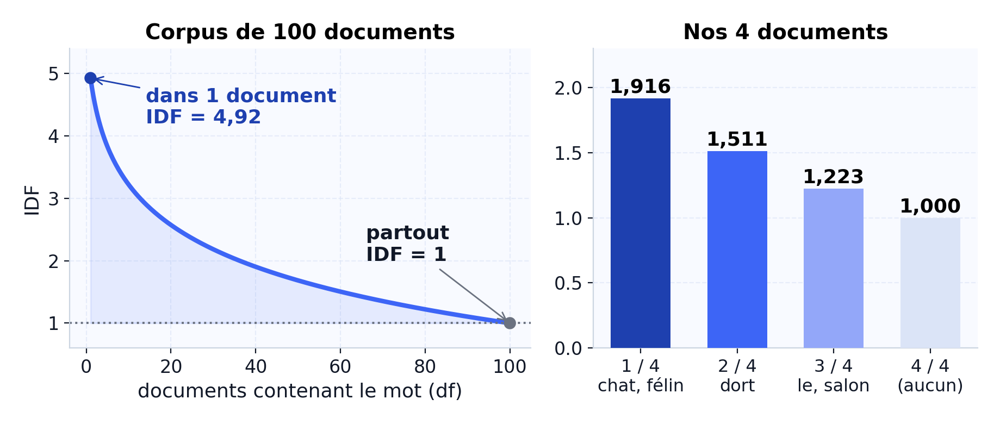

- **À gauche** — 100 documents : un mot présent dans un seul pèse **4,92**, un mot présent partout pèse **1,00**. La chute est brutale, puis plate.
- **À droite** — nos 4 documents : `chat` ne pèse que **1,57 fois** plus que `le`, parce que toutes les valeurs sont écrasées entre 1 et 2.

<p class="small">Conséquence : un IDF calculé sur un petit corpus n'est pas transposable — c'est la question de fin de section.</p>

---

### **Résultat — `le chat`**

<div class="reveal">

| Document | Cosinus (comptages) | Cosinus (TF-IDF) | Écart |
|---|---|---|---|
| D1 | **0,671** | **0,641** | −0,030 |
| D2 | 0,447 | 0,288 | −0,159 |
| D3 | 0,000 | 0,000 | 0 |
| D4 | 0,365 | 0,214 | −0,151 |

</div>

- Le classement **ne change pas** : D1 reste en tête, et c'est normal, il contient vraiment `chat`.
- Les **écarts se creusent** : D2 et D4, qui ne partagent que `le` avec la requête, perdent beaucoup.
- D3 reste à 0 : TF-IDF ne crée **aucun lien** entre `chat` et `félin`.

<p class="small">Si vous avez répondu « oui » à la vérification précédente, la correction est ici : une pondération multiplie des colonnes, elle n'en crée pas. Aucun poids ne peut rapprocher deux colonnes différentes.</p>

---

### **Vérification — le cas qui compte**

<div class="cfu">

Nouvelle requête : `félin salon`. Qui arrive en tête, cette fois **en TF-IDF** ?

**1.** D4 — il répète `salon` deux fois.

**2.** D3 — `félin` est rare, donc lourd.

**3.** D1 — c'est le document le plus court, il est donc avantagé.

**4.** D1 et D2 à égalité, et devant.

</div>

<div class="small">

Attention : la réponse 1 est le raisonnement **correct en comptages**. Elle montre seulement que l'IDF n'est pas encore entré en jeu.

</div>

---

### **Résultat — `félin salon`, le seul cas d'inversion**

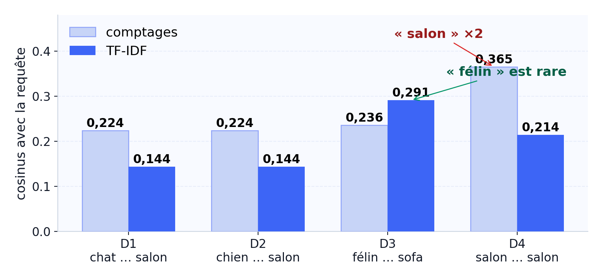

Avec les comptages, **D4 gagne** (0,365) parce qu'il répète `salon`, alors qu'il ne parle d'aucun animal. En TF-IDF, `salon` est banalisé (`idf = 1,223`) et `félin` pèse plus lourd (`idf = 1,916`) : **D3 passe de 0,236 à 0,291** et prend la tête.

<div class="why">

C'est le seul moment du cours où la pondération corrige un classement **réellement faux** — et D1/D2 ne bougent pas de leur place.

</div>

---

### **Ce que TF-IDF ne sait pas faire**

- **Les synonymes** : `voiture` et `automobile` n'ont toujours aucune colonne commune.
- **Les sens multiples** : `avocat` le fruit et `avocat` le métier partagent la même colonne.
- **L'ordre** : il reste perdu.
- **Les mots inconnus** : ils sont toujours ignorés.
- **La stabilité** : ajouter des documents modifie tous les poids.

<div class="warn">

**Le piège de lecture.** Un cosinus qui baisse ne veut pas dire « document moins pertinent ». Il veut dire « document moins soutenu par des mots discriminants ». Confondre les deux fait rejeter le bon document.

</div>

<p class="small">TF-IDF n'est pas « mieux » que les comptages. C'est un arbitrage différent entre fréquence et pouvoir discriminant — et il ne peut inverser un classement que si un mot banal soutenait artificiellement un document.</p>

---

### **Ticket de sortie — S5**

<div class="exit">

**1.** Écrivez la formule de l'IDF utilisée par scikit-learn, et expliquez le rôle du `+1` au dénominateur.

**2.** Un mot apparaît dans **tous** les documents. Son IDF sklearn vaut-il 0 ? Justifiez par le calcul.

**3.** *(section 4)* Vous ajoutez 100 documents au corpus. Qu'est-ce qui change dans les scores TF-IDF, et qu'est-ce qui ne change pas ?

</div>

<div class="small">

La question 2 est l'erreur la plus fréquente de la séquence. Elle vient de la formule historique `log(N/df)`, qui donne bien 0 — mais ce n'est pas celle du cours.

</div>

---

<!-- header: ⭐️ 6 · Des mots aux vecteurs · 21 min -->

### **Pourquoi des vecteurs de mots ?**

Retour au fil rouge : l'utilisateur tape <span class="search">félin</span>. D1 parle d'un chat, mais n'a aucun mot en commun avec la requête.

<div class="cols mid">
<div>

Dans un sac de mots, chaque mot a sa propre colonne. Pris seul, un mot est un vecteur *one-hot* :

```text
chat  = [1, 0, 0, …]
félin = [0, 1, 0, …]
pneu  = [0, 0, 1, …]
```

</div>
<div>

cos(`chat`, `félin`) = 0

cos(`chat`, `pneu`) = 0

Pour ces vecteurs, `félin` est **aussi loin** de `chat` que `pneu`.

</div>
</div>

<div class="why">

Avec une colonne par mot, deux synonymes n'ont rien en commun. On veut des vecteurs où deux mots de même sens ont des valeurs proches.

</div>

---

### **L'idée de Word2Vec**

> « You shall know a word by the company it keeps. » — J. R. Firth, 1957

Dans « le ___ dort sur le canapé », on peut mettre `chat`, `chien` ou `félin`, mais pas `pneu`. Des mots qui partagent leurs voisins ont souvent un sens proche.

Word2Vec lit des millions de phrases et apprend un vecteur par mot, de sorte que les mots aux voisins semblables reçoivent des vecteurs proches. **Aucun dictionnaire n'est nécessaire.**

<div class="warn">

C'est une **hypothèse**, pas une vérité. Elle est fausse dans des cas précis et important : les antonymes. Retenez-le, il revient deux slides plus loin.

</div>

<p class="src">Mikolov et al. (2013), <em>Efficient Estimation of Word Representations in Vector Space</em>.</p>

---

### **À vous d'expliquer**

<div class="predict">

« Le ___ dort sur le canapé. »

**1.** Quels mots peuvent aller dans le blanc ? **2.** Lequel **ne peut pas** y aller, alors qu'il est un mot très courant du français ?

Répondez avant de lire la suite. 45 secondes.

</div>

<div class="small">

Si vous avez répondu `pneu` ou `radiateur`, vous venez de faire exactement le raisonnement que Word2Vec automatise : la place d'un mot dans une phrase contraint son identité.

</div>

---

### **Les contextes : une fenêtre qui glisse**

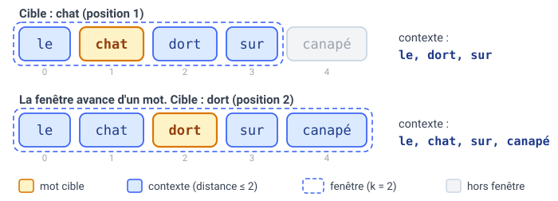

On parcourt le corpus mot par mot. Pour chaque mot cible, les voisins situés à $k$ positions ou moins forment son contexte. Chaque couple (cible, voisin) devient un exemple d'entraînement.

<div class="warn">

La taille de la fenêtre est un **réglage**. Petite, elle capte la syntaxe (quel mot suit quel autre). Grande, elle capte plutôt le thème du texte.

</div>

<div class="small">

Exemple à connaître : `le(0) chat(1) dort(2) sur(3) canapé(4)` avec une fenêtre de 2. Pour la cible `dort` (indice 2), le contexte est `le(0)`, `chat(1)`, `sur(3)`, `canapé(4)` — l'écart maximal est 2, donc ils sont bien dans la fenêtre.

</div>

---

### **Deux façons d'apprendre : CBOW et Skip-gram**

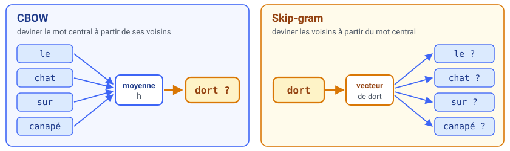

- **CBOW** devine le mot central à partir de ses voisins : rapide, bon sur les mots fréquents.
- **Skip-gram** fait l'inverse : plus lent, mais meilleur sur les mots rares.

<div class="why">

Pour forcer deux mots qui ont les mêmes voisins à recevoir des vecteurs proches, on entraîne le modèle à **deviner** un mot à partir de ses voisins. La contrainte de la tâche produit la géométrie voulue.

</div>

<p class="small">Sur un corpus de quelques milliers de phrases, Skip-gram est en général préférable : les mots rares y sont mal représentés par CBOW, qui les noie dans la moyenne du contexte.</p>

---

### **Où sont les vecteurs ?**

Les vecteurs sont rangés dans une matrice $W$ de taille $|V| \times d$ : une ligne par mot, $d$ colonnes (souvent 100 à 300).

$$h=\frac{1}{|C|}\sum_{w\in C}\mathbf e_w$$

<div class="small">

$\mathbf e_w$ : la ligne de $W$ du mot $w$. $C$ : les mots du contexte, **sans la cible**. $|C| \le 2k$, car la fenêtre est tronquée aux bords de la phrase.

</div>

- **CBOW** fait la moyenne $h$ des vecteurs du contexte, puis donne un score à chaque mot du vocabulaire.
- **Skip-gram** part du vecteur du mot central et donne un score aux mots du contexte.
- Au départ, $W$ est **aléatoire**. L'entraînement la corrige pour que les mots réellement observés obtiennent les meilleurs scores.

<p class="small">« Score transformé en probabilité », puis « on augmente la probabilité des mots observés » : c'est tout ce qu'il faut retenir du mécanisme. Le détail (softmax, negative sampling) est en séance 6.</p>

---

### **À compléter — combien de paramètres ?**

<div class="fade">

Word2Vec utilise **deux** matrices de taille $|V| \times d$ : celle d'entrée contient les vecteurs que l'on garde, celle de sortie sert à calculer les scores.

**Calculez** le nombre de poids pour 10 000 mots en 100 dimensions :

$$2 \times \_\_\_ \times \_\_\_ = \_\_\_$$

Puis répondez : avec 100 000 mots en 300 dimensions, on atteint combien ?

</div>

<p class="small">La réponse à la première ligne est <b>2 × 10⁶</b>. Si vous avez trouvé 10⁶, vous avez oublié la matrice de sortie — c'est l'erreur classique, et elle divise le coût par deux.</p>

---

### **Les vecteurs du TP, vus en 2D**

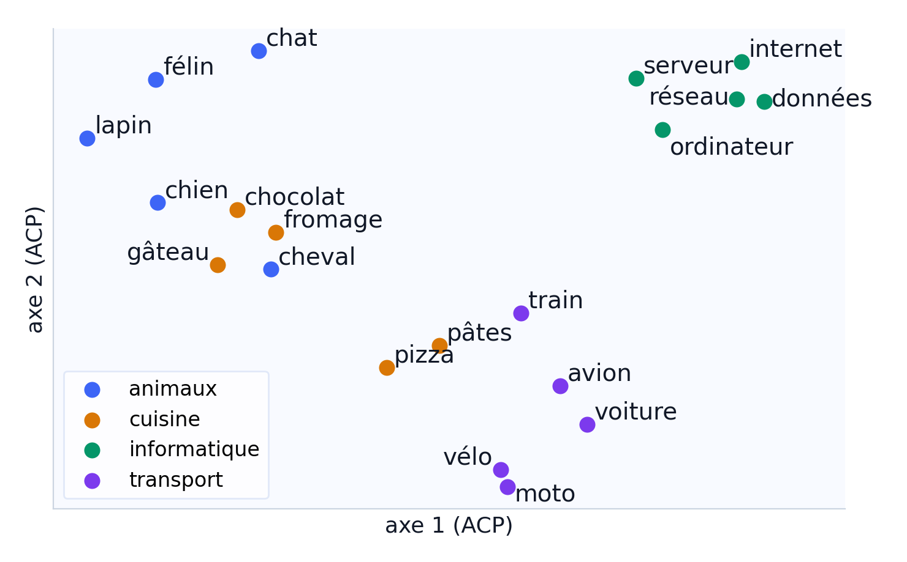

20 mots du modèle du TP, ramenés de 100 à 2 dimensions (projection ACP) pour pouvoir les dessiner. Les thèmes se regroupent seuls ; les couleurs, c'est nous qui les avons ajoutées.

<div class="warn">

**Proche veut dire « employé dans les mêmes contextes »** : `chat` a pour voisins `félin` (0,72) et `chien` (0,62) — mais `chaud` et `froid` sont aussi à **0,74**.

Deux antonymes sont parmi les mots les plus proches du modèle. Ce n'est pas un bug : c'est l'hypothèse distributionnelle prise en défaut.

</div>

---

### **Les analogies, et où elles échouent**

<div class="cols mid">
<div>

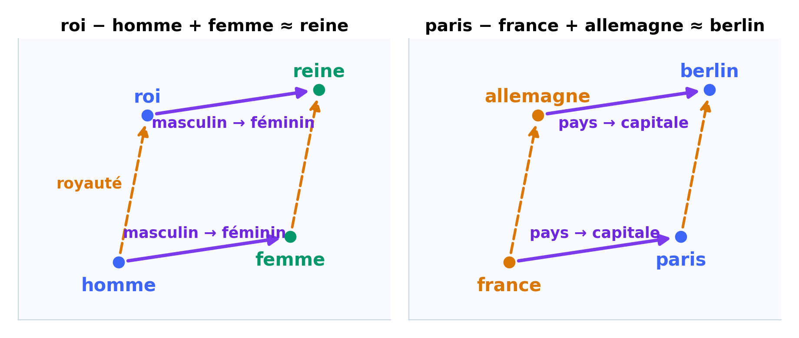

</div>
<div>

Dans un espace idéal, aller de `homme` à `femme` demande le même déplacement qu'aller de `roi` à `reine` :

$$\vec{\text{roi}} - \vec{\text{homme}} + \vec{\text{femme}} \approx \vec{\text{reine}}$$

**Sur le modèle du TP :**

- `acteur − homme + femme` → `actrice`, nettement en tête ✅
- `roi − homme + femme` → `reine` **2ᵉ**, derrière `roy` ⚠️
- `paris − france + italie` → `espagne`, `rome` 3ᵉ ⚠️

</div>
</div>

<div class="note">

Les analogies citées dans les articles sont souvent **choisies parmi celles qui marchent**. Ici, `femme − homme` et `reine − roi` n'ont qu'un cosinus de 0,37.

</div>

---

### **Ticket de sortie — S6**

<div class="exit">

**1.** Énoncez l'hypothèse distributionnelle en une phrase, **sans** utiliser le mot « sens ».

**2.** `chaud` et `froid` ont un cosinus de 0,74. Qu'est-ce que cela vous oblige à corriger dans ce que vous croyiez ?

**3.** *(sections 2 et 4)* Un mot est absent du vocabulaire de Word2Vec. Le cosinus peut-il le représenter ? Reliez à ce que vous avez vu sur les sous-mots.

</div>

<p class="small">La question 1 est un test de précision, pas de récitation : si votre phrase contient « sens », vous avez énoncé la conclusion au lieu de l'hypothèse.</p>

---

<!-- header: ⭐️ 7 · Limites et RAG · 10 min -->

### **Cinq limites à garder en tête**

<div class="tight">

| Limite | Exemple | Piste | Traitée en |
|---|---|---|---|
| Synonymes | `voiture` / `automobile` : cosinus 0 | vecteurs appris (Word2Vec) | **S6** |
| Sens multiples | `avocat` : un vecteur pour deux sens | un vecteur par contexte | S6 → séance 6 |
| Ordre | qui mord qui ? | modèles de séquence | non |
| Mots inconnus | aucun vecteur | sous-mots (fastText, BPE) | S2 → séance 6 |
| Expressions | `animal de compagnie` | encodeur de phrases | séance 6 |

</div>

<div class="note">

Word2Vec règle **en grande partie** la première limite : sur le modèle du TP, les voisins de `voiture` sont `véhicule` (0,74) et `bagnole` (0,71). Les quatre autres demandent de lire la phrase entière — c'est-à-dire autre chose qu'un dictionnaire de mots.

</div>

---

### **Un mot, plusieurs sens**

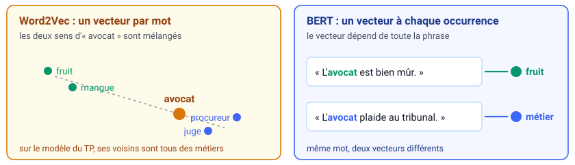

- Word2Vec donne **un seul** vecteur à `avocat`. Sur le modèle du TP, ses plus proches voisins sont tous des métiers : `légiste`, `avocate`, `procureur`. **Le fruit a disparu.**
- Un Transformer comme BERT calcule un vecteur **différent pour chaque phrase**. C'est le sujet de la séance 6.

<p class="small">C'est la limite la plus mal comprise en pratique : on croit qu'un embedding « connaît » le sens d'un mot. Il connaît une position moyenne, calculée sur tous ses emplois.</p>

---

### **Retour au fil rouge**

<div class="tight" style="font-size:.8em;">

| Requête | Problème | Ce qui l'a réglé | Réglé ? |
|---|---|---|---|
| <span class="search">Chats</span> | majuscule et pluriel | normalisation, lemmatisation | ✅ |
| <span class="search">salom</span> | faute de frappe | distance d'édition | ✅ |
| <span class="search">le chat</span> | `le` fait remonter D2 et D4 | stop words, TF-IDF | ✅ |
| <span class="search">félin salon</span> | D4 répète `salon` | TF-IDF | ✅ |
| <span class="search">félin</span> | synonyme de `chat` | Word2Vec | ⚠️ en partie |
| <span class="search">avocat mûr</span> | un mot, deux sens | un vecteur par contexte | ❌ séance 6 |

</div>

<div class="note">

Chaque outil de la séance répond à un problème **concret** de recherche. Les deux dernières lignes montrent ce qu'il reste à voir — et ce n'est pas un défaut du cours, c'est la carte de la suite.

</div>

---

### **Comparer les représentations**

<div class="tight">

| | Ce qu'elle garde | Ce qu'elle perd | Coût |
|---|---|---|---|
| Comptages | quels mots, combien de fois | l'ordre, les synonymes | très faible |
| TF-IDF | les mots qui distinguent | l'ordre, les synonymes | faible |
| Word2Vec | une proximité d'usage | l'ordre, les sens multiples | moyen |

</div>

- L'utilisateur emploie **les mêmes mots** que les documents ? Comptages ou TF-IDF suffisent, et leurs résultats sont faciles à expliquer.
- Il écrit **autrement** que les documents ? Il faut des vecteurs denses : Word2Vec, puis les encodeurs de la séance 6.

<div class="warn">

Ce tableau est un **outil de décision**, pas un classement de qualité. Il n'y a pas de « meilleure » représentation : il y a des pertes que votre tâche supporte ou ne supporte pas.

</div>

---

### **Ticket de sortie — S7**

<div class="exit">

**1.** Pour chacune des trois représentations, donnez **une** chose qu'elle garde et **une** chose qu'elle perd.

**2.** On vous dit : « le cosinus de D3 baisse de 0,40 à 0,21 en TF-IDF, donc D3 est moins pertinent ». Corrigez cette phrase en une ou deux lignes.

**3.** *(section 5)* `le chat`, puis `félin salon` : dans lequel des deux cas TF-IDF change réellement le classement, et pourquoi l'autre non ?

</div>

<p class="small">La question 2 est la plus utile de tout le cours pour la pratique : c'est l'erreur d'interprétation la plus répandue chez les professionnels.</p>

---

<!-- header: ⭐️ 8 · Synthèse et transfert · 9 min -->

### **La carte des capacités**

<div class="tight" style="font-size:.9em;">

| Palier | Vous savez faire | La question à vous poser |
|---|---|---|
| **C1** | prétraiter en justifiant | *Qu'est-ce que cette étape me fait perdre ?* |
| **C2** | comparer deux chaînes | *Est-ce que je mesure l'orthographe ou le sens ?* |
| **C3** | vectoriser et classer | *Mon score nul, il veut dire « non pertinent » ou « non mesuré » ?* |
| **C4** | pondérer et anticiper | *Une pondération peut-elle créer un lien entre deux mots ?* |
| **C5** | expliquer Word2Vec | *« Proche » veut-il dire « synonyme » ?* |
| **C6** | choisir une représentation | *Quelle perte ma tâche peut-elle supporter ?* |

</div>

<div class="note">

Les cinq premières sont des **moyens**. La sixième est la seule qui vous servira encore dans deux ans, quand les outils auront changé deux fois.

</div>

---

### **À vous : trois situations**

Pour chaque cas, **quelle représentation** choisiriez-vous, et **quelle limite** acceptez-vous ?

<div class="card" style="width:100%; margin-top:8px;">

**1.** Chercher `voiture` dans un catalogue qui n'emploie que le mot `automobile`.

</div>
<div class="card" style="width:100%; margin-top:8px;">

**2.** Retrouver les documents où `avocat` désigne le fruit, et pas le métier.

</div>
<div class="card" style="width:100%; margin-top:8px;">

**3.** Répondre à une question dont aucun mot n'apparaît dans le corpus.

</div>

<div class="small" style="margin-top:10px;">

Réponse attendue : **une** représentation nommée, **une** justification liée à la situation, **une** limite acceptée. « Ça dépend » sans critère ne compte pas.

</div>

---

### **Le banc d'essai des quatre requêtes**

<div class="note">

**La tâche de performance.** Vous recevez un corpus que vous n'avez jamais vu : **40 avis clients** sur des hébergements, fautes de frappe et accents manquants compris.

| Requête | Ce qui la caractérise |
|---|---|
| `chambre bucale` | faute de frappe |
| `chambre calme` | mot employé nulle part (`silencieux` est partout) |
| `wifi` | fréquent, peu discriminant |
| `vue mer` | expression figée |

</div>

**Pour chacune :** choisissez une représentation, justifiez par les propriétés de la requête, **prédisez l'ordre des trois premiers résultats**, puis vérifiez par le calcul. Terminez par le tableau des quatre limites acceptées.

<p class="small">Le corpus est nouveau et les requêtes ne portent pas le nom de la méthode. C'est la seule tâche du cours où vous ne pouvez pas reconnaître la réponse attendue — il faut décider.</p>

---

### **Le TP et la suite**

<div class="cols">
<div class="card">

**Bloc 1 · 15 min**

Normaliser, tokeniser, retirer les stop words, puis **mesurer l'effet**.

</div>
<div class="card">

**Bloc 2 · 20 min**

Comptages, TF-IDF, cosinus, et un vecteur nul à provoquer.

</div>
<div class="card">

**Bloc 3 · 12 min**

Embeddings pré-calculés : voisins, analogies, échecs.

</div>
</div>

<div class="note">

**La grille du TP est connue d'avance** : quatre critères, quatre niveaux, le niveau visé étant *Autonome*. Elle est dans `GRILLE_TP.md`. Lisez-la avant de commencer — on ne découvre pas les critères après la note.

</div>

**Après la séance :** J+1, J+7, J+21 (15 à 18 min chacun). Détail dans `review-schedule.md`. Si vous ne faites qu'un créneau, faites **J+1**.

<p class="small">Séance 6 : les embeddings contextuels, l'attention, et les encodeurs de phrases. Tout ce qui est resté en ⚠️ et ❌ dans le retour au fil rouge y sera traité.</p>
